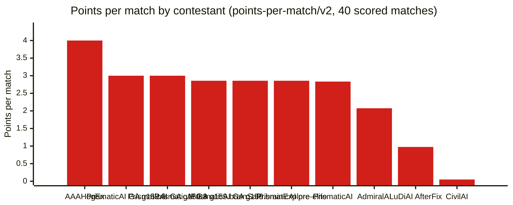
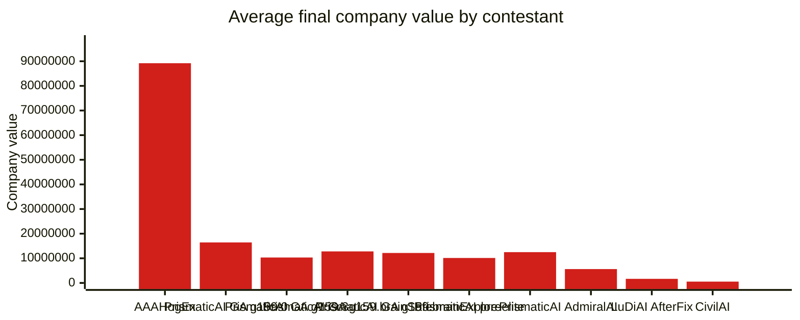
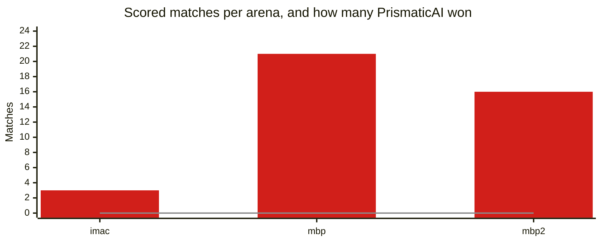

# battle-20261120T161953-a671ae2e

Derived from `battle-20261120T161953-a671ae2e.json` by `tools/research/ai-battle/battle.py report`; do not edit.

- Edition `a671ae2e34213e97`: PrismaticAI and referee at `2b32ecb6f1049e718e513efb309e963aa0a5205c`, base set `opengfx-8.0.tar`
- 20-year free-for-all from 1960, map 256x256 temperate, breakdowns 1
- 40 scored match(es) on `imac` (20261119-master-gdf1e05e7d8), `mbp` (20261120-master-m17653b726e), `mbp2` (20261119-master-gdf1e05e7d8)
- Replays: 0 of 0 identical to their original on another arena

| # | Contestant | Played | Wins | Points | Points/match | Avg rank | Avg final value | Squirrel errors | Matches with anomalies |
|---|---|---|---|---|---|---|---|---|---|
| 1 | AAAHogEx | 40 | 40 | 160 | 4.0 | 1.0 | 89.2 M | 0 | 0 |
| 2 | PrismaticAI GA g159.0 | 7 | 0 | 21 | 3.0 | 2.0 | 16.4 M | 0 | 0 |
| 3 | PrismaticAI GA g159.3 | 6 | 0 | 18 | 3.0 | 2.0 | 10.3 M | 0 | 0 |
| 4 | PrismaticAI GA g159.brainSafe | 7 | 0 | 20 | 2.857 | 2.14 | 12.8 M | 0 | 0 |
| 5 | PrismaticAI GA g159.brainExplore | 7 | 0 | 20 | 2.857 | 2.14 | 12.2 M | 0 | 0 |
| 6 | PrismaticAI pre-elite | 7 | 0 | 20 | 2.857 | 2.14 | 10.1 M | 0 | 1 |
| 7 | PrismaticAI | 6 | 0 | 17 | 2.833 | 2.17 | 12.5 M | 0 | 3 |
| 8 | AdmiralAI | 40 | 0 | 83 | 2.075 | 2.92 | 5.6 M | 0 | 3 |
| 9 | LuDiAI AfterFix | 40 | 0 | 39 | 0.975 | 4.03 | 1.7 M | 0 | 2 |
| 10 | CivilAI | 40 | 0 | 2 | 0.05 | 4.95 | 533.4 k | 0 | 5 |

```mermaid
---
config:
  xyChart:
    width: 900
    height: 360
  themeVariables:
    xyChart:
      plotColorPalette: "#d11f1a, #8a8a8a, #0b0b0b, #ece4d6"
---
xychart-beta
    title "Final company value per scored match: winner vs best PrismaticAI"
    x-axis ["m-0001", "m-0002", "m-0003", "m-0004", "m-0005", "m-0006", "m-0007", "m-0008", "m-0009", "m-0010", "m-0011", "m-0012", "m-0013", "m-0014", "m-0015", "m-0016", "m-0017", "m-0018", "m-0019", "m-0020", "m-0021", "m-0022", "m-0023", "m-0024", "m-0025", "m-0026", "m-0027", "m-0028", "m-0036", "m-0037", "m-0038", "m-0039", "m-0040", "m-0041", "m-0042", "m-0043", "m-0044", "m-0045", "m-0046", "m-0047"]
    %% series: Winner | Best PrismaticAI
    %% links: battle-20261120T161953-a671ae2e.md?col=Match&filter=m-0001 | battle-20261120T161953-a671ae2e.md?col=Match&filter=m-0002 | battle-20261120T161953-a671ae2e.md?col=Match&filter=m-0003 | battle-20261120T161953-a671ae2e.md?col=Match&filter=m-0004 | battle-20261120T161953-a671ae2e.md?col=Match&filter=m-0005 | battle-20261120T161953-a671ae2e.md?col=Match&filter=m-0006 | battle-20261120T161953-a671ae2e.md?col=Match&filter=m-0007 | battle-20261120T161953-a671ae2e.md?col=Match&filter=m-0008 | battle-20261120T161953-a671ae2e.md?col=Match&filter=m-0009 | battle-20261120T161953-a671ae2e.md?col=Match&filter=m-0010 | battle-20261120T161953-a671ae2e.md?col=Match&filter=m-0011 | battle-20261120T161953-a671ae2e.md?col=Match&filter=m-0012 | battle-20261120T161953-a671ae2e.md?col=Match&filter=m-0013 | battle-20261120T161953-a671ae2e.md?col=Match&filter=m-0014 | battle-20261120T161953-a671ae2e.md?col=Match&filter=m-0015 | battle-20261120T161953-a671ae2e.md?col=Match&filter=m-0016 | battle-20261120T161953-a671ae2e.md?col=Match&filter=m-0017 | battle-20261120T161953-a671ae2e.md?col=Match&filter=m-0018 | battle-20261120T161953-a671ae2e.md?col=Match&filter=m-0019 | battle-20261120T161953-a671ae2e.md?col=Match&filter=m-0020 | battle-20261120T161953-a671ae2e.md?col=Match&filter=m-0021 | battle-20261120T161953-a671ae2e.md?col=Match&filter=m-0022 | battle-20261120T161953-a671ae2e.md?col=Match&filter=m-0023 | battle-20261120T161953-a671ae2e.md?col=Match&filter=m-0024 | battle-20261120T161953-a671ae2e.md?col=Match&filter=m-0025 | battle-20261120T161953-a671ae2e.md?col=Match&filter=m-0026 | battle-20261120T161953-a671ae2e.md?col=Match&filter=m-0027 | battle-20261120T161953-a671ae2e.md?col=Match&filter=m-0028 | battle-20261120T161953-a671ae2e.md?col=Match&filter=m-0036 | battle-20261120T161953-a671ae2e.md?col=Match&filter=m-0037 | battle-20261120T161953-a671ae2e.md?col=Match&filter=m-0038 | battle-20261120T161953-a671ae2e.md?col=Match&filter=m-0039 | battle-20261120T161953-a671ae2e.md?col=Match&filter=m-0040 | battle-20261120T161953-a671ae2e.md?col=Match&filter=m-0041 | battle-20261120T161953-a671ae2e.md?col=Match&filter=m-0042 | battle-20261120T161953-a671ae2e.md?col=Match&filter=m-0043 | battle-20261120T161953-a671ae2e.md?col=Match&filter=m-0044 | battle-20261120T161953-a671ae2e.md?col=Match&filter=m-0045 | battle-20261120T161953-a671ae2e.md?col=Match&filter=m-0046 | battle-20261120T161953-a671ae2e.md?col=Match&filter=m-0047
    y-axis "Company value" 0 --> 144000000
    bar [81421085, 94348288, 65757311, 85706018, 73025328, 104960874, 91312097, 96902332, 78695877, 100113880, 101463150, 116703908, 104470404, 102460627, 111200945, 130979749, 96661774, 90283422, 80357607, 88852104, 62008779, 78525953, 86920434, 85374787, 62479553, 63931475, 65149422, 62799603, 77670168, 99389695, 73624828, 90685777, 91624527, 97929507, 96537987, 87919064, 108870015, 83536267, 106037371, 91117279]
    line [14802127, 19933190, 13962749, 14438060, 15877641, 20899507, 14127521, 15911352, 19544360, 14493317, 9210379, 10505963, 12306819, 13916673, 9556235, 10340011, 10582317, 12521043, 9305840, 16927429, 8113619, 12255779, 11769143, 8627944, 7042656, 20030980, 13931427, 13187007, 12723407, 7333199, 11200982, 8135935, 9142847, 4763199, 9708092, 5978815, 17188910, 16310566, 11264400, 9712761]
```

<!-- battle-charts:begin -->
<!-- derived from battle-20261120T161953-a671ae2e.json by `battle.py render`; `battle.py check` fails when it is stale -->

<!-- battle-charts:end -->

| Match | Arena | Seed | Winner | Value | Last | Anomalies |
|---|---|---|---|---|---|---|
| m-0001 | mbp | 1878283750 | AAAHogEx | 81.4 M | CivilAI | AdmiralAI: fleet_drop:36->24 |
| m-0002 | mbp | 1878283750 | AAAHogEx | 94.3 M | CivilAI | CivilAI: fleet_drop:110->61 |
| m-0003 | mbp | 1878283750 | AAAHogEx | 65.8 M | CivilAI | - |
| m-0004 | mbp | 1878283750 | AAAHogEx | 85.7 M | CivilAI | - |
| m-0005 | mbp | 1878283750 | AAAHogEx | 73.0 M | CivilAI | - |
| m-0006 | mbp | 1389760711 | AAAHogEx | 105.0 M | CivilAI | - |
| m-0007 | mbp | 1389760711 | AAAHogEx | 91.3 M | CivilAI | PrismaticAI pre-elite: fleet_drop:61->41 |
| m-0008 | mbp | 1389760711 | AAAHogEx | 96.9 M | CivilAI | - |
| m-0009 | mbp | 1389760711 | AAAHogEx | 78.7 M | CivilAI | - |
| m-0010 | imac | 1389760711 | AAAHogEx | 100.1 M | CivilAI | - |
| m-0011 | imac | 1389760711 | AAAHogEx | 101.5 M | CivilAI | - |
| m-0012 | imac | 1610738760 | AAAHogEx | 116.7 M | LuDiAI AfterFix | PrismaticAI: fleet_drop:145->57; AdmiralAI: fleet_drop:238->135 |
| m-0013 | mbp2 | 1610738760 | AAAHogEx | 104.5 M | CivilAI | - |
| m-0014 | mbp2 | 1610738760 | AAAHogEx | 102.5 M | CivilAI | - |
| m-0015 | mbp2 | 1610738760 | AAAHogEx | 111.2 M | CivilAI | - |
| m-0016 | mbp2 | 1610738760 | AAAHogEx | 131.0 M | CivilAI | - |
| m-0017 | mbp2 | 1610738760 | AAAHogEx | 96.7 M | CivilAI | - |
| m-0018 | mbp2 | 1977739807 | AAAHogEx | 90.3 M | CivilAI | PrismaticAI: fleet_drop:87->50 |
| m-0019 | mbp2 | 1977739807 | AAAHogEx | 80.4 M | CivilAI | - |
| m-0020 | mbp2 | 1977739807 | AAAHogEx | 88.9 M | CivilAI | - |
| m-0021 | mbp2 | 1977739807 | AAAHogEx | 62.0 M | CivilAI | - |
| m-0022 | mbp2 | 1977739807 | AAAHogEx | 78.5 M | CivilAI | LuDiAI AfterFix: fleet_drop:83->47; CivilAI: fleet_drop:67->46 |
| m-0023 | mbp2 | 1977739807 | AAAHogEx | 86.9 M | CivilAI | CivilAI: fleet_drop:19->13 |
| m-0024 | mbp2 | 62584073 | AAAHogEx | 85.4 M | LuDiAI AfterFix | - |
| m-0025 | mbp2 | 62584073 | AAAHogEx | 62.5 M | CivilAI | AdmiralAI: fleet_drop:470->272 |
| m-0026 | mbp2 | 62584073 | AAAHogEx | 63.9 M | CivilAI | - |
| m-0027 | mbp2 | 62584073 | AAAHogEx | 65.1 M | CivilAI | - |
| m-0028 | mbp2 | 62584073 | AAAHogEx | 62.8 M | CivilAI | - |
| m-0036 | mbp | 1222772271 | AAAHogEx | 77.7 M | CivilAI | - |
| m-0037 | mbp | 1222772271 | AAAHogEx | 99.4 M | CivilAI | - |
| m-0038 | mbp | 1222772271 | AAAHogEx | 73.6 M | CivilAI | LuDiAI AfterFix: fleet_drop:78->51; CivilAI: no_vehicles |
| m-0039 | mbp | 1222772271 | AAAHogEx | 90.7 M | CivilAI | - |
| m-0040 | mbp | 1222772271 | AAAHogEx | 91.6 M | CivilAI | - |
| m-0041 | mbp | 1222772271 | AAAHogEx | 97.9 M | CivilAI | - |
| m-0042 | mbp | 957244795 | AAAHogEx | 96.5 M | CivilAI | PrismaticAI: fleet_drop:96->50 |
| m-0043 | mbp | 957244795 | AAAHogEx | 87.9 M | CivilAI | - |
| m-0044 | mbp | 957244795 | AAAHogEx | 108.9 M | CivilAI | - |
| m-0045 | mbp | 957244795 | AAAHogEx | 83.5 M | CivilAI | CivilAI: fleet_drop:48->24 |
| m-0046 | mbp | 957244795 | AAAHogEx | 106.0 M | CivilAI | - |
| m-0047 | mbp | 957244795 | AAAHogEx | 91.1 M | CivilAI | - |
