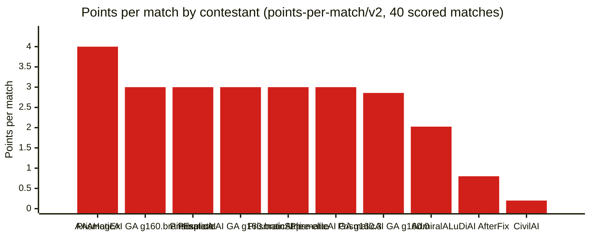
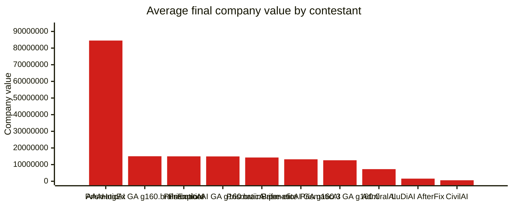
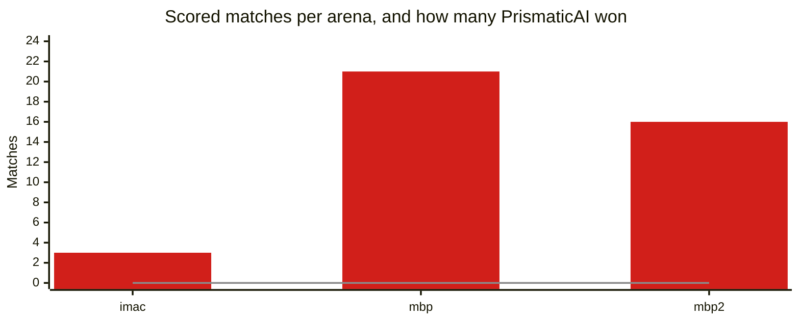

# battle-20261120T162931-35cd73aa

Derived from `battle-20261120T162931-35cd73aa.json` by `tools/research/ai-battle/battle.py report`; do not edit.

- Edition `35cd73aa077eac57`: PrismaticAI and referee at `2b32ecb6f1049e718e513efb309e963aa0a5205c`, base set `opengfx-8.0.tar`
- 20-year free-for-all from 1960, map 256x256 temperate, breakdowns 1
- 40 scored match(es) on `imac` (20261119-master-gdf1e05e7d8), `mbp` (20261120-master-m17653b726e), `mbp2` (20261119-master-gdf1e05e7d8)
- Replays: 0 of 0 identical to their original on another arena

| # | Contestant | Played | Wins | Points | Points/match | Avg rank | Avg final value | Squirrel errors | Matches with anomalies |
|---|---|---|---|---|---|---|---|---|---|
| 1 | AAAHogEx | 40 | 40 | 160 | 4.0 | 1.0 | 84.5 M | 0 | 0 |
| 2 | PrismaticAI GA g160.brainExplore | 7 | 0 | 21 | 3.0 | 2.0 | 15.0 M | 0 | 0 |
| 3 | PrismaticAI | 6 | 0 | 18 | 3.0 | 2.0 | 15.0 M | 0 | 2 |
| 4 | PrismaticAI GA g160.brainSafe | 7 | 0 | 21 | 3.0 | 2.0 | 14.9 M | 0 | 0 |
| 5 | PrismaticAI pre-elite | 7 | 0 | 21 | 3.0 | 2.0 | 14.3 M | 0 | 0 |
| 6 | PrismaticAI GA g160.3 | 6 | 0 | 18 | 3.0 | 2.0 | 13.2 M | 0 | 1 |
| 7 | PrismaticAI GA g160.0 | 7 | 0 | 20 | 2.857 | 2.14 | 12.6 M | 0 | 0 |
| 8 | AdmiralAI | 40 | 0 | 81 | 2.025 | 2.98 | 7.3 M | 118 | 3 |
| 9 | LuDiAI AfterFix | 40 | 0 | 32 | 0.8 | 4.2 | 1.6 M | 0 | 4 |
| 10 | CivilAI | 40 | 0 | 8 | 0.2 | 4.8 | 592.7 k | 0 | 8 |

```mermaid
---
config:
  xyChart:
    width: 900
    height: 360
  themeVariables:
    xyChart:
      plotColorPalette: "#d11f1a, #8a8a8a, #0b0b0b, #ece4d6"
---
xychart-beta
    title "Final company value per scored match: winner vs best PrismaticAI"
    x-axis ["m-0001", "m-0002", "m-0003", "m-0004", "m-0005", "m-0006", "m-0007", "m-0008", "m-0009", "m-0010", "m-0011", "m-0012", "m-0013", "m-0014", "m-0015", "m-0016", "m-0017", "m-0018", "m-0019", "m-0020", "m-0021", "m-0022", "m-0023", "m-0024", "m-0025", "m-0026", "m-0027", "m-0028", "m-0036", "m-0037", "m-0038", "m-0039", "m-0040", "m-0041", "m-0042", "m-0043", "m-0044", "m-0046", "m-0051", "m-0053"]
    %% series: Winner | Best PrismaticAI
    %% links: battle-20261120T162931-35cd73aa.md?col=Match&filter=m-0001 | battle-20261120T162931-35cd73aa.md?col=Match&filter=m-0002 | battle-20261120T162931-35cd73aa.md?col=Match&filter=m-0003 | battle-20261120T162931-35cd73aa.md?col=Match&filter=m-0004 | battle-20261120T162931-35cd73aa.md?col=Match&filter=m-0005 | battle-20261120T162931-35cd73aa.md?col=Match&filter=m-0006 | battle-20261120T162931-35cd73aa.md?col=Match&filter=m-0007 | battle-20261120T162931-35cd73aa.md?col=Match&filter=m-0008 | battle-20261120T162931-35cd73aa.md?col=Match&filter=m-0009 | battle-20261120T162931-35cd73aa.md?col=Match&filter=m-0010 | battle-20261120T162931-35cd73aa.md?col=Match&filter=m-0011 | battle-20261120T162931-35cd73aa.md?col=Match&filter=m-0012 | battle-20261120T162931-35cd73aa.md?col=Match&filter=m-0013 | battle-20261120T162931-35cd73aa.md?col=Match&filter=m-0014 | battle-20261120T162931-35cd73aa.md?col=Match&filter=m-0015 | battle-20261120T162931-35cd73aa.md?col=Match&filter=m-0016 | battle-20261120T162931-35cd73aa.md?col=Match&filter=m-0017 | battle-20261120T162931-35cd73aa.md?col=Match&filter=m-0018 | battle-20261120T162931-35cd73aa.md?col=Match&filter=m-0019 | battle-20261120T162931-35cd73aa.md?col=Match&filter=m-0020 | battle-20261120T162931-35cd73aa.md?col=Match&filter=m-0021 | battle-20261120T162931-35cd73aa.md?col=Match&filter=m-0022 | battle-20261120T162931-35cd73aa.md?col=Match&filter=m-0023 | battle-20261120T162931-35cd73aa.md?col=Match&filter=m-0024 | battle-20261120T162931-35cd73aa.md?col=Match&filter=m-0025 | battle-20261120T162931-35cd73aa.md?col=Match&filter=m-0026 | battle-20261120T162931-35cd73aa.md?col=Match&filter=m-0027 | battle-20261120T162931-35cd73aa.md?col=Match&filter=m-0028 | battle-20261120T162931-35cd73aa.md?col=Match&filter=m-0036 | battle-20261120T162931-35cd73aa.md?col=Match&filter=m-0037 | battle-20261120T162931-35cd73aa.md?col=Match&filter=m-0038 | battle-20261120T162931-35cd73aa.md?col=Match&filter=m-0039 | battle-20261120T162931-35cd73aa.md?col=Match&filter=m-0040 | battle-20261120T162931-35cd73aa.md?col=Match&filter=m-0041 | battle-20261120T162931-35cd73aa.md?col=Match&filter=m-0042 | battle-20261120T162931-35cd73aa.md?col=Match&filter=m-0043 | battle-20261120T162931-35cd73aa.md?col=Match&filter=m-0044 | battle-20261120T162931-35cd73aa.md?col=Match&filter=m-0046 | battle-20261120T162931-35cd73aa.md?col=Match&filter=m-0051 | battle-20261120T162931-35cd73aa.md?col=Match&filter=m-0053
    y-axis "Company value" 0 --> 161000000
    bar [93808466, 67211343, 51935038, 76033454, 82245544, 87706282, 106278331, 87125735, 90891524, 101625361, 93528931, 84977800, 77485064, 88979969, 82863611, 104652098, 94137196, 58217169, 45753146, 68940978, 51566457, 63566215, 66108775, 56963645, 62084445, 51014189, 59641353, 69021702, 131728765, 108829891, 118201085, 146702295, 118092163, 130150093, 67981919, 86489665, 71989775, 71486918, 104554724, 100663635]
    line [15186407, 13158347, 23149087, 18031043, 12818967, 13394428, 14998040, 11807171, 18489006, 11537908, 14401661, 14417071, 11142585, 6541016, 12267495, 13450919, 9947157, 13673612, 9337815, 10905423, 15678201, 12675324, 11546927, 14841383, 12624257, 13761287, 13883153, 17363041, 15469575, 18349079, 15524298, 12240804, 16785098, 16651200, 17977672, 18243848, 16570084, 15345882, 8701071, 13762338]
```

<!-- battle-charts:begin -->
<!-- derived from battle-20261120T162931-35cd73aa.json by `battle.py render`; `battle.py check` fails when it is stale -->

<!-- battle-charts:end -->

| Match | Arena | Seed | Winner | Value | Last | Anomalies |
|---|---|---|---|---|---|---|
| m-0001 | mbp | 1518987534 | AAAHogEx | 93.8 M | CivilAI | - |
| m-0002 | mbp | 1518987534 | AAAHogEx | 67.2 M | CivilAI | - |
| m-0003 | mbp | 1518987534 | AAAHogEx | 51.9 M | LuDiAI AfterFix | - |
| m-0004 | mbp | 1518987534 | AAAHogEx | 76.0 M | LuDiAI AfterFix | - |
| m-0005 | mbp | 1518987534 | AAAHogEx | 82.2 M | CivilAI | PrismaticAI GA g160.3: fleet_drop:69->47 |
| m-0006 | mbp | 34196196 | AAAHogEx | 87.7 M | CivilAI | PrismaticAI: fleet_drop:55->38 |
| m-0007 | mbp | 34196196 | AAAHogEx | 106.3 M | CivilAI | CivilAI: fleet_drop:31->18 |
| m-0008 | mbp | 34196196 | AAAHogEx | 87.1 M | CivilAI | CivilAI: fleet_drop:75->50 |
| m-0009 | mbp | 34196196 | AAAHogEx | 90.9 M | CivilAI | - |
| m-0010 | imac | 34196196 | AAAHogEx | 101.6 M | CivilAI | - |
| m-0011 | imac | 34196196 | AAAHogEx | 93.5 M | CivilAI | CivilAI: fleet_drop:13->9 |
| m-0012 | imac | 522778716 | AAAHogEx | 85.0 M | CivilAI | AdmiralAI: fleet_drop:373->214; CivilAI: fleet_drop:103->68 |
| m-0013 | mbp2 | 522778716 | AAAHogEx | 77.5 M | LuDiAI AfterFix | LuDiAI AfterFix: fleet_drop:45->14 |
| m-0014 | mbp2 | 522778716 | AAAHogEx | 89.0 M | CivilAI | - |
| m-0015 | mbp2 | 522778716 | AAAHogEx | 82.9 M | LuDiAI AfterFix | - |
| m-0016 | mbp2 | 522778716 | AAAHogEx | 104.7 M | LuDiAI AfterFix | - |
| m-0017 | mbp2 | 522778716 | AAAHogEx | 94.1 M | LuDiAI AfterFix | - |
| m-0018 | mbp2 | 1597681735 | AAAHogEx | 58.2 M | CivilAI | - |
| m-0019 | mbp2 | 1597681735 | AAAHogEx | 45.8 M | CivilAI | - |
| m-0020 | mbp2 | 1597681735 | AAAHogEx | 68.9 M | LuDiAI AfterFix | AdmiralAI: squirrel_errors:59 |
| m-0021 | mbp2 | 1597681735 | AAAHogEx | 51.6 M | CivilAI | - |
| m-0022 | mbp2 | 1597681735 | AAAHogEx | 63.6 M | LuDiAI AfterFix | - |
| m-0023 | mbp2 | 1597681735 | AAAHogEx | 66.1 M | CivilAI | - |
| m-0024 | mbp2 | 77002145 | AAAHogEx | 57.0 M | CivilAI | PrismaticAI: fleet_drop:123->66 |
| m-0025 | mbp2 | 77002145 | AAAHogEx | 62.1 M | CivilAI | - |
| m-0026 | mbp2 | 77002145 | AAAHogEx | 51.0 M | CivilAI | - |
| m-0027 | mbp2 | 77002145 | AAAHogEx | 59.6 M | CivilAI | - |
| m-0028 | mbp2 | 77002145 | AAAHogEx | 69.0 M | CivilAI | - |
| m-0036 | mbp | 952625277 | AAAHogEx | 131.7 M | CivilAI | - |
| m-0037 | mbp | 952625277 | AAAHogEx | 108.8 M | CivilAI | CivilAI: fleet_drop:23->15 |
| m-0038 | mbp | 952625277 | AAAHogEx | 118.2 M | CivilAI | - |
| m-0039 | mbp | 952625277 | AAAHogEx | 146.7 M | CivilAI | - |
| m-0040 | mbp | 952625277 | AAAHogEx | 118.1 M | CivilAI | - |
| m-0041 | mbp | 952625277 | AAAHogEx | 130.2 M | CivilAI | - |
| m-0042 | mbp | 892969306 | AAAHogEx | 68.0 M | CivilAI | LuDiAI AfterFix: fleet_drop:95->55 |
| m-0043 | mbp | 892969306 | AAAHogEx | 86.5 M | CivilAI | - |
| m-0044 | mbp | 892969306 | AAAHogEx | 72.0 M | CivilAI | LuDiAI AfterFix: fleet_drop:19->6; CivilAI: fleet_drop:43->24 |
| m-0046 | mbp | 892969306 | AAAHogEx | 71.5 M | CivilAI | LuDiAI AfterFix: fleet_drop:81->56 |
| m-0051 | mbp | 531021344 | AAAHogEx | 104.6 M | CivilAI | CivilAI: fleet_drop:32->9 |
| m-0053 | mbp | 531021344 | AAAHogEx | 100.7 M | CivilAI | AdmiralAI: squirrel_errors:59; CivilAI: fleet_drop:30->3 |
