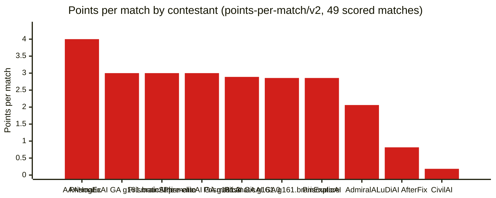
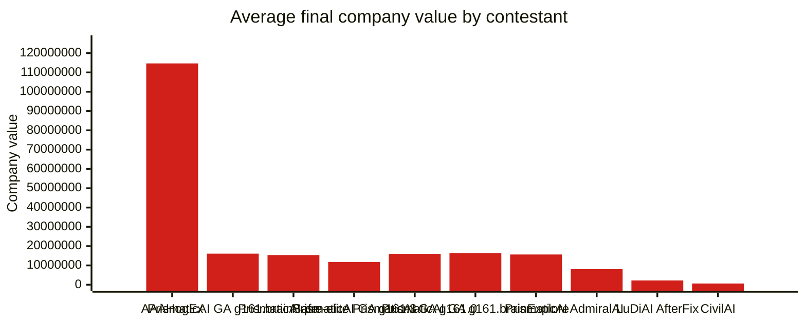
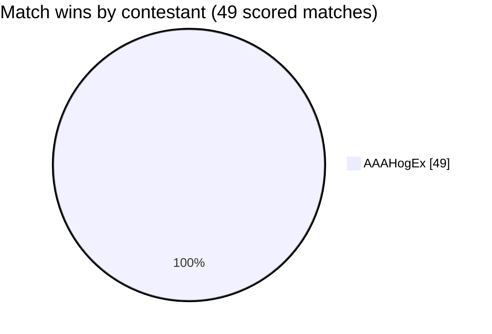
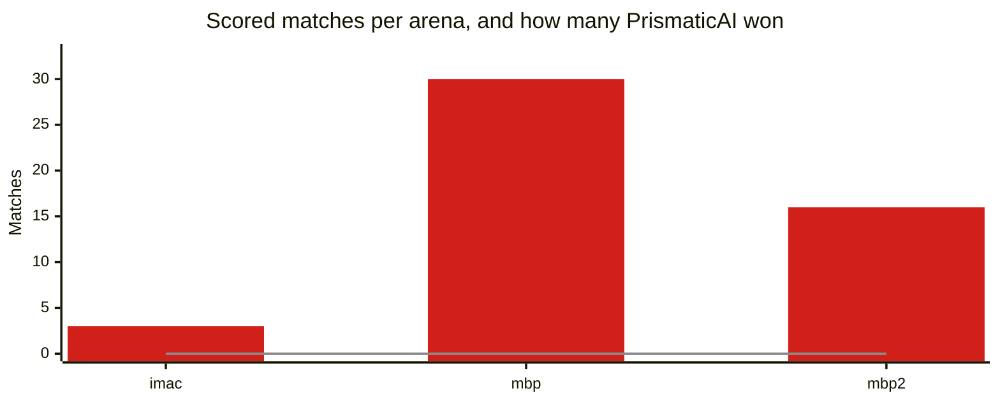

# battle-20261120T164305-3aab43e0

Derived from `battle-20261120T164305-3aab43e0.json` by `tools/research/ai-battle/battle.py report`; do not edit.

- Edition `3aab43e07d6bc308`: PrismaticAI and referee at `2b32ecb6f1049e718e513efb309e963aa0a5205c`, base set `opengfx-8.0.tar`
- 20-year free-for-all from 1960, map 256x256 temperate, breakdowns 1
- 49 scored match(es) on `imac` (20261119-master-gdf1e05e7d8), `mbp` (20261120-master-m17653b726e), `mbp2` (20261119-master-gdf1e05e7d8)
- Replays: 0 of 1 identical to their original on another arena

| # | Contestant | Played | Wins | Points | Points/match | Avg rank | Avg final value | Squirrel errors | Matches with anomalies |
|---|---|---|---|---|---|---|---|---|---|
| 1 | AAAHogEx | 49 | 49 | 196 | 4.0 | 1.0 | 114.7 M | 0 | 0 |
| 2 | PrismaticAI GA g161.brainSafe | 9 | 0 | 27 | 3.0 | 2.0 | 16.1 M | 0 | 3 |
| 3 | PrismaticAI pre-elite | 11 | 0 | 33 | 3.0 | 2.0 | 15.3 M | 0 | 0 |
| 4 | PrismaticAI GA g161.3 | 6 | 0 | 18 | 3.0 | 2.0 | 11.8 M | 0 | 0 |
| 5 | PrismaticAI GA g161.0 | 9 | 0 | 26 | 2.889 | 2.11 | 16.0 M | 0 | 0 |
| 6 | PrismaticAI GA g161.brainExplore | 7 | 0 | 20 | 2.857 | 2.14 | 16.3 M | 0 | 0 |
| 7 | PrismaticAI | 7 | 0 | 20 | 2.857 | 2.14 | 15.7 M | 0 | 5 |
| 8 | AdmiralAI | 49 | 0 | 101 | 2.061 | 2.94 | 8.0 M | 0 | 4 |
| 9 | LuDiAI AfterFix | 49 | 0 | 40 | 0.816 | 4.18 | 2.2 M | 0 | 1 |
| 10 | CivilAI | 49 | 0 | 9 | 0.184 | 4.82 | 618.2 k | 3745 | 9 |

```mermaid
---
config:
  xyChart:
    width: 900
    height: 360
  themeVariables:
    xyChart:
      plotColorPalette: "#d11f1a, #8a8a8a, #0b0b0b, #ece4d6"
---
xychart-beta
    title "Final company value per scored match: winner vs best PrismaticAI"
    x-axis ["m-0001", "m-0002", "m-0003", "m-0004", "m-0005", "m-0006", "m-0007", "m-0008", "m-0009", "m-0010", "m-0011", "m-0012", "m-0013", "m-0014", "m-0015", "m-0016", "m-0017", "m-0018", "m-0019", "m-0020", "m-0021", "m-0022", "m-0023", "m-0024", "m-0025", "m-0026", "m-0027", "m-0028", "m-0036", "m-0037", "m-0038", "m-0039", "m-0040", "m-0041", "m-0042", "m-0043", "m-0044", "m-0049", "m-0050", "m-0051", "m-0052", "m-0054", "m-0055", "m-0057", "m-0061", "m-0067", "m-0068", "m-0069", "m-0071"]
    %% series: Winner | Best PrismaticAI
    %% links: battle-20261120T164305-3aab43e0.md?col=Match&filter=m-0001 | battle-20261120T164305-3aab43e0.md?col=Match&filter=m-0002 | battle-20261120T164305-3aab43e0.md?col=Match&filter=m-0003 | battle-20261120T164305-3aab43e0.md?col=Match&filter=m-0004 | battle-20261120T164305-3aab43e0.md?col=Match&filter=m-0005 | battle-20261120T164305-3aab43e0.md?col=Match&filter=m-0006 | battle-20261120T164305-3aab43e0.md?col=Match&filter=m-0007 | battle-20261120T164305-3aab43e0.md?col=Match&filter=m-0008 | battle-20261120T164305-3aab43e0.md?col=Match&filter=m-0009 | battle-20261120T164305-3aab43e0.md?col=Match&filter=m-0010 | battle-20261120T164305-3aab43e0.md?col=Match&filter=m-0011 | battle-20261120T164305-3aab43e0.md?col=Match&filter=m-0012 | battle-20261120T164305-3aab43e0.md?col=Match&filter=m-0013 | battle-20261120T164305-3aab43e0.md?col=Match&filter=m-0014 | battle-20261120T164305-3aab43e0.md?col=Match&filter=m-0015 | battle-20261120T164305-3aab43e0.md?col=Match&filter=m-0016 | battle-20261120T164305-3aab43e0.md?col=Match&filter=m-0017 | battle-20261120T164305-3aab43e0.md?col=Match&filter=m-0018 | battle-20261120T164305-3aab43e0.md?col=Match&filter=m-0019 | battle-20261120T164305-3aab43e0.md?col=Match&filter=m-0020 | battle-20261120T164305-3aab43e0.md?col=Match&filter=m-0021 | battle-20261120T164305-3aab43e0.md?col=Match&filter=m-0022 | battle-20261120T164305-3aab43e0.md?col=Match&filter=m-0023 | battle-20261120T164305-3aab43e0.md?col=Match&filter=m-0024 | battle-20261120T164305-3aab43e0.md?col=Match&filter=m-0025 | battle-20261120T164305-3aab43e0.md?col=Match&filter=m-0026 | battle-20261120T164305-3aab43e0.md?col=Match&filter=m-0027 | battle-20261120T164305-3aab43e0.md?col=Match&filter=m-0028 | battle-20261120T164305-3aab43e0.md?col=Match&filter=m-0036 | battle-20261120T164305-3aab43e0.md?col=Match&filter=m-0037 | battle-20261120T164305-3aab43e0.md?col=Match&filter=m-0038 | battle-20261120T164305-3aab43e0.md?col=Match&filter=m-0039 | battle-20261120T164305-3aab43e0.md?col=Match&filter=m-0040 | battle-20261120T164305-3aab43e0.md?col=Match&filter=m-0041 | battle-20261120T164305-3aab43e0.md?col=Match&filter=m-0042 | battle-20261120T164305-3aab43e0.md?col=Match&filter=m-0043 | battle-20261120T164305-3aab43e0.md?col=Match&filter=m-0044 | battle-20261120T164305-3aab43e0.md?col=Match&filter=m-0049 | battle-20261120T164305-3aab43e0.md?col=Match&filter=m-0050 | battle-20261120T164305-3aab43e0.md?col=Match&filter=m-0051 | battle-20261120T164305-3aab43e0.md?col=Match&filter=m-0052 | battle-20261120T164305-3aab43e0.md?col=Match&filter=m-0054 | battle-20261120T164305-3aab43e0.md?col=Match&filter=m-0055 | battle-20261120T164305-3aab43e0.md?col=Match&filter=m-0057 | battle-20261120T164305-3aab43e0.md?col=Match&filter=m-0061 | battle-20261120T164305-3aab43e0.md?col=Match&filter=m-0067 | battle-20261120T164305-3aab43e0.md?col=Match&filter=m-0068 | battle-20261120T164305-3aab43e0.md?col=Match&filter=m-0069 | battle-20261120T164305-3aab43e0.md?col=Match&filter=m-0071
    y-axis "Company value" 0 --> 195000000
    bar [116167910, 104109758, 130533798, 126765798, 112560647, 92884411, 76518446, 80245817, 67808615, 81820605, 87370454, 175487162, 148003960, 118656053, 176894970, 145591368, 150500417, 88560185, 88649361, 78945004, 84794023, 87139161, 84690875, 99767159, 99871429, 129692849, 118845256, 86879336, 102149074, 120455937, 117058105, 133524531, 98849361, 108507684, 168996092, 143028452, 158535370, 107979887, 103683073, 125185035, 132831148, 97033527, 97886908, 94020768, 155395286, 122944663, 109043393, 160121959, 122150440]
    line [13390871, 14179658, 16956152, 22354267, 13365985, 9027393, 7957127, 7967314, 13663101, 7053554, 6945494, 15936772, 20759940, 18957511, 16573238, 16836255, 13563744, 17290241, 14612597, 13580008, 13020044, 14998578, 11056842, 19680014, 17951625, 18330536, 21977365, 17959056, 13011617, 10772056, 18121862, 16121993, 12821549, 13474820, 22602871, 18919452, 20897418, 19872234, 21537746, 26412435, 22344513, 12061621, 14291822, 13362640, 20006859, 10180051, 10503078, 6822981, 12347956]
```

<!-- battle-charts:begin -->
<!-- derived from battle-20261120T164305-3aab43e0.json by `battle.py render`; `battle.py check` fails when it is stale -->

<!-- battle-charts:end -->

| Seed | Original | Replay | Arenas | Identical |
|---|---|---|---|---|
| 1489918256 | m-0011 | m-0056 | imac / mbp | NO |

| Match | Arena | Seed | Winner | Value | Last | Anomalies |
|---|---|---|---|---|---|---|
| m-0001 | mbp | 585637375 | AAAHogEx | 116.2 M | CivilAI | - |
| m-0002 | mbp | 585637375 | AAAHogEx | 104.1 M | CivilAI | CivilAI: squirrel_errors:3745 |
| m-0003 | mbp | 585637375 | AAAHogEx | 130.5 M | CivilAI | PrismaticAI GA g161.brainSafe: fleet_drop:99->51 |
| m-0004 | mbp | 585637375 | AAAHogEx | 126.8 M | CivilAI | AdmiralAI: fleet_drop:274->179 |
| m-0005 | mbp | 585637375 | AAAHogEx | 112.6 M | CivilAI | - |
| m-0006 | mbp | 1489918256 | AAAHogEx | 92.9 M | LuDiAI AfterFix | PrismaticAI: fleet_drop:54->27; CivilAI: fleet_drop:34->15 |
| m-0007 | mbp | 1489918256 | AAAHogEx | 76.5 M | CivilAI | - |
| m-0008 | mbp | 1489918256 | AAAHogEx | 80.2 M | CivilAI | - |
| m-0009 | mbp | 1489918256 | AAAHogEx | 67.8 M | LuDiAI AfterFix | CivilAI: fleet_drop:46->24 |
| m-0010 | imac | 1489918256 | AAAHogEx | 81.8 M | LuDiAI AfterFix | - |
| m-0011 | imac | 1489918256 | AAAHogEx | 87.4 M | CivilAI | - |
| m-0012 | imac | 906882216 | AAAHogEx | 175.5 M | CivilAI | PrismaticAI: fleet_drop:135->80 |
| m-0013 | mbp2 | 906882216 | AAAHogEx | 148.0 M | CivilAI | - |
| m-0014 | mbp2 | 906882216 | AAAHogEx | 118.7 M | CivilAI | AdmiralAI: fleet_drop:511->226 |
| m-0015 | mbp2 | 906882216 | AAAHogEx | 176.9 M | CivilAI | PrismaticAI GA g161.brainSafe: fleet_drop:108->57 |
| m-0016 | mbp2 | 906882216 | AAAHogEx | 145.6 M | CivilAI | CivilAI: fleet_drop:49->24 |
| m-0017 | mbp2 | 906882216 | AAAHogEx | 150.5 M | CivilAI | - |
| m-0018 | mbp2 | 1821400232 | AAAHogEx | 88.6 M | CivilAI | - |
| m-0019 | mbp2 | 1821400232 | AAAHogEx | 88.6 M | CivilAI | CivilAI: fleet_drop:41->27 |
| m-0020 | mbp2 | 1821400232 | AAAHogEx | 78.9 M | CivilAI | LuDiAI AfterFix: fleet_drop:77->48; CivilAI: no_vehicles |
| m-0021 | mbp2 | 1821400232 | AAAHogEx | 84.8 M | LuDiAI AfterFix | - |
| m-0022 | mbp2 | 1821400232 | AAAHogEx | 87.1 M | CivilAI | CivilAI: fleet_drop:28->5 |
| m-0023 | mbp2 | 1821400232 | AAAHogEx | 84.7 M | CivilAI | - |
| m-0024 | mbp2 | 1325632406 | AAAHogEx | 99.8 M | CivilAI | PrismaticAI: fleet_drop:99->60; CivilAI: no_vehicles |
| m-0025 | mbp2 | 1325632406 | AAAHogEx | 99.9 M | CivilAI | - |
| m-0026 | mbp2 | 1325632406 | AAAHogEx | 129.7 M | CivilAI | - |
| m-0027 | mbp2 | 1325632406 | AAAHogEx | 118.8 M | CivilAI | - |
| m-0028 | mbp2 | 1325632406 | AAAHogEx | 86.9 M | CivilAI | - |
| m-0036 | mbp | 73842579 | AAAHogEx | 102.1 M | CivilAI | PrismaticAI: fleet_drop:116->35 |
| m-0037 | mbp | 73842579 | AAAHogEx | 120.5 M | CivilAI | - |
| m-0038 | mbp | 73842579 | AAAHogEx | 117.1 M | CivilAI | - |
| m-0039 | mbp | 73842579 | AAAHogEx | 133.5 M | CivilAI | PrismaticAI GA g161.brainSafe: fleet_drop:102->51 |
| m-0040 | mbp | 73842579 | AAAHogEx | 98.8 M | CivilAI | - |
| m-0041 | mbp | 73842579 | AAAHogEx | 108.5 M | CivilAI | - |
| m-0042 | mbp | 1571101174 | AAAHogEx | 169.0 M | CivilAI | PrismaticAI: fleet_drop:170->89 |
| m-0043 | mbp | 1571101174 | AAAHogEx | 143.0 M | CivilAI | AdmiralAI: fleet_drop:212->100 |
| m-0044 | mbp | 1571101174 | AAAHogEx | 158.5 M | CivilAI | - |
| m-0049 | mbp | 1196026683 | AAAHogEx | 108.0 M | CivilAI | - |
| m-0050 | mbp | 1196026683 | AAAHogEx | 103.7 M | CivilAI | - |
| m-0051 | mbp | 1196026683 | AAAHogEx | 125.2 M | CivilAI | - |
| m-0052 | mbp | 1196026683 | AAAHogEx | 132.8 M | LuDiAI AfterFix | - |
| m-0054 | mbp | 1870652142 | AAAHogEx | 97.0 M | CivilAI | CivilAI: fleet_drop:36->17 |
| m-0055 | mbp | 1870652142 | AAAHogEx | 97.9 M | CivilAI | - |
| m-0056 (replay) | mbp | 1489918256 | AAAHogEx | 90.3 M | CivilAI | - |
| m-0057 | mbp | 1870652142 | AAAHogEx | 94.0 M | CivilAI | - |
| m-0061 | mbp | 871347330 | AAAHogEx | 155.4 M | LuDiAI AfterFix | - |
| m-0067 | mbp | 1846626941 | AAAHogEx | 122.9 M | LuDiAI AfterFix | - |
| m-0068 | mbp | 1846626941 | AAAHogEx | 109.0 M | CivilAI | - |
| m-0069 | mbp | 1846626941 | AAAHogEx | 160.1 M | LuDiAI AfterFix | - |
| m-0071 | mbp | 1846626941 | AAAHogEx | 122.2 M | LuDiAI AfterFix | AdmiralAI: fleet_drop:218->144 |
