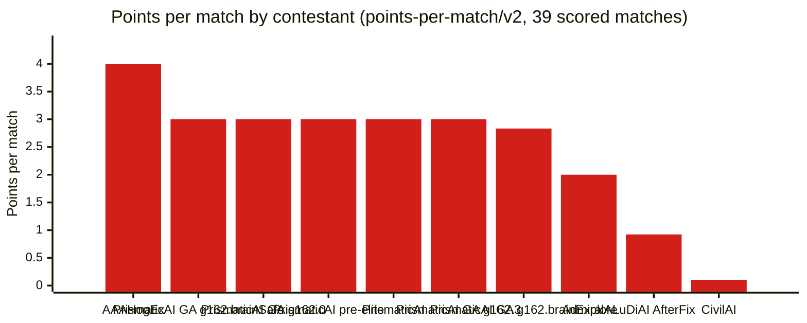
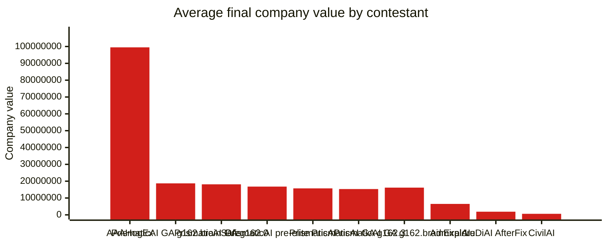
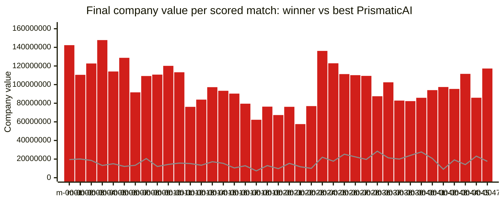
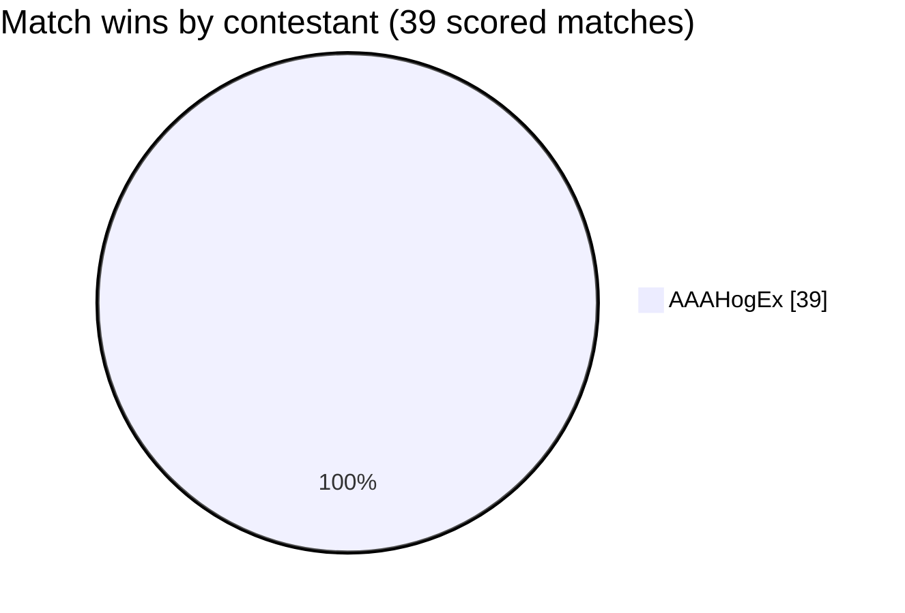
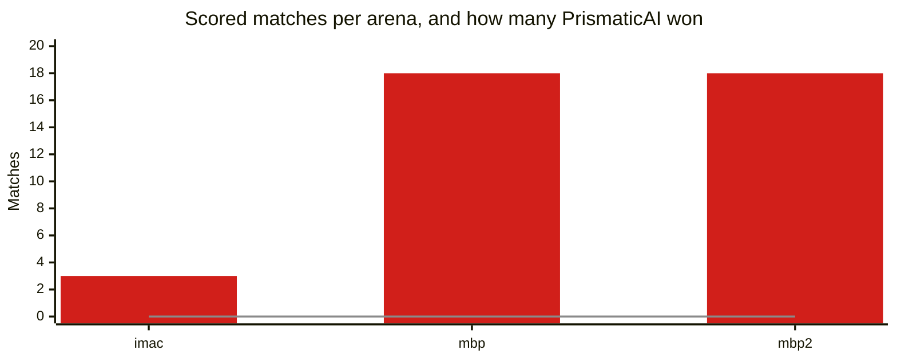

# battle-20261120T165230-720469c5

Derived from `battle-20261120T165230-720469c5.json` by `tools/research/ai-battle/battle.py report`; do not edit.

- Edition `720469c596d35be0`: PrismaticAI and referee at `2b32ecb6f1049e718e513efb309e963aa0a5205c`, base set `opengfx-8.0.tar`
- 20-year free-for-all from 1960, map 256x256 temperate, breakdowns 1
- 39 scored match(es) on `imac` (20261119-master-gdf1e05e7d8), `mbp` (20261120-master-m17653b726e), `mbp2` (20261119-master-gdf1e05e7d8)
- Replays: 0 of 0 identical to their original on another arena

| # | Contestant | Played | Wins | Points | Points/match | Avg rank | Avg final value | Squirrel errors | Matches with anomalies |
|---|---|---|---|---|---|---|---|---|---|
| 1 | AAAHogEx | 39 | 39 | 156 | 4.0 | 1.0 | 99.5 M | 0 | 0 |
| 2 | PrismaticAI GA g162.brainSafe | 7 | 0 | 21 | 3.0 | 2.0 | 18.7 M | 0 | 4 |
| 3 | PrismaticAI GA g162.0 | 7 | 0 | 21 | 3.0 | 2.0 | 18.1 M | 0 | 4 |
| 4 | PrismaticAI pre-elite | 7 | 0 | 21 | 3.0 | 2.0 | 16.8 M | 0 | 0 |
| 5 | PrismaticAI | 6 | 0 | 18 | 3.0 | 2.0 | 15.7 M | 0 | 4 |
| 6 | PrismaticAI GA g162.3 | 6 | 0 | 18 | 3.0 | 2.0 | 15.3 M | 0 | 0 |
| 7 | PrismaticAI GA g162.brainExplore | 6 | 0 | 17 | 2.833 | 2.17 | 16.2 M | 0 | 4 |
| 8 | AdmiralAI | 39 | 0 | 78 | 2.0 | 3.0 | 6.5 M | 0 | 1 |
| 9 | LuDiAI AfterFix | 39 | 0 | 36 | 0.923 | 4.08 | 1.9 M | 0 | 0 |
| 10 | CivilAI | 39 | 0 | 4 | 0.103 | 4.9 | 617.2 k | 3985 | 8 |

<!-- battle-charts:begin -->
<!-- derived from battle-20261120T165230-720469c5.json by `battle.py render`; `battle.py check` fails when it is stale -->

<!-- battle-charts:end -->

| Match | Arena | Seed | Winner | Value | Last | Anomalies |
|---|---|---|---|---|---|---|
| m-0001 | mbp | 1983215958 | AAAHogEx | 142.4 M | CivilAI | - |
| m-0002 | mbp | 1983215958 | AAAHogEx | 110.5 M | CivilAI | PrismaticAI GA g162.0: fleet_drop:114->65 |
| m-0003 | mbp | 1983215958 | AAAHogEx | 122.7 M | CivilAI | - |
| m-0004 | mbp | 1983215958 | AAAHogEx | 147.8 M | CivilAI | PrismaticAI GA g162.brainExplore: fleet_drop:218->74 |
| m-0005 | mbp | 1983215958 | AAAHogEx | 114.1 M | CivilAI | CivilAI: squirrel_errors:3985 |
| m-0006 | mbp | 638735198 | AAAHogEx | 128.8 M | CivilAI | PrismaticAI: fleet_drop:79->41; CivilAI: fleet_drop:22->12 |
| m-0007 | mbp | 638735198 | AAAHogEx | 91.7 M | CivilAI | CivilAI: fleet_drop:14->4 |
| m-0008 | mbp | 638735198 | AAAHogEx | 109.2 M | CivilAI | PrismaticAI GA g162.0: fleet_drop:121->56 |
| m-0009 | mbp | 638735198 | AAAHogEx | 110.7 M | CivilAI | PrismaticAI GA g162.brainSafe: fleet_drop:102->51 |
| m-0010 | imac | 638735198 | AAAHogEx | 120.1 M | CivilAI | PrismaticAI GA g162.brainExplore: fleet_drop:194->55 |
| m-0011 | imac | 638735198 | AAAHogEx | 113.2 M | CivilAI | - |
| m-0012 | imac | 1970721913 | AAAHogEx | 76.1 M | CivilAI | AdmiralAI: fleet_drop:223->151 |
| m-0013 | mbp2 | 1970721913 | AAAHogEx | 83.9 M | CivilAI | - |
| m-0014 | mbp2 | 1970721913 | AAAHogEx | 97.2 M | CivilAI | CivilAI: fleet_drop:43->18 |
| m-0015 | mbp2 | 1970721913 | AAAHogEx | 93.4 M | LuDiAI AfterFix | PrismaticAI GA g162.brainSafe: fleet_drop:93->46 |
| m-0016 | mbp2 | 1970721913 | AAAHogEx | 90.3 M | CivilAI | - |
| m-0017 | mbp2 | 1970721913 | AAAHogEx | 79.5 M | CivilAI | - |
| m-0018 | mbp2 | 1331652273 | AAAHogEx | 62.2 M | LuDiAI AfterFix | PrismaticAI: fleet_drop:84->43; CivilAI: fleet_drop:56->36 |
| m-0019 | mbp2 | 1331652273 | AAAHogEx | 76.3 M | CivilAI | - |
| m-0020 | mbp2 | 1331652273 | AAAHogEx | 67.3 M | CivilAI | - |
| m-0021 | mbp2 | 1331652273 | AAAHogEx | 76.2 M | CivilAI | - |
| m-0022 | mbp2 | 1331652273 | AAAHogEx | 57.6 M | LuDiAI AfterFix | CivilAI: fleet_drop:79->40 |
| m-0023 | mbp2 | 1331652273 | AAAHogEx | 76.9 M | LuDiAI AfterFix | - |
| m-0024 | mbp2 | 901062631 | AAAHogEx | 136.2 M | CivilAI | PrismaticAI: fleet_drop:154->96 |
| m-0025 | mbp2 | 901062631 | AAAHogEx | 122.9 M | CivilAI | - |
| m-0026 | mbp2 | 901062631 | AAAHogEx | 111.3 M | CivilAI | PrismaticAI GA g162.0: fleet_drop:124->65 |
| m-0027 | mbp2 | 901062631 | AAAHogEx | 110.1 M | CivilAI | PrismaticAI GA g162.brainSafe: fleet_drop:174->95 |
| m-0028 | mbp2 | 901062631 | AAAHogEx | 109.4 M | CivilAI | PrismaticAI GA g162.brainExplore: fleet_drop:240->134 |
| m-0036 | mbp | 198191437 | AAAHogEx | 87.5 M | CivilAI | PrismaticAI: fleet_drop:127->64 |
| m-0037 | mbp | 198191437 | AAAHogEx | 102.5 M | CivilAI | - |
| m-0038 | mbp | 198191437 | AAAHogEx | 82.8 M | CivilAI | PrismaticAI GA g162.0: fleet_drop:102->51 |
| m-0039 | mbp | 198191437 | AAAHogEx | 82.3 M | CivilAI | - |
| m-0040 | mbp | 198191437 | AAAHogEx | 85.8 M | CivilAI | PrismaticAI GA g162.brainExplore: fleet_drop:147->69 |
| m-0041 | mbp | 198191437 | AAAHogEx | 94.1 M | CivilAI | - |
| m-0042 | mbp | 1337724969 | AAAHogEx | 97.4 M | CivilAI | - |
| m-0043 | mbp | 1337724969 | AAAHogEx | 95.4 M | CivilAI | - |
| m-0044 | mbp | 1337724969 | AAAHogEx | 111.5 M | CivilAI | CivilAI: no_vehicles |
| m-0045 | mbp2 | 1337724969 | AAAHogEx | 85.9 M | CivilAI | PrismaticAI GA g162.brainSafe: fleet_drop:170->95 |
| m-0047 | mbp2 | 1337724969 | AAAHogEx | 117.3 M | CivilAI | CivilAI: fleet_drop:28->15 |
