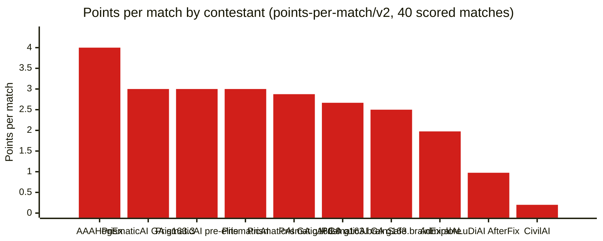
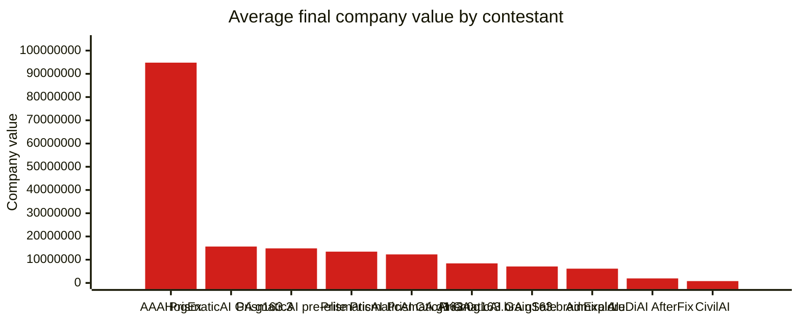
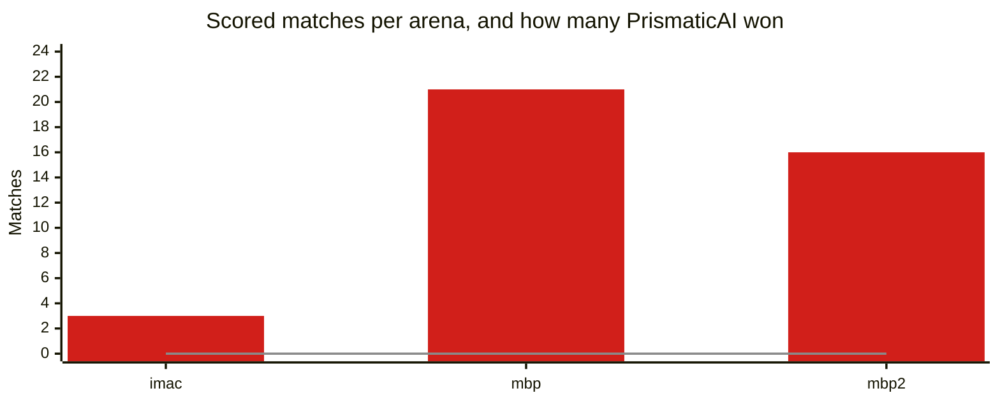

# battle-20261120T170219-be00f066

Derived from `battle-20261120T170219-be00f066.json` by `tools/research/ai-battle/battle.py report`; do not edit.

- Edition `be00f066f0358193`: PrismaticAI and referee at `2b32ecb6f1049e718e513efb309e963aa0a5205c`, base set `opengfx-8.0.tar`
- 20-year free-for-all from 1960, map 256x256 temperate, breakdowns 1
- 40 scored match(es) on `imac` (20261119-master-gdf1e05e7d8), `mbp` (20261120-master-m17653b726e), `mbp2` (20261119-master-gdf1e05e7d8)
- Replays: 0 of 0 identical to their original on another arena

| # | Contestant | Played | Wins | Points | Points/match | Avg rank | Avg final value | Squirrel errors | Matches with anomalies |
|---|---|---|---|---|---|---|---|---|---|
| 1 | AAAHogEx | 40 | 40 | 160 | 4.0 | 1.0 | 94.8 M | 0 | 0 |
| 2 | PrismaticAI GA g163.3 | 6 | 0 | 18 | 3.0 | 2.0 | 15.7 M | 0 | 2 |
| 3 | PrismaticAI pre-elite | 7 | 0 | 21 | 3.0 | 2.0 | 14.9 M | 0 | 0 |
| 4 | PrismaticAI | 7 | 0 | 21 | 3.0 | 2.0 | 13.5 M | 0 | 2 |
| 5 | PrismaticAI GA g163.0 | 8 | 0 | 23 | 2.875 | 2.12 | 12.3 M | 0 | 6 |
| 6 | PrismaticAI GA g163.brainSafe | 6 | 0 | 16 | 2.667 | 2.33 | 8.4 M | 0 | 4 |
| 7 | PrismaticAI GA g163.brainExplore | 6 | 0 | 15 | 2.5 | 2.5 | 7.1 M | 0 | 2 |
| 8 | AdmiralAI | 40 | 0 | 79 | 1.975 | 3.02 | 6.1 M | 0 | 1 |
| 9 | LuDiAI AfterFix | 40 | 0 | 39 | 0.975 | 4.03 | 1.9 M | 0 | 0 |
| 10 | CivilAI | 40 | 0 | 8 | 0.2 | 4.8 | 787.9 k | 0 | 6 |

```mermaid
---
config:
  xyChart:
    width: 900
    height: 360
  themeVariables:
    xyChart:
      plotColorPalette: "#d11f1a, #8a8a8a, #0b0b0b, #ece4d6"
---
xychart-beta
    title "Final company value per scored match: winner vs best PrismaticAI"
    x-axis ["m-0001", "m-0002", "m-0003", "m-0004", "m-0005", "m-0006", "m-0007", "m-0008", "m-0009", "m-0010", "m-0011", "m-0012", "m-0013", "m-0014", "m-0015", "m-0016", "m-0017", "m-0018", "m-0019", "m-0020", "m-0021", "m-0022", "m-0023", "m-0024", "m-0025", "m-0026", "m-0027", "m-0028", "m-0036", "m-0037", "m-0038", "m-0039", "m-0040", "m-0041", "m-0042", "m-0043", "m-0044", "m-0059", "m-0062", "m-0066"]
    %% series: Winner | Best PrismaticAI
    %% links: battle-20261120T170219-be00f066.md?col=Match&filter=m-0001 | battle-20261120T170219-be00f066.md?col=Match&filter=m-0002 | battle-20261120T170219-be00f066.md?col=Match&filter=m-0003 | battle-20261120T170219-be00f066.md?col=Match&filter=m-0004 | battle-20261120T170219-be00f066.md?col=Match&filter=m-0005 | battle-20261120T170219-be00f066.md?col=Match&filter=m-0006 | battle-20261120T170219-be00f066.md?col=Match&filter=m-0007 | battle-20261120T170219-be00f066.md?col=Match&filter=m-0008 | battle-20261120T170219-be00f066.md?col=Match&filter=m-0009 | battle-20261120T170219-be00f066.md?col=Match&filter=m-0010 | battle-20261120T170219-be00f066.md?col=Match&filter=m-0011 | battle-20261120T170219-be00f066.md?col=Match&filter=m-0012 | battle-20261120T170219-be00f066.md?col=Match&filter=m-0013 | battle-20261120T170219-be00f066.md?col=Match&filter=m-0014 | battle-20261120T170219-be00f066.md?col=Match&filter=m-0015 | battle-20261120T170219-be00f066.md?col=Match&filter=m-0016 | battle-20261120T170219-be00f066.md?col=Match&filter=m-0017 | battle-20261120T170219-be00f066.md?col=Match&filter=m-0018 | battle-20261120T170219-be00f066.md?col=Match&filter=m-0019 | battle-20261120T170219-be00f066.md?col=Match&filter=m-0020 | battle-20261120T170219-be00f066.md?col=Match&filter=m-0021 | battle-20261120T170219-be00f066.md?col=Match&filter=m-0022 | battle-20261120T170219-be00f066.md?col=Match&filter=m-0023 | battle-20261120T170219-be00f066.md?col=Match&filter=m-0024 | battle-20261120T170219-be00f066.md?col=Match&filter=m-0025 | battle-20261120T170219-be00f066.md?col=Match&filter=m-0026 | battle-20261120T170219-be00f066.md?col=Match&filter=m-0027 | battle-20261120T170219-be00f066.md?col=Match&filter=m-0028 | battle-20261120T170219-be00f066.md?col=Match&filter=m-0036 | battle-20261120T170219-be00f066.md?col=Match&filter=m-0037 | battle-20261120T170219-be00f066.md?col=Match&filter=m-0038 | battle-20261120T170219-be00f066.md?col=Match&filter=m-0039 | battle-20261120T170219-be00f066.md?col=Match&filter=m-0040 | battle-20261120T170219-be00f066.md?col=Match&filter=m-0041 | battle-20261120T170219-be00f066.md?col=Match&filter=m-0042 | battle-20261120T170219-be00f066.md?col=Match&filter=m-0043 | battle-20261120T170219-be00f066.md?col=Match&filter=m-0044 | battle-20261120T170219-be00f066.md?col=Match&filter=m-0059 | battle-20261120T170219-be00f066.md?col=Match&filter=m-0062 | battle-20261120T170219-be00f066.md?col=Match&filter=m-0066
    y-axis "Company value" 0 --> 159000000
    bar [77445366, 120570208, 78248562, 79888709, 81205224, 117365492, 95020322, 99785733, 86445507, 118676040, 99259849, 128166653, 144933937, 123695122, 122613432, 116109297, 110235250, 113271896, 86265346, 85866638, 97249015, 87230930, 101415135, 88562489, 95284372, 85773059, 73163666, 82189222, 88478815, 83265770, 72201128, 88971123, 71946495, 72382819, 57496148, 77030129, 89402703, 112862167, 108721180, 73725217]
    line [10692496, 15876259, 8010499, 8917564, 20347822, 13320465, 11594026, 9633770, 2904969, 6110972, 10449386, 10881819, 16526838, 12932646, 9159933, 7779850, 19803065, 20602846, 19190795, 14384833, 10690476, 8356522, 14310959, 11815187, 18489957, 13620780, 11868648, 6906136, 9914469, 15923338, 11778539, 7848960, 4412922, 10790473, 15080453, 11692842, 4341167, 18302440, 15636214, 12664546]
```

<!-- battle-charts:begin -->
<!-- derived from battle-20261120T170219-be00f066.json by `battle.py render`; `battle.py check` fails when it is stale -->

<!-- battle-charts:end -->

| Match | Arena | Seed | Winner | Value | Last | Anomalies |
|---|---|---|---|---|---|---|
| m-0001 | mbp | 854127433 | AAAHogEx | 77.4 M | LuDiAI AfterFix | - |
| m-0002 | mbp | 854127433 | AAAHogEx | 120.6 M | CivilAI | - |
| m-0003 | mbp | 854127433 | AAAHogEx | 78.2 M | LuDiAI AfterFix | PrismaticAI GA g163.brainSafe: fleet_drop:146->63 |
| m-0004 | mbp | 854127433 | AAAHogEx | 79.9 M | CivilAI | CivilAI: fleet_drop:50->31 |
| m-0005 | mbp | 854127433 | AAAHogEx | 81.2 M | LuDiAI AfterFix | - |
| m-0006 | mbp | 280718071 | AAAHogEx | 117.4 M | CivilAI | - |
| m-0007 | mbp | 280718071 | AAAHogEx | 95.0 M | CivilAI | - |
| m-0008 | mbp | 280718071 | AAAHogEx | 99.8 M | CivilAI | PrismaticAI GA g163.0: fleet_drop:136->87 |
| m-0009 | mbp | 280718071 | AAAHogEx | 86.4 M | CivilAI | PrismaticAI GA g163.brainSafe: fleet_drop:113->75 |
| m-0010 | imac | 280718071 | AAAHogEx | 118.7 M | CivilAI | - |
| m-0011 | imac | 280718071 | AAAHogEx | 99.3 M | CivilAI | CivilAI: fleet_drop:29->18 |
| m-0012 | imac | 315435176 | AAAHogEx | 128.2 M | LuDiAI AfterFix | - |
| m-0013 | mbp2 | 315435176 | AAAHogEx | 144.9 M | CivilAI | - |
| m-0014 | mbp2 | 315435176 | AAAHogEx | 123.7 M | CivilAI | PrismaticAI GA g163.0: fleet_drop:119->73 |
| m-0015 | mbp2 | 315435176 | AAAHogEx | 122.6 M | CivilAI | - |
| m-0016 | mbp2 | 315435176 | AAAHogEx | 116.1 M | CivilAI | PrismaticAI GA g163.brainExplore: fleet_drop:141->91 |
| m-0017 | mbp2 | 315435176 | AAAHogEx | 110.2 M | CivilAI | PrismaticAI GA g163.3: fleet_drop:140->72; CivilAI: fleet_drop:41->19 |
| m-0018 | mbp2 | 376617121 | AAAHogEx | 113.3 M | CivilAI | - |
| m-0019 | mbp2 | 376617121 | AAAHogEx | 86.3 M | LuDiAI AfterFix | - |
| m-0020 | mbp2 | 376617121 | AAAHogEx | 85.9 M | CivilAI | PrismaticAI GA g163.0: fleet_drop:96->57 |
| m-0021 | mbp2 | 376617121 | AAAHogEx | 97.2 M | CivilAI | PrismaticAI GA g163.brainSafe: fleet_drop:128->54 |
| m-0022 | mbp2 | 376617121 | AAAHogEx | 87.2 M | CivilAI | PrismaticAI GA g163.brainExplore: fleet_drop:162->63 |
| m-0023 | mbp2 | 376617121 | AAAHogEx | 101.4 M | LuDiAI AfterFix | PrismaticAI GA g163.3: fleet_drop:105->45; CivilAI: fleet_drop:64->36 |
| m-0024 | mbp2 | 629006932 | AAAHogEx | 88.6 M | CivilAI | PrismaticAI: fleet_drop:177->106 |
| m-0025 | mbp2 | 629006932 | AAAHogEx | 95.3 M | CivilAI | - |
| m-0026 | mbp2 | 629006932 | AAAHogEx | 85.8 M | AdmiralAI | - |
| m-0027 | mbp2 | 629006932 | AAAHogEx | 73.2 M | AdmiralAI | PrismaticAI GA g163.brainSafe: fleet_drop:195->135 |
| m-0028 | mbp2 | 629006932 | AAAHogEx | 82.2 M | CivilAI | - |
| m-0036 | mbp | 1668815575 | AAAHogEx | 88.5 M | CivilAI | PrismaticAI: fleet_drop:62->42 |
| m-0037 | mbp | 1668815575 | AAAHogEx | 83.3 M | CivilAI | CivilAI: no_vehicles |
| m-0038 | mbp | 1668815575 | AAAHogEx | 72.2 M | CivilAI | PrismaticAI GA g163.0: fleet_drop:88->56 |
| m-0039 | mbp | 1668815575 | AAAHogEx | 89.0 M | CivilAI | - |
| m-0040 | mbp | 1668815575 | AAAHogEx | 71.9 M | CivilAI | - |
| m-0041 | mbp | 1668815575 | AAAHogEx | 72.4 M | CivilAI | - |
| m-0042 | mbp | 413786555 | AAAHogEx | 57.5 M | CivilAI | - |
| m-0043 | mbp | 413786555 | AAAHogEx | 77.0 M | CivilAI | - |
| m-0044 | mbp | 413786555 | AAAHogEx | 89.4 M | CivilAI | PrismaticAI GA g163.0: fleet_drop:77->32 |
| m-0059 | mbp | 136084551 | AAAHogEx | 112.9 M | CivilAI | AdmiralAI: fleet_drop:232->149 |
| m-0062 | mbp | 813031754 | AAAHogEx | 108.7 M | CivilAI | PrismaticAI GA g163.0: fleet_drop:126->61 |
| m-0066 | mbp | 1051270332 | AAAHogEx | 73.7 M | CivilAI | CivilAI: no_vehicles |
