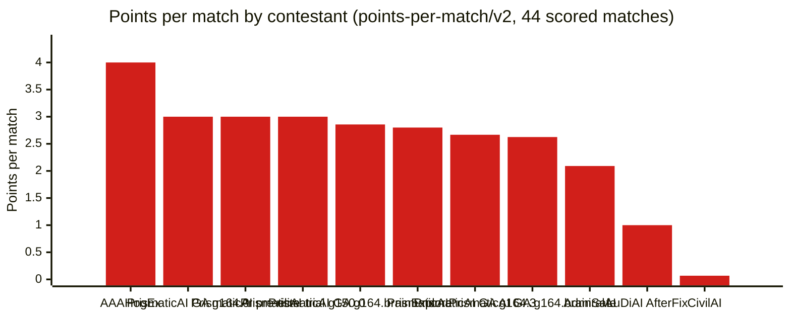
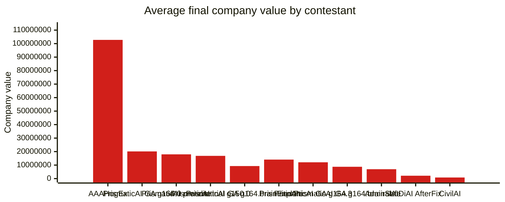
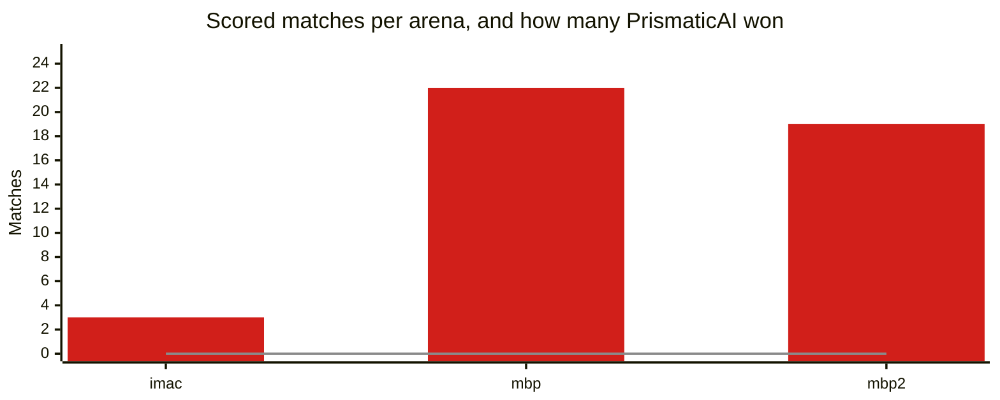

# battle-20261120T171242-355194e4

Derived from `battle-20261120T171242-355194e4.json` by `tools/research/ai-battle/battle.py report`; do not edit.

- Edition `355194e4cfa1a8c4`: PrismaticAI and referee at `2b32ecb6f1049e718e513efb309e963aa0a5205c`, base set `opengfx-8.0.tar`
- 20-year free-for-all from 1960, map 256x256 temperate, breakdowns 1
- 44 scored match(es) on `imac` (20261119-master-gdf1e05e7d8), `mbp` (20261120-master-m17653b726e), `mbp2` (20261119-master-gdf1e05e7d8)
- Replays: 0 of 0 identical to their original on another arena

| # | Contestant | Played | Wins | Points | Points/match | Avg rank | Avg final value | Squirrel errors | Matches with anomalies |
|---|---|---|---|---|---|---|---|---|---|
| 1 | AAAHogEx | 44 | 44 | 176 | 4.0 | 1.0 | 102.8 M | 0 | 0 |
| 2 | PrismaticAI GA g164.0 | 6 | 0 | 18 | 3.0 | 2.0 | 20.1 M | 0 | 2 |
| 3 | PrismaticAI pre-elite | 6 | 0 | 18 | 3.0 | 2.0 | 18.0 M | 0 | 0 |
| 4 | PrismaticAI trial g150.0 | 6 | 0 | 18 | 3.0 | 2.0 | 16.8 M | 0 | 0 |
| 5 | PrismaticAI GA g164.brainExplore | 7 | 0 | 20 | 2.857 | 2.14 | 9.3 M | 0 | 2 |
| 6 | PrismaticAI | 5 | 0 | 14 | 2.8 | 2.2 | 14.1 M | 0 | 3 |
| 7 | PrismaticAI GA g164.3 | 6 | 0 | 16 | 2.667 | 2.33 | 12.1 M | 0 | 1 |
| 8 | PrismaticAI GA g164.brainSafe | 8 | 0 | 21 | 2.625 | 2.38 | 8.8 M | 0 | 4 |
| 9 | AdmiralAI | 44 | 0 | 92 | 2.091 | 2.91 | 7.0 M | 0 | 2 |
| 10 | LuDiAI AfterFix | 44 | 0 | 44 | 1.0 | 4.0 | 2.1 M | 0 | 0 |
| 11 | CivilAI | 44 | 0 | 3 | 0.068 | 4.93 | 816.7 k | 3705 | 6 |

```mermaid
---
config:
  xyChart:
    width: 900
    height: 360
  themeVariables:
    xyChart:
      plotColorPalette: "#d11f1a, #8a8a8a, #0b0b0b, #ece4d6"
---
xychart-beta
    title "Final company value per scored match: winner vs best PrismaticAI"
    x-axis ["m-0001", "m-0002", "m-0003", "m-0004", "m-0005", "m-0006", "m-0007", "m-0008", "m-0009", "m-0010", "m-0011", "m-0012", "m-0013", "m-0014", "m-0015", "m-0016", "m-0017", "m-0018", "m-0019", "m-0020", "m-0021", "m-0022", "m-0023", "m-0024", "m-0025", "m-0026", "m-0027", "m-0028", "m-0036", "m-0037", "m-0038", "m-0039", "m-0040", "m-0041", "m-0042", "m-0043", "m-0044", "m-0045", "m-0046", "m-0047", "m-0053", "m-0060", "m-0061", "m-0062"]
    %% series: Winner | Best PrismaticAI
    %% links: battle-20261120T171242-355194e4.md?col=Match&filter=m-0001 | battle-20261120T171242-355194e4.md?col=Match&filter=m-0002 | battle-20261120T171242-355194e4.md?col=Match&filter=m-0003 | battle-20261120T171242-355194e4.md?col=Match&filter=m-0004 | battle-20261120T171242-355194e4.md?col=Match&filter=m-0005 | battle-20261120T171242-355194e4.md?col=Match&filter=m-0006 | battle-20261120T171242-355194e4.md?col=Match&filter=m-0007 | battle-20261120T171242-355194e4.md?col=Match&filter=m-0008 | battle-20261120T171242-355194e4.md?col=Match&filter=m-0009 | battle-20261120T171242-355194e4.md?col=Match&filter=m-0010 | battle-20261120T171242-355194e4.md?col=Match&filter=m-0011 | battle-20261120T171242-355194e4.md?col=Match&filter=m-0012 | battle-20261120T171242-355194e4.md?col=Match&filter=m-0013 | battle-20261120T171242-355194e4.md?col=Match&filter=m-0014 | battle-20261120T171242-355194e4.md?col=Match&filter=m-0015 | battle-20261120T171242-355194e4.md?col=Match&filter=m-0016 | battle-20261120T171242-355194e4.md?col=Match&filter=m-0017 | battle-20261120T171242-355194e4.md?col=Match&filter=m-0018 | battle-20261120T171242-355194e4.md?col=Match&filter=m-0019 | battle-20261120T171242-355194e4.md?col=Match&filter=m-0020 | battle-20261120T171242-355194e4.md?col=Match&filter=m-0021 | battle-20261120T171242-355194e4.md?col=Match&filter=m-0022 | battle-20261120T171242-355194e4.md?col=Match&filter=m-0023 | battle-20261120T171242-355194e4.md?col=Match&filter=m-0024 | battle-20261120T171242-355194e4.md?col=Match&filter=m-0025 | battle-20261120T171242-355194e4.md?col=Match&filter=m-0026 | battle-20261120T171242-355194e4.md?col=Match&filter=m-0027 | battle-20261120T171242-355194e4.md?col=Match&filter=m-0028 | battle-20261120T171242-355194e4.md?col=Match&filter=m-0036 | battle-20261120T171242-355194e4.md?col=Match&filter=m-0037 | battle-20261120T171242-355194e4.md?col=Match&filter=m-0038 | battle-20261120T171242-355194e4.md?col=Match&filter=m-0039 | battle-20261120T171242-355194e4.md?col=Match&filter=m-0040 | battle-20261120T171242-355194e4.md?col=Match&filter=m-0041 | battle-20261120T171242-355194e4.md?col=Match&filter=m-0042 | battle-20261120T171242-355194e4.md?col=Match&filter=m-0043 | battle-20261120T171242-355194e4.md?col=Match&filter=m-0044 | battle-20261120T171242-355194e4.md?col=Match&filter=m-0045 | battle-20261120T171242-355194e4.md?col=Match&filter=m-0046 | battle-20261120T171242-355194e4.md?col=Match&filter=m-0047 | battle-20261120T171242-355194e4.md?col=Match&filter=m-0053 | battle-20261120T171242-355194e4.md?col=Match&filter=m-0060 | battle-20261120T171242-355194e4.md?col=Match&filter=m-0061 | battle-20261120T171242-355194e4.md?col=Match&filter=m-0062
    y-axis "Company value" 0 --> 154000000
    bar [69604891, 96042863, 86442502, 96197809, 62925711, 85920111, 125025304, 115059512, 115966930, 101286195, 113470953, 97650570, 110559089, 111865617, 119337572, 115353264, 124669617, 135136441, 128758775, 108758524, 78007965, 84075802, 73056058, 95382889, 68613609, 100521956, 85988830, 140181144, 105833780, 96135834, 75775423, 102297518, 112745615, 119885903, 96286279, 127311392, 120952715, 107817107, 89070417, 132775877, 77970680, 101862282, 97178101, 111645444]
    line [19838679, 18496251, 23544784, 9589990, 9714341, 7119937, 13967081, 15159855, 13644752, 18264194, 5904052, 6969425, 13767755, 22051345, 21050018, 23476616, 28302940, 10484614, 15340552, 19878459, 7241424, 14824564, 7174831, 9743813, 4163612, 5024072, 5678918, 15528834, 14160262, 15419629, 25709193, 10710002, 9200365, 13682469, 11637539, 22777387, 22848579, 15265311, 7817403, 7398080, 6908795, 14502675, 11425888, 12358534]
```

<!-- battle-charts:begin -->
<!-- derived from battle-20261120T171242-355194e4.json by `battle.py render`; `battle.py check` fails when it is stale -->

<!-- battle-charts:end -->

| Match | Arena | Seed | Winner | Value | Last | Anomalies |
|---|---|---|---|---|---|---|
| m-0001 | mbp | 1533825813 | AAAHogEx | 69.6 M | CivilAI | CivilAI: fleet_drop:45->23 |
| m-0002 | mbp | 1533825813 | AAAHogEx | 96.0 M | CivilAI | AdmiralAI: fleet_drop:376->245 |
| m-0003 | mbp | 1533825813 | AAAHogEx | 86.4 M | CivilAI | - |
| m-0004 | mbp | 1533825813 | AAAHogEx | 96.2 M | CivilAI | - |
| m-0005 | mbp | 1533825813 | AAAHogEx | 62.9 M | CivilAI | - |
| m-0006 | mbp | 1533825813 | AAAHogEx | 85.9 M | CivilAI | AdmiralAI: fleet_drop:221->148 |
| m-0007 | mbp | 34877865 | AAAHogEx | 125.0 M | CivilAI | PrismaticAI: fleet_drop:94->61 |
| m-0008 | mbp | 34877865 | AAAHogEx | 115.1 M | CivilAI | - |
| m-0009 | mbp | 34877865 | AAAHogEx | 116.0 M | CivilAI | - |
| m-0010 | imac | 34877865 | AAAHogEx | 101.3 M | CivilAI | - |
| m-0011 | imac | 34877865 | AAAHogEx | 113.5 M | CivilAI | PrismaticAI GA g164.brainSafe: fleet_drop:128->51 |
| m-0012 | imac | 34877865 | AAAHogEx | 97.7 M | CivilAI | PrismaticAI GA g164.brainExplore: fleet_drop:103->54 |
| m-0013 | mbp2 | 34877865 | AAAHogEx | 110.6 M | CivilAI | - |
| m-0014 | mbp2 | 1997036293 | AAAHogEx | 111.9 M | CivilAI | PrismaticAI: fleet_drop:144->91 |
| m-0015 | mbp2 | 1997036293 | AAAHogEx | 119.3 M | CivilAI | - |
| m-0016 | mbp2 | 1997036293 | AAAHogEx | 115.4 M | CivilAI | - |
| m-0017 | mbp2 | 1997036293 | AAAHogEx | 124.7 M | AdmiralAI | PrismaticAI GA g164.0: fleet_drop:165->111 |
| m-0018 | mbp2 | 1997036293 | AAAHogEx | 135.1 M | CivilAI | PrismaticAI GA g164.brainSafe: fleet_drop:109->51 |
| m-0019 | mbp2 | 1997036293 | AAAHogEx | 128.8 M | CivilAI | PrismaticAI GA g164.brainExplore: fleet_drop:130->70 |
| m-0020 | mbp2 | 1997036293 | AAAHogEx | 108.8 M | CivilAI | - |
| m-0021 | mbp2 | 1809912058 | AAAHogEx | 78.0 M | CivilAI | PrismaticAI: fleet_drop:74->47; CivilAI: fleet_drop:45->25 |
| m-0022 | mbp2 | 1809912058 | AAAHogEx | 84.1 M | CivilAI | - |
| m-0023 | mbp2 | 1809912058 | AAAHogEx | 73.1 M | CivilAI | - |
| m-0024 | mbp2 | 1809912058 | AAAHogEx | 95.4 M | CivilAI | CivilAI: fleet_drop:91->59 |
| m-0025 | mbp2 | 1809912058 | AAAHogEx | 68.6 M | LuDiAI AfterFix | PrismaticAI GA g164.brainSafe: fleet_drop:100->62 |
| m-0026 | mbp2 | 1809912058 | AAAHogEx | 100.5 M | CivilAI | CivilAI: squirrel_errors:3705 |
| m-0027 | mbp2 | 1809912058 | AAAHogEx | 86.0 M | CivilAI | PrismaticAI GA g164.3: fleet_drop:100->63 |
| m-0028 | mbp2 | 148514422 | AAAHogEx | 140.2 M | CivilAI | - |
| m-0036 | mbp | 1241915296 | AAAHogEx | 105.8 M | CivilAI | - |
| m-0037 | mbp | 1241915296 | AAAHogEx | 96.1 M | CivilAI | - |
| m-0038 | mbp | 1241915296 | AAAHogEx | 75.8 M | CivilAI | CivilAI: fleet_drop:24->9 |
| m-0039 | mbp | 1241915296 | AAAHogEx | 102.3 M | CivilAI | - |
| m-0040 | mbp | 1241915296 | AAAHogEx | 112.7 M | CivilAI | - |
| m-0041 | mbp | 1241915296 | AAAHogEx | 119.9 M | CivilAI | - |
| m-0042 | mbp | 376830611 | AAAHogEx | 96.3 M | CivilAI | - |
| m-0043 | mbp | 376830611 | AAAHogEx | 127.3 M | CivilAI | - |
| m-0044 | mbp | 376830611 | AAAHogEx | 121.0 M | CivilAI | - |
| m-0045 | mbp2 | 376830611 | AAAHogEx | 107.8 M | CivilAI | PrismaticAI GA g164.0: fleet_drop:134->72; CivilAI: no_vehicles |
| m-0046 | mbp2 | 376830611 | AAAHogEx | 89.1 M | CivilAI | - |
| m-0047 | mbp2 | 376830611 | AAAHogEx | 132.8 M | LuDiAI AfterFix | - |
| m-0053 | mbp | 907383943 | AAAHogEx | 78.0 M | CivilAI | PrismaticAI GA g164.brainSafe: fleet_drop:102->36 |
| m-0060 | mbp | 874375593 | AAAHogEx | 101.9 M | CivilAI | - |
| m-0061 | mbp | 874375593 | AAAHogEx | 97.2 M | CivilAI | - |
| m-0062 | mbp | 874375593 | AAAHogEx | 111.6 M | CivilAI | - |
