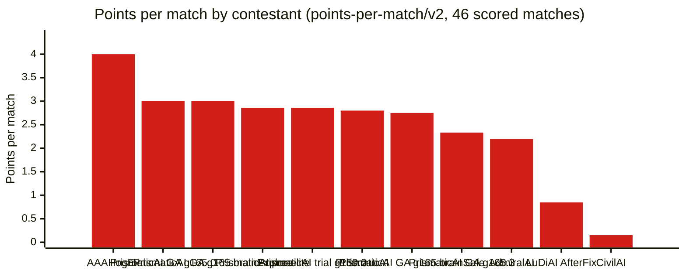
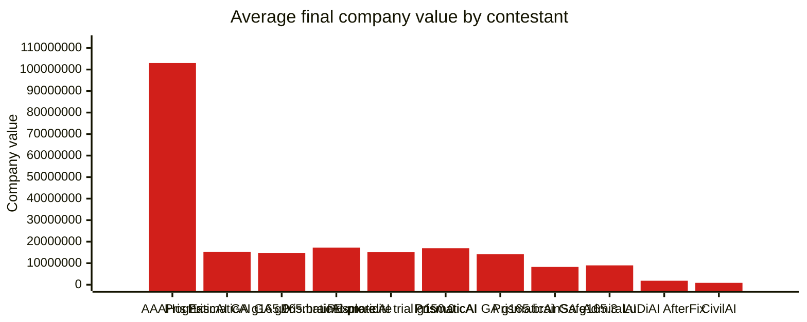
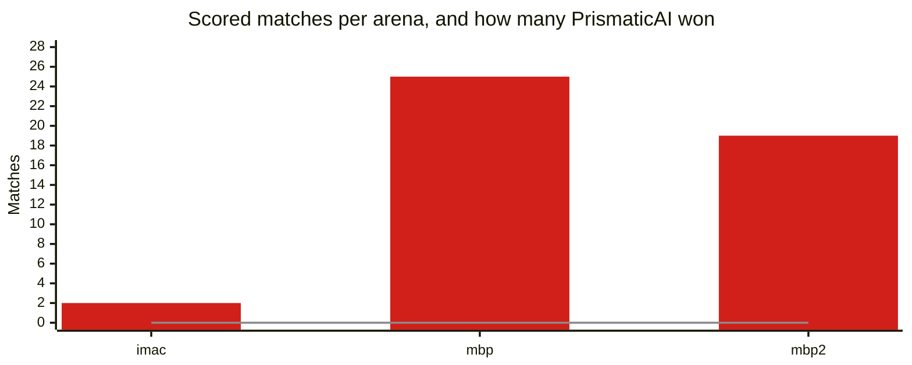

# battle-20261120T172301-1a43fb5a

Derived from `battle-20261120T172301-1a43fb5a.json` by `tools/research/ai-battle/battle.py report`; do not edit.

- Edition `1a43fb5a9fb34f5c`: PrismaticAI and referee at `2b32ecb6f1049e718e513efb309e963aa0a5205c`, base set `opengfx-8.0.tar`
- 20-year free-for-all from 1960, map 256x256 temperate, breakdowns 1
- 46 scored match(es) on `imac` (20261119-master-gdf1e05e7d8), `mbp` (20261120-master-m17653b726e), `mbp2` (20261119-master-gdf1e05e7d8)
- Replays: 1 of 1 identical to their original on another arena

| # | Contestant | Played | Wins | Points | Points/match | Avg rank | Avg final value | Squirrel errors | Matches with anomalies |
|---|---|---|---|---|---|---|---|---|---|
| 1 | AAAHogEx | 46 | 46 | 184 | 4.0 | 1.0 | 103.0 M | 0 | 0 |
| 2 | PrismaticAI GA g165.0 | 7 | 0 | 21 | 3.0 | 2.0 | 15.3 M | 0 | 2 |
| 3 | PrismaticAI GA g165.brainExplore | 6 | 0 | 18 | 3.0 | 2.0 | 14.8 M | 0 | 2 |
| 4 | PrismaticAI pre-elite | 7 | 0 | 20 | 2.857 | 2.14 | 17.3 M | 0 | 0 |
| 5 | PrismaticAI trial g150.0 | 7 | 0 | 20 | 2.857 | 2.14 | 15.1 M | 0 | 0 |
| 6 | PrismaticAI | 5 | 0 | 14 | 2.8 | 2.2 | 16.9 M | 0 | 3 |
| 7 | PrismaticAI GA g165.brainSafe | 8 | 0 | 22 | 2.75 | 2.25 | 14.2 M | 0 | 6 |
| 8 | PrismaticAI GA g165.3 | 6 | 0 | 14 | 2.333 | 2.67 | 8.3 M | 0 | 2 |
| 9 | AdmiralAI | 46 | 0 | 101 | 2.196 | 2.8 | 9.0 M | 0 | 1 |
| 10 | LuDiAI AfterFix | 46 | 0 | 39 | 0.848 | 4.15 | 1.8 M | 0 | 0 |
| 11 | CivilAI | 46 | 0 | 7 | 0.152 | 4.85 | 854.4 k | 3670 | 8 |

```mermaid
---
config:
  xyChart:
    width: 900
    height: 360
  themeVariables:
    xyChart:
      plotColorPalette: "#d11f1a, #8a8a8a, #0b0b0b, #ece4d6"
---
xychart-beta
    title "Final company value per scored match: winner vs best PrismaticAI"
    x-axis ["m-0001", "m-0002", "m-0003", "m-0004", "m-0005", "m-0006", "m-0007", "m-0008", "m-0009", "m-0011", "m-0012", "m-0013", "m-0014", "m-0015", "m-0016", "m-0017", "m-0018", "m-0019", "m-0020", "m-0021", "m-0022", "m-0023", "m-0024", "m-0025", "m-0026", "m-0027", "m-0028", "m-0036", "m-0037", "m-0038", "m-0039", "m-0040", "m-0041", "m-0042", "m-0043", "m-0044", "m-0045", "m-0046", "m-0047", "m-0055", "m-0057", "m-0058", "m-0059", "m-0060", "m-0066", "m-0067"]
    %% series: Winner | Best PrismaticAI
    %% links: battle-20261120T172301-1a43fb5a.md?col=Match&filter=m-0001 | battle-20261120T172301-1a43fb5a.md?col=Match&filter=m-0002 | battle-20261120T172301-1a43fb5a.md?col=Match&filter=m-0003 | battle-20261120T172301-1a43fb5a.md?col=Match&filter=m-0004 | battle-20261120T172301-1a43fb5a.md?col=Match&filter=m-0005 | battle-20261120T172301-1a43fb5a.md?col=Match&filter=m-0006 | battle-20261120T172301-1a43fb5a.md?col=Match&filter=m-0007 | battle-20261120T172301-1a43fb5a.md?col=Match&filter=m-0008 | battle-20261120T172301-1a43fb5a.md?col=Match&filter=m-0009 | battle-20261120T172301-1a43fb5a.md?col=Match&filter=m-0011 | battle-20261120T172301-1a43fb5a.md?col=Match&filter=m-0012 | battle-20261120T172301-1a43fb5a.md?col=Match&filter=m-0013 | battle-20261120T172301-1a43fb5a.md?col=Match&filter=m-0014 | battle-20261120T172301-1a43fb5a.md?col=Match&filter=m-0015 | battle-20261120T172301-1a43fb5a.md?col=Match&filter=m-0016 | battle-20261120T172301-1a43fb5a.md?col=Match&filter=m-0017 | battle-20261120T172301-1a43fb5a.md?col=Match&filter=m-0018 | battle-20261120T172301-1a43fb5a.md?col=Match&filter=m-0019 | battle-20261120T172301-1a43fb5a.md?col=Match&filter=m-0020 | battle-20261120T172301-1a43fb5a.md?col=Match&filter=m-0021 | battle-20261120T172301-1a43fb5a.md?col=Match&filter=m-0022 | battle-20261120T172301-1a43fb5a.md?col=Match&filter=m-0023 | battle-20261120T172301-1a43fb5a.md?col=Match&filter=m-0024 | battle-20261120T172301-1a43fb5a.md?col=Match&filter=m-0025 | battle-20261120T172301-1a43fb5a.md?col=Match&filter=m-0026 | battle-20261120T172301-1a43fb5a.md?col=Match&filter=m-0027 | battle-20261120T172301-1a43fb5a.md?col=Match&filter=m-0028 | battle-20261120T172301-1a43fb5a.md?col=Match&filter=m-0036 | battle-20261120T172301-1a43fb5a.md?col=Match&filter=m-0037 | battle-20261120T172301-1a43fb5a.md?col=Match&filter=m-0038 | battle-20261120T172301-1a43fb5a.md?col=Match&filter=m-0039 | battle-20261120T172301-1a43fb5a.md?col=Match&filter=m-0040 | battle-20261120T172301-1a43fb5a.md?col=Match&filter=m-0041 | battle-20261120T172301-1a43fb5a.md?col=Match&filter=m-0042 | battle-20261120T172301-1a43fb5a.md?col=Match&filter=m-0043 | battle-20261120T172301-1a43fb5a.md?col=Match&filter=m-0044 | battle-20261120T172301-1a43fb5a.md?col=Match&filter=m-0045 | battle-20261120T172301-1a43fb5a.md?col=Match&filter=m-0046 | battle-20261120T172301-1a43fb5a.md?col=Match&filter=m-0047 | battle-20261120T172301-1a43fb5a.md?col=Match&filter=m-0055 | battle-20261120T172301-1a43fb5a.md?col=Match&filter=m-0057 | battle-20261120T172301-1a43fb5a.md?col=Match&filter=m-0058 | battle-20261120T172301-1a43fb5a.md?col=Match&filter=m-0059 | battle-20261120T172301-1a43fb5a.md?col=Match&filter=m-0060 | battle-20261120T172301-1a43fb5a.md?col=Match&filter=m-0066 | battle-20261120T172301-1a43fb5a.md?col=Match&filter=m-0067
    y-axis "Company value" 0 --> 155000000
    bar [140679046, 98319505, 122244950, 127335287, 106559721, 90093522, 111389382, 122302634, 121345809, 104610455, 93105135, 126757782, 108218007, 100140220, 111959579, 110347125, 110290657, 85917169, 125717047, 112511174, 100499934, 107375659, 81312503, 86601963, 102693595, 120491685, 134480760, 119173301, 107245329, 116393158, 119557078, 122686666, 114501225, 77815188, 80858269, 76417093, 85777236, 79313391, 83085203, 90406316, 73966325, 136087206, 91304759, 88930379, 53940072, 58142331]
    line [26305709, 14238604, 19698340, 20237914, 14685123, 8808632, 17969187, 15308355, 13250711, 20308617, 15552492, 8764010, 7468497, 15866027, 11522924, 10224644, 7266742, 13368407, 2574883, 16057622, 15831897, 22069737, 18514013, 19602318, 18200352, 10589099, 27372325, 14813740, 17447770, 16238733, 8963464, 12966407, 14654215, 15777773, 18602630, 17167878, 18207009, 16912460, 13968479, 4179522, 14074147, 10230929, 14663546, 8808130, 9710337, 11208274]
```

<!-- battle-charts:begin -->
<!-- derived from battle-20261120T172301-1a43fb5a.json by `battle.py render`; `battle.py check` fails when it is stale -->

<!-- battle-charts:end -->

| Seed | Original | Replay | Arenas | Identical |
|---|---|---|---|---|
| 1468369372 | m-0013 | m-0056 | mbp2 / mbp | yes |

| Match | Arena | Seed | Winner | Value | Last | Anomalies |
|---|---|---|---|---|---|---|
| m-0001 | mbp | 239107961 | AAAHogEx | 140.7 M | CivilAI | - |
| m-0002 | mbp | 239107961 | AAAHogEx | 98.3 M | CivilAI | - |
| m-0003 | mbp | 239107961 | AAAHogEx | 122.2 M | CivilAI | CivilAI: no_vehicles |
| m-0004 | mbp | 239107961 | AAAHogEx | 127.3 M | CivilAI | PrismaticAI GA g165.brainSafe: fleet_drop:102->57 |
| m-0005 | mbp | 239107961 | AAAHogEx | 106.6 M | CivilAI | AdmiralAI: fleet_drop:351->226; CivilAI: fleet_drop:66->40 |
| m-0006 | mbp | 239107961 | AAAHogEx | 90.1 M | CivilAI | PrismaticAI GA g165.3: fleet_drop:110->69 |
| m-0007 | mbp | 1468369372 | AAAHogEx | 111.4 M | CivilAI | PrismaticAI: fleet_drop:83->57; CivilAI: fleet_drop:31->19 |
| m-0008 | mbp | 1468369372 | AAAHogEx | 122.3 M | CivilAI | - |
| m-0009 | mbp | 1468369372 | AAAHogEx | 121.3 M | CivilAI | - |
| m-0011 | imac | 1468369372 | AAAHogEx | 104.6 M | CivilAI | PrismaticAI GA g165.brainSafe: fleet_drop:135->45 |
| m-0012 | imac | 1468369372 | AAAHogEx | 93.1 M | CivilAI | PrismaticAI GA g165.brainExplore: fleet_drop:74->36 |
| m-0013 | mbp2 | 1468369372 | AAAHogEx | 126.8 M | CivilAI | PrismaticAI GA g165.3: fleet_drop:102->41 |
| m-0014 | mbp2 | 1156222055 | AAAHogEx | 108.2 M | LuDiAI AfterFix | - |
| m-0015 | mbp2 | 1156222055 | AAAHogEx | 100.1 M | CivilAI | - |
| m-0016 | mbp2 | 1156222055 | AAAHogEx | 112.0 M | CivilAI | - |
| m-0017 | mbp2 | 1156222055 | AAAHogEx | 110.3 M | CivilAI | - |
| m-0018 | mbp2 | 1156222055 | AAAHogEx | 110.3 M | LuDiAI AfterFix | PrismaticAI GA g165.brainSafe: fleet_drop:99->66 |
| m-0019 | mbp2 | 1156222055 | AAAHogEx | 85.9 M | CivilAI | - |
| m-0020 | mbp2 | 1156222055 | AAAHogEx | 125.7 M | LuDiAI AfterFix | - |
| m-0021 | mbp2 | 1154420689 | AAAHogEx | 112.5 M | CivilAI | PrismaticAI: fleet_drop:132->78 |
| m-0022 | mbp2 | 1154420689 | AAAHogEx | 100.5 M | CivilAI | - |
| m-0023 | mbp2 | 1154420689 | AAAHogEx | 107.4 M | CivilAI | - |
| m-0024 | mbp2 | 1154420689 | AAAHogEx | 81.3 M | CivilAI | PrismaticAI GA g165.0: fleet_drop:146->89 |
| m-0025 | mbp2 | 1154420689 | AAAHogEx | 86.6 M | CivilAI | PrismaticAI GA g165.brainSafe: fleet_drop:190->95 |
| m-0026 | mbp2 | 1154420689 | AAAHogEx | 102.7 M | CivilAI | PrismaticAI GA g165.brainExplore: fleet_drop:133->90 |
| m-0027 | mbp2 | 1154420689 | AAAHogEx | 120.5 M | CivilAI | - |
| m-0028 | mbp2 | 1912872906 | AAAHogEx | 134.5 M | CivilAI | - |
| m-0036 | mbp | 391612220 | AAAHogEx | 119.2 M | CivilAI | - |
| m-0037 | mbp | 391612220 | AAAHogEx | 107.2 M | CivilAI | - |
| m-0038 | mbp | 391612220 | AAAHogEx | 116.4 M | CivilAI | PrismaticAI GA g165.0: fleet_drop:100->66 |
| m-0039 | mbp | 391612220 | AAAHogEx | 119.6 M | CivilAI | PrismaticAI GA g165.brainSafe: fleet_drop:107->38 |
| m-0040 | mbp | 391612220 | AAAHogEx | 122.7 M | LuDiAI AfterFix | - |
| m-0041 | mbp | 391612220 | AAAHogEx | 114.5 M | CivilAI | - |
| m-0042 | mbp | 1620301685 | AAAHogEx | 77.8 M | CivilAI | PrismaticAI: fleet_drop:96->65 |
| m-0043 | mbp | 1620301685 | AAAHogEx | 80.9 M | CivilAI | - |
| m-0044 | mbp | 1620301685 | AAAHogEx | 76.4 M | CivilAI | CivilAI: fleet_drop:34->8 |
| m-0045 | mbp2 | 1620301685 | AAAHogEx | 85.8 M | CivilAI | - |
| m-0046 | mbp2 | 1620301685 | AAAHogEx | 79.3 M | LuDiAI AfterFix | CivilAI: fleet_drop:37->25 |
| m-0047 | mbp2 | 1620301685 | AAAHogEx | 83.1 M | CivilAI | - |
| m-0055 | mbp | 1259235559 | AAAHogEx | 90.4 M | CivilAI | CivilAI: fleet_drop:119->77 |
| m-0056 (replay) | mbp | 1468369372 | AAAHogEx | 126.8 M | CivilAI | PrismaticAI GA g165.3: fleet_drop:102->41 |
| m-0057 | mbp | 140034356 | AAAHogEx | 74.0 M | CivilAI | - |
| m-0058 | mbp | 140034356 | AAAHogEx | 136.1 M | LuDiAI AfterFix | CivilAI: squirrel_errors:3670 |
| m-0059 | mbp | 140034356 | AAAHogEx | 91.3 M | LuDiAI AfterFix | - |
| m-0060 | mbp | 140034356 | AAAHogEx | 88.9 M | CivilAI | PrismaticAI GA g165.brainSafe: fleet_drop:125->83; CivilAI: fleet_drop:22->15 |
| m-0066 | mbp | 1313138370 | AAAHogEx | 53.9 M | CivilAI | - |
| m-0067 | mbp | 1313138370 | AAAHogEx | 58.1 M | CivilAI | - |
