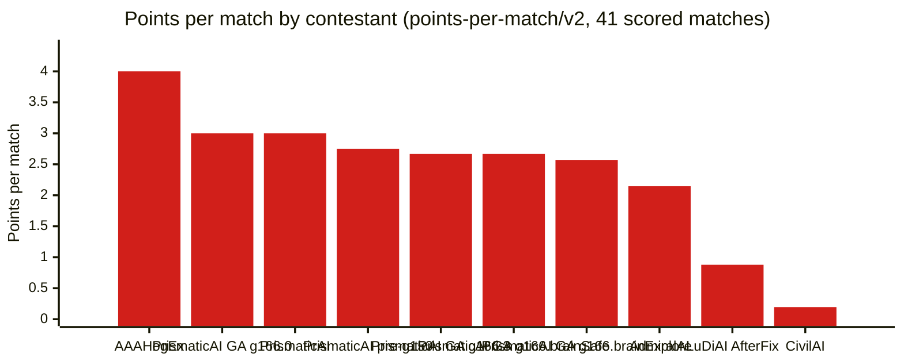
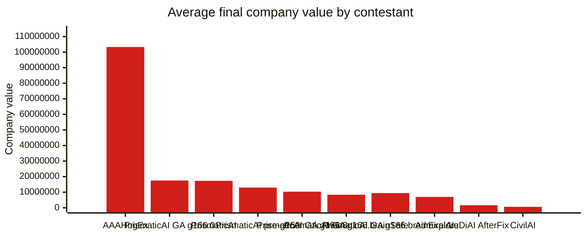
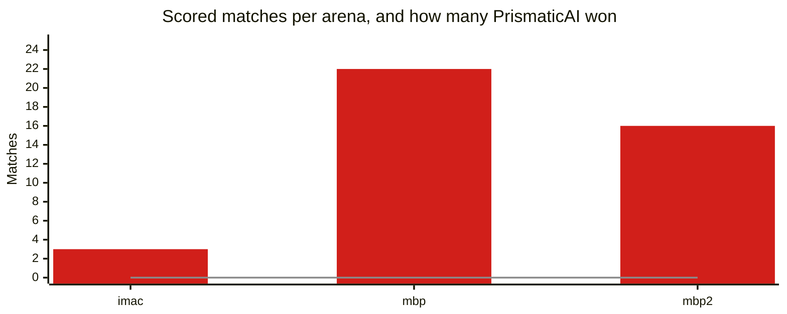

# battle-20261120T174305-121f34cd

Derived from `battle-20261120T174305-121f34cd.json` by `tools/research/ai-battle/battle.py report`; do not edit.

- Edition `121f34cdd7e1773d`: PrismaticAI and referee at `962699034c20d90baeb9f617789ea6558cc6ff52`, base set `opengfx-8.0.tar`
- 20-year free-for-all from 1960, map 256x256 temperate, breakdowns 1
- 41 scored match(es) on `imac` (20261119-master-gdf1e05e7d8), `mbp` (20261120-master-m17653b726e), `mbp2` (20261119-master-gdf1e05e7d8)
- Replays: 0 of 1 identical to their original on another arena

| # | Contestant | Played | Wins | Points | Points/match | Avg rank | Avg final value | Squirrel errors | Matches with anomalies |
|---|---|---|---|---|---|---|---|---|---|
| 1 | AAAHogEx | 41 | 41 | 164 | 4.0 | 1.0 | 103.3 M | 0 | 0 |
| 2 | PrismaticAI GA g166.0 | 8 | 0 | 24 | 3.0 | 2.0 | 17.5 M | 0 | 1 |
| 3 | PrismaticAI | 6 | 0 | 18 | 3.0 | 2.0 | 17.3 M | 0 | 0 |
| 4 | PrismaticAI pre-g150 | 8 | 0 | 22 | 2.75 | 2.25 | 13.0 M | 0 | 3 |
| 5 | PrismaticAI GA g166.3 | 6 | 0 | 16 | 2.667 | 2.33 | 10.3 M | 0 | 0 |
| 6 | PrismaticAI GA g166.brainSafe | 6 | 0 | 16 | 2.667 | 2.33 | 8.4 M | 0 | 2 |
| 7 | PrismaticAI GA g166.brainExplore | 7 | 0 | 18 | 2.571 | 2.43 | 9.4 M | 0 | 2 |
| 8 | AdmiralAI | 41 | 0 | 88 | 2.146 | 2.85 | 7.0 M | 0 | 3 |
| 9 | LuDiAI AfterFix | 41 | 0 | 36 | 0.878 | 4.12 | 1.6 M | 0 | 0 |
| 10 | CivilAI | 41 | 0 | 8 | 0.195 | 4.8 | 600.5 k | 0 | 5 |

```mermaid
---
config:
  xyChart:
    width: 900
    height: 360
  themeVariables:
    xyChart:
      plotColorPalette: "#d11f1a, #8a8a8a, #0b0b0b, #ece4d6"
---
xychart-beta
    title "Final company value per scored match: winner vs best PrismaticAI"
    x-axis ["m-0001", "m-0002", "m-0003", "m-0004", "m-0005", "m-0006", "m-0007", "m-0008", "m-0009", "m-0010", "m-0011", "m-0012", "m-0013", "m-0014", "m-0015", "m-0016", "m-0017", "m-0018", "m-0019", "m-0020", "m-0021", "m-0022", "m-0023", "m-0024", "m-0025", "m-0026", "m-0027", "m-0028", "m-0036", "m-0037", "m-0038", "m-0039", "m-0040", "m-0041", "m-0042", "m-0043", "m-0044", "m-0046", "m-0047", "m-0049", "m-0050"]
    %% series: Winner | Best PrismaticAI
    %% links: battle-20261120T174305-121f34cd.md?col=Match&filter=m-0001 | battle-20261120T174305-121f34cd.md?col=Match&filter=m-0002 | battle-20261120T174305-121f34cd.md?col=Match&filter=m-0003 | battle-20261120T174305-121f34cd.md?col=Match&filter=m-0004 | battle-20261120T174305-121f34cd.md?col=Match&filter=m-0005 | battle-20261120T174305-121f34cd.md?col=Match&filter=m-0006 | battle-20261120T174305-121f34cd.md?col=Match&filter=m-0007 | battle-20261120T174305-121f34cd.md?col=Match&filter=m-0008 | battle-20261120T174305-121f34cd.md?col=Match&filter=m-0009 | battle-20261120T174305-121f34cd.md?col=Match&filter=m-0010 | battle-20261120T174305-121f34cd.md?col=Match&filter=m-0011 | battle-20261120T174305-121f34cd.md?col=Match&filter=m-0012 | battle-20261120T174305-121f34cd.md?col=Match&filter=m-0013 | battle-20261120T174305-121f34cd.md?col=Match&filter=m-0014 | battle-20261120T174305-121f34cd.md?col=Match&filter=m-0015 | battle-20261120T174305-121f34cd.md?col=Match&filter=m-0016 | battle-20261120T174305-121f34cd.md?col=Match&filter=m-0017 | battle-20261120T174305-121f34cd.md?col=Match&filter=m-0018 | battle-20261120T174305-121f34cd.md?col=Match&filter=m-0019 | battle-20261120T174305-121f34cd.md?col=Match&filter=m-0020 | battle-20261120T174305-121f34cd.md?col=Match&filter=m-0021 | battle-20261120T174305-121f34cd.md?col=Match&filter=m-0022 | battle-20261120T174305-121f34cd.md?col=Match&filter=m-0023 | battle-20261120T174305-121f34cd.md?col=Match&filter=m-0024 | battle-20261120T174305-121f34cd.md?col=Match&filter=m-0025 | battle-20261120T174305-121f34cd.md?col=Match&filter=m-0026 | battle-20261120T174305-121f34cd.md?col=Match&filter=m-0027 | battle-20261120T174305-121f34cd.md?col=Match&filter=m-0028 | battle-20261120T174305-121f34cd.md?col=Match&filter=m-0036 | battle-20261120T174305-121f34cd.md?col=Match&filter=m-0037 | battle-20261120T174305-121f34cd.md?col=Match&filter=m-0038 | battle-20261120T174305-121f34cd.md?col=Match&filter=m-0039 | battle-20261120T174305-121f34cd.md?col=Match&filter=m-0040 | battle-20261120T174305-121f34cd.md?col=Match&filter=m-0041 | battle-20261120T174305-121f34cd.md?col=Match&filter=m-0042 | battle-20261120T174305-121f34cd.md?col=Match&filter=m-0043 | battle-20261120T174305-121f34cd.md?col=Match&filter=m-0044 | battle-20261120T174305-121f34cd.md?col=Match&filter=m-0046 | battle-20261120T174305-121f34cd.md?col=Match&filter=m-0047 | battle-20261120T174305-121f34cd.md?col=Match&filter=m-0049 | battle-20261120T174305-121f34cd.md?col=Match&filter=m-0050
    y-axis "Company value" 0 --> 173000000
    bar [144544302, 124502014, 156872390, 114792652, 116480916, 98727577, 86419648, 87100905, 99273593, 124751339, 114386746, 138935627, 114010657, 96798931, 142632383, 123228375, 111164201, 74467208, 95089488, 87905063, 97283074, 76257130, 106673760, 80717435, 95731211, 74481900, 65129825, 82856962, 108001724, 99320662, 150553939, 137177582, 136311565, 101181395, 69074028, 58474323, 74435085, 71180485, 68270045, 113717244, 116053553]
    line [16395409, 16571641, 7503865, 6527451, 8746358, 12826924, 21059630, 20598410, 12444444, 16193947, 10516721, 13785417, 8667385, 15304275, 1661984, 8741772, 5593921, 19571167, 17639729, 15108173, 8500517, 1774987, 5186102, 15962175, 10726829, 16212397, 13630232, 13895349, 23047141, 14365851, 24200826, 6518109, 8025919, 13070246, 18607224, 10079808, 20620203, 10685407, 18899098, 4929842, 11462186]
```

<!-- battle-charts:begin -->
<!-- derived from battle-20261120T174305-121f34cd.json by `battle.py render`; `battle.py check` fails when it is stale -->

<!-- battle-charts:end -->

| Seed | Original | Replay | Arenas | Identical |
|---|---|---|---|---|
| 45790269 | m-0011 | m-0048 | imac / mbp | NO |

| Match | Arena | Seed | Winner | Value | Last | Anomalies |
|---|---|---|---|---|---|---|
| m-0001 | mbp | 146881737 | AAAHogEx | 144.5 M | CivilAI | - |
| m-0002 | mbp | 146881737 | AAAHogEx | 124.5 M | CivilAI | - |
| m-0003 | mbp | 146881737 | AAAHogEx | 156.9 M | CivilAI | PrismaticAI GA g166.brainSafe: fleet_drop:102->66 |
| m-0004 | mbp | 146881737 | AAAHogEx | 114.8 M | LuDiAI AfterFix | - |
| m-0005 | mbp | 146881737 | AAAHogEx | 116.5 M | CivilAI | CivilAI: fleet_drop:68->35 |
| m-0006 | mbp | 45790269 | AAAHogEx | 98.7 M | CivilAI | - |
| m-0007 | mbp | 45790269 | AAAHogEx | 86.4 M | CivilAI | PrismaticAI pre-g150: fleet_drop:119->62 |
| m-0008 | mbp | 45790269 | AAAHogEx | 87.1 M | CivilAI | - |
| m-0009 | mbp | 45790269 | AAAHogEx | 99.3 M | CivilAI | - |
| m-0010 | imac | 45790269 | AAAHogEx | 124.8 M | CivilAI | CivilAI: no_vehicles |
| m-0011 | imac | 45790269 | AAAHogEx | 114.4 M | CivilAI | - |
| m-0012 | imac | 558576494 | AAAHogEx | 138.9 M | CivilAI | - |
| m-0013 | mbp2 | 558576494 | AAAHogEx | 114.0 M | CivilAI | PrismaticAI pre-g150: fleet_drop:87->49 |
| m-0014 | mbp2 | 558576494 | AAAHogEx | 96.8 M | CivilAI | - |
| m-0015 | mbp2 | 558576494 | AAAHogEx | 142.6 M | CivilAI | - |
| m-0016 | mbp2 | 558576494 | AAAHogEx | 123.2 M | CivilAI | PrismaticAI GA g166.brainExplore: fleet_drop:69->38; AdmiralAI: fleet_drop:332->207; CivilAI: fleet_drop:11->5 |
| m-0017 | mbp2 | 558576494 | AAAHogEx | 111.2 M | CivilAI | - |
| m-0018 | mbp2 | 1548461061 | AAAHogEx | 74.5 M | CivilAI | - |
| m-0019 | mbp2 | 1548461061 | AAAHogEx | 95.1 M | CivilAI | - |
| m-0020 | mbp2 | 1548461061 | AAAHogEx | 87.9 M | LuDiAI AfterFix | - |
| m-0021 | mbp2 | 1548461061 | AAAHogEx | 97.3 M | CivilAI | PrismaticAI GA g166.brainSafe: fleet_drop:120->53 |
| m-0022 | mbp2 | 1548461061 | AAAHogEx | 76.3 M | CivilAI | - |
| m-0023 | mbp2 | 1548461061 | AAAHogEx | 106.7 M | LuDiAI AfterFix | - |
| m-0024 | mbp2 | 272851488 | AAAHogEx | 80.7 M | CivilAI | - |
| m-0025 | mbp2 | 272851488 | AAAHogEx | 95.7 M | CivilAI | PrismaticAI pre-g150: fleet_drop:83->52 |
| m-0026 | mbp2 | 272851488 | AAAHogEx | 74.5 M | CivilAI | - |
| m-0027 | mbp2 | 272851488 | AAAHogEx | 65.1 M | CivilAI | AdmiralAI: fleet_drop:284->182 |
| m-0028 | mbp2 | 272851488 | AAAHogEx | 82.9 M | CivilAI | - |
| m-0036 | mbp | 1857440365 | AAAHogEx | 108.0 M | LuDiAI AfterFix | - |
| m-0037 | mbp | 1857440365 | AAAHogEx | 99.3 M | CivilAI | - |
| m-0038 | mbp | 1857440365 | AAAHogEx | 150.6 M | CivilAI | - |
| m-0039 | mbp | 1857440365 | AAAHogEx | 137.2 M | CivilAI | - |
| m-0040 | mbp | 1857440365 | AAAHogEx | 136.3 M | CivilAI | PrismaticAI GA g166.brainExplore: fleet_drop:84->48 |
| m-0041 | mbp | 1857440365 | AAAHogEx | 101.2 M | CivilAI | - |
| m-0042 | mbp | 1237310810 | AAAHogEx | 69.1 M | LuDiAI AfterFix | - |
| m-0043 | mbp | 1237310810 | AAAHogEx | 58.5 M | CivilAI | AdmiralAI: fleet_drop:346->236 |
| m-0044 | mbp | 1237310810 | AAAHogEx | 74.4 M | LuDiAI AfterFix | CivilAI: no_vehicles |
| m-0046 | mbp | 1237310810 | AAAHogEx | 71.2 M | CivilAI | - |
| m-0047 | mbp | 1237310810 | AAAHogEx | 68.3 M | LuDiAI AfterFix | CivilAI: fleet_drop:54->37 |
| m-0048 (replay) | mbp | 45790269 | AAAHogEx | 109.0 M | CivilAI | PrismaticAI GA g166.3: fleet_drop:83->53 |
| m-0049 | mbp | 326602461 | AAAHogEx | 113.7 M | CivilAI | - |
| m-0050 | mbp | 326602461 | AAAHogEx | 116.1 M | LuDiAI AfterFix | PrismaticAI GA g166.0: fleet_drop:121->64 |
