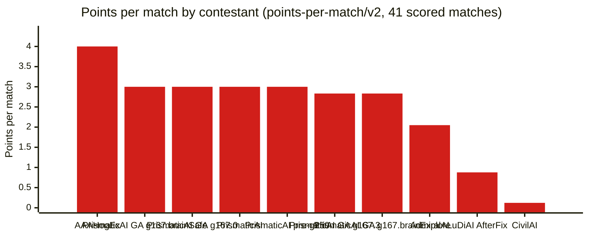
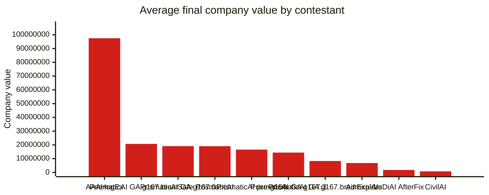
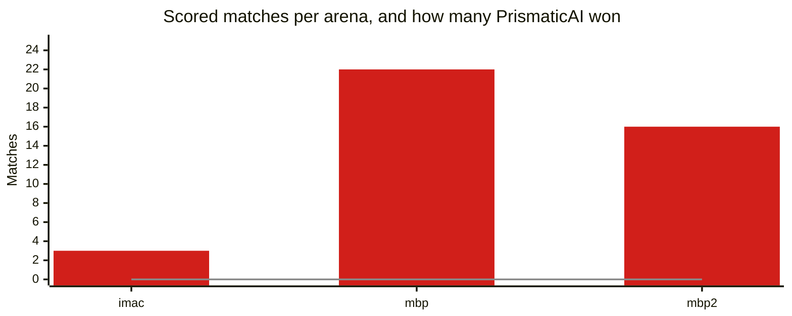

# battle-20261120T175242-48408522

Derived from `battle-20261120T175242-48408522.json` by `tools/research/ai-battle/battle.py report`; do not edit.

- Edition `484085220314d0a1`: PrismaticAI and referee at `962699034c20d90baeb9f617789ea6558cc6ff52`, base set `opengfx-8.0.tar`
- 20-year free-for-all from 1960, map 256x256 temperate, breakdowns 1
- 41 scored match(es) on `imac` (20261119-master-gdf1e05e7d8), `mbp` (20261120-master-m17653b726e), `mbp2` (20261119-master-gdf1e05e7d8)
- Replays: 1 of 1 identical to their original on another arena

| # | Contestant | Played | Wins | Points | Points/match | Avg rank | Avg final value | Squirrel errors | Matches with anomalies |
|---|---|---|---|---|---|---|---|---|---|
| 1 | AAAHogEx | 41 | 41 | 164 | 4.0 | 1.0 | 97.5 M | 0 | 0 |
| 2 | PrismaticAI GA g167.brainSafe | 6 | 0 | 18 | 3.0 | 2.0 | 20.7 M | 0 | 0 |
| 3 | PrismaticAI GA g167.0 | 8 | 0 | 24 | 3.0 | 2.0 | 19.1 M | 0 | 2 |
| 4 | PrismaticAI | 6 | 0 | 18 | 3.0 | 2.0 | 19.1 M | 0 | 0 |
| 5 | PrismaticAI pre-g150 | 9 | 0 | 27 | 3.0 | 2.0 | 16.6 M | 0 | 1 |
| 6 | PrismaticAI GA g167.3 | 6 | 0 | 17 | 2.833 | 2.17 | 14.4 M | 0 | 0 |
| 7 | PrismaticAI GA g167.brainExplore | 6 | 0 | 17 | 2.833 | 2.17 | 8.3 M | 0 | 0 |
| 8 | AdmiralAI | 41 | 0 | 84 | 2.049 | 2.95 | 6.8 M | 0 | 1 |
| 9 | LuDiAI AfterFix | 41 | 0 | 36 | 0.878 | 4.12 | 1.8 M | 0 | 1 |
| 10 | CivilAI | 41 | 0 | 5 | 0.122 | 4.88 | 759.2 k | 0 | 9 |

```mermaid
---
config:
  xyChart:
    width: 900
    height: 360
  themeVariables:
    xyChart:
      plotColorPalette: "#d11f1a, #8a8a8a, #0b0b0b, #ece4d6"
---
xychart-beta
    title "Final company value per scored match: winner vs best PrismaticAI"
    x-axis ["m-0001", "m-0002", "m-0003", "m-0004", "m-0005", "m-0006", "m-0007", "m-0008", "m-0009", "m-0010", "m-0011", "m-0012", "m-0013", "m-0014", "m-0015", "m-0016", "m-0017", "m-0018", "m-0019", "m-0020", "m-0021", "m-0022", "m-0023", "m-0024", "m-0025", "m-0026", "m-0027", "m-0028", "m-0036", "m-0037", "m-0038", "m-0039", "m-0040", "m-0041", "m-0042", "m-0043", "m-0044", "m-0050", "m-0055", "m-0059", "m-0061"]
    %% series: Winner | Best PrismaticAI
    %% links: battle-20261120T175242-48408522.md?col=Match&filter=m-0001 | battle-20261120T175242-48408522.md?col=Match&filter=m-0002 | battle-20261120T175242-48408522.md?col=Match&filter=m-0003 | battle-20261120T175242-48408522.md?col=Match&filter=m-0004 | battle-20261120T175242-48408522.md?col=Match&filter=m-0005 | battle-20261120T175242-48408522.md?col=Match&filter=m-0006 | battle-20261120T175242-48408522.md?col=Match&filter=m-0007 | battle-20261120T175242-48408522.md?col=Match&filter=m-0008 | battle-20261120T175242-48408522.md?col=Match&filter=m-0009 | battle-20261120T175242-48408522.md?col=Match&filter=m-0010 | battle-20261120T175242-48408522.md?col=Match&filter=m-0011 | battle-20261120T175242-48408522.md?col=Match&filter=m-0012 | battle-20261120T175242-48408522.md?col=Match&filter=m-0013 | battle-20261120T175242-48408522.md?col=Match&filter=m-0014 | battle-20261120T175242-48408522.md?col=Match&filter=m-0015 | battle-20261120T175242-48408522.md?col=Match&filter=m-0016 | battle-20261120T175242-48408522.md?col=Match&filter=m-0017 | battle-20261120T175242-48408522.md?col=Match&filter=m-0018 | battle-20261120T175242-48408522.md?col=Match&filter=m-0019 | battle-20261120T175242-48408522.md?col=Match&filter=m-0020 | battle-20261120T175242-48408522.md?col=Match&filter=m-0021 | battle-20261120T175242-48408522.md?col=Match&filter=m-0022 | battle-20261120T175242-48408522.md?col=Match&filter=m-0023 | battle-20261120T175242-48408522.md?col=Match&filter=m-0024 | battle-20261120T175242-48408522.md?col=Match&filter=m-0025 | battle-20261120T175242-48408522.md?col=Match&filter=m-0026 | battle-20261120T175242-48408522.md?col=Match&filter=m-0027 | battle-20261120T175242-48408522.md?col=Match&filter=m-0028 | battle-20261120T175242-48408522.md?col=Match&filter=m-0036 | battle-20261120T175242-48408522.md?col=Match&filter=m-0037 | battle-20261120T175242-48408522.md?col=Match&filter=m-0038 | battle-20261120T175242-48408522.md?col=Match&filter=m-0039 | battle-20261120T175242-48408522.md?col=Match&filter=m-0040 | battle-20261120T175242-48408522.md?col=Match&filter=m-0041 | battle-20261120T175242-48408522.md?col=Match&filter=m-0042 | battle-20261120T175242-48408522.md?col=Match&filter=m-0043 | battle-20261120T175242-48408522.md?col=Match&filter=m-0044 | battle-20261120T175242-48408522.md?col=Match&filter=m-0050 | battle-20261120T175242-48408522.md?col=Match&filter=m-0055 | battle-20261120T175242-48408522.md?col=Match&filter=m-0059 | battle-20261120T175242-48408522.md?col=Match&filter=m-0061
    y-axis "Company value" 0 --> 157000000
    bar [78778639, 88587834, 96212896, 91110577, 91769518, 74300133, 77498588, 86163336, 87895954, 60631159, 72737057, 125614616, 128073587, 95255512, 122802135, 134505937, 135651882, 73480938, 72786723, 64044978, 71163865, 57959316, 72766302, 110827792, 98054339, 122317074, 80278180, 103036142, 97114976, 130029225, 114788776, 102433961, 94979141, 129153924, 126163143, 142622849, 134740503, 92408828, 78494005, 88938994, 91192041]
    line [19122331, 18536162, 25267062, 6955660, 12021880, 18404330, 12280312, 17894228, 18369054, 10658740, 14051165, 22428704, 21644037, 26428065, 26953943, 4775559, 26206848, 20343778, 17375065, 18611592, 21065770, 12139572, 16038821, 14529817, 17430587, 14830641, 13179178, 2870119, 15681871, 6312618, 16191594, 19541505, 12278050, 6598278, 22938263, 29471514, 24447448, 15866232, 12348589, 11484762, 13307091]
```

<!-- battle-charts:begin -->
<!-- derived from battle-20261120T175242-48408522.json by `battle.py render`; `battle.py check` fails when it is stale -->

<!-- battle-charts:end -->

| Seed | Original | Replay | Arenas | Identical |
|---|---|---|---|---|
| 245071539 | m-0018 | m-0056 | mbp2 / mbp | yes |

| Match | Arena | Seed | Winner | Value | Last | Anomalies |
|---|---|---|---|---|---|---|
| m-0001 | mbp | 1943729777 | AAAHogEx | 78.8 M | CivilAI | - |
| m-0002 | mbp | 1943729777 | AAAHogEx | 88.6 M | CivilAI | - |
| m-0003 | mbp | 1943729777 | AAAHogEx | 96.2 M | CivilAI | - |
| m-0004 | mbp | 1943729777 | AAAHogEx | 91.1 M | CivilAI | - |
| m-0005 | mbp | 1943729777 | AAAHogEx | 91.8 M | CivilAI | CivilAI: fleet_drop:10->2 |
| m-0006 | mbp | 130774943 | AAAHogEx | 74.3 M | CivilAI | - |
| m-0007 | mbp | 130774943 | AAAHogEx | 77.5 M | CivilAI | - |
| m-0008 | mbp | 130774943 | AAAHogEx | 86.2 M | CivilAI | - |
| m-0009 | mbp | 130774943 | AAAHogEx | 87.9 M | LuDiAI AfterFix | - |
| m-0010 | imac | 130774943 | AAAHogEx | 60.6 M | CivilAI | - |
| m-0011 | imac | 130774943 | AAAHogEx | 72.7 M | CivilAI | - |
| m-0012 | imac | 955543587 | AAAHogEx | 125.6 M | CivilAI | - |
| m-0013 | mbp2 | 955543587 | AAAHogEx | 128.1 M | CivilAI | - |
| m-0014 | mbp2 | 955543587 | AAAHogEx | 95.3 M | CivilAI | - |
| m-0015 | mbp2 | 955543587 | AAAHogEx | 122.8 M | CivilAI | - |
| m-0016 | mbp2 | 955543587 | AAAHogEx | 134.5 M | CivilAI | - |
| m-0017 | mbp2 | 955543587 | AAAHogEx | 135.7 M | CivilAI | CivilAI: fleet_drop:55->37 |
| m-0018 | mbp2 | 245071539 | AAAHogEx | 73.5 M | CivilAI | - |
| m-0019 | mbp2 | 245071539 | AAAHogEx | 72.8 M | CivilAI | CivilAI: fleet_drop:52->28 |
| m-0020 | mbp2 | 245071539 | AAAHogEx | 64.0 M | CivilAI | - |
| m-0021 | mbp2 | 245071539 | AAAHogEx | 71.2 M | CivilAI | - |
| m-0022 | mbp2 | 245071539 | AAAHogEx | 58.0 M | CivilAI | - |
| m-0023 | mbp2 | 245071539 | AAAHogEx | 72.8 M | LuDiAI AfterFix | - |
| m-0024 | mbp2 | 1823183648 | AAAHogEx | 110.8 M | LuDiAI AfterFix | - |
| m-0025 | mbp2 | 1823183648 | AAAHogEx | 98.1 M | CivilAI | PrismaticAI pre-g150: fleet_drop:81->55 |
| m-0026 | mbp2 | 1823183648 | AAAHogEx | 122.3 M | CivilAI | - |
| m-0027 | mbp2 | 1823183648 | AAAHogEx | 80.3 M | CivilAI | CivilAI: fleet_drop:46->30 |
| m-0028 | mbp2 | 1823183648 | AAAHogEx | 103.0 M | LuDiAI AfterFix | - |
| m-0036 | mbp | 768449236 | AAAHogEx | 97.1 M | CivilAI | CivilAI: fleet_drop:72->41 |
| m-0037 | mbp | 768449236 | AAAHogEx | 130.0 M | CivilAI | CivilAI: fleet_drop:49->20 |
| m-0038 | mbp | 768449236 | AAAHogEx | 114.8 M | CivilAI | LuDiAI AfterFix: fleet_drop:261->165; CivilAI: fleet_drop:30->19 |
| m-0039 | mbp | 768449236 | AAAHogEx | 102.4 M | LuDiAI AfterFix | CivilAI: fleet_drop:56->29 |
| m-0040 | mbp | 768449236 | AAAHogEx | 95.0 M | CivilAI | - |
| m-0041 | mbp | 768449236 | AAAHogEx | 129.2 M | CivilAI | - |
| m-0042 | mbp | 242367154 | AAAHogEx | 126.2 M | CivilAI | - |
| m-0043 | mbp | 242367154 | AAAHogEx | 142.6 M | CivilAI | - |
| m-0044 | mbp | 242367154 | AAAHogEx | 134.7 M | CivilAI | PrismaticAI GA g167.0: fleet_drop:104->72 |
| m-0050 | mbp | 776280809 | AAAHogEx | 92.4 M | CivilAI | PrismaticAI GA g167.0: fleet_drop:90->56 |
| m-0055 | mbp | 630931130 | AAAHogEx | 78.5 M | CivilAI | AdmiralAI: fleet_drop:176->109; CivilAI: fleet_drop:53->24 |
| m-0056 (replay) | mbp | 245071539 | AAAHogEx | 73.5 M | CivilAI | - |
| m-0059 | mbp | 630931130 | AAAHogEx | 88.9 M | CivilAI | - |
| m-0061 | mbp | 1925236526 | AAAHogEx | 91.2 M | CivilAI | - |
