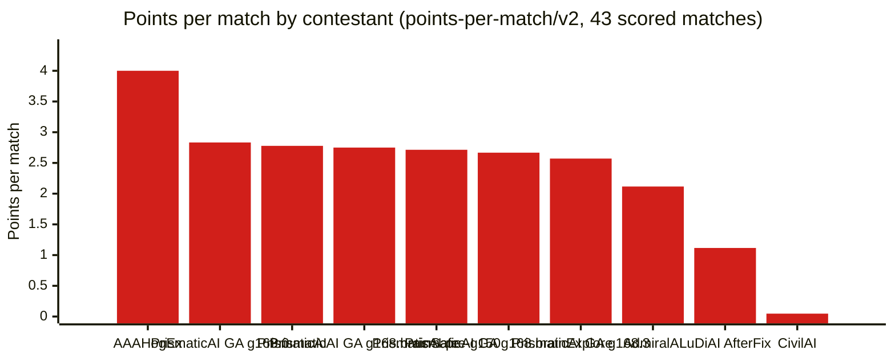
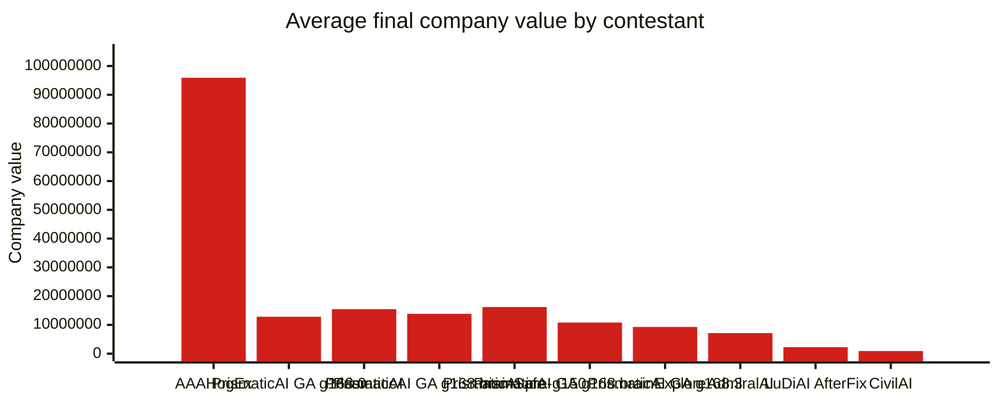
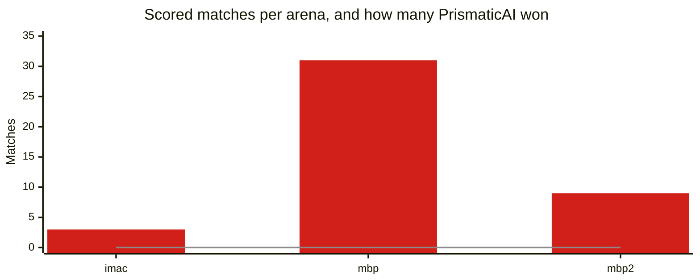

# battle-20261120T180556-a1a8bd94

Derived from `battle-20261120T180556-a1a8bd94.json` by `tools/research/ai-battle/battle.py report`; do not edit.

- Edition `a1a8bd941c6620a9`: PrismaticAI and referee at `962699034c20d90baeb9f617789ea6558cc6ff52`, base set `opengfx-8.0.tar`
- 20-year free-for-all from 1960, map 256x256 temperate, breakdowns 1
- 43 scored match(es) on `imac` (20261119-master-gdf1e05e7d8), `mbp` (20261120-master-m17653b726e), `mbp2` (20261119-master-gdf1e05e7d8)
- Replays: 2 of 3 identical to their original on another arena

| # | Contestant | Played | Wins | Points | Points/match | Avg rank | Avg final value | Squirrel errors | Matches with anomalies |
|---|---|---|---|---|---|---|---|---|---|
| 1 | AAAHogEx | 43 | 43 | 172 | 4.0 | 1.0 | 95.9 M | 0 | 0 |
| 2 | PrismaticAI GA g168.0 | 6 | 0 | 17 | 2.833 | 2.17 | 12.8 M | 0 | 4 |
| 3 | PrismaticAI | 9 | 0 | 25 | 2.778 | 2.22 | 15.5 M | 0 | 0 |
| 4 | PrismaticAI GA g168.brainSafe | 8 | 0 | 22 | 2.75 | 2.25 | 13.8 M | 0 | 2 |
| 5 | PrismaticAI pre-g150 | 7 | 0 | 19 | 2.714 | 2.29 | 16.2 M | 0 | 3 |
| 6 | PrismaticAI GA g168.brainExplore | 6 | 0 | 16 | 2.667 | 2.33 | 10.8 M | 0 | 2 |
| 7 | PrismaticAI GA g168.3 | 7 | 0 | 18 | 2.571 | 2.43 | 9.3 M | 0 | 2 |
| 8 | AdmiralAI | 43 | 0 | 91 | 2.116 | 2.88 | 7.1 M | 0 | 4 |
| 9 | LuDiAI AfterFix | 43 | 0 | 48 | 1.116 | 3.88 | 2.2 M | 0 | 2 |
| 10 | CivilAI | 43 | 0 | 2 | 0.047 | 4.95 | 910.2 k | 33 | 7 |

```mermaid
---
config:
  xyChart:
    width: 900
    height: 360
  themeVariables:
    xyChart:
      plotColorPalette: "#d11f1a, #8a8a8a, #0b0b0b, #ece4d6"
---
xychart-beta
    title "Final company value per scored match: winner vs best PrismaticAI"
    x-axis ["m-0001", "m-0002", "m-0003", "m-0004", "m-0005", "m-0006", "m-0007", "m-0008", "m-0009", "m-0010", "m-0011", "m-0012", "m-0013", "m-0014", "m-0015", "m-0018", "m-0022", "m-0024", "m-0025", "m-0036", "m-0037", "m-0038", "m-0039", "m-0040", "m-0041", "m-0042", "m-0043", "m-0044", "m-0045", "m-0046", "m-0047", "m-0053", "m-0054", "m-0055", "m-0057", "m-0058", "m-0059", "m-0060", "m-0063", "m-0065", "m-0066", "m-0068", "m-0069"]
    %% series: Winner | Best PrismaticAI
    %% links: battle-20261120T180556-a1a8bd94.md?col=Match&filter=m-0001 | battle-20261120T180556-a1a8bd94.md?col=Match&filter=m-0002 | battle-20261120T180556-a1a8bd94.md?col=Match&filter=m-0003 | battle-20261120T180556-a1a8bd94.md?col=Match&filter=m-0004 | battle-20261120T180556-a1a8bd94.md?col=Match&filter=m-0005 | battle-20261120T180556-a1a8bd94.md?col=Match&filter=m-0006 | battle-20261120T180556-a1a8bd94.md?col=Match&filter=m-0007 | battle-20261120T180556-a1a8bd94.md?col=Match&filter=m-0008 | battle-20261120T180556-a1a8bd94.md?col=Match&filter=m-0009 | battle-20261120T180556-a1a8bd94.md?col=Match&filter=m-0010 | battle-20261120T180556-a1a8bd94.md?col=Match&filter=m-0011 | battle-20261120T180556-a1a8bd94.md?col=Match&filter=m-0012 | battle-20261120T180556-a1a8bd94.md?col=Match&filter=m-0013 | battle-20261120T180556-a1a8bd94.md?col=Match&filter=m-0014 | battle-20261120T180556-a1a8bd94.md?col=Match&filter=m-0015 | battle-20261120T180556-a1a8bd94.md?col=Match&filter=m-0018 | battle-20261120T180556-a1a8bd94.md?col=Match&filter=m-0022 | battle-20261120T180556-a1a8bd94.md?col=Match&filter=m-0024 | battle-20261120T180556-a1a8bd94.md?col=Match&filter=m-0025 | battle-20261120T180556-a1a8bd94.md?col=Match&filter=m-0036 | battle-20261120T180556-a1a8bd94.md?col=Match&filter=m-0037 | battle-20261120T180556-a1a8bd94.md?col=Match&filter=m-0038 | battle-20261120T180556-a1a8bd94.md?col=Match&filter=m-0039 | battle-20261120T180556-a1a8bd94.md?col=Match&filter=m-0040 | battle-20261120T180556-a1a8bd94.md?col=Match&filter=m-0041 | battle-20261120T180556-a1a8bd94.md?col=Match&filter=m-0042 | battle-20261120T180556-a1a8bd94.md?col=Match&filter=m-0043 | battle-20261120T180556-a1a8bd94.md?col=Match&filter=m-0044 | battle-20261120T180556-a1a8bd94.md?col=Match&filter=m-0045 | battle-20261120T180556-a1a8bd94.md?col=Match&filter=m-0046 | battle-20261120T180556-a1a8bd94.md?col=Match&filter=m-0047 | battle-20261120T180556-a1a8bd94.md?col=Match&filter=m-0053 | battle-20261120T180556-a1a8bd94.md?col=Match&filter=m-0054 | battle-20261120T180556-a1a8bd94.md?col=Match&filter=m-0055 | battle-20261120T180556-a1a8bd94.md?col=Match&filter=m-0057 | battle-20261120T180556-a1a8bd94.md?col=Match&filter=m-0058 | battle-20261120T180556-a1a8bd94.md?col=Match&filter=m-0059 | battle-20261120T180556-a1a8bd94.md?col=Match&filter=m-0060 | battle-20261120T180556-a1a8bd94.md?col=Match&filter=m-0063 | battle-20261120T180556-a1a8bd94.md?col=Match&filter=m-0065 | battle-20261120T180556-a1a8bd94.md?col=Match&filter=m-0066 | battle-20261120T180556-a1a8bd94.md?col=Match&filter=m-0068 | battle-20261120T180556-a1a8bd94.md?col=Match&filter=m-0069
    y-axis "Company value" 0 --> 138000000
    bar [106747326, 107269256, 125347380, 105649480, 111368146, 67799422, 75332865, 83042504, 75007003, 96965598, 76223410, 90614397, 94892858, 91344849, 73860717, 99164549, 120479105, 91845532, 84463315, 85728188, 97040320, 100956672, 87406259, 109704688, 96727684, 79812704, 81652322, 116583267, 108955307, 77028370, 98415443, 94406375, 95217181, 85061792, 87485844, 84789888, 94113293, 117907272, 108479284, 104693238, 120876669, 95035908, 118302910]
    line [30272970, 23183926, 14453619, 7275020, 17597907, 13913632, 12608793, 10369537, 15042607, 10735859, 6488987, 15698208, 9671664, 16878420, 18377089, 21266564, 14458875, 27351191, 21310790, 4735938, 1349134, 2147416, 1556050, 4951849, 2144083, 12241004, 18368040, 8318841, 13628215, 14630171, 9230356, 13620097, 13154778, 19862318, 22348299, 12806932, 8090898, 13886313, 11951222, 7827203, 16953623, 16132428, 13438111]
```

<!-- battle-charts:begin -->
<!-- derived from battle-20261120T180556-a1a8bd94.json by `battle.py render`; `battle.py check` fails when it is stale -->

<!-- battle-charts:end -->

| Seed | Original | Replay | Arenas | Identical |
|---|---|---|---|---|
| 818912097 | m-0013 | m-0048 | mbp2 / mbp | yes |
| 1066803111 | m-0001 | m-0056 | mbp / mbp2 | yes |
| 1994585749 | m-0010 | m-0064 | imac / mbp | NO |

| Match | Arena | Seed | Winner | Value | Last | Anomalies |
|---|---|---|---|---|---|---|
| m-0001 | mbp | 1066803111 | AAAHogEx | 106.7 M | CivilAI | LuDiAI AfterFix: fleet_drop:203->141 |
| m-0002 | mbp | 1066803111 | AAAHogEx | 107.3 M | CivilAI | PrismaticAI GA g168.0: fleet_drop:138->88; AdmiralAI: fleet_drop:222->136 |
| m-0003 | mbp | 1066803111 | AAAHogEx | 125.3 M | CivilAI | PrismaticAI GA g168.brainSafe: fleet_drop:130->89; CivilAI: fleet_drop:31->21 |
| m-0004 | mbp | 1066803111 | AAAHogEx | 105.6 M | CivilAI | PrismaticAI GA g168.brainExplore: fleet_drop:173->118; CivilAI: fleet_drop:34->15 |
| m-0005 | mbp | 1066803111 | AAAHogEx | 111.4 M | CivilAI | AdmiralAI: fleet_drop:297->135 |
| m-0006 | mbp | 1994585749 | AAAHogEx | 67.8 M | CivilAI | AdmiralAI: fleet_drop:461->304; CivilAI: fleet_drop:33->22 |
| m-0007 | mbp | 1994585749 | AAAHogEx | 75.3 M | CivilAI | - |
| m-0008 | mbp | 1994585749 | AAAHogEx | 83.0 M | CivilAI | - |
| m-0009 | mbp | 1994585749 | AAAHogEx | 75.0 M | CivilAI | - |
| m-0010 | imac | 1994585749 | AAAHogEx | 97.0 M | CivilAI | - |
| m-0011 | imac | 1994585749 | AAAHogEx | 76.2 M | CivilAI | CivilAI: fleet_drop:69->40 |
| m-0012 | imac | 818912097 | AAAHogEx | 90.6 M | CivilAI | - |
| m-0013 | mbp2 | 818912097 | AAAHogEx | 94.9 M | CivilAI | - |
| m-0014 | mbp2 | 818912097 | AAAHogEx | 91.3 M | CivilAI | - |
| m-0015 | mbp2 | 818912097 | AAAHogEx | 73.9 M | CivilAI | - |
| m-0018 | mbp2 | 430156832 | AAAHogEx | 99.2 M | CivilAI | AdmiralAI: fleet_drop:262->177 |
| m-0022 | mbp2 | 430156832 | AAAHogEx | 120.5 M | CivilAI | - |
| m-0024 | mbp2 | 610227163 | AAAHogEx | 91.8 M | CivilAI | - |
| m-0025 | mbp2 | 610227163 | AAAHogEx | 84.5 M | CivilAI | PrismaticAI pre-g150: fleet_drop:134->82 |
| m-0036 | mbp | 1408228026 | AAAHogEx | 85.7 M | CivilAI | - |
| m-0037 | mbp | 1408228026 | AAAHogEx | 97.0 M | CivilAI | PrismaticAI pre-g150: fleet_drop:67->39 |
| m-0038 | mbp | 1408228026 | AAAHogEx | 101.0 M | CivilAI | PrismaticAI GA g168.0: fleet_drop:53->30 |
| m-0039 | mbp | 1408228026 | AAAHogEx | 87.4 M | CivilAI | PrismaticAI GA g168.brainSafe: fleet_drop:38->13; CivilAI: fleet_drop:29->16 |
| m-0040 | mbp | 1408228026 | AAAHogEx | 109.7 M | CivilAI | PrismaticAI GA g168.brainExplore: fleet_drop:55->36 |
| m-0041 | mbp | 1408228026 | AAAHogEx | 96.7 M | CivilAI | - |
| m-0042 | mbp | 816794856 | AAAHogEx | 79.8 M | CivilAI | CivilAI: fleet_drop:54->26 |
| m-0043 | mbp | 816794856 | AAAHogEx | 81.7 M | CivilAI | - |
| m-0044 | mbp | 816794856 | AAAHogEx | 116.6 M | LuDiAI AfterFix | PrismaticAI GA g168.0: fleet_drop:101->64 |
| m-0045 | mbp | 816794856 | AAAHogEx | 109.0 M | CivilAI | CivilAI: squirrel_errors:33 |
| m-0046 | mbp | 816794856 | AAAHogEx | 77.0 M | CivilAI | - |
| m-0047 | mbp | 816794856 | AAAHogEx | 98.4 M | CivilAI | - |
| m-0048 (replay) | mbp | 818912097 | AAAHogEx | 94.9 M | CivilAI | - |
| m-0053 | mbp | 1003563497 | AAAHogEx | 94.4 M | CivilAI | - |
| m-0054 | mbp | 1284698018 | AAAHogEx | 95.2 M | CivilAI | - |
| m-0055 | mbp | 1284698018 | AAAHogEx | 85.1 M | CivilAI | PrismaticAI pre-g150: fleet_drop:58->36 |
| m-0056 (replay) | mbp2 | 1066803111 | AAAHogEx | 106.7 M | CivilAI | LuDiAI AfterFix: fleet_drop:203->141 |
| m-0057 | mbp2 | 1284698018 | AAAHogEx | 87.5 M | CivilAI | - |
| m-0058 | mbp2 | 1284698018 | AAAHogEx | 84.8 M | CivilAI | - |
| m-0059 | mbp | 1284698018 | AAAHogEx | 94.1 M | CivilAI | PrismaticAI GA g168.3: fleet_drop:83->58 |
| m-0060 | mbp | 984084698 | AAAHogEx | 117.9 M | CivilAI | - |
| m-0063 | mbp | 984084698 | AAAHogEx | 108.5 M | CivilAI | - |
| m-0064 (replay) | mbp | 1994585749 | AAAHogEx | 83.9 M | CivilAI | AdmiralAI: squirrel_errors:70, fleet_drop:239->157 |
| m-0065 | mbp | 984084698 | AAAHogEx | 104.7 M | CivilAI | PrismaticAI GA g168.3: fleet_drop:84->53 |
| m-0066 | mbp | 745806803 | AAAHogEx | 120.9 M | CivilAI | - |
| m-0068 | mbp | 745806803 | AAAHogEx | 95.0 M | LuDiAI AfterFix | PrismaticAI GA g168.0: fleet_drop:111->72; LuDiAI AfterFix: fleet_drop:60->30 |
| m-0069 | mbp | 745806803 | AAAHogEx | 118.3 M | CivilAI | - |
