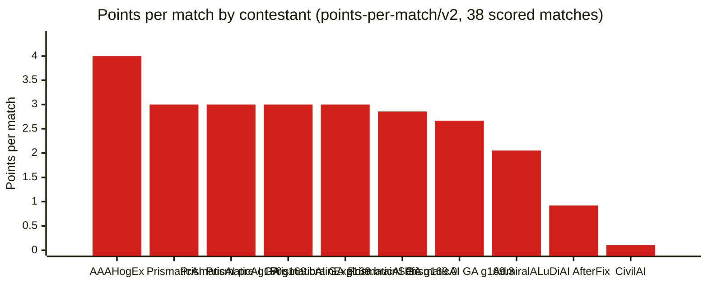
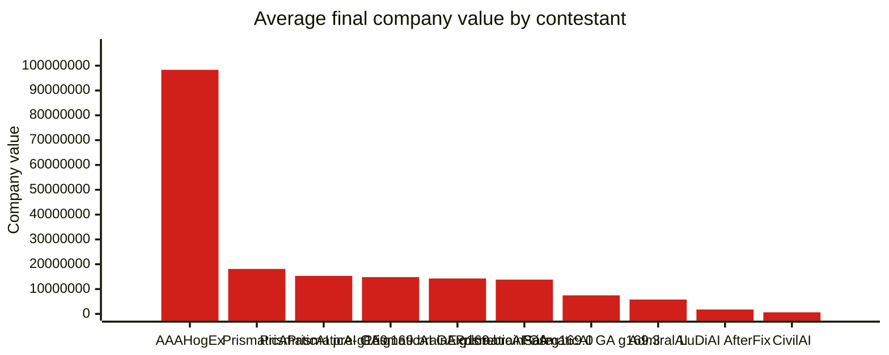
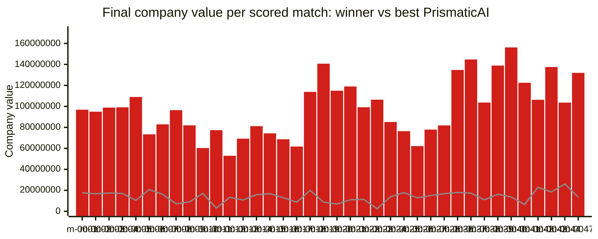
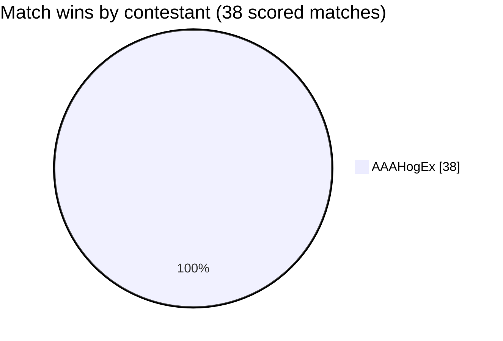
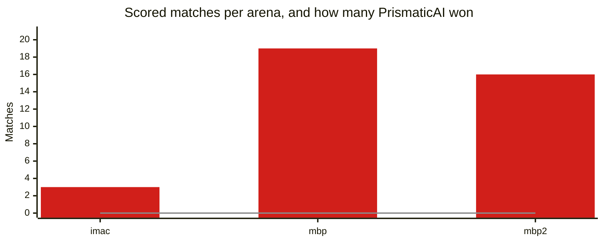

# battle-20261120T181523-ed722d1d

Derived from `battle-20261120T181523-ed722d1d.json` by `tools/research/ai-battle/battle.py report`; do not edit.

- Edition `ed722d1da6d25f81`: PrismaticAI and referee at `962699034c20d90baeb9f617789ea6558cc6ff52`, base set `opengfx-8.0.tar`
- 20-year free-for-all from 1960, map 256x256 temperate, breakdowns 1
- 38 scored match(es) on `imac` (20261119-master-gdf1e05e7d8), `mbp` (20261120-master-m17653b726e), `mbp2` (20261119-master-gdf1e05e7d8)
- Replays: 0 of 1 identical to their original on another arena

| # | Contestant | Played | Wins | Points | Points/match | Avg rank | Avg final value | Squirrel errors | Matches with anomalies |
|---|---|---|---|---|---|---|---|---|---|
| 1 | AAAHogEx | 38 | 38 | 152 | 4.0 | 1.0 | 98.3 M | 0 | 0 |
| 2 | PrismaticAI | 6 | 0 | 18 | 3.0 | 2.0 | 18.1 M | 0 | 0 |
| 3 | PrismaticAI pre-g150 | 7 | 0 | 21 | 3.0 | 2.0 | 15.3 M | 0 | 5 |
| 4 | PrismaticAI GA g169.brainExplore | 6 | 0 | 18 | 3.0 | 2.0 | 14.8 M | 0 | 3 |
| 5 | PrismaticAI GA g169.brainSafe | 6 | 0 | 18 | 3.0 | 2.0 | 14.3 M | 0 | 0 |
| 6 | PrismaticAI GA g169.0 | 7 | 0 | 20 | 2.857 | 2.14 | 13.8 M | 0 | 0 |
| 7 | PrismaticAI GA g169.3 | 6 | 0 | 16 | 2.667 | 2.33 | 7.5 M | 0 | 1 |
| 8 | AdmiralAI | 38 | 0 | 78 | 2.053 | 2.95 | 5.8 M | 44 | 3 |
| 9 | LuDiAI AfterFix | 38 | 0 | 35 | 0.921 | 4.08 | 1.8 M | 0 | 1 |
| 10 | CivilAI | 38 | 0 | 4 | 0.105 | 4.89 | 633.1 k | 0 | 7 |

<!-- battle-charts:begin -->
<!-- derived from battle-20261120T181523-ed722d1d.json by `battle.py render`; `battle.py check` fails when it is stale -->

<!-- battle-charts:end -->

| Seed | Original | Replay | Arenas | Identical |
|---|---|---|---|---|
| 743294632 | m-0010 | m-0048 | imac / mbp | NO |

| Match | Arena | Seed | Winner | Value | Last | Anomalies |
|---|---|---|---|---|---|---|
| m-0001 | mbp | 1017292857 | AAAHogEx | 96.8 M | CivilAI | PrismaticAI pre-g150: fleet_drop:143->93 |
| m-0002 | mbp | 1017292857 | AAAHogEx | 94.9 M | CivilAI | AdmiralAI: squirrel_errors:44 |
| m-0003 | mbp | 1017292857 | AAAHogEx | 98.8 M | CivilAI | AdmiralAI: fleet_drop:151->105 |
| m-0004 | mbp | 1017292857 | AAAHogEx | 99.1 M | CivilAI | PrismaticAI GA g169.brainExplore: fleet_drop:128->84 |
| m-0005 | mbp | 1017292857 | AAAHogEx | 109.0 M | CivilAI | - |
| m-0006 | mbp | 743294632 | AAAHogEx | 73.3 M | CivilAI | - |
| m-0007 | mbp | 743294632 | AAAHogEx | 82.9 M | CivilAI | PrismaticAI pre-g150: fleet_drop:112->65 |
| m-0008 | mbp | 743294632 | AAAHogEx | 96.4 M | CivilAI | - |
| m-0009 | mbp | 743294632 | AAAHogEx | 81.9 M | CivilAI | AdmiralAI: fleet_drop:424->225; CivilAI: fleet_drop:27->14 |
| m-0010 | imac | 743294632 | AAAHogEx | 60.3 M | CivilAI | - |
| m-0011 | imac | 743294632 | AAAHogEx | 77.3 M | CivilAI | PrismaticAI GA g169.3: fleet_drop:128->59 |
| m-0012 | imac | 661590268 | AAAHogEx | 52.9 M | CivilAI | CivilAI: fleet_drop:16->7 |
| m-0013 | mbp2 | 661590268 | AAAHogEx | 69.2 M | CivilAI | PrismaticAI pre-g150: fleet_drop:71->35; CivilAI: no_vehicles |
| m-0014 | mbp2 | 661590268 | AAAHogEx | 81.2 M | CivilAI | CivilAI: fleet_drop:24->16 |
| m-0015 | mbp2 | 661590268 | AAAHogEx | 74.3 M | CivilAI | - |
| m-0016 | mbp2 | 661590268 | AAAHogEx | 68.7 M | CivilAI | - |
| m-0017 | mbp2 | 661590268 | AAAHogEx | 61.7 M | CivilAI | - |
| m-0018 | mbp2 | 838807912 | AAAHogEx | 113.8 M | LuDiAI AfterFix | - |
| m-0019 | mbp2 | 838807912 | AAAHogEx | 140.7 M | LuDiAI AfterFix | LuDiAI AfterFix: fleet_drop:70->43 |
| m-0020 | mbp2 | 838807912 | AAAHogEx | 114.9 M | CivilAI | - |
| m-0021 | mbp2 | 838807912 | AAAHogEx | 119.0 M | CivilAI | - |
| m-0022 | mbp2 | 838807912 | AAAHogEx | 99.2 M | CivilAI | PrismaticAI GA g169.brainExplore: fleet_drop:120->45; CivilAI: fleet_drop:75->50 |
| m-0023 | mbp2 | 838807912 | AAAHogEx | 106.4 M | LuDiAI AfterFix | - |
| m-0024 | mbp2 | 421254588 | AAAHogEx | 85.1 M | LuDiAI AfterFix | - |
| m-0025 | mbp2 | 421254588 | AAAHogEx | 76.4 M | CivilAI | PrismaticAI pre-g150: fleet_drop:88->59 |
| m-0026 | mbp2 | 421254588 | AAAHogEx | 62.2 M | CivilAI | - |
| m-0027 | mbp2 | 421254588 | AAAHogEx | 77.9 M | CivilAI | CivilAI: fleet_drop:74->24 |
| m-0028 | mbp2 | 421254588 | AAAHogEx | 81.9 M | CivilAI | PrismaticAI GA g169.brainExplore: fleet_drop:102->65 |
| m-0036 | mbp | 1567694431 | AAAHogEx | 134.7 M | CivilAI | - |
| m-0037 | mbp | 1567694431 | AAAHogEx | 144.7 M | CivilAI | - |
| m-0038 | mbp | 1567694431 | AAAHogEx | 103.7 M | CivilAI | CivilAI: fleet_drop:32->22 |
| m-0039 | mbp | 1567694431 | AAAHogEx | 138.9 M | CivilAI | - |
| m-0040 | mbp | 1567694431 | AAAHogEx | 156.2 M | CivilAI | - |
| m-0041 | mbp | 1567694431 | AAAHogEx | 122.5 M | CivilAI | - |
| m-0042 | mbp | 1537199971 | AAAHogEx | 106.3 M | CivilAI | - |
| m-0043 | mbp | 1537199971 | AAAHogEx | 137.5 M | CivilAI | PrismaticAI pre-g150: fleet_drop:121->69 |
| m-0044 | mbp | 1537199971 | AAAHogEx | 103.6 M | CivilAI | - |
| m-0047 | mbp | 1537199971 | AAAHogEx | 132.0 M | CivilAI | - |
| m-0048 (replay) | mbp | 743294632 | AAAHogEx | 63.9 M | CivilAI | - |
