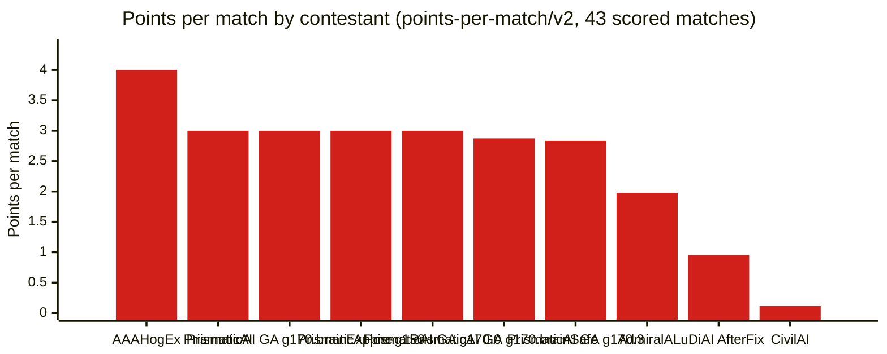
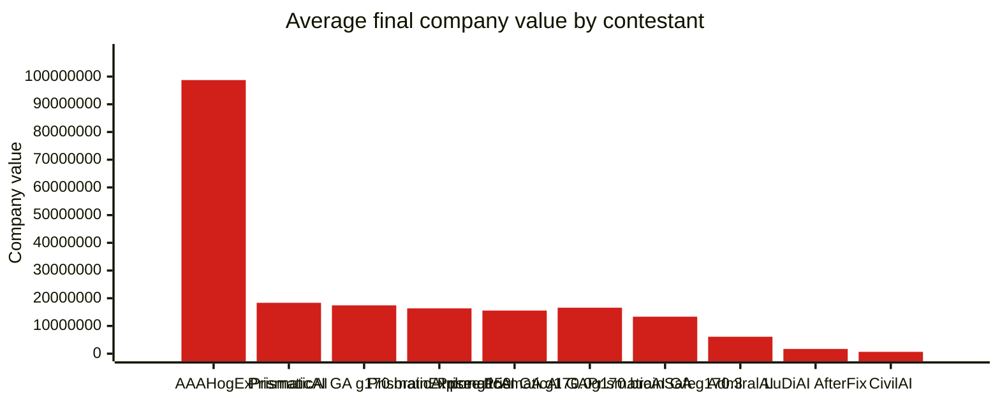
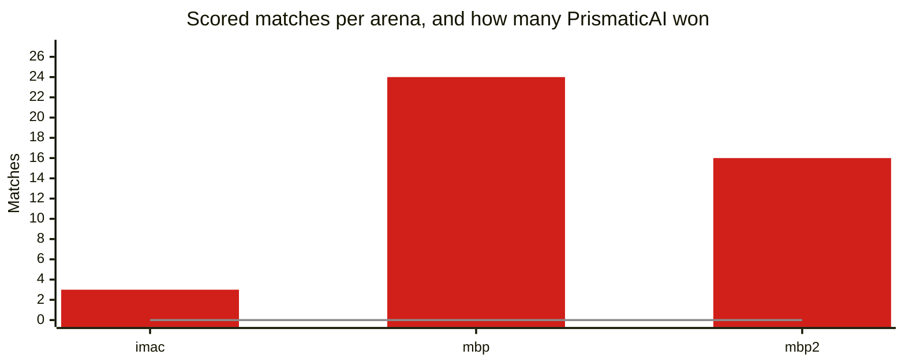

# battle-20261120T182523-e4ae7afe

Derived from `battle-20261120T182523-e4ae7afe.json` by `tools/research/ai-battle/battle.py report`; do not edit.

- Edition `e4ae7afe4cfb17e9`: PrismaticAI and referee at `962699034c20d90baeb9f617789ea6558cc6ff52`, base set `opengfx-8.0.tar`
- 20-year free-for-all from 1960, map 256x256 temperate, breakdowns 1
- 43 scored match(es) on `imac` (20261119-master-gdf1e05e7d8), `mbp` (20261120-master-m17653b726e), `mbp2` (20261119-master-gdf1e05e7d8)
- Replays: 0 of 2 identical to their original on another arena

| # | Contestant | Played | Wins | Points | Points/match | Avg rank | Avg final value | Squirrel errors | Matches with anomalies |
|---|---|---|---|---|---|---|---|---|---|
| 1 | AAAHogEx | 43 | 43 | 172 | 4.0 | 1.0 | 98.7 M | 0 | 0 |
| 2 | PrismaticAI | 6 | 0 | 18 | 3.0 | 2.0 | 18.4 M | 0 | 0 |
| 3 | PrismaticAI GA g170.brainExplore | 7 | 0 | 21 | 3.0 | 2.0 | 17.4 M | 0 | 1 |
| 4 | PrismaticAI pre-g150 | 9 | 0 | 27 | 3.0 | 2.0 | 16.3 M | 0 | 5 |
| 5 | PrismaticAI GA g170.0 | 7 | 0 | 21 | 3.0 | 2.0 | 15.6 M | 0 | 1 |
| 6 | PrismaticAI GA g170.brainSafe | 8 | 0 | 23 | 2.875 | 2.12 | 16.6 M | 0 | 3 |
| 7 | PrismaticAI GA g170.3 | 6 | 0 | 17 | 2.833 | 2.17 | 13.3 M | 0 | 1 |
| 8 | AdmiralAI | 43 | 0 | 85 | 1.977 | 3.02 | 6.1 M | 0 | 2 |
| 9 | LuDiAI AfterFix | 43 | 0 | 41 | 0.953 | 4.05 | 1.7 M | 0 | 2 |
| 10 | CivilAI | 43 | 0 | 5 | 0.116 | 4.88 | 661.5 k | 37 | 11 |

```mermaid
---
config:
  xyChart:
    width: 900
    height: 360
  themeVariables:
    xyChart:
      plotColorPalette: "#d11f1a, #8a8a8a, #0b0b0b, #ece4d6"
---
xychart-beta
    title "Final company value per scored match: winner vs best PrismaticAI"
    x-axis ["m-0001", "m-0002", "m-0003", "m-0004", "m-0005", "m-0006", "m-0007", "m-0008", "m-0009", "m-0010", "m-0011", "m-0012", "m-0013", "m-0014", "m-0015", "m-0016", "m-0017", "m-0018", "m-0019", "m-0020", "m-0021", "m-0022", "m-0023", "m-0024", "m-0025", "m-0026", "m-0027", "m-0028", "m-0036", "m-0037", "m-0038", "m-0039", "m-0040", "m-0041", "m-0042", "m-0043", "m-0044", "m-0045", "m-0046", "m-0047", "m-0049", "m-0055", "m-0057"]
    %% series: Winner | Best PrismaticAI
    %% links: battle-20261120T182523-e4ae7afe.md?col=Match&filter=m-0001 | battle-20261120T182523-e4ae7afe.md?col=Match&filter=m-0002 | battle-20261120T182523-e4ae7afe.md?col=Match&filter=m-0003 | battle-20261120T182523-e4ae7afe.md?col=Match&filter=m-0004 | battle-20261120T182523-e4ae7afe.md?col=Match&filter=m-0005 | battle-20261120T182523-e4ae7afe.md?col=Match&filter=m-0006 | battle-20261120T182523-e4ae7afe.md?col=Match&filter=m-0007 | battle-20261120T182523-e4ae7afe.md?col=Match&filter=m-0008 | battle-20261120T182523-e4ae7afe.md?col=Match&filter=m-0009 | battle-20261120T182523-e4ae7afe.md?col=Match&filter=m-0010 | battle-20261120T182523-e4ae7afe.md?col=Match&filter=m-0011 | battle-20261120T182523-e4ae7afe.md?col=Match&filter=m-0012 | battle-20261120T182523-e4ae7afe.md?col=Match&filter=m-0013 | battle-20261120T182523-e4ae7afe.md?col=Match&filter=m-0014 | battle-20261120T182523-e4ae7afe.md?col=Match&filter=m-0015 | battle-20261120T182523-e4ae7afe.md?col=Match&filter=m-0016 | battle-20261120T182523-e4ae7afe.md?col=Match&filter=m-0017 | battle-20261120T182523-e4ae7afe.md?col=Match&filter=m-0018 | battle-20261120T182523-e4ae7afe.md?col=Match&filter=m-0019 | battle-20261120T182523-e4ae7afe.md?col=Match&filter=m-0020 | battle-20261120T182523-e4ae7afe.md?col=Match&filter=m-0021 | battle-20261120T182523-e4ae7afe.md?col=Match&filter=m-0022 | battle-20261120T182523-e4ae7afe.md?col=Match&filter=m-0023 | battle-20261120T182523-e4ae7afe.md?col=Match&filter=m-0024 | battle-20261120T182523-e4ae7afe.md?col=Match&filter=m-0025 | battle-20261120T182523-e4ae7afe.md?col=Match&filter=m-0026 | battle-20261120T182523-e4ae7afe.md?col=Match&filter=m-0027 | battle-20261120T182523-e4ae7afe.md?col=Match&filter=m-0028 | battle-20261120T182523-e4ae7afe.md?col=Match&filter=m-0036 | battle-20261120T182523-e4ae7afe.md?col=Match&filter=m-0037 | battle-20261120T182523-e4ae7afe.md?col=Match&filter=m-0038 | battle-20261120T182523-e4ae7afe.md?col=Match&filter=m-0039 | battle-20261120T182523-e4ae7afe.md?col=Match&filter=m-0040 | battle-20261120T182523-e4ae7afe.md?col=Match&filter=m-0041 | battle-20261120T182523-e4ae7afe.md?col=Match&filter=m-0042 | battle-20261120T182523-e4ae7afe.md?col=Match&filter=m-0043 | battle-20261120T182523-e4ae7afe.md?col=Match&filter=m-0044 | battle-20261120T182523-e4ae7afe.md?col=Match&filter=m-0045 | battle-20261120T182523-e4ae7afe.md?col=Match&filter=m-0046 | battle-20261120T182523-e4ae7afe.md?col=Match&filter=m-0047 | battle-20261120T182523-e4ae7afe.md?col=Match&filter=m-0049 | battle-20261120T182523-e4ae7afe.md?col=Match&filter=m-0055 | battle-20261120T182523-e4ae7afe.md?col=Match&filter=m-0057
    y-axis "Company value" 0 --> 171000000
    bar [77314600, 80717783, 104825421, 83151221, 81087160, 71195798, 70249667, 53381946, 67674784, 66902709, 63036237, 138910153, 117263944, 124550189, 116934588, 140068526, 155250196, 121522645, 90927369, 100063843, 75694194, 86913711, 93311959, 110210494, 83060736, 66238566, 61846726, 86146855, 102230436, 120350131, 95203148, 116314410, 108195056, 121479682, 98987723, 108676559, 115711117, 112421834, 97102093, 112689582, 80174244, 124669396, 142898292]
    line [9701007, 8134304, 4845770, 12296098, 9182593, 16204483, 16039261, 14829838, 18758050, 15515876, 11302791, 15752267, 16507603, 18760821, 23276473, 19662740, 9974710, 16063563, 17284045, 17552172, 16544527, 18438797, 11161784, 19115350, 16727962, 19142812, 19428351, 20332120, 21975286, 19970092, 17196724, 16889709, 17238946, 18267413, 21023644, 16031752, 13307394, 18570183, 18570733, 20176369, 11829159, 22954760, 14333255]
```

<!-- battle-charts:begin -->
<!-- derived from battle-20261120T182523-e4ae7afe.json by `battle.py render`; `battle.py check` fails when it is stale -->

<!-- battle-charts:end -->

| Seed | Original | Replay | Arenas | Identical |
|---|---|---|---|---|
| 381519674 | m-0011 | m-0048 | imac / mbp | NO |
| 381519674 | m-0010 | m-0056 | imac / mbp | NO |

| Match | Arena | Seed | Winner | Value | Last | Anomalies |
|---|---|---|---|---|---|---|
| m-0001 | mbp | 1297804722 | AAAHogEx | 77.3 M | CivilAI | - |
| m-0002 | mbp | 1297804722 | AAAHogEx | 80.7 M | CivilAI | - |
| m-0003 | mbp | 1297804722 | AAAHogEx | 104.8 M | CivilAI | PrismaticAI GA g170.brainSafe: fleet_drop:48->29 |
| m-0004 | mbp | 1297804722 | AAAHogEx | 83.2 M | CivilAI | CivilAI: fleet_drop:25->14 |
| m-0005 | mbp | 1297804722 | AAAHogEx | 81.1 M | CivilAI | - |
| m-0006 | mbp | 381519674 | AAAHogEx | 71.2 M | CivilAI | CivilAI: fleet_drop:37->17 |
| m-0007 | mbp | 381519674 | AAAHogEx | 70.2 M | CivilAI | - |
| m-0008 | mbp | 381519674 | AAAHogEx | 53.4 M | CivilAI | - |
| m-0009 | mbp | 381519674 | AAAHogEx | 67.7 M | CivilAI | AdmiralAI: fleet_drop:199->92; CivilAI: fleet_drop:29->18 |
| m-0010 | imac | 381519674 | AAAHogEx | 66.9 M | CivilAI | AdmiralAI: fleet_drop:210->96 |
| m-0011 | imac | 381519674 | AAAHogEx | 63.0 M | LuDiAI AfterFix | CivilAI: fleet_drop:29->15 |
| m-0012 | imac | 1865247007 | AAAHogEx | 138.9 M | CivilAI | - |
| m-0013 | mbp2 | 1865247007 | AAAHogEx | 117.3 M | CivilAI | - |
| m-0014 | mbp2 | 1865247007 | AAAHogEx | 124.6 M | LuDiAI AfterFix | PrismaticAI GA g170.0: fleet_drop:106->71 |
| m-0015 | mbp2 | 1865247007 | AAAHogEx | 116.9 M | CivilAI | PrismaticAI GA g170.brainSafe: fleet_drop:150->66 |
| m-0016 | mbp2 | 1865247007 | AAAHogEx | 140.1 M | CivilAI | PrismaticAI GA g170.brainExplore: fleet_drop:137->88 |
| m-0017 | mbp2 | 1865247007 | AAAHogEx | 155.3 M | CivilAI | - |
| m-0018 | mbp2 | 219362115 | AAAHogEx | 121.5 M | CivilAI | - |
| m-0019 | mbp2 | 219362115 | AAAHogEx | 90.9 M | CivilAI | LuDiAI AfterFix: fleet_drop:105->65 |
| m-0020 | mbp2 | 219362115 | AAAHogEx | 100.1 M | CivilAI | CivilAI: squirrel_errors:37 |
| m-0021 | mbp2 | 219362115 | AAAHogEx | 75.7 M | CivilAI | - |
| m-0022 | mbp2 | 219362115 | AAAHogEx | 86.9 M | CivilAI | - |
| m-0023 | mbp2 | 219362115 | AAAHogEx | 93.3 M | CivilAI | PrismaticAI GA g170.3: fleet_drop:46->25 |
| m-0024 | mbp2 | 271811651 | AAAHogEx | 110.2 M | CivilAI | - |
| m-0025 | mbp2 | 271811651 | AAAHogEx | 83.1 M | CivilAI | PrismaticAI pre-g150: fleet_drop:115->67 |
| m-0026 | mbp2 | 271811651 | AAAHogEx | 66.2 M | LuDiAI AfterFix | CivilAI: fleet_drop:62->34; LuDiAI AfterFix: fleet_drop:42->24 |
| m-0027 | mbp2 | 271811651 | AAAHogEx | 61.8 M | CivilAI | - |
| m-0028 | mbp2 | 271811651 | AAAHogEx | 86.1 M | CivilAI | CivilAI: fleet_drop:11->4 |
| m-0036 | mbp | 897257491 | AAAHogEx | 102.2 M | CivilAI | - |
| m-0037 | mbp | 897257491 | AAAHogEx | 120.4 M | CivilAI | PrismaticAI pre-g150: fleet_drop:154->75 |
| m-0038 | mbp | 897257491 | AAAHogEx | 95.2 M | CivilAI | CivilAI: fleet_drop:34->14 |
| m-0039 | mbp | 897257491 | AAAHogEx | 116.3 M | CivilAI | - |
| m-0040 | mbp | 897257491 | AAAHogEx | 108.2 M | CivilAI | - |
| m-0041 | mbp | 897257491 | AAAHogEx | 121.5 M | CivilAI | CivilAI: fleet_drop:47->23 |
| m-0042 | mbp | 468369659 | AAAHogEx | 99.0 M | CivilAI | - |
| m-0043 | mbp | 468369659 | AAAHogEx | 108.7 M | CivilAI | PrismaticAI pre-g150: fleet_drop:97->57 |
| m-0044 | mbp | 468369659 | AAAHogEx | 115.7 M | CivilAI | CivilAI: fleet_drop:38->21 |
| m-0045 | mbp | 468369659 | AAAHogEx | 112.4 M | CivilAI | - |
| m-0046 | mbp | 468369659 | AAAHogEx | 97.1 M | LuDiAI AfterFix | - |
| m-0047 | mbp | 468369659 | AAAHogEx | 112.7 M | CivilAI | - |
| m-0048 (replay) | mbp | 381519674 | AAAHogEx | 56.6 M | LuDiAI AfterFix | PrismaticAI GA g170.3: fleet_drop:53->35 |
| m-0049 | mbp | 1461397299 | AAAHogEx | 80.2 M | CivilAI | PrismaticAI pre-g150: fleet_drop:90->58; CivilAI: fleet_drop:63->32 |
| m-0055 | mbp | 305360550 | AAAHogEx | 124.7 M | LuDiAI AfterFix | PrismaticAI pre-g150: fleet_drop:132->84 |
| m-0056 (replay) | mbp | 381519674 | AAAHogEx | 67.7 M | CivilAI | AdmiralAI: fleet_drop:210->99 |
| m-0057 | mbp | 305360550 | AAAHogEx | 142.9 M | CivilAI | PrismaticAI GA g170.brainSafe: fleet_drop:129->87 |
