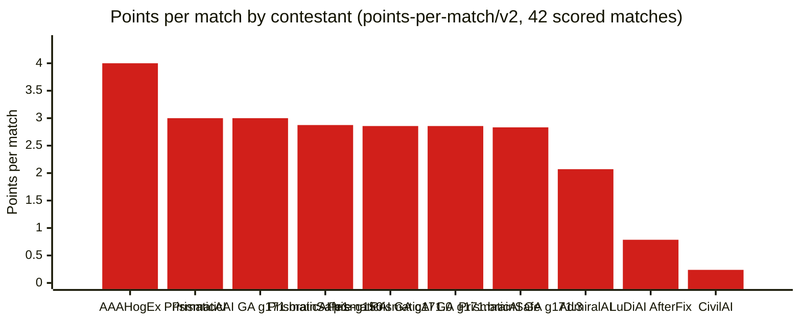
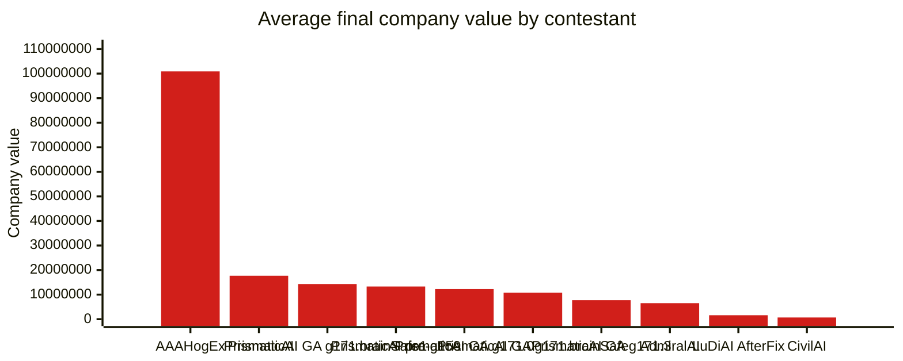
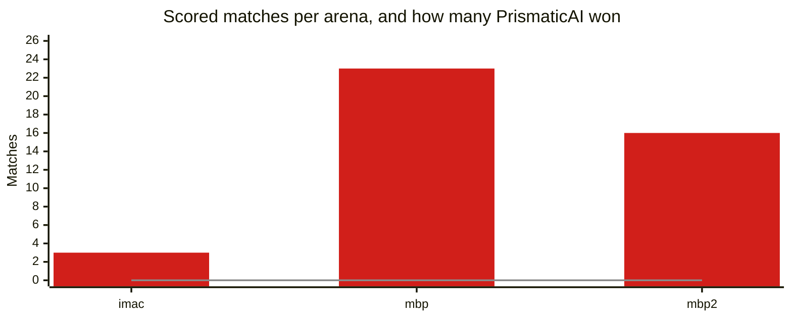

# battle-20261120T183516-3cbb96e4

Derived from `battle-20261120T183516-3cbb96e4.json` by `tools/research/ai-battle/battle.py report`; do not edit.

- Edition `3cbb96e4c8459e69`: PrismaticAI and referee at `962699034c20d90baeb9f617789ea6558cc6ff52`, base set `opengfx-8.0.tar`
- 20-year free-for-all from 1960, map 256x256 temperate, breakdowns 1
- 42 scored match(es) on `imac` (20261119-master-gdf1e05e7d8), `mbp` (20261120-master-m17653b726e), `mbp2` (20261119-master-gdf1e05e7d8)
- Replays: 2 of 2 identical to their original on another arena

| # | Contestant | Played | Wins | Points | Points/match | Avg rank | Avg final value | Squirrel errors | Matches with anomalies |
|---|---|---|---|---|---|---|---|---|---|
| 1 | AAAHogEx | 42 | 42 | 168 | 4.0 | 1.0 | 100.9 M | 0 | 0 |
| 2 | PrismaticAI | 7 | 0 | 21 | 3.0 | 2.0 | 17.7 M | 0 | 0 |
| 3 | PrismaticAI GA g171.brainSafe1 | 7 | 0 | 21 | 3.0 | 2.0 | 14.3 M | 0 | 0 |
| 4 | PrismaticAI pre-g150 | 8 | 0 | 23 | 2.875 | 2.12 | 13.3 M | 0 | 4 |
| 5 | PrismaticAI GA g171.0 | 7 | 0 | 20 | 2.857 | 2.14 | 12.2 M | 0 | 2 |
| 6 | PrismaticAI GA g171.brainSafe | 7 | 0 | 20 | 2.857 | 2.14 | 10.8 M | 0 | 0 |
| 7 | PrismaticAI GA g171.3 | 6 | 0 | 17 | 2.833 | 2.17 | 7.8 M | 0 | 0 |
| 8 | AdmiralAI | 42 | 0 | 87 | 2.071 | 2.93 | 6.5 M | 0 | 0 |
| 9 | LuDiAI AfterFix | 42 | 0 | 33 | 0.786 | 4.21 | 1.6 M | 0 | 2 |
| 10 | CivilAI | 42 | 0 | 10 | 0.238 | 4.76 | 689.2 k | 0 | 3 |

```mermaid
---
config:
  xyChart:
    width: 900
    height: 360
  themeVariables:
    xyChart:
      plotColorPalette: "#d11f1a, #8a8a8a, #0b0b0b, #ece4d6"
---
xychart-beta
    title "Final company value per scored match: winner vs best PrismaticAI"
    x-axis ["m-0001", "m-0002", "m-0003", "m-0004", "m-0005", "m-0006", "m-0007", "m-0008", "m-0009", "m-0010", "m-0011", "m-0012", "m-0013", "m-0014", "m-0015", "m-0016", "m-0017", "m-0018", "m-0019", "m-0020", "m-0021", "m-0022", "m-0023", "m-0024", "m-0025", "m-0026", "m-0027", "m-0028", "m-0036", "m-0037", "m-0038", "m-0039", "m-0040", "m-0041", "m-0042", "m-0043", "m-0044", "m-0054", "m-0055", "m-0057", "m-0058", "m-0065"]
    %% series: Winner | Best PrismaticAI
    %% links: battle-20261120T183516-3cbb96e4.md?col=Match&filter=m-0001 | battle-20261120T183516-3cbb96e4.md?col=Match&filter=m-0002 | battle-20261120T183516-3cbb96e4.md?col=Match&filter=m-0003 | battle-20261120T183516-3cbb96e4.md?col=Match&filter=m-0004 | battle-20261120T183516-3cbb96e4.md?col=Match&filter=m-0005 | battle-20261120T183516-3cbb96e4.md?col=Match&filter=m-0006 | battle-20261120T183516-3cbb96e4.md?col=Match&filter=m-0007 | battle-20261120T183516-3cbb96e4.md?col=Match&filter=m-0008 | battle-20261120T183516-3cbb96e4.md?col=Match&filter=m-0009 | battle-20261120T183516-3cbb96e4.md?col=Match&filter=m-0010 | battle-20261120T183516-3cbb96e4.md?col=Match&filter=m-0011 | battle-20261120T183516-3cbb96e4.md?col=Match&filter=m-0012 | battle-20261120T183516-3cbb96e4.md?col=Match&filter=m-0013 | battle-20261120T183516-3cbb96e4.md?col=Match&filter=m-0014 | battle-20261120T183516-3cbb96e4.md?col=Match&filter=m-0015 | battle-20261120T183516-3cbb96e4.md?col=Match&filter=m-0016 | battle-20261120T183516-3cbb96e4.md?col=Match&filter=m-0017 | battle-20261120T183516-3cbb96e4.md?col=Match&filter=m-0018 | battle-20261120T183516-3cbb96e4.md?col=Match&filter=m-0019 | battle-20261120T183516-3cbb96e4.md?col=Match&filter=m-0020 | battle-20261120T183516-3cbb96e4.md?col=Match&filter=m-0021 | battle-20261120T183516-3cbb96e4.md?col=Match&filter=m-0022 | battle-20261120T183516-3cbb96e4.md?col=Match&filter=m-0023 | battle-20261120T183516-3cbb96e4.md?col=Match&filter=m-0024 | battle-20261120T183516-3cbb96e4.md?col=Match&filter=m-0025 | battle-20261120T183516-3cbb96e4.md?col=Match&filter=m-0026 | battle-20261120T183516-3cbb96e4.md?col=Match&filter=m-0027 | battle-20261120T183516-3cbb96e4.md?col=Match&filter=m-0028 | battle-20261120T183516-3cbb96e4.md?col=Match&filter=m-0036 | battle-20261120T183516-3cbb96e4.md?col=Match&filter=m-0037 | battle-20261120T183516-3cbb96e4.md?col=Match&filter=m-0038 | battle-20261120T183516-3cbb96e4.md?col=Match&filter=m-0039 | battle-20261120T183516-3cbb96e4.md?col=Match&filter=m-0040 | battle-20261120T183516-3cbb96e4.md?col=Match&filter=m-0041 | battle-20261120T183516-3cbb96e4.md?col=Match&filter=m-0042 | battle-20261120T183516-3cbb96e4.md?col=Match&filter=m-0043 | battle-20261120T183516-3cbb96e4.md?col=Match&filter=m-0044 | battle-20261120T183516-3cbb96e4.md?col=Match&filter=m-0054 | battle-20261120T183516-3cbb96e4.md?col=Match&filter=m-0055 | battle-20261120T183516-3cbb96e4.md?col=Match&filter=m-0057 | battle-20261120T183516-3cbb96e4.md?col=Match&filter=m-0058 | battle-20261120T183516-3cbb96e4.md?col=Match&filter=m-0065
    y-axis "Company value" 0 --> 176000000
    bar [103916220, 111112625, 122445942, 101588188, 115200494, 83887902, 91095443, 111716396, 122988858, 80565388, 130485529, 86125223, 57665823, 102448492, 83167984, 99729152, 69497503, 100078483, 95918097, 108566760, 88738849, 92185460, 92343784, 111434983, 102696477, 158350539, 160373002, 130438750, 94327435, 105934082, 92135093, 111277288, 96518198, 131245278, 80798587, 76141011, 71599251, 82944717, 101525887, 102478168, 80913402, 94908337]
    line [7865553, 4861931, 5503458, 10123181, 6166581, 21085636, 15160759, 14201031, 15845177, 18070749, 9336354, 21701889, 19945521, 17199729, 12048237, 18404169, 5157174, 11116144, 15292762, 11956659, 14562660, 9775169, 10853700, 12304418, 8614624, 11365221, 5835494, 9158261, 20526072, 10942774, 16158218, 11565693, 17867572, 8203349, 15697767, 15703414, 9991454, 21309302, 12799221, 10093317, 16664480, 6799102]
```

<!-- battle-charts:begin -->
<!-- derived from battle-20261120T183516-3cbb96e4.json by `battle.py render`; `battle.py check` fails when it is stale -->

<!-- battle-charts:end -->

| Seed | Original | Replay | Arenas | Identical |
|---|---|---|---|---|
| 1540386525 | m-0013 | m-0056 | mbp2 / mbp | yes |
| 1540386525 | m-0015 | m-0064 | mbp2 / mbp | yes |

| Match | Arena | Seed | Winner | Value | Last | Anomalies |
|---|---|---|---|---|---|---|
| m-0001 | mbp | 686670912 | AAAHogEx | 103.9 M | LuDiAI AfterFix | - |
| m-0002 | mbp | 686670912 | AAAHogEx | 111.1 M | CivilAI | PrismaticAI GA g171.0: fleet_drop:86->52 |
| m-0003 | mbp | 686670912 | AAAHogEx | 122.4 M | CivilAI | LuDiAI AfterFix: fleet_drop:78->40 |
| m-0004 | mbp | 686670912 | AAAHogEx | 101.6 M | CivilAI | - |
| m-0005 | mbp | 686670912 | AAAHogEx | 115.2 M | LuDiAI AfterFix | - |
| m-0006 | mbp | 854656180 | AAAHogEx | 83.9 M | CivilAI | - |
| m-0007 | mbp | 854656180 | AAAHogEx | 91.1 M | LuDiAI AfterFix | - |
| m-0008 | mbp | 854656180 | AAAHogEx | 111.7 M | LuDiAI AfterFix | - |
| m-0009 | mbp | 854656180 | AAAHogEx | 123.0 M | LuDiAI AfterFix | - |
| m-0010 | imac | 854656180 | AAAHogEx | 80.6 M | LuDiAI AfterFix | - |
| m-0011 | imac | 854656180 | AAAHogEx | 130.5 M | LuDiAI AfterFix | - |
| m-0012 | imac | 1540386525 | AAAHogEx | 86.1 M | LuDiAI AfterFix | - |
| m-0013 | mbp2 | 1540386525 | AAAHogEx | 57.7 M | CivilAI | - |
| m-0014 | mbp2 | 1540386525 | AAAHogEx | 102.4 M | CivilAI | - |
| m-0015 | mbp2 | 1540386525 | AAAHogEx | 83.2 M | CivilAI | - |
| m-0016 | mbp2 | 1540386525 | AAAHogEx | 99.7 M | CivilAI | - |
| m-0017 | mbp2 | 1540386525 | AAAHogEx | 69.5 M | CivilAI | - |
| m-0018 | mbp2 | 957362442 | AAAHogEx | 100.1 M | CivilAI | - |
| m-0019 | mbp2 | 957362442 | AAAHogEx | 95.9 M | LuDiAI AfterFix | - |
| m-0020 | mbp2 | 957362442 | AAAHogEx | 108.6 M | CivilAI | - |
| m-0021 | mbp2 | 957362442 | AAAHogEx | 88.7 M | CivilAI | - |
| m-0022 | mbp2 | 957362442 | AAAHogEx | 92.2 M | CivilAI | - |
| m-0023 | mbp2 | 957362442 | AAAHogEx | 92.3 M | CivilAI | - |
| m-0024 | mbp2 | 1613960728 | AAAHogEx | 111.4 M | CivilAI | - |
| m-0025 | mbp2 | 1613960728 | AAAHogEx | 102.7 M | CivilAI | PrismaticAI pre-g150: fleet_drop:74->27 |
| m-0026 | mbp2 | 1613960728 | AAAHogEx | 158.4 M | CivilAI | - |
| m-0027 | mbp2 | 1613960728 | AAAHogEx | 160.4 M | CivilAI | - |
| m-0028 | mbp2 | 1613960728 | AAAHogEx | 130.4 M | CivilAI | - |
| m-0036 | mbp | 1210889041 | AAAHogEx | 94.3 M | CivilAI | - |
| m-0037 | mbp | 1210889041 | AAAHogEx | 105.9 M | CivilAI | PrismaticAI pre-g150: fleet_drop:113->69 |
| m-0038 | mbp | 1210889041 | AAAHogEx | 92.1 M | CivilAI | - |
| m-0039 | mbp | 1210889041 | AAAHogEx | 111.3 M | CivilAI | CivilAI: no_vehicles |
| m-0040 | mbp | 1210889041 | AAAHogEx | 96.5 M | CivilAI | CivilAI: no_vehicles |
| m-0041 | mbp | 1210889041 | AAAHogEx | 131.2 M | CivilAI | - |
| m-0042 | mbp | 433277175 | AAAHogEx | 80.8 M | CivilAI | - |
| m-0043 | mbp | 433277175 | AAAHogEx | 76.1 M | CivilAI | PrismaticAI pre-g150: fleet_drop:77->52; LuDiAI AfterFix: fleet_drop:48->31 |
| m-0044 | mbp | 433277175 | AAAHogEx | 71.6 M | CivilAI | PrismaticAI GA g171.0: fleet_drop:52->32; CivilAI: fleet_drop:15->7 |
| m-0054 | mbp | 1677769400 | AAAHogEx | 82.9 M | CivilAI | - |
| m-0055 | mbp | 1677769400 | AAAHogEx | 101.5 M | CivilAI | PrismaticAI pre-g150: fleet_drop:59->36 |
| m-0056 (replay) | mbp | 1540386525 | AAAHogEx | 57.7 M | CivilAI | - |
| m-0057 | mbp | 1677769400 | AAAHogEx | 102.5 M | CivilAI | - |
| m-0058 | mbp | 1677769400 | AAAHogEx | 80.9 M | CivilAI | - |
| m-0064 (replay) | mbp | 1540386525 | AAAHogEx | 83.2 M | CivilAI | - |
| m-0065 | mbp | 642373961 | AAAHogEx | 94.9 M | CivilAI | - |
