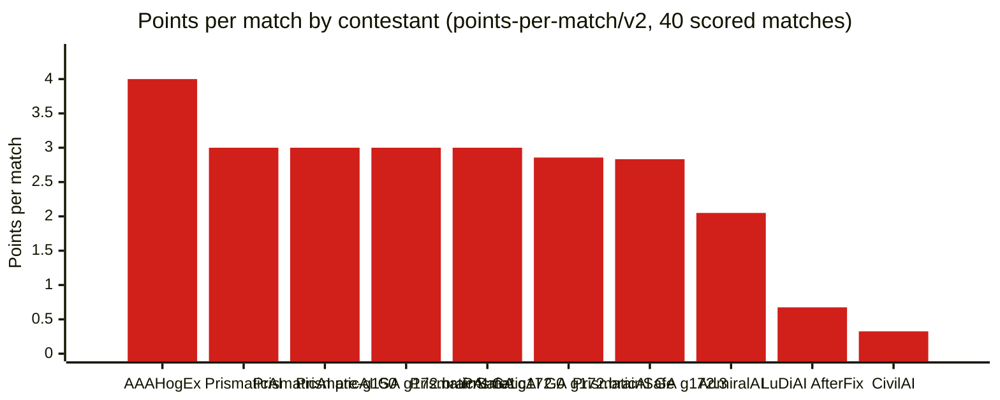
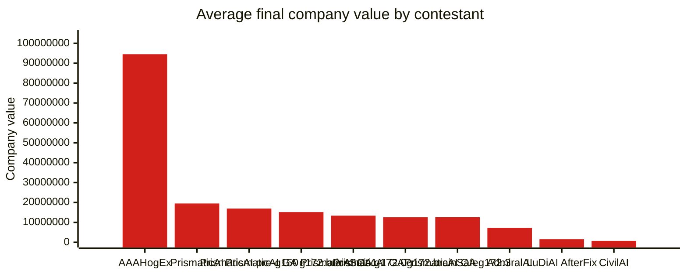
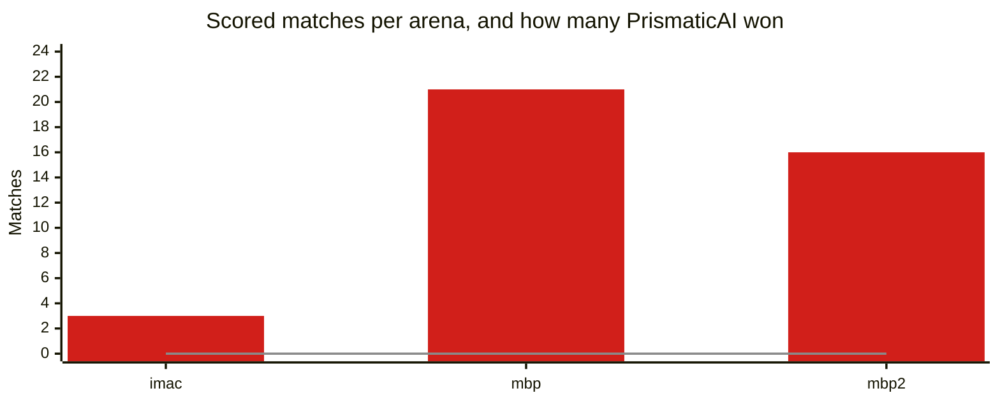

# battle-20261120T184504-aaaecae3

Derived from `battle-20261120T184504-aaaecae3.json` by `tools/research/ai-battle/battle.py report`; do not edit.

- Edition `aaaecae37f11b22a`: PrismaticAI and referee at `962699034c20d90baeb9f617789ea6558cc6ff52`, base set `opengfx-8.0.tar`
- 20-year free-for-all from 1960, map 256x256 temperate, breakdowns 1
- 40 scored match(es) on `imac` (20261119-master-gdf1e05e7d8), `mbp` (20261120-master-m17653b726e), `mbp2` (20261119-master-gdf1e05e7d8)
- Replays: 0 of 0 identical to their original on another arena

| # | Contestant | Played | Wins | Points | Points/match | Avg rank | Avg final value | Squirrel errors | Matches with anomalies |
|---|---|---|---|---|---|---|---|---|---|
| 1 | AAAHogEx | 40 | 40 | 160 | 4.0 | 1.0 | 94.5 M | 0 | 0 |
| 2 | PrismaticAI | 6 | 0 | 18 | 3.0 | 2.0 | 19.5 M | 0 | 0 |
| 3 | PrismaticAI pre-g150 | 7 | 0 | 21 | 3.0 | 2.0 | 17.0 M | 0 | 2 |
| 4 | PrismaticAI GA g172.brainSafe1 | 7 | 0 | 21 | 3.0 | 2.0 | 15.2 M | 0 | 0 |
| 5 | PrismaticAI GA g172.0 | 7 | 0 | 21 | 3.0 | 2.0 | 13.4 M | 0 | 0 |
| 6 | PrismaticAI GA g172.brainSafe | 7 | 0 | 20 | 2.857 | 2.14 | 12.5 M | 0 | 0 |
| 7 | PrismaticAI GA g172.3 | 6 | 0 | 17 | 2.833 | 2.17 | 12.6 M | 0 | 3 |
| 8 | AdmiralAI | 40 | 0 | 82 | 2.05 | 2.95 | 7.3 M | 0 | 0 |
| 9 | LuDiAI AfterFix | 40 | 0 | 27 | 0.675 | 4.33 | 1.6 M | 0 | 2 |
| 10 | CivilAI | 40 | 0 | 13 | 0.325 | 4.67 | 723.8 k | 0 | 2 |

```mermaid
---
config:
  xyChart:
    width: 900
    height: 360
  themeVariables:
    xyChart:
      plotColorPalette: "#d11f1a, #8a8a8a, #0b0b0b, #ece4d6"
---
xychart-beta
    title "Final company value per scored match: winner vs best PrismaticAI"
    x-axis ["m-0001", "m-0002", "m-0003", "m-0004", "m-0005", "m-0006", "m-0007", "m-0008", "m-0009", "m-0010", "m-0011", "m-0012", "m-0013", "m-0014", "m-0015", "m-0016", "m-0017", "m-0018", "m-0019", "m-0020", "m-0021", "m-0022", "m-0023", "m-0024", "m-0025", "m-0026", "m-0027", "m-0028", "m-0036", "m-0037", "m-0038", "m-0039", "m-0040", "m-0041", "m-0042", "m-0043", "m-0044", "m-0045", "m-0052", "m-0053"]
    %% series: Winner | Best PrismaticAI
    %% links: battle-20261120T184504-aaaecae3.md?col=Match&filter=m-0001 | battle-20261120T184504-aaaecae3.md?col=Match&filter=m-0002 | battle-20261120T184504-aaaecae3.md?col=Match&filter=m-0003 | battle-20261120T184504-aaaecae3.md?col=Match&filter=m-0004 | battle-20261120T184504-aaaecae3.md?col=Match&filter=m-0005 | battle-20261120T184504-aaaecae3.md?col=Match&filter=m-0006 | battle-20261120T184504-aaaecae3.md?col=Match&filter=m-0007 | battle-20261120T184504-aaaecae3.md?col=Match&filter=m-0008 | battle-20261120T184504-aaaecae3.md?col=Match&filter=m-0009 | battle-20261120T184504-aaaecae3.md?col=Match&filter=m-0010 | battle-20261120T184504-aaaecae3.md?col=Match&filter=m-0011 | battle-20261120T184504-aaaecae3.md?col=Match&filter=m-0012 | battle-20261120T184504-aaaecae3.md?col=Match&filter=m-0013 | battle-20261120T184504-aaaecae3.md?col=Match&filter=m-0014 | battle-20261120T184504-aaaecae3.md?col=Match&filter=m-0015 | battle-20261120T184504-aaaecae3.md?col=Match&filter=m-0016 | battle-20261120T184504-aaaecae3.md?col=Match&filter=m-0017 | battle-20261120T184504-aaaecae3.md?col=Match&filter=m-0018 | battle-20261120T184504-aaaecae3.md?col=Match&filter=m-0019 | battle-20261120T184504-aaaecae3.md?col=Match&filter=m-0020 | battle-20261120T184504-aaaecae3.md?col=Match&filter=m-0021 | battle-20261120T184504-aaaecae3.md?col=Match&filter=m-0022 | battle-20261120T184504-aaaecae3.md?col=Match&filter=m-0023 | battle-20261120T184504-aaaecae3.md?col=Match&filter=m-0024 | battle-20261120T184504-aaaecae3.md?col=Match&filter=m-0025 | battle-20261120T184504-aaaecae3.md?col=Match&filter=m-0026 | battle-20261120T184504-aaaecae3.md?col=Match&filter=m-0027 | battle-20261120T184504-aaaecae3.md?col=Match&filter=m-0028 | battle-20261120T184504-aaaecae3.md?col=Match&filter=m-0036 | battle-20261120T184504-aaaecae3.md?col=Match&filter=m-0037 | battle-20261120T184504-aaaecae3.md?col=Match&filter=m-0038 | battle-20261120T184504-aaaecae3.md?col=Match&filter=m-0039 | battle-20261120T184504-aaaecae3.md?col=Match&filter=m-0040 | battle-20261120T184504-aaaecae3.md?col=Match&filter=m-0041 | battle-20261120T184504-aaaecae3.md?col=Match&filter=m-0042 | battle-20261120T184504-aaaecae3.md?col=Match&filter=m-0043 | battle-20261120T184504-aaaecae3.md?col=Match&filter=m-0044 | battle-20261120T184504-aaaecae3.md?col=Match&filter=m-0045 | battle-20261120T184504-aaaecae3.md?col=Match&filter=m-0052 | battle-20261120T184504-aaaecae3.md?col=Match&filter=m-0053
    y-axis "Company value" 0 --> 151000000
    bar [97824094, 66193406, 77979999, 77269558, 78955788, 113335103, 103281661, 117703216, 110386393, 116282288, 114404623, 130011517, 96931696, 125760539, 123620201, 137192657, 111182046, 91049475, 82788328, 91894273, 87841280, 86975903, 85884640, 90560859, 119406671, 100858839, 74985317, 89815613, 92190413, 84152373, 73052504, 93205601, 86587766, 78403614, 74615042, 75821451, 66752072, 80631485, 67812087, 107083386]
    line [14795190, 16327291, 12921613, 10779529, 13737832, 18425526, 16649205, 9955593, 10443606, 14091688, 11944584, 18504530, 20256448, 16690635, 11035097, 19170242, 9682574, 17348962, 21199458, 15382805, 17408150, 15629672, 16728715, 18998543, 18235570, 14288016, 11809871, 13654192, 20707267, 12529777, 11986360, 12916350, 18732247, 8288695, 22959285, 15018374, 8999288, 11272921, 14004194, 15080733]
```

<!-- battle-charts:begin -->
<!-- derived from battle-20261120T184504-aaaecae3.json by `battle.py render`; `battle.py check` fails when it is stale -->

<!-- battle-charts:end -->

| Match | Arena | Seed | Winner | Value | Last | Anomalies |
|---|---|---|---|---|---|---|
| m-0001 | mbp | 1595326126 | AAAHogEx | 97.8 M | CivilAI | PrismaticAI pre-g150: fleet_drop:96->59 |
| m-0002 | mbp | 1595326126 | AAAHogEx | 66.2 M | CivilAI | - |
| m-0003 | mbp | 1595326126 | AAAHogEx | 78.0 M | CivilAI | CivilAI: fleet_drop:35->16 |
| m-0004 | mbp | 1595326126 | AAAHogEx | 77.3 M | CivilAI | - |
| m-0005 | mbp | 1595326126 | AAAHogEx | 79.0 M | CivilAI | PrismaticAI GA g172.3: fleet_drop:150->90 |
| m-0006 | mbp | 1161624129 | AAAHogEx | 113.3 M | LuDiAI AfterFix | - |
| m-0007 | mbp | 1161624129 | AAAHogEx | 103.3 M | CivilAI | - |
| m-0008 | mbp | 1161624129 | AAAHogEx | 117.7 M | CivilAI | - |
| m-0009 | mbp | 1161624129 | AAAHogEx | 110.4 M | LuDiAI AfterFix | - |
| m-0010 | imac | 1161624129 | AAAHogEx | 116.3 M | CivilAI | - |
| m-0011 | imac | 1161624129 | AAAHogEx | 114.4 M | CivilAI | - |
| m-0012 | imac | 1694691615 | AAAHogEx | 130.0 M | LuDiAI AfterFix | - |
| m-0013 | mbp2 | 1694691615 | AAAHogEx | 96.9 M | LuDiAI AfterFix | PrismaticAI pre-g150: fleet_drop:155->103 |
| m-0014 | mbp2 | 1694691615 | AAAHogEx | 125.8 M | LuDiAI AfterFix | - |
| m-0015 | mbp2 | 1694691615 | AAAHogEx | 123.6 M | CivilAI | - |
| m-0016 | mbp2 | 1694691615 | AAAHogEx | 137.2 M | LuDiAI AfterFix | - |
| m-0017 | mbp2 | 1694691615 | AAAHogEx | 111.2 M | CivilAI | - |
| m-0018 | mbp2 | 1152164290 | AAAHogEx | 91.0 M | CivilAI | - |
| m-0019 | mbp2 | 1152164290 | AAAHogEx | 82.8 M | CivilAI | - |
| m-0020 | mbp2 | 1152164290 | AAAHogEx | 91.9 M | CivilAI | - |
| m-0021 | mbp2 | 1152164290 | AAAHogEx | 87.8 M | CivilAI | - |
| m-0022 | mbp2 | 1152164290 | AAAHogEx | 87.0 M | LuDiAI AfterFix | - |
| m-0023 | mbp2 | 1152164290 | AAAHogEx | 85.9 M | CivilAI | PrismaticAI GA g172.3: fleet_drop:145->101 |
| m-0024 | mbp2 | 1291243463 | AAAHogEx | 90.6 M | LuDiAI AfterFix | - |
| m-0025 | mbp2 | 1291243463 | AAAHogEx | 119.4 M | LuDiAI AfterFix | - |
| m-0026 | mbp2 | 1291243463 | AAAHogEx | 100.9 M | LuDiAI AfterFix | - |
| m-0027 | mbp2 | 1291243463 | AAAHogEx | 75.0 M | CivilAI | - |
| m-0028 | mbp2 | 1291243463 | AAAHogEx | 89.8 M | LuDiAI AfterFix | LuDiAI AfterFix: fleet_drop:16->5 |
| m-0036 | mbp | 433879160 | AAAHogEx | 92.2 M | LuDiAI AfterFix | LuDiAI AfterFix: fleet_drop:83->51 |
| m-0037 | mbp | 433879160 | AAAHogEx | 84.2 M | CivilAI | - |
| m-0038 | mbp | 433879160 | AAAHogEx | 73.1 M | CivilAI | CivilAI: fleet_drop:34->23 |
| m-0039 | mbp | 433879160 | AAAHogEx | 93.2 M | CivilAI | - |
| m-0040 | mbp | 433879160 | AAAHogEx | 86.6 M | CivilAI | - |
| m-0041 | mbp | 433879160 | AAAHogEx | 78.4 M | CivilAI | PrismaticAI GA g172.3: fleet_drop:131->75 |
| m-0042 | mbp | 154049447 | AAAHogEx | 74.6 M | CivilAI | - |
| m-0043 | mbp | 154049447 | AAAHogEx | 75.8 M | LuDiAI AfterFix | - |
| m-0044 | mbp | 154049447 | AAAHogEx | 66.8 M | CivilAI | - |
| m-0045 | mbp | 154049447 | AAAHogEx | 80.6 M | CivilAI | - |
| m-0052 | mbp | 1373389865 | AAAHogEx | 67.8 M | CivilAI | - |
| m-0053 | mbp | 1373389865 | AAAHogEx | 107.1 M | CivilAI | - |
