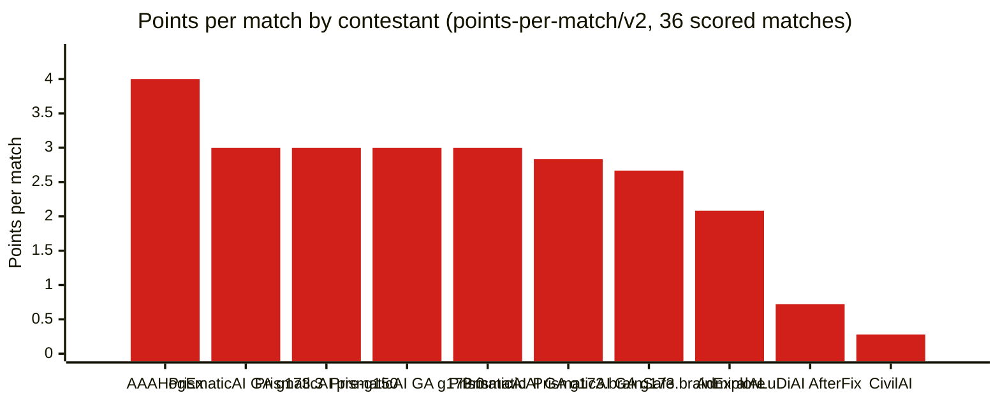
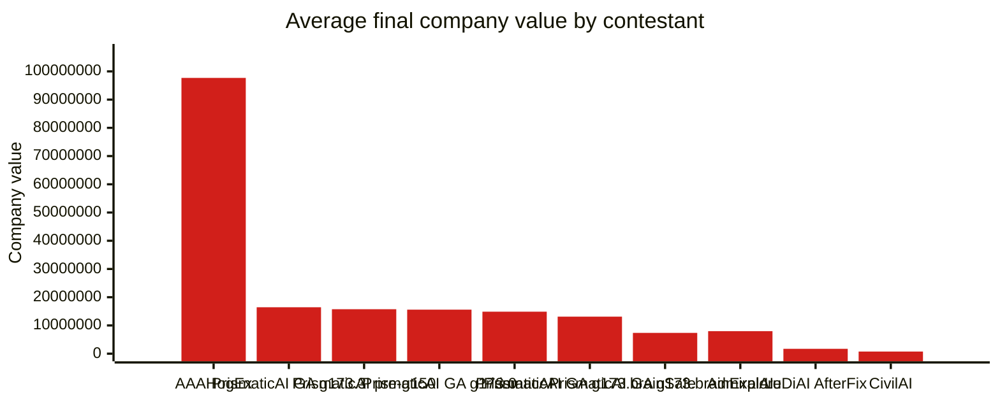
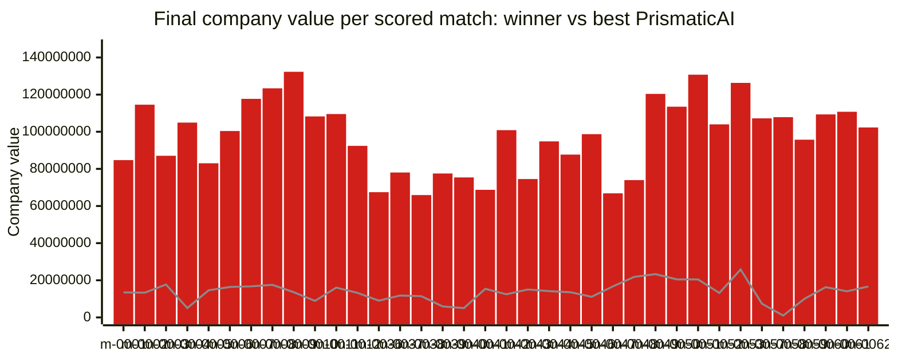
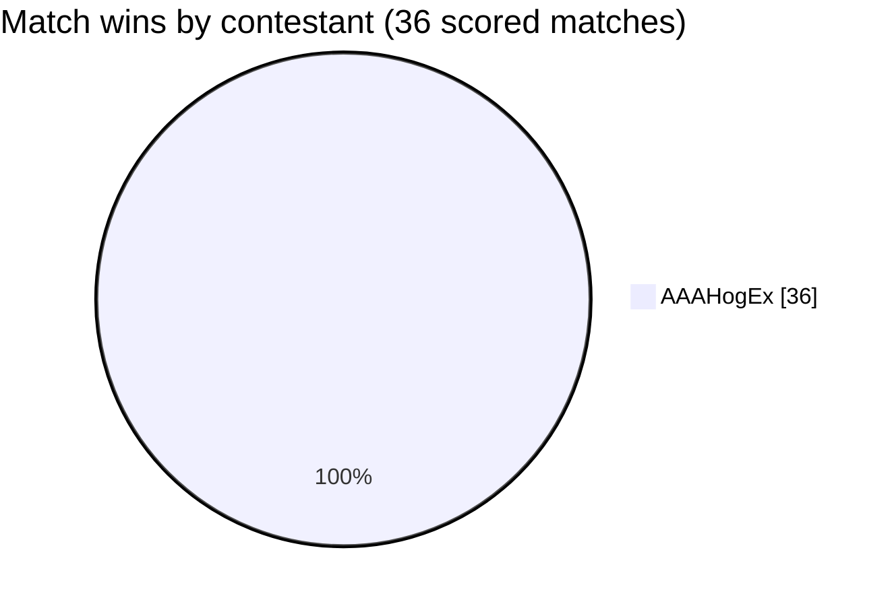
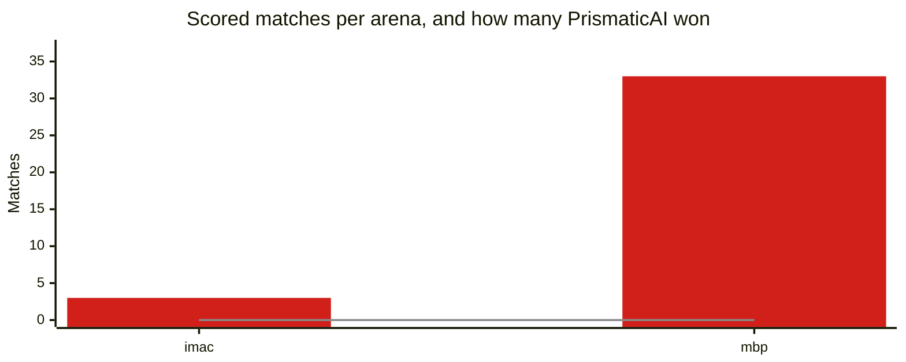

# battle-20261120T185811-db854c5d

Derived from `battle-20261120T185811-db854c5d.json` by `tools/research/ai-battle/battle.py report`; do not edit.

- Edition `db854c5de1122322`: PrismaticAI and referee at `962699034c20d90baeb9f617789ea6558cc6ff52`, base set `opengfx-8.0.tar`
- 20-year free-for-all from 1960, map 256x256 temperate, breakdowns 1
- 36 scored match(es) on `imac` (20261119-master-gdf1e05e7d8), `mbp` (20261120-master-m17653b726e), `mbp2` (20261119-master-gdf1e05e7d8)
- Replays: 0 of 0 identical to their original on another arena

| # | Contestant | Played | Wins | Points | Points/match | Avg rank | Avg final value | Squirrel errors | Matches with anomalies |
|---|---|---|---|---|---|---|---|---|---|
| 1 | AAAHogEx | 36 | 36 | 144 | 4.0 | 1.0 | 97.7 M | 0 | 0 |
| 2 | PrismaticAI GA g173.3 | 6 | 0 | 18 | 3.0 | 2.0 | 16.4 M | 0 | 0 |
| 3 | PrismaticAI pre-g150 | 6 | 0 | 18 | 3.0 | 2.0 | 15.7 M | 0 | 3 |
| 4 | PrismaticAI GA g173.0 | 6 | 0 | 18 | 3.0 | 2.0 | 15.6 M | 0 | 0 |
| 5 | PrismaticAI | 6 | 0 | 18 | 3.0 | 2.0 | 14.9 M | 0 | 0 |
| 6 | PrismaticAI GA g173.brainSafe | 6 | 0 | 17 | 2.833 | 2.17 | 13.1 M | 0 | 1 |
| 7 | PrismaticAI GA g173.brainExplore | 6 | 0 | 16 | 2.667 | 2.33 | 7.4 M | 0 | 3 |
| 8 | AdmiralAI | 36 | 0 | 75 | 2.083 | 2.92 | 8.0 M | 0 | 0 |
| 9 | LuDiAI AfterFix | 36 | 0 | 26 | 0.722 | 4.28 | 1.7 M | 0 | 2 |
| 10 | CivilAI | 36 | 0 | 10 | 0.278 | 4.72 | 750.3 k | 7545 | 6 |

<!-- battle-charts:begin -->
<!-- derived from battle-20261120T185811-db854c5d.json by `battle.py render`; `battle.py check` fails when it is stale -->

<!-- battle-charts:end -->

| Match | Arena | Seed | Winner | Value | Last | Anomalies |
|---|---|---|---|---|---|---|
| m-0001 | mbp | 594089279 | AAAHogEx | 84.7 M | CivilAI | CivilAI: fleet_drop:37->13 |
| m-0002 | mbp | 594089279 | AAAHogEx | 114.6 M | LuDiAI AfterFix | - |
| m-0003 | mbp | 594089279 | AAAHogEx | 87.1 M | LuDiAI AfterFix | - |
| m-0004 | mbp | 594089279 | AAAHogEx | 104.9 M | CivilAI | CivilAI: squirrel_errors:3720 |
| m-0005 | mbp | 594089279 | AAAHogEx | 83.0 M | CivilAI | - |
| m-0006 | mbp | 124187586 | AAAHogEx | 100.4 M | LuDiAI AfterFix | - |
| m-0007 | mbp | 124187586 | AAAHogEx | 117.7 M | LuDiAI AfterFix | PrismaticAI pre-g150: fleet_drop:73->51 |
| m-0008 | mbp | 124187586 | AAAHogEx | 123.4 M | CivilAI | - |
| m-0009 | mbp | 124187586 | AAAHogEx | 132.3 M | CivilAI | PrismaticAI GA g173.brainSafe: fleet_drop:80->42 |
| m-0010 | imac | 124187586 | AAAHogEx | 108.3 M | CivilAI | - |
| m-0011 | imac | 124187586 | AAAHogEx | 109.5 M | CivilAI | - |
| m-0012 | imac | 478762172 | AAAHogEx | 92.4 M | CivilAI | - |
| m-0013 | mbp2 | 478762172 | AAAHogEx | 4.0 M | CivilAI | - |
| m-0014 | mbp2 | 478762172 | AAAHogEx | 5.4 M | CivilAI | - |
| m-0015 | mbp2 | 478762172 | AAAHogEx | 14.8 M | CivilAI | - |
| m-0016 | mbp2 | 478762172 | AAAHogEx | 8.8 M | CivilAI | - |
| m-0017 | mbp2 | 478762172 | AAAHogEx | 5.3 M | CivilAI | - |
| m-0018 | mbp2 | 1999780915 | AAAHogEx | 7.5 M | CivilAI | - |
| m-0019 | mbp2 | 1999780915 | AAAHogEx | 4.8 M | CivilAI | - |
| m-0020 | mbp2 | 1999780915 | AAAHogEx | 7.5 M | CivilAI | - |
| m-0021 | mbp2 | 1999780915 | AAAHogEx | 7.1 M | CivilAI | - |
| m-0022 | mbp2 | 1999780915 | AAAHogEx | 8.4 M | CivilAI | - |
| m-0023 | mbp2 | 1999780915 | PrismaticAI GA g173.3 | 3.9 M | CivilAI | - |
| m-0024 | mbp2 | 900273632 | AAAHogEx | 6.8 M | LuDiAI AfterFix | - |
| m-0025 | mbp2 | 900273632 | AAAHogEx | 8.1 M | LuDiAI AfterFix | - |
| m-0026 | mbp2 | 900273632 | AAAHogEx | 8.5 M | CivilAI | - |
| m-0027 | mbp2 | 900273632 | AAAHogEx | 4.7 M | CivilAI | - |
| m-0028 | mbp2 | 900273632 | AAAHogEx | 4.7 M | CivilAI | - |
| m-0036 | mbp | 35784110 | AAAHogEx | 67.5 M | LuDiAI AfterFix | CivilAI: fleet_drop:50->12 |
| m-0037 | mbp | 35784110 | AAAHogEx | 78.0 M | CivilAI | - |
| m-0038 | mbp | 35784110 | AAAHogEx | 65.9 M | CivilAI | - |
| m-0039 | mbp | 35784110 | AAAHogEx | 77.5 M | LuDiAI AfterFix | - |
| m-0040 | mbp | 35784110 | AAAHogEx | 75.4 M | CivilAI | PrismaticAI GA g173.brainExplore: fleet_drop:81->40; CivilAI: squirrel_errors:3825 |
| m-0041 | mbp | 35784110 | AAAHogEx | 68.7 M | CivilAI | - |
| m-0042 | mbp | 1573881837 | AAAHogEx | 100.9 M | LuDiAI AfterFix | - |
| m-0043 | mbp | 1573881837 | AAAHogEx | 74.5 M | CivilAI | - |
| m-0044 | mbp | 1573881837 | AAAHogEx | 94.8 M | CivilAI | - |
| m-0045 | mbp | 1573881837 | AAAHogEx | 87.7 M | CivilAI | - |
| m-0046 | mbp | 1573881837 | AAAHogEx | 98.7 M | LuDiAI AfterFix | CivilAI: fleet_drop:32->14; LuDiAI AfterFix: fleet_drop:32->9 |
| m-0047 | mbp | 1573881837 | AAAHogEx | 66.8 M | LuDiAI AfterFix | - |
| m-0048 | mbp | 673492347 | AAAHogEx | 74.0 M | CivilAI | - |
| m-0049 | mbp | 673492347 | AAAHogEx | 120.4 M | CivilAI | PrismaticAI pre-g150: fleet_drop:81->49 |
| m-0050 | mbp | 673492347 | AAAHogEx | 113.5 M | CivilAI | - |
| m-0051 | mbp | 673492347 | AAAHogEx | 130.7 M | CivilAI | - |
| m-0052 | mbp | 673492347 | AAAHogEx | 104.0 M | LuDiAI AfterFix | PrismaticAI GA g173.brainExplore: fleet_drop:103->67; LuDiAI AfterFix: no_vehicles |
| m-0053 | mbp | 673492347 | AAAHogEx | 126.3 M | CivilAI | - |
| m-0057 | mbp | 337187691 | AAAHogEx | 107.2 M | CivilAI | - |
| m-0058 | mbp | 337187691 | AAAHogEx | 107.8 M | CivilAI | PrismaticAI GA g173.brainExplore: fleet_drop:51->24 |
| m-0059 | mbp | 337187691 | AAAHogEx | 95.7 M | CivilAI | - |
| m-0060 | mbp | 806020515 | AAAHogEx | 109.3 M | CivilAI | - |
| m-0061 | mbp | 806020515 | AAAHogEx | 110.8 M | CivilAI | PrismaticAI pre-g150: fleet_drop:93->63 |
| m-0062 | mbp | 806020515 | AAAHogEx | 102.3 M | CivilAI | CivilAI: fleet_drop:39->21 |
