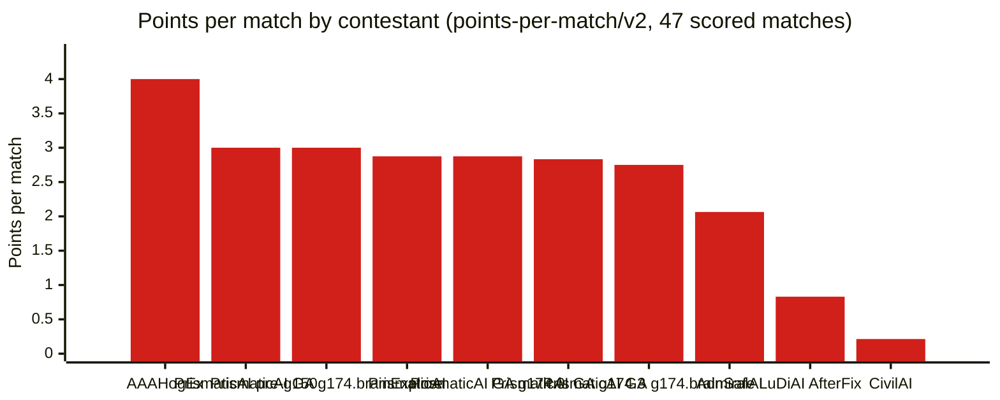
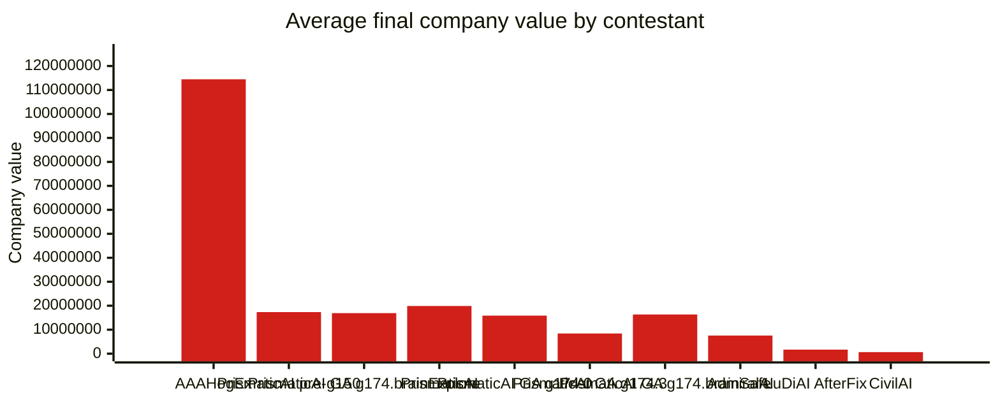
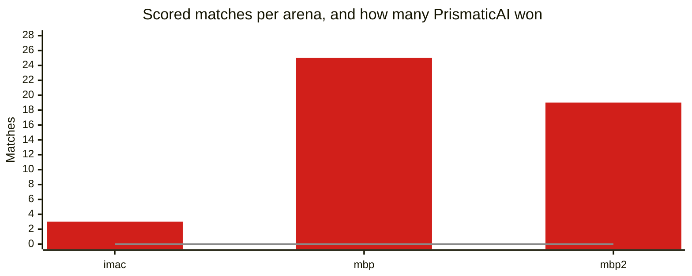

# battle-20261120T191005-7ce145d5

Derived from `battle-20261120T191005-7ce145d5.json` by `tools/research/ai-battle/battle.py report`; do not edit.

- Edition `7ce145d5966e53c2`: PrismaticAI and referee at `962699034c20d90baeb9f617789ea6558cc6ff52`, base set `opengfx-8.0.tar`
- 20-year free-for-all from 1960, map 256x256 temperate, breakdowns 1
- 47 scored match(es) on `imac` (20261119-master-gdf1e05e7d8), `mbp` (20261120-master-m17653b726e), `mbp2` (20261119-master-gdf1e05e7d8)
- Replays: 1 of 3 identical to their original on another arena

| # | Contestant | Played | Wins | Points | Points/match | Avg rank | Avg final value | Squirrel errors | Matches with anomalies |
|---|---|---|---|---|---|---|---|---|---|
| 1 | AAAHogEx | 47 | 47 | 188 | 4.0 | 1.0 | 114.5 M | 0 | 0 |
| 2 | PrismaticAI pre-g150 | 9 | 0 | 27 | 3.0 | 2.0 | 17.3 M | 0 | 4 |
| 3 | PrismaticAI GA g174.brainExplore | 8 | 0 | 24 | 3.0 | 2.0 | 16.9 M | 0 | 3 |
| 4 | PrismaticAI | 8 | 0 | 23 | 2.875 | 2.12 | 19.9 M | 0 | 0 |
| 5 | PrismaticAI GA g174.0 | 8 | 0 | 23 | 2.875 | 2.12 | 15.9 M | 0 | 0 |
| 6 | PrismaticAI GA g174.3 | 6 | 0 | 17 | 2.833 | 2.17 | 8.4 M | 0 | 1 |
| 7 | PrismaticAI GA g174.brainSafe | 8 | 0 | 22 | 2.75 | 2.25 | 16.3 M | 0 | 5 |
| 8 | AdmiralAI | 47 | 0 | 97 | 2.064 | 2.94 | 7.6 M | 0 | 1 |
| 9 | LuDiAI AfterFix | 47 | 0 | 39 | 0.83 | 4.17 | 1.7 M | 0 | 1 |
| 10 | CivilAI | 47 | 0 | 10 | 0.213 | 4.79 | 643.9 k | 14528 | 13 |

```mermaid
---
config:
  xyChart:
    width: 900
    height: 360
  themeVariables:
    xyChart:
      plotColorPalette: "#d11f1a, #8a8a8a, #0b0b0b, #ece4d6"
---
xychart-beta
    title "Final company value per scored match: winner vs best PrismaticAI"
    x-axis ["m-0001", "m-0002", "m-0003", "m-0004", "m-0005", "m-0006", "m-0007", "m-0008", "m-0009", "m-0010", "m-0011", "m-0012", "m-0013", "m-0014", "m-0015", "m-0016", "m-0017", "m-0018", "m-0019", "m-0020", "m-0021", "m-0022", "m-0023", "m-0024", "m-0025", "m-0026", "m-0027", "m-0028", "m-0036", "m-0037", "m-0038", "m-0039", "m-0040", "m-0041", "m-0042", "m-0043", "m-0044", "m-0051", "m-0052", "m-0053", "m-0054", "m-0055", "m-0066", "m-0067", "m-0068", "m-0069", "m-0070"]
    %% series: Winner | Best PrismaticAI
    %% links: battle-20261120T191005-7ce145d5.md?col=Match&filter=m-0001 | battle-20261120T191005-7ce145d5.md?col=Match&filter=m-0002 | battle-20261120T191005-7ce145d5.md?col=Match&filter=m-0003 | battle-20261120T191005-7ce145d5.md?col=Match&filter=m-0004 | battle-20261120T191005-7ce145d5.md?col=Match&filter=m-0005 | battle-20261120T191005-7ce145d5.md?col=Match&filter=m-0006 | battle-20261120T191005-7ce145d5.md?col=Match&filter=m-0007 | battle-20261120T191005-7ce145d5.md?col=Match&filter=m-0008 | battle-20261120T191005-7ce145d5.md?col=Match&filter=m-0009 | battle-20261120T191005-7ce145d5.md?col=Match&filter=m-0010 | battle-20261120T191005-7ce145d5.md?col=Match&filter=m-0011 | battle-20261120T191005-7ce145d5.md?col=Match&filter=m-0012 | battle-20261120T191005-7ce145d5.md?col=Match&filter=m-0013 | battle-20261120T191005-7ce145d5.md?col=Match&filter=m-0014 | battle-20261120T191005-7ce145d5.md?col=Match&filter=m-0015 | battle-20261120T191005-7ce145d5.md?col=Match&filter=m-0016 | battle-20261120T191005-7ce145d5.md?col=Match&filter=m-0017 | battle-20261120T191005-7ce145d5.md?col=Match&filter=m-0018 | battle-20261120T191005-7ce145d5.md?col=Match&filter=m-0019 | battle-20261120T191005-7ce145d5.md?col=Match&filter=m-0020 | battle-20261120T191005-7ce145d5.md?col=Match&filter=m-0021 | battle-20261120T191005-7ce145d5.md?col=Match&filter=m-0022 | battle-20261120T191005-7ce145d5.md?col=Match&filter=m-0023 | battle-20261120T191005-7ce145d5.md?col=Match&filter=m-0024 | battle-20261120T191005-7ce145d5.md?col=Match&filter=m-0025 | battle-20261120T191005-7ce145d5.md?col=Match&filter=m-0026 | battle-20261120T191005-7ce145d5.md?col=Match&filter=m-0027 | battle-20261120T191005-7ce145d5.md?col=Match&filter=m-0028 | battle-20261120T191005-7ce145d5.md?col=Match&filter=m-0036 | battle-20261120T191005-7ce145d5.md?col=Match&filter=m-0037 | battle-20261120T191005-7ce145d5.md?col=Match&filter=m-0038 | battle-20261120T191005-7ce145d5.md?col=Match&filter=m-0039 | battle-20261120T191005-7ce145d5.md?col=Match&filter=m-0040 | battle-20261120T191005-7ce145d5.md?col=Match&filter=m-0041 | battle-20261120T191005-7ce145d5.md?col=Match&filter=m-0042 | battle-20261120T191005-7ce145d5.md?col=Match&filter=m-0043 | battle-20261120T191005-7ce145d5.md?col=Match&filter=m-0044 | battle-20261120T191005-7ce145d5.md?col=Match&filter=m-0051 | battle-20261120T191005-7ce145d5.md?col=Match&filter=m-0052 | battle-20261120T191005-7ce145d5.md?col=Match&filter=m-0053 | battle-20261120T191005-7ce145d5.md?col=Match&filter=m-0054 | battle-20261120T191005-7ce145d5.md?col=Match&filter=m-0055 | battle-20261120T191005-7ce145d5.md?col=Match&filter=m-0066 | battle-20261120T191005-7ce145d5.md?col=Match&filter=m-0067 | battle-20261120T191005-7ce145d5.md?col=Match&filter=m-0068 | battle-20261120T191005-7ce145d5.md?col=Match&filter=m-0069 | battle-20261120T191005-7ce145d5.md?col=Match&filter=m-0070
    y-axis "Company value" 0 --> 201000000
    bar [106853573, 120787709, 137007690, 100605160, 98825410, 95448030, 80917339, 117144967, 80661980, 89925944, 77996466, 145523152, 127469531, 125910027, 139123601, 132819277, 126862206, 70657453, 81095620, 102721488, 101653699, 89360371, 79693281, 82736271, 78037795, 130635923, 76003860, 124554785, 129112023, 182970862, 139734343, 117660002, 98946957, 171782021, 161296831, 143337065, 145133585, 113384526, 157772044, 131061262, 150963526, 136480329, 96197145, 103036603, 86782561, 98466179, 94480094]
    line [14257419, 8622335, 7742747, 10395838, 10015185, 18250378, 12571509, 12797907, 9240923, 11595106, 11770267, 23124570, 17140644, 21412754, 17617475, 20429832, 6183514, 26418880, 23590949, 23941413, 20347658, 20092187, 12432287, 20854206, 15967834, 14172976, 16342428, 16354511, 14212596, 16425106, 14964828, 23060472, 21013932, 3902201, 24840425, 19455051, 17128163, 17287468, 15768138, 6187845, 14384073, 22623304, 16983943, 13994556, 13908295, 19097043, 19647698]
```

<!-- battle-charts:begin -->
<!-- derived from battle-20261120T191005-7ce145d5.json by `battle.py render`; `battle.py check` fails when it is stale -->

<!-- battle-charts:end -->

| Seed | Original | Replay | Arenas | Identical |
|---|---|---|---|---|
| 14091138 | m-0001 | m-0048 | mbp / mbp2 | yes |
| 1280603127 | m-0010 | m-0056 | imac / mbp | NO |
| 1280603127 | m-0011 | m-0072 | imac / mbp | NO |

| Match | Arena | Seed | Winner | Value | Last | Anomalies |
|---|---|---|---|---|---|---|
| m-0001 | mbp | 14091138 | AAAHogEx | 106.9 M | CivilAI | PrismaticAI pre-g150: fleet_drop:84->51 |
| m-0002 | mbp | 14091138 | AAAHogEx | 120.8 M | CivilAI | - |
| m-0003 | mbp | 14091138 | AAAHogEx | 137.0 M | CivilAI | PrismaticAI GA g174.brainSafe: fleet_drop:94->55 |
| m-0004 | mbp | 14091138 | AAAHogEx | 100.6 M | LuDiAI AfterFix | - |
| m-0005 | mbp | 14091138 | AAAHogEx | 98.8 M | LuDiAI AfterFix | CivilAI: fleet_drop:55->23 |
| m-0006 | mbp | 1280603127 | AAAHogEx | 95.4 M | LuDiAI AfterFix | - |
| m-0007 | mbp | 1280603127 | AAAHogEx | 80.9 M | CivilAI | PrismaticAI pre-g150: fleet_drop:94->40; LuDiAI AfterFix: fleet_drop:48->32; CivilAI: fleet_drop:55->33 |
| m-0008 | mbp | 1280603127 | AAAHogEx | 117.1 M | LuDiAI AfterFix | - |
| m-0009 | mbp | 1280603127 | AAAHogEx | 80.7 M | LuDiAI AfterFix | PrismaticAI GA g174.brainSafe: fleet_drop:87->47 |
| m-0010 | imac | 1280603127 | AAAHogEx | 89.9 M | LuDiAI AfterFix | PrismaticAI GA g174.brainExplore: fleet_drop:67->38 |
| m-0011 | imac | 1280603127 | AAAHogEx | 78.0 M | CivilAI | - |
| m-0012 | imac | 270746431 | AAAHogEx | 145.5 M | AdmiralAI | - |
| m-0013 | mbp2 | 270746431 | AAAHogEx | 127.5 M | CivilAI | PrismaticAI pre-g150: fleet_drop:103->69 |
| m-0014 | mbp2 | 270746431 | AAAHogEx | 125.9 M | CivilAI | AdmiralAI: fleet_drop:285->192 |
| m-0015 | mbp2 | 270746431 | AAAHogEx | 139.1 M | CivilAI | PrismaticAI GA g174.brainSafe: fleet_drop:170->87 |
| m-0016 | mbp2 | 270746431 | AAAHogEx | 132.8 M | CivilAI | CivilAI: fleet_drop:56->23 |
| m-0017 | mbp2 | 270746431 | AAAHogEx | 126.9 M | CivilAI | PrismaticAI GA g174.3: fleet_drop:113->78 |
| m-0018 | mbp2 | 1952426423 | AAAHogEx | 70.7 M | CivilAI | - |
| m-0019 | mbp2 | 1952426423 | AAAHogEx | 81.1 M | CivilAI | CivilAI: fleet_drop:81->37 |
| m-0020 | mbp2 | 1952426423 | AAAHogEx | 102.7 M | CivilAI | - |
| m-0021 | mbp2 | 1952426423 | AAAHogEx | 101.7 M | CivilAI | - |
| m-0022 | mbp2 | 1952426423 | AAAHogEx | 89.4 M | CivilAI | - |
| m-0023 | mbp2 | 1952426423 | AAAHogEx | 79.7 M | CivilAI | - |
| m-0024 | mbp2 | 1398087989 | AAAHogEx | 82.7 M | CivilAI | CivilAI: fleet_drop:57->39 |
| m-0025 | mbp2 | 1398087989 | AAAHogEx | 78.0 M | CivilAI | - |
| m-0026 | mbp2 | 1398087989 | AAAHogEx | 130.6 M | CivilAI | - |
| m-0027 | mbp2 | 1398087989 | AAAHogEx | 76.0 M | CivilAI | - |
| m-0028 | mbp2 | 1398087989 | AAAHogEx | 124.6 M | LuDiAI AfterFix | CivilAI: squirrel_errors:33, fleet_drop:95->64 |
| m-0036 | mbp | 124044833 | AAAHogEx | 129.1 M | CivilAI | CivilAI: squirrel_errors:3665 |
| m-0037 | mbp | 124044833 | AAAHogEx | 183.0 M | CivilAI | CivilAI: squirrel_errors:3605, no_vehicles |
| m-0038 | mbp | 124044833 | AAAHogEx | 139.7 M | CivilAI | - |
| m-0039 | mbp | 124044833 | AAAHogEx | 117.7 M | CivilAI | PrismaticAI GA g174.brainSafe: fleet_drop:181->107; CivilAI: fleet_drop:31->19 |
| m-0040 | mbp | 124044833 | AAAHogEx | 98.9 M | CivilAI | PrismaticAI GA g174.brainExplore: fleet_drop:147->84 |
| m-0041 | mbp | 124044833 | AAAHogEx | 171.8 M | CivilAI | CivilAI: squirrel_errors:3605 |
| m-0042 | mbp | 1342334567 | AAAHogEx | 161.3 M | CivilAI | - |
| m-0043 | mbp | 1342334567 | AAAHogEx | 143.3 M | LuDiAI AfterFix | - |
| m-0044 | mbp | 1342334567 | AAAHogEx | 145.1 M | CivilAI | CivilAI: fleet_drop:21->14 |
| m-0048 (replay) | mbp2 | 14091138 | AAAHogEx | 106.9 M | CivilAI | PrismaticAI pre-g150: fleet_drop:84->51 |
| m-0051 | mbp2 | 1633337582 | AAAHogEx | 113.4 M | CivilAI | CivilAI: fleet_drop:10->3 |
| m-0052 | mbp2 | 1633337582 | AAAHogEx | 157.8 M | CivilAI | - |
| m-0053 | mbp2 | 1633337582 | AAAHogEx | 131.1 M | CivilAI | - |
| m-0054 | mbp | 378745381 | AAAHogEx | 151.0 M | CivilAI | - |
| m-0055 | mbp | 378745381 | AAAHogEx | 136.5 M | CivilAI | - |
| m-0056 (replay) | mbp | 1280603127 | AAAHogEx | 79.8 M | CivilAI | PrismaticAI GA g174.brainExplore: fleet_drop:71->47 |
| m-0066 | mbp | 1925545944 | AAAHogEx | 96.2 M | LuDiAI AfterFix | - |
| m-0067 | mbp | 1925545944 | AAAHogEx | 103.0 M | CivilAI | PrismaticAI pre-g150: fleet_drop:158->92 |
| m-0068 | mbp | 1925545944 | AAAHogEx | 86.8 M | CivilAI | - |
| m-0069 | mbp | 1925545944 | AAAHogEx | 98.5 M | CivilAI | PrismaticAI GA g174.brainSafe: fleet_drop:189->98 |
| m-0070 | mbp | 1925545944 | AAAHogEx | 94.5 M | CivilAI | PrismaticAI GA g174.brainExplore: fleet_drop:119->60; CivilAI: squirrel_errors:3620 |
| m-0072 (replay) | mbp | 1280603127 | AAAHogEx | 77.6 M | CivilAI | - |
