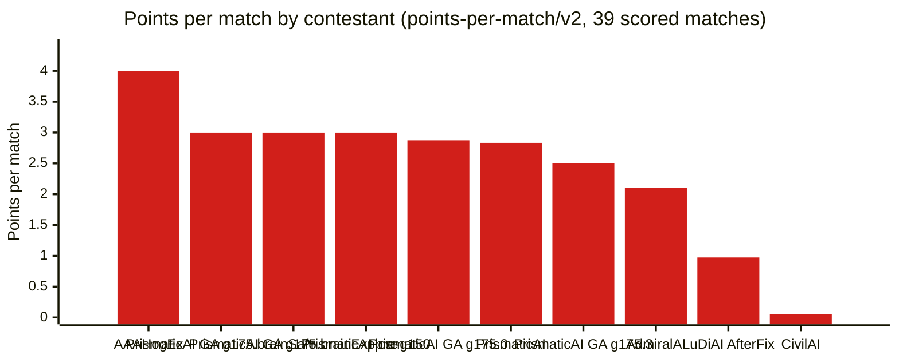
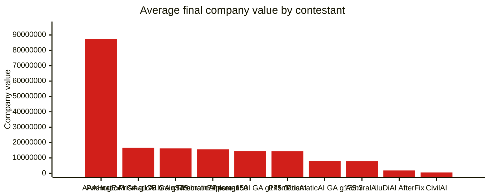
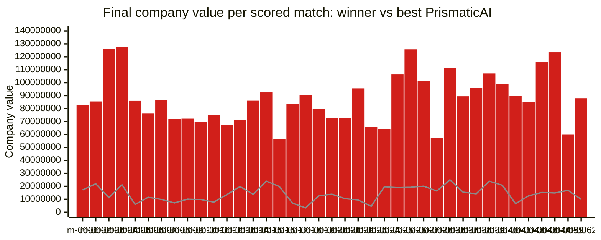
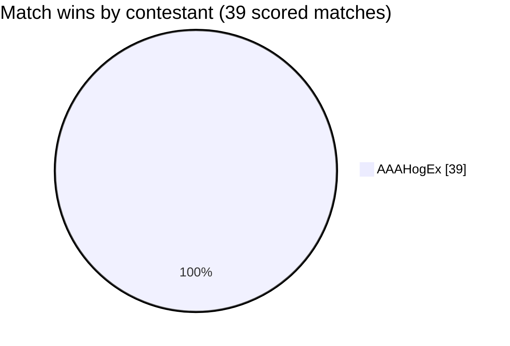
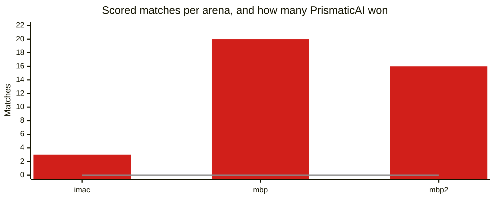

# battle-20261120T191947-1d857b76

Derived from `battle-20261120T191947-1d857b76.json` by `tools/research/ai-battle/battle.py report`; do not edit.

- Edition `1d857b768d547ee5`: PrismaticAI and referee at `962699034c20d90baeb9f617789ea6558cc6ff52`, base set `opengfx-8.0.tar`
- 20-year free-for-all from 1960, map 256x256 temperate, breakdowns 1
- 39 scored match(es) on `imac` (20261119-master-gdf1e05e7d8), `mbp` (20261120-master-m17653b726e), `mbp2` (20261119-master-gdf1e05e7d8)
- Replays: 0 of 0 identical to their original on another arena

| # | Contestant | Played | Wins | Points | Points/match | Avg rank | Avg final value | Squirrel errors | Matches with anomalies |
|---|---|---|---|---|---|---|---|---|---|
| 1 | AAAHogEx | 39 | 39 | 156 | 4.0 | 1.0 | 87.6 M | 0 | 0 |
| 2 | PrismaticAI GA g175.brainSafe | 6 | 0 | 18 | 3.0 | 2.0 | 16.6 M | 0 | 1 |
| 3 | PrismaticAI GA g175.brainExplore | 6 | 0 | 18 | 3.0 | 2.0 | 16.2 M | 0 | 0 |
| 4 | PrismaticAI pre-g150 | 7 | 0 | 21 | 3.0 | 2.0 | 15.6 M | 0 | 1 |
| 5 | PrismaticAI GA g175.0 | 8 | 0 | 23 | 2.875 | 2.12 | 14.4 M | 0 | 5 |
| 6 | PrismaticAI | 6 | 0 | 17 | 2.833 | 2.17 | 14.3 M | 0 | 0 |
| 7 | PrismaticAI GA g175.3 | 6 | 0 | 15 | 2.5 | 2.5 | 8.1 M | 0 | 0 |
| 8 | AdmiralAI | 39 | 0 | 82 | 2.103 | 2.9 | 7.8 M | 0 | 2 |
| 9 | LuDiAI AfterFix | 39 | 0 | 38 | 0.974 | 4.03 | 1.8 M | 0 | 0 |
| 10 | CivilAI | 39 | 0 | 2 | 0.051 | 4.95 | 550.8 k | 3650 | 5 |

<!-- battle-charts:begin -->
<!-- derived from battle-20261120T191947-1d857b76.json by `battle.py render`; `battle.py check` fails when it is stale -->

<!-- battle-charts:end -->

| Match | Arena | Seed | Winner | Value | Last | Anomalies |
|---|---|---|---|---|---|---|
| m-0001 | mbp | 1395709353 | AAAHogEx | 82.8 M | CivilAI | PrismaticAI pre-g150: fleet_drop:122->61; CivilAI: fleet_drop:25->11 |
| m-0002 | mbp | 1395709353 | AAAHogEx | 85.5 M | CivilAI | PrismaticAI GA g175.0: fleet_drop:130->81 |
| m-0003 | mbp | 1395709353 | AAAHogEx | 126.3 M | CivilAI | - |
| m-0004 | mbp | 1395709353 | AAAHogEx | 127.6 M | CivilAI | - |
| m-0005 | mbp | 1395709353 | AAAHogEx | 86.3 M | CivilAI | - |
| m-0006 | mbp | 1670532687 | AAAHogEx | 76.4 M | CivilAI | CivilAI: fleet_drop:19->13 |
| m-0007 | mbp | 1670532687 | AAAHogEx | 86.7 M | LuDiAI AfterFix | - |
| m-0008 | mbp | 1670532687 | AAAHogEx | 71.8 M | CivilAI | PrismaticAI GA g175.0: fleet_drop:57->32; CivilAI: fleet_drop:43->28 |
| m-0009 | mbp | 1670532687 | AAAHogEx | 72.2 M | CivilAI | - |
| m-0010 | imac | 1670532687 | AAAHogEx | 69.6 M | CivilAI | CivilAI: squirrel_errors:3650 |
| m-0011 | imac | 1670532687 | AAAHogEx | 75.2 M | CivilAI | - |
| m-0012 | imac | 1205414224 | AAAHogEx | 67.2 M | CivilAI | - |
| m-0013 | mbp2 | 1205414224 | AAAHogEx | 71.5 M | CivilAI | AdmiralAI: fleet_drop:340->213 |
| m-0014 | mbp2 | 1205414224 | AAAHogEx | 86.4 M | CivilAI | PrismaticAI GA g175.0: fleet_drop:82->46 |
| m-0015 | mbp2 | 1205414224 | AAAHogEx | 92.5 M | CivilAI | PrismaticAI GA g175.brainSafe: fleet_drop:127->71 |
| m-0016 | mbp2 | 1205414224 | AAAHogEx | 56.3 M | CivilAI | - |
| m-0017 | mbp2 | 1205414224 | AAAHogEx | 83.6 M | CivilAI | - |
| m-0018 | mbp2 | 596441512 | AAAHogEx | 90.5 M | CivilAI | - |
| m-0019 | mbp2 | 596441512 | AAAHogEx | 79.7 M | CivilAI | - |
| m-0020 | mbp2 | 596441512 | AAAHogEx | 72.6 M | CivilAI | PrismaticAI GA g175.0: fleet_drop:78->42 |
| m-0021 | mbp2 | 596441512 | AAAHogEx | 72.6 M | CivilAI | - |
| m-0022 | mbp2 | 596441512 | AAAHogEx | 95.6 M | CivilAI | - |
| m-0023 | mbp2 | 596441512 | AAAHogEx | 65.8 M | CivilAI | - |
| m-0024 | mbp2 | 476193334 | AAAHogEx | 64.4 M | CivilAI | - |
| m-0025 | mbp2 | 476193334 | AAAHogEx | 106.6 M | CivilAI | - |
| m-0026 | mbp2 | 476193334 | AAAHogEx | 125.8 M | CivilAI | - |
| m-0027 | mbp2 | 476193334 | AAAHogEx | 101.1 M | CivilAI | - |
| m-0028 | mbp2 | 476193334 | AAAHogEx | 57.6 M | CivilAI | - |
| m-0036 | mbp | 1327687167 | AAAHogEx | 111.3 M | CivilAI | - |
| m-0037 | mbp | 1327687167 | AAAHogEx | 89.5 M | LuDiAI AfterFix | - |
| m-0038 | mbp | 1327687167 | AAAHogEx | 95.9 M | CivilAI | - |
| m-0039 | mbp | 1327687167 | AAAHogEx | 107.1 M | CivilAI | - |
| m-0040 | mbp | 1327687167 | AAAHogEx | 98.9 M | CivilAI | - |
| m-0041 | mbp | 1327687167 | AAAHogEx | 89.6 M | CivilAI | CivilAI: fleet_drop:33->22 |
| m-0042 | mbp | 614067724 | AAAHogEx | 85.1 M | CivilAI | - |
| m-0043 | mbp | 614067724 | AAAHogEx | 115.8 M | CivilAI | - |
| m-0044 | mbp | 614067724 | AAAHogEx | 123.5 M | CivilAI | PrismaticAI GA g175.0: fleet_drop:79->54; AdmiralAI: fleet_drop:187->126 |
| m-0059 | mbp | 754986419 | AAAHogEx | 60.1 M | CivilAI | - |
| m-0062 | mbp | 184526943 | AAAHogEx | 88.0 M | CivilAI | - |
