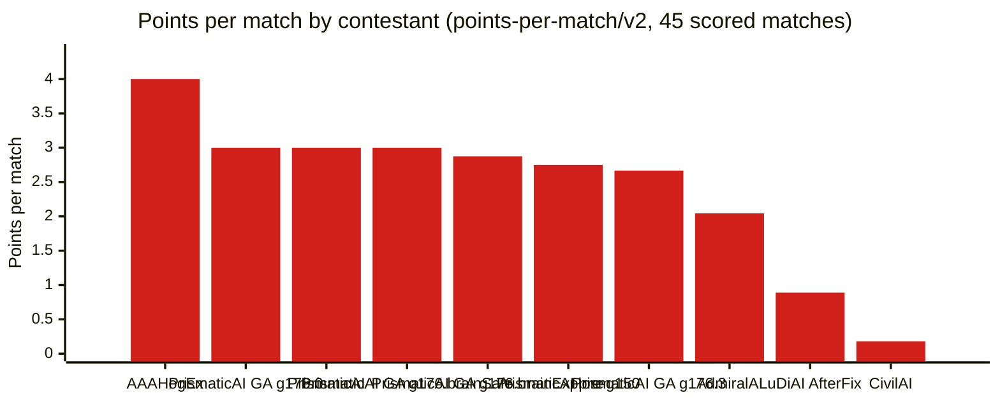
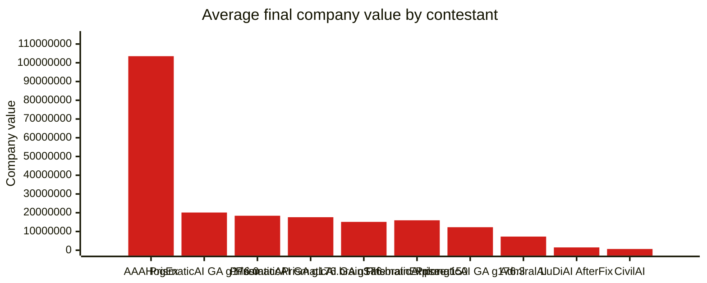
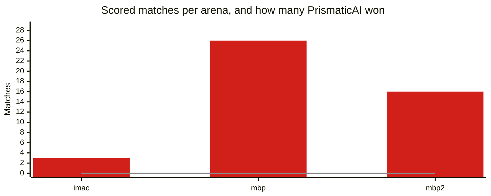

# battle-20261120T192940-cf5e5c23

Derived from `battle-20261120T192940-cf5e5c23.json` by `tools/research/ai-battle/battle.py report`; do not edit.

- Edition `cf5e5c23b75b6e41`: PrismaticAI and referee at `962699034c20d90baeb9f617789ea6558cc6ff52`, base set `opengfx-8.0.tar`
- 20-year free-for-all from 1960, map 256x256 temperate, breakdowns 1
- 45 scored match(es) on `imac` (20261119-master-gdf1e05e7d8), `mbp` (20261120-master-m17653b726e), `mbp2` (20261119-master-gdf1e05e7d8)
- Replays: 0 of 0 identical to their original on another arena

| # | Contestant | Played | Wins | Points | Points/match | Avg rank | Avg final value | Squirrel errors | Matches with anomalies |
|---|---|---|---|---|---|---|---|---|---|
| 1 | AAAHogEx | 45 | 45 | 180 | 4.0 | 1.0 | 103.5 M | 0 | 0 |
| 2 | PrismaticAI GA g176.0 | 8 | 0 | 24 | 3.0 | 2.0 | 20.1 M | 0 | 0 |
| 3 | PrismaticAI | 7 | 0 | 21 | 3.0 | 2.0 | 18.4 M | 0 | 0 |
| 4 | PrismaticAI GA g176.brainSafe | 8 | 0 | 24 | 3.0 | 2.0 | 17.6 M | 0 | 1 |
| 5 | PrismaticAI GA g176.brainExplore | 8 | 0 | 23 | 2.875 | 2.12 | 15.1 M | 0 | 0 |
| 6 | PrismaticAI pre-g150 | 8 | 0 | 22 | 2.75 | 2.25 | 16.0 M | 0 | 1 |
| 7 | PrismaticAI GA g176.3 | 6 | 0 | 16 | 2.667 | 2.33 | 12.3 M | 0 | 1 |
| 8 | AdmiralAI | 45 | 0 | 92 | 2.044 | 2.96 | 7.3 M | 0 | 1 |
| 9 | LuDiAI AfterFix | 45 | 0 | 40 | 0.889 | 4.11 | 1.5 M | 0 | 2 |
| 10 | CivilAI | 45 | 0 | 8 | 0.178 | 4.82 | 656.4 k | 0 | 9 |

```mermaid
---
config:
  xyChart:
    width: 900
    height: 360
  themeVariables:
    xyChart:
      plotColorPalette: "#d11f1a, #8a8a8a, #0b0b0b, #ece4d6"
---
xychart-beta
    title "Final company value per scored match: winner vs best PrismaticAI"
    x-axis ["m-0001", "m-0002", "m-0003", "m-0004", "m-0005", "m-0006", "m-0007", "m-0008", "m-0009", "m-0010", "m-0011", "m-0012", "m-0013", "m-0014", "m-0015", "m-0016", "m-0017", "m-0018", "m-0019", "m-0020", "m-0021", "m-0022", "m-0023", "m-0024", "m-0025", "m-0026", "m-0027", "m-0028", "m-0036", "m-0037", "m-0038", "m-0039", "m-0040", "m-0041", "m-0042", "m-0043", "m-0044", "m-0045", "m-0046", "m-0049", "m-0050", "m-0051", "m-0052", "m-0053", "m-0054"]
    %% series: Winner | Best PrismaticAI
    %% links: battle-20261120T192940-cf5e5c23.md?col=Match&filter=m-0001 | battle-20261120T192940-cf5e5c23.md?col=Match&filter=m-0002 | battle-20261120T192940-cf5e5c23.md?col=Match&filter=m-0003 | battle-20261120T192940-cf5e5c23.md?col=Match&filter=m-0004 | battle-20261120T192940-cf5e5c23.md?col=Match&filter=m-0005 | battle-20261120T192940-cf5e5c23.md?col=Match&filter=m-0006 | battle-20261120T192940-cf5e5c23.md?col=Match&filter=m-0007 | battle-20261120T192940-cf5e5c23.md?col=Match&filter=m-0008 | battle-20261120T192940-cf5e5c23.md?col=Match&filter=m-0009 | battle-20261120T192940-cf5e5c23.md?col=Match&filter=m-0010 | battle-20261120T192940-cf5e5c23.md?col=Match&filter=m-0011 | battle-20261120T192940-cf5e5c23.md?col=Match&filter=m-0012 | battle-20261120T192940-cf5e5c23.md?col=Match&filter=m-0013 | battle-20261120T192940-cf5e5c23.md?col=Match&filter=m-0014 | battle-20261120T192940-cf5e5c23.md?col=Match&filter=m-0015 | battle-20261120T192940-cf5e5c23.md?col=Match&filter=m-0016 | battle-20261120T192940-cf5e5c23.md?col=Match&filter=m-0017 | battle-20261120T192940-cf5e5c23.md?col=Match&filter=m-0018 | battle-20261120T192940-cf5e5c23.md?col=Match&filter=m-0019 | battle-20261120T192940-cf5e5c23.md?col=Match&filter=m-0020 | battle-20261120T192940-cf5e5c23.md?col=Match&filter=m-0021 | battle-20261120T192940-cf5e5c23.md?col=Match&filter=m-0022 | battle-20261120T192940-cf5e5c23.md?col=Match&filter=m-0023 | battle-20261120T192940-cf5e5c23.md?col=Match&filter=m-0024 | battle-20261120T192940-cf5e5c23.md?col=Match&filter=m-0025 | battle-20261120T192940-cf5e5c23.md?col=Match&filter=m-0026 | battle-20261120T192940-cf5e5c23.md?col=Match&filter=m-0027 | battle-20261120T192940-cf5e5c23.md?col=Match&filter=m-0028 | battle-20261120T192940-cf5e5c23.md?col=Match&filter=m-0036 | battle-20261120T192940-cf5e5c23.md?col=Match&filter=m-0037 | battle-20261120T192940-cf5e5c23.md?col=Match&filter=m-0038 | battle-20261120T192940-cf5e5c23.md?col=Match&filter=m-0039 | battle-20261120T192940-cf5e5c23.md?col=Match&filter=m-0040 | battle-20261120T192940-cf5e5c23.md?col=Match&filter=m-0041 | battle-20261120T192940-cf5e5c23.md?col=Match&filter=m-0042 | battle-20261120T192940-cf5e5c23.md?col=Match&filter=m-0043 | battle-20261120T192940-cf5e5c23.md?col=Match&filter=m-0044 | battle-20261120T192940-cf5e5c23.md?col=Match&filter=m-0045 | battle-20261120T192940-cf5e5c23.md?col=Match&filter=m-0046 | battle-20261120T192940-cf5e5c23.md?col=Match&filter=m-0049 | battle-20261120T192940-cf5e5c23.md?col=Match&filter=m-0050 | battle-20261120T192940-cf5e5c23.md?col=Match&filter=m-0051 | battle-20261120T192940-cf5e5c23.md?col=Match&filter=m-0052 | battle-20261120T192940-cf5e5c23.md?col=Match&filter=m-0053 | battle-20261120T192940-cf5e5c23.md?col=Match&filter=m-0054
    y-axis "Company value" 0 --> 182000000
    bar [121686046, 157767338, 119945480, 125662791, 126580737, 61499355, 68005517, 66791716, 56074788, 55966525, 57303464, 88071905, 77523660, 86787735, 83253903, 87668370, 82551177, 86569835, 90276448, 80701929, 87938700, 67631758, 92370465, 114825613, 146566356, 154157920, 165254632, 143694278, 123066997, 134726129, 135275840, 98573052, 116787749, 111054150, 70557782, 77920154, 107599564, 78932445, 95928406, 133394778, 134822094, 140942199, 129306313, 141100857, 75110592]
    line [20286895, 28686432, 24066939, 20744657, 22081182, 7925546, 8145496, 9114131, 8597564, 4941948, 6725349, 14918155, 13661001, 16269420, 19386700, 10042564, 7145029, 19012508, 9834132, 14396292, 13634014, 14635513, 11276329, 29594970, 21656157, 28079269, 26133352, 26835525, 20919997, 16200990, 18091016, 16946445, 18092813, 16495571, 16176385, 10917935, 18163850, 14373456, 11795847, 27067668, 28066355, 17703034, 13814223, 9902583, 20266694]
```

<!-- battle-charts:begin -->
<!-- derived from battle-20261120T192940-cf5e5c23.json by `battle.py render`; `battle.py check` fails when it is stale -->

<!-- battle-charts:end -->

| Match | Arena | Seed | Winner | Value | Last | Anomalies |
|---|---|---|---|---|---|---|
| m-0001 | mbp | 1652068319 | AAAHogEx | 121.7 M | CivilAI | - |
| m-0002 | mbp | 1652068319 | AAAHogEx | 157.8 M | LuDiAI AfterFix | - |
| m-0003 | mbp | 1652068319 | AAAHogEx | 119.9 M | LuDiAI AfterFix | - |
| m-0004 | mbp | 1652068319 | AAAHogEx | 125.7 M | LuDiAI AfterFix | - |
| m-0005 | mbp | 1652068319 | AAAHogEx | 126.6 M | CivilAI | - |
| m-0006 | mbp | 1535254794 | AAAHogEx | 61.5 M | LuDiAI AfterFix | - |
| m-0007 | mbp | 1535254794 | AAAHogEx | 68.0 M | CivilAI | LuDiAI AfterFix: fleet_drop:54->27; CivilAI: fleet_drop:44->13 |
| m-0008 | mbp | 1535254794 | AAAHogEx | 66.8 M | CivilAI | - |
| m-0009 | mbp | 1535254794 | AAAHogEx | 56.1 M | CivilAI | - |
| m-0010 | imac | 1535254794 | AAAHogEx | 56.0 M | CivilAI | - |
| m-0011 | imac | 1535254794 | AAAHogEx | 57.3 M | LuDiAI AfterFix | - |
| m-0012 | imac | 1065502113 | AAAHogEx | 88.1 M | CivilAI | CivilAI: fleet_drop:37->22 |
| m-0013 | mbp2 | 1065502113 | AAAHogEx | 77.5 M | CivilAI | - |
| m-0014 | mbp2 | 1065502113 | AAAHogEx | 86.8 M | CivilAI | CivilAI: fleet_drop:31->7 |
| m-0015 | mbp2 | 1065502113 | AAAHogEx | 83.3 M | CivilAI | - |
| m-0016 | mbp2 | 1065502113 | AAAHogEx | 87.7 M | CivilAI | - |
| m-0017 | mbp2 | 1065502113 | AAAHogEx | 82.6 M | CivilAI | - |
| m-0018 | mbp2 | 1250894353 | AAAHogEx | 86.6 M | CivilAI | - |
| m-0019 | mbp2 | 1250894353 | AAAHogEx | 90.3 M | CivilAI | PrismaticAI pre-g150: fleet_drop:80->33 |
| m-0020 | mbp2 | 1250894353 | AAAHogEx | 80.7 M | CivilAI | - |
| m-0021 | mbp2 | 1250894353 | AAAHogEx | 87.9 M | CivilAI | - |
| m-0022 | mbp2 | 1250894353 | AAAHogEx | 67.6 M | CivilAI | - |
| m-0023 | mbp2 | 1250894353 | AAAHogEx | 92.4 M | CivilAI | PrismaticAI GA g176.3: fleet_drop:118->72 |
| m-0024 | mbp2 | 1734449822 | AAAHogEx | 114.8 M | LuDiAI AfterFix | - |
| m-0025 | mbp2 | 1734449822 | AAAHogEx | 146.6 M | CivilAI | CivilAI: fleet_drop:44->28 |
| m-0026 | mbp2 | 1734449822 | AAAHogEx | 154.2 M | CivilAI | - |
| m-0027 | mbp2 | 1734449822 | AAAHogEx | 165.3 M | CivilAI | - |
| m-0028 | mbp2 | 1734449822 | AAAHogEx | 143.7 M | CivilAI | - |
| m-0036 | mbp | 73480085 | AAAHogEx | 123.1 M | CivilAI | CivilAI: fleet_drop:52->30 |
| m-0037 | mbp | 73480085 | AAAHogEx | 134.7 M | CivilAI | CivilAI: fleet_drop:29->16 |
| m-0038 | mbp | 73480085 | AAAHogEx | 135.3 M | CivilAI | - |
| m-0039 | mbp | 73480085 | AAAHogEx | 98.6 M | CivilAI | PrismaticAI GA g176.brainSafe: fleet_drop:122->77 |
| m-0040 | mbp | 73480085 | AAAHogEx | 116.8 M | CivilAI | CivilAI: fleet_drop:36->22 |
| m-0041 | mbp | 73480085 | AAAHogEx | 111.1 M | CivilAI | CivilAI: fleet_drop:41->18 |
| m-0042 | mbp | 4970971 | AAAHogEx | 70.6 M | CivilAI | - |
| m-0043 | mbp | 4970971 | AAAHogEx | 77.9 M | CivilAI | - |
| m-0044 | mbp | 4970971 | AAAHogEx | 107.6 M | CivilAI | - |
| m-0045 | mbp | 4970971 | AAAHogEx | 78.9 M | AdmiralAI | - |
| m-0046 | mbp | 4970971 | AAAHogEx | 95.9 M | CivilAI | - |
| m-0049 | mbp | 1237828667 | AAAHogEx | 133.4 M | CivilAI | - |
| m-0050 | mbp | 1237828667 | AAAHogEx | 134.8 M | CivilAI | CivilAI: fleet_drop:11->5 |
| m-0051 | mbp | 1237828667 | AAAHogEx | 140.9 M | CivilAI | LuDiAI AfterFix: fleet_drop:82->55 |
| m-0052 | mbp | 1237828667 | AAAHogEx | 129.3 M | CivilAI | AdmiralAI: fleet_drop:177->108 |
| m-0053 | mbp | 1237828667 | AAAHogEx | 141.1 M | LuDiAI AfterFix | - |
| m-0054 | mbp | 1419599141 | AAAHogEx | 75.1 M | CivilAI | - |
