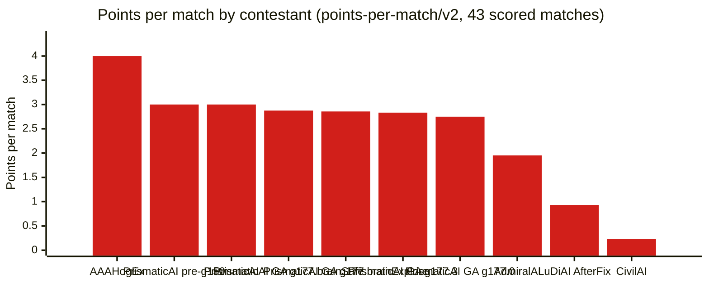
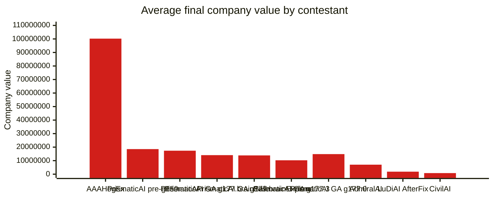
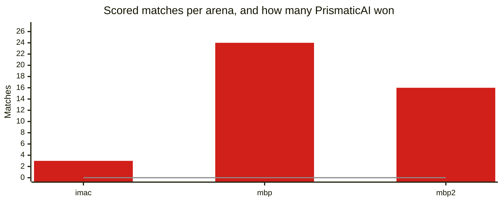

# battle-20261120T194014-6a7363ab

Derived from `battle-20261120T194014-6a7363ab.json` by `tools/research/ai-battle/battle.py report`; do not edit.

- Edition `6a7363ab1f3e735e`: PrismaticAI and referee at `962699034c20d90baeb9f617789ea6558cc6ff52`, base set `opengfx-8.0.tar`
- 20-year free-for-all from 1960, map 256x256 temperate, breakdowns 1
- 43 scored match(es) on `imac` (20261119-master-gdf1e05e7d8), `mbp` (20261120-master-m17653b726e), `mbp2` (20261119-master-gdf1e05e7d8)
- Replays: 1 of 2 identical to their original on another arena

| # | Contestant | Played | Wins | Points | Points/match | Avg rank | Avg final value | Squirrel errors | Matches with anomalies |
|---|---|---|---|---|---|---|---|---|---|
| 1 | AAAHogEx | 43 | 43 | 172 | 4.0 | 1.0 | 100.2 M | 0 | 0 |
| 2 | PrismaticAI pre-g150 | 8 | 0 | 24 | 3.0 | 2.0 | 18.5 M | 0 | 4 |
| 3 | PrismaticAI | 6 | 0 | 18 | 3.0 | 2.0 | 17.4 M | 0 | 0 |
| 4 | PrismaticAI GA g177.brainSafe | 8 | 0 | 23 | 2.875 | 2.12 | 14.1 M | 0 | 4 |
| 5 | PrismaticAI GA g177.brainExplore | 7 | 0 | 20 | 2.857 | 2.14 | 13.9 M | 0 | 2 |
| 6 | PrismaticAI GA g177.3 | 6 | 0 | 17 | 2.833 | 2.17 | 10.3 M | 0 | 1 |
| 7 | PrismaticAI GA g177.0 | 8 | 0 | 22 | 2.75 | 2.25 | 14.8 M | 0 | 3 |
| 8 | AdmiralAI | 43 | 0 | 84 | 1.953 | 3.05 | 7.0 M | 47 | 2 |
| 9 | LuDiAI AfterFix | 43 | 0 | 40 | 0.93 | 4.07 | 1.9 M | 0 | 1 |
| 10 | CivilAI | 43 | 0 | 10 | 0.233 | 4.77 | 802.6 k | 3620 | 10 |

```mermaid
---
config:
  xyChart:
    width: 900
    height: 360
  themeVariables:
    xyChart:
      plotColorPalette: "#d11f1a, #8a8a8a, #0b0b0b, #ece4d6"
---
xychart-beta
    title "Final company value per scored match: winner vs best PrismaticAI"
    x-axis ["m-0001", "m-0002", "m-0003", "m-0004", "m-0005", "m-0006", "m-0007", "m-0008", "m-0009", "m-0010", "m-0011", "m-0012", "m-0013", "m-0014", "m-0015", "m-0016", "m-0017", "m-0018", "m-0019", "m-0020", "m-0021", "m-0022", "m-0023", "m-0024", "m-0025", "m-0026", "m-0027", "m-0028", "m-0036", "m-0037", "m-0038", "m-0039", "m-0040", "m-0041", "m-0042", "m-0043", "m-0044", "m-0045", "m-0046", "m-0047", "m-0049", "m-0050", "m-0051"]
    %% series: Winner | Best PrismaticAI
    %% links: battle-20261120T194014-6a7363ab.md?col=Match&filter=m-0001 | battle-20261120T194014-6a7363ab.md?col=Match&filter=m-0002 | battle-20261120T194014-6a7363ab.md?col=Match&filter=m-0003 | battle-20261120T194014-6a7363ab.md?col=Match&filter=m-0004 | battle-20261120T194014-6a7363ab.md?col=Match&filter=m-0005 | battle-20261120T194014-6a7363ab.md?col=Match&filter=m-0006 | battle-20261120T194014-6a7363ab.md?col=Match&filter=m-0007 | battle-20261120T194014-6a7363ab.md?col=Match&filter=m-0008 | battle-20261120T194014-6a7363ab.md?col=Match&filter=m-0009 | battle-20261120T194014-6a7363ab.md?col=Match&filter=m-0010 | battle-20261120T194014-6a7363ab.md?col=Match&filter=m-0011 | battle-20261120T194014-6a7363ab.md?col=Match&filter=m-0012 | battle-20261120T194014-6a7363ab.md?col=Match&filter=m-0013 | battle-20261120T194014-6a7363ab.md?col=Match&filter=m-0014 | battle-20261120T194014-6a7363ab.md?col=Match&filter=m-0015 | battle-20261120T194014-6a7363ab.md?col=Match&filter=m-0016 | battle-20261120T194014-6a7363ab.md?col=Match&filter=m-0017 | battle-20261120T194014-6a7363ab.md?col=Match&filter=m-0018 | battle-20261120T194014-6a7363ab.md?col=Match&filter=m-0019 | battle-20261120T194014-6a7363ab.md?col=Match&filter=m-0020 | battle-20261120T194014-6a7363ab.md?col=Match&filter=m-0021 | battle-20261120T194014-6a7363ab.md?col=Match&filter=m-0022 | battle-20261120T194014-6a7363ab.md?col=Match&filter=m-0023 | battle-20261120T194014-6a7363ab.md?col=Match&filter=m-0024 | battle-20261120T194014-6a7363ab.md?col=Match&filter=m-0025 | battle-20261120T194014-6a7363ab.md?col=Match&filter=m-0026 | battle-20261120T194014-6a7363ab.md?col=Match&filter=m-0027 | battle-20261120T194014-6a7363ab.md?col=Match&filter=m-0028 | battle-20261120T194014-6a7363ab.md?col=Match&filter=m-0036 | battle-20261120T194014-6a7363ab.md?col=Match&filter=m-0037 | battle-20261120T194014-6a7363ab.md?col=Match&filter=m-0038 | battle-20261120T194014-6a7363ab.md?col=Match&filter=m-0039 | battle-20261120T194014-6a7363ab.md?col=Match&filter=m-0040 | battle-20261120T194014-6a7363ab.md?col=Match&filter=m-0041 | battle-20261120T194014-6a7363ab.md?col=Match&filter=m-0042 | battle-20261120T194014-6a7363ab.md?col=Match&filter=m-0043 | battle-20261120T194014-6a7363ab.md?col=Match&filter=m-0044 | battle-20261120T194014-6a7363ab.md?col=Match&filter=m-0045 | battle-20261120T194014-6a7363ab.md?col=Match&filter=m-0046 | battle-20261120T194014-6a7363ab.md?col=Match&filter=m-0047 | battle-20261120T194014-6a7363ab.md?col=Match&filter=m-0049 | battle-20261120T194014-6a7363ab.md?col=Match&filter=m-0050 | battle-20261120T194014-6a7363ab.md?col=Match&filter=m-0051
    y-axis "Company value" 0 --> 169000000
    bar [95697933, 96516551, 91688707, 91046355, 98324149, 132396529, 106032579, 102436340, 153743386, 111427077, 114552846, 69573733, 68726290, 89211641, 71410551, 74902841, 93210566, 150344874, 132232159, 109057716, 134282484, 138443613, 153345823, 93465964, 89521849, 80222829, 76581404, 88383620, 61844875, 45401457, 76411113, 42344503, 60200078, 52422890, 116078291, 134685224, 103039194, 141730713, 123510199, 128408421, 104492273, 112678876, 99818390]
    line [19704990, 13490854, 10514818, 13893317, 9218620, 21384323, 23950004, 20494730, 16806894, 17851302, 9778398, 20190727, 28420245, 9542905, 13349397, 11727790, 9510035, 21585474, 21047230, 18246537, 14724975, 16474217, 16797960, 15759939, 12168155, 7586080, 13730867, 10445201, 7233845, 15105368, 14486505, 12105483, 11185727, 6504946, 18012921, 15021074, 19597099, 18917940, 15567365, 9812240, 12931678, 15294476, 12493281]
```

<!-- battle-charts:begin -->
<!-- derived from battle-20261120T194014-6a7363ab.json by `battle.py render`; `battle.py check` fails when it is stale -->

<!-- battle-charts:end -->

| Seed | Original | Replay | Arenas | Identical |
|---|---|---|---|---|
| 523915650 | m-0013 | m-0048 | mbp2 / mbp | yes |
| 523915650 | m-0012 | m-0056 | imac / mbp | NO |

| Match | Arena | Seed | Winner | Value | Last | Anomalies |
|---|---|---|---|---|---|---|
| m-0001 | mbp | 480905994 | AAAHogEx | 95.7 M | AdmiralAI | - |
| m-0002 | mbp | 480905994 | AAAHogEx | 96.5 M | CivilAI | CivilAI: fleet_drop:44->23 |
| m-0003 | mbp | 480905994 | AAAHogEx | 91.7 M | CivilAI | LuDiAI AfterFix: fleet_drop:98->61 |
| m-0004 | mbp | 480905994 | AAAHogEx | 91.0 M | AdmiralAI | CivilAI: fleet_drop:48->31 |
| m-0005 | mbp | 480905994 | AAAHogEx | 98.3 M | AdmiralAI | - |
| m-0006 | mbp | 1637627327 | AAAHogEx | 132.4 M | LuDiAI AfterFix | - |
| m-0007 | mbp | 1637627327 | AAAHogEx | 106.0 M | CivilAI | PrismaticAI pre-g150: fleet_drop:122->69 |
| m-0008 | mbp | 1637627327 | AAAHogEx | 102.4 M | CivilAI | PrismaticAI GA g177.0: fleet_drop:122->79 |
| m-0009 | mbp | 1637627327 | AAAHogEx | 153.7 M | CivilAI | - |
| m-0010 | imac | 1637627327 | AAAHogEx | 111.4 M | CivilAI | PrismaticAI GA g177.brainExplore: fleet_drop:113->74 |
| m-0011 | imac | 1637627327 | AAAHogEx | 114.6 M | CivilAI | CivilAI: fleet_drop:84->43 |
| m-0012 | imac | 523915650 | AAAHogEx | 69.6 M | LuDiAI AfterFix | - |
| m-0013 | mbp2 | 523915650 | AAAHogEx | 68.7 M | CivilAI | - |
| m-0014 | mbp2 | 523915650 | AAAHogEx | 89.2 M | LuDiAI AfterFix | - |
| m-0015 | mbp2 | 523915650 | AAAHogEx | 71.4 M | CivilAI | PrismaticAI GA g177.brainSafe: fleet_drop:99->67; CivilAI: fleet_drop:39->20 |
| m-0016 | mbp2 | 523915650 | AAAHogEx | 74.9 M | CivilAI | PrismaticAI GA g177.brainExplore: fleet_drop:79->41 |
| m-0017 | mbp2 | 523915650 | AAAHogEx | 93.2 M | CivilAI | PrismaticAI GA g177.3: fleet_drop:72->46 |
| m-0018 | mbp2 | 466303039 | AAAHogEx | 150.3 M | CivilAI | - |
| m-0019 | mbp2 | 466303039 | AAAHogEx | 132.2 M | CivilAI | PrismaticAI pre-g150: fleet_drop:149->69; CivilAI: fleet_drop:83->19 |
| m-0020 | mbp2 | 466303039 | AAAHogEx | 109.1 M | LuDiAI AfterFix | PrismaticAI GA g177.0: fleet_drop:85->45 |
| m-0021 | mbp2 | 466303039 | AAAHogEx | 134.3 M | CivilAI | PrismaticAI GA g177.brainSafe: fleet_drop:132->69 |
| m-0022 | mbp2 | 466303039 | AAAHogEx | 138.4 M | CivilAI | - |
| m-0023 | mbp2 | 466303039 | AAAHogEx | 153.3 M | LuDiAI AfterFix | - |
| m-0024 | mbp2 | 190620092 | AAAHogEx | 93.5 M | CivilAI | - |
| m-0025 | mbp2 | 190620092 | AAAHogEx | 89.5 M | CivilAI | - |
| m-0026 | mbp2 | 190620092 | AAAHogEx | 80.2 M | CivilAI | CivilAI: squirrel_errors:3620 |
| m-0027 | mbp2 | 190620092 | AAAHogEx | 76.6 M | CivilAI | PrismaticAI GA g177.brainSafe: fleet_drop:135->86 |
| m-0028 | mbp2 | 190620092 | AAAHogEx | 88.4 M | CivilAI | - |
| m-0036 | mbp | 403507422 | AAAHogEx | 61.8 M | CivilAI | - |
| m-0037 | mbp | 403507422 | AAAHogEx | 45.4 M | LuDiAI AfterFix | PrismaticAI pre-g150: fleet_drop:82->43 |
| m-0038 | mbp | 403507422 | AAAHogEx | 76.4 M | CivilAI | - |
| m-0039 | mbp | 403507422 | AAAHogEx | 42.3 M | CivilAI | CivilAI: fleet_drop:19->3 |
| m-0040 | mbp | 403507422 | AAAHogEx | 60.2 M | CivilAI | AdmiralAI: squirrel_errors:47 |
| m-0041 | mbp | 403507422 | AAAHogEx | 52.4 M | CivilAI | - |
| m-0042 | mbp | 1009471410 | AAAHogEx | 116.1 M | CivilAI | CivilAI: fleet_drop:22->13 |
| m-0043 | mbp | 1009471410 | AAAHogEx | 134.7 M | CivilAI | PrismaticAI pre-g150: fleet_drop:145->81 |
| m-0044 | mbp | 1009471410 | AAAHogEx | 103.0 M | CivilAI | AdmiralAI: fleet_drop:160->95 |
| m-0045 | mbp | 1009471410 | AAAHogEx | 141.7 M | CivilAI | PrismaticAI GA g177.brainSafe: fleet_drop:144->72 |
| m-0046 | mbp | 1009471410 | AAAHogEx | 123.5 M | CivilAI | - |
| m-0047 | mbp | 1009471410 | AAAHogEx | 128.4 M | CivilAI | - |
| m-0048 (replay) | mbp | 523915650 | AAAHogEx | 68.7 M | CivilAI | - |
| m-0049 | mbp | 143897185 | AAAHogEx | 104.5 M | CivilAI | CivilAI: fleet_drop:12->8 |
| m-0050 | mbp | 143897185 | AAAHogEx | 112.7 M | CivilAI | PrismaticAI GA g177.0: fleet_drop:65->45; CivilAI: fleet_drop:97->55 |
| m-0051 | mbp | 143897185 | AAAHogEx | 99.8 M | CivilAI | - |
| m-0056 (replay) | mbp | 523915650 | AAAHogEx | 72.2 M | CivilAI | - |
