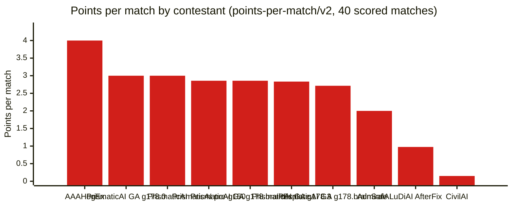
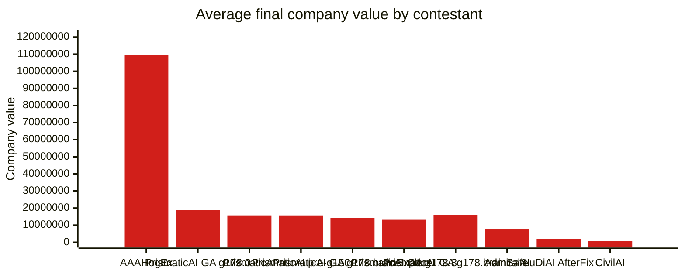
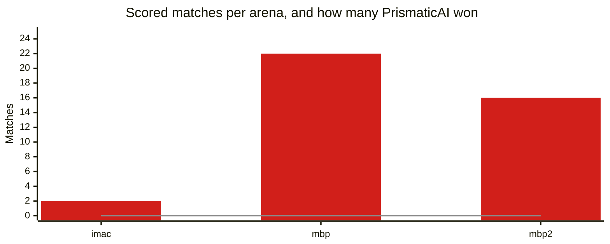

# battle-20261120T195017-78ce8038

Derived from `battle-20261120T195017-78ce8038.json` by `tools/research/ai-battle/battle.py report`; do not edit.

- Edition `78ce80382f6ddcc7`: PrismaticAI and referee at `962699034c20d90baeb9f617789ea6558cc6ff52`, base set `opengfx-8.0.tar`
- 20-year free-for-all from 1960, map 256x256 temperate, breakdowns 1
- 40 scored match(es) on `imac` (20261119-master-gdf1e05e7d8), `mbp` (20261120-master-m17653b726e), `mbp2` (20261119-master-gdf1e05e7d8)
- Replays: 0 of 0 identical to their original on another arena

| # | Contestant | Played | Wins | Points | Points/match | Avg rank | Avg final value | Squirrel errors | Matches with anomalies |
|---|---|---|---|---|---|---|---|---|---|
| 1 | AAAHogEx | 40 | 40 | 160 | 4.0 | 1.0 | 109.7 M | 0 | 0 |
| 2 | PrismaticAI GA g178.0 | 8 | 0 | 24 | 3.0 | 2.0 | 18.9 M | 0 | 4 |
| 3 | PrismaticAI | 5 | 0 | 15 | 3.0 | 2.0 | 15.7 M | 0 | 0 |
| 4 | PrismaticAI pre-g150 | 7 | 0 | 20 | 2.857 | 2.14 | 15.7 M | 0 | 1 |
| 5 | PrismaticAI GA g178.brainExplore | 7 | 0 | 20 | 2.857 | 2.14 | 14.2 M | 0 | 3 |
| 6 | PrismaticAI GA g178.3 | 6 | 0 | 17 | 2.833 | 2.17 | 13.2 M | 0 | 1 |
| 7 | PrismaticAI GA g178.brainSafe | 7 | 0 | 19 | 2.714 | 2.29 | 16.0 M | 0 | 2 |
| 8 | AdmiralAI | 40 | 0 | 80 | 2.0 | 3.0 | 7.5 M | 91 | 6 |
| 9 | LuDiAI AfterFix | 40 | 0 | 39 | 0.975 | 4.03 | 1.9 M | 0 | 0 |
| 10 | CivilAI | 40 | 0 | 6 | 0.15 | 4.85 | 714.9 k | 0 | 3 |

```mermaid
---
config:
  xyChart:
    width: 900
    height: 360
  themeVariables:
    xyChart:
      plotColorPalette: "#d11f1a, #8a8a8a, #0b0b0b, #ece4d6"
---
xychart-beta
    title "Final company value per scored match: winner vs best PrismaticAI"
    x-axis ["m-0001", "m-0002", "m-0003", "m-0004", "m-0005", "m-0006", "m-0007", "m-0008", "m-0009", "m-0010", "m-0011", "m-0013", "m-0014", "m-0015", "m-0016", "m-0017", "m-0018", "m-0019", "m-0020", "m-0021", "m-0022", "m-0023", "m-0024", "m-0025", "m-0026", "m-0027", "m-0028", "m-0036", "m-0037", "m-0038", "m-0039", "m-0040", "m-0041", "m-0042", "m-0043", "m-0044", "m-0045", "m-0046", "m-0047", "m-0050"]
    %% series: Winner | Best PrismaticAI
    %% links: battle-20261120T195017-78ce8038.md?col=Match&filter=m-0001 | battle-20261120T195017-78ce8038.md?col=Match&filter=m-0002 | battle-20261120T195017-78ce8038.md?col=Match&filter=m-0003 | battle-20261120T195017-78ce8038.md?col=Match&filter=m-0004 | battle-20261120T195017-78ce8038.md?col=Match&filter=m-0005 | battle-20261120T195017-78ce8038.md?col=Match&filter=m-0006 | battle-20261120T195017-78ce8038.md?col=Match&filter=m-0007 | battle-20261120T195017-78ce8038.md?col=Match&filter=m-0008 | battle-20261120T195017-78ce8038.md?col=Match&filter=m-0009 | battle-20261120T195017-78ce8038.md?col=Match&filter=m-0010 | battle-20261120T195017-78ce8038.md?col=Match&filter=m-0011 | battle-20261120T195017-78ce8038.md?col=Match&filter=m-0013 | battle-20261120T195017-78ce8038.md?col=Match&filter=m-0014 | battle-20261120T195017-78ce8038.md?col=Match&filter=m-0015 | battle-20261120T195017-78ce8038.md?col=Match&filter=m-0016 | battle-20261120T195017-78ce8038.md?col=Match&filter=m-0017 | battle-20261120T195017-78ce8038.md?col=Match&filter=m-0018 | battle-20261120T195017-78ce8038.md?col=Match&filter=m-0019 | battle-20261120T195017-78ce8038.md?col=Match&filter=m-0020 | battle-20261120T195017-78ce8038.md?col=Match&filter=m-0021 | battle-20261120T195017-78ce8038.md?col=Match&filter=m-0022 | battle-20261120T195017-78ce8038.md?col=Match&filter=m-0023 | battle-20261120T195017-78ce8038.md?col=Match&filter=m-0024 | battle-20261120T195017-78ce8038.md?col=Match&filter=m-0025 | battle-20261120T195017-78ce8038.md?col=Match&filter=m-0026 | battle-20261120T195017-78ce8038.md?col=Match&filter=m-0027 | battle-20261120T195017-78ce8038.md?col=Match&filter=m-0028 | battle-20261120T195017-78ce8038.md?col=Match&filter=m-0036 | battle-20261120T195017-78ce8038.md?col=Match&filter=m-0037 | battle-20261120T195017-78ce8038.md?col=Match&filter=m-0038 | battle-20261120T195017-78ce8038.md?col=Match&filter=m-0039 | battle-20261120T195017-78ce8038.md?col=Match&filter=m-0040 | battle-20261120T195017-78ce8038.md?col=Match&filter=m-0041 | battle-20261120T195017-78ce8038.md?col=Match&filter=m-0042 | battle-20261120T195017-78ce8038.md?col=Match&filter=m-0043 | battle-20261120T195017-78ce8038.md?col=Match&filter=m-0044 | battle-20261120T195017-78ce8038.md?col=Match&filter=m-0045 | battle-20261120T195017-78ce8038.md?col=Match&filter=m-0046 | battle-20261120T195017-78ce8038.md?col=Match&filter=m-0047 | battle-20261120T195017-78ce8038.md?col=Match&filter=m-0050
    y-axis "Company value" 0 --> 171000000
    bar [92380910, 48651384, 95324217, 58646776, 83871452, 125526165, 92241068, 86870542, 96840622, 114822979, 102284128, 106427438, 114060707, 87517150, 100169998, 109554388, 107168598, 144047933, 111869262, 137798011, 132864984, 124707088, 70923866, 103786861, 104183565, 84944943, 85522608, 133246047, 97750118, 114460694, 130965963, 136334796, 101948216, 150656447, 155639901, 143141290, 122554340, 150868751, 149982346, 78270704]
    line [19446090, 20061563, 12070838, 12171697, 15033232, 18410701, 7888028, 20961264, 21500653, 22437074, 12836565, 20293560, 19584176, 21202765, 18386810, 17149121, 18807660, 17562469, 16215103, 17505469, 14708457, 12109709, 14051470, 12762126, 15903391, 14005916, 14925117, 12561531, 14983771, 11816867, 4467050, 7659703, 5332881, 14731498, 16961737, 21464887, 20917327, 9434221, 16655509, 25073599]
```

<!-- battle-charts:begin -->
<!-- derived from battle-20261120T195017-78ce8038.json by `battle.py render`; `battle.py check` fails when it is stale -->

<!-- battle-charts:end -->

| Match | Arena | Seed | Winner | Value | Last | Anomalies |
|---|---|---|---|---|---|---|
| m-0001 | mbp | 1348398992 | AAAHogEx | 92.4 M | CivilAI | - |
| m-0002 | mbp | 1348398992 | AAAHogEx | 48.7 M | CivilAI | - |
| m-0003 | mbp | 1348398992 | AAAHogEx | 95.3 M | CivilAI | - |
| m-0004 | mbp | 1348398992 | AAAHogEx | 58.6 M | CivilAI | - |
| m-0005 | mbp | 1348398992 | AAAHogEx | 83.9 M | CivilAI | AdmiralAI: squirrel_errors:44 |
| m-0006 | mbp | 46776306 | AAAHogEx | 125.5 M | CivilAI | - |
| m-0007 | mbp | 46776306 | AAAHogEx | 92.2 M | CivilAI | PrismaticAI pre-g150: fleet_drop:111->46 |
| m-0008 | mbp | 46776306 | AAAHogEx | 86.9 M | CivilAI | PrismaticAI GA g178.0: fleet_drop:87->59 |
| m-0009 | mbp | 46776306 | AAAHogEx | 96.8 M | CivilAI | PrismaticAI GA g178.brainSafe: fleet_drop:94->51 |
| m-0010 | imac | 46776306 | AAAHogEx | 114.8 M | CivilAI | PrismaticAI GA g178.brainExplore: fleet_drop:115->60 |
| m-0011 | imac | 46776306 | AAAHogEx | 102.3 M | CivilAI | AdmiralAI: squirrel_errors:47 |
| m-0013 | mbp2 | 79679335 | AAAHogEx | 106.4 M | CivilAI | - |
| m-0014 | mbp2 | 79679335 | AAAHogEx | 114.1 M | CivilAI | - |
| m-0015 | mbp2 | 79679335 | AAAHogEx | 87.5 M | CivilAI | - |
| m-0016 | mbp2 | 79679335 | AAAHogEx | 100.2 M | AdmiralAI | PrismaticAI GA g178.brainExplore: fleet_drop:132->92; AdmiralAI: fleet_drop:103->57 |
| m-0017 | mbp2 | 79679335 | AAAHogEx | 109.6 M | CivilAI | - |
| m-0018 | mbp2 | 965112186 | AAAHogEx | 107.2 M | CivilAI | - |
| m-0019 | mbp2 | 965112186 | AAAHogEx | 144.0 M | CivilAI | - |
| m-0020 | mbp2 | 965112186 | AAAHogEx | 111.9 M | CivilAI | PrismaticAI GA g178.0: fleet_drop:86->56 |
| m-0021 | mbp2 | 965112186 | AAAHogEx | 137.8 M | CivilAI | - |
| m-0022 | mbp2 | 965112186 | AAAHogEx | 132.9 M | CivilAI | - |
| m-0023 | mbp2 | 965112186 | AAAHogEx | 124.7 M | CivilAI | AdmiralAI: fleet_drop:245->130 |
| m-0024 | mbp2 | 1093435955 | AAAHogEx | 70.9 M | CivilAI | - |
| m-0025 | mbp2 | 1093435955 | AAAHogEx | 103.8 M | CivilAI | - |
| m-0026 | mbp2 | 1093435955 | AAAHogEx | 104.2 M | CivilAI | - |
| m-0027 | mbp2 | 1093435955 | AAAHogEx | 84.9 M | CivilAI | - |
| m-0028 | mbp2 | 1093435955 | AAAHogEx | 85.5 M | CivilAI | - |
| m-0036 | mbp | 530163857 | AAAHogEx | 133.2 M | CivilAI | AdmiralAI: fleet_drop:231->112 |
| m-0037 | mbp | 530163857 | AAAHogEx | 97.8 M | LuDiAI AfterFix | - |
| m-0038 | mbp | 530163857 | AAAHogEx | 114.5 M | CivilAI | PrismaticAI GA g178.0: fleet_drop:130->57 |
| m-0039 | mbp | 530163857 | AAAHogEx | 131.0 M | CivilAI | PrismaticAI GA g178.brainSafe: fleet_drop:76->50 |
| m-0040 | mbp | 530163857 | AAAHogEx | 136.3 M | CivilAI | PrismaticAI GA g178.brainExplore: fleet_drop:110->35 |
| m-0041 | mbp | 530163857 | AAAHogEx | 101.9 M | CivilAI | PrismaticAI GA g178.3: fleet_drop:80->50 |
| m-0042 | mbp | 1773519832 | AAAHogEx | 150.7 M | CivilAI | CivilAI: fleet_drop:72->50 |
| m-0043 | mbp | 1773519832 | AAAHogEx | 155.6 M | CivilAI | - |
| m-0044 | mbp | 1773519832 | AAAHogEx | 143.1 M | AdmiralAI | PrismaticAI GA g178.0: fleet_drop:153->94; AdmiralAI: fleet_drop:27->14 |
| m-0045 | mbp | 1773519832 | AAAHogEx | 122.6 M | LuDiAI AfterFix | - |
| m-0046 | mbp | 1773519832 | AAAHogEx | 150.9 M | LuDiAI AfterFix | - |
| m-0047 | mbp | 1773519832 | AAAHogEx | 150.0 M | CivilAI | CivilAI: fleet_drop:36->16 |
| m-0050 | mbp | 1602316334 | AAAHogEx | 78.3 M | CivilAI | CivilAI: fleet_drop:61->41 |
