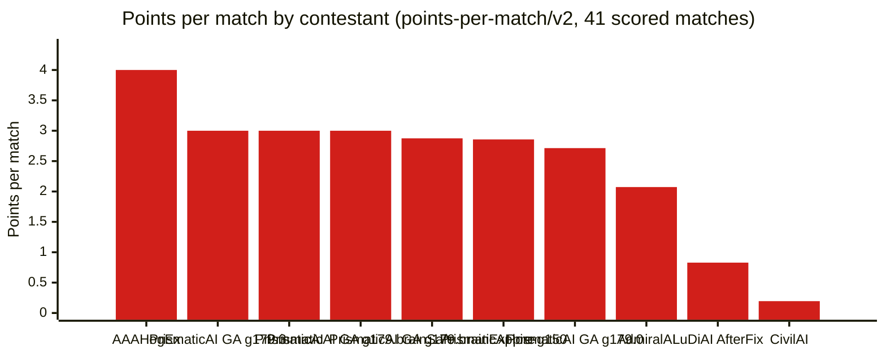
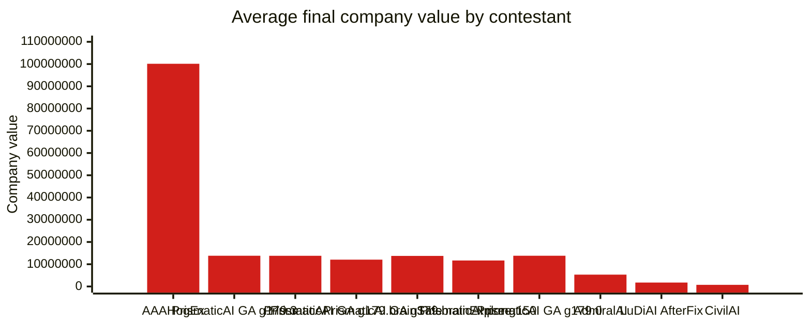
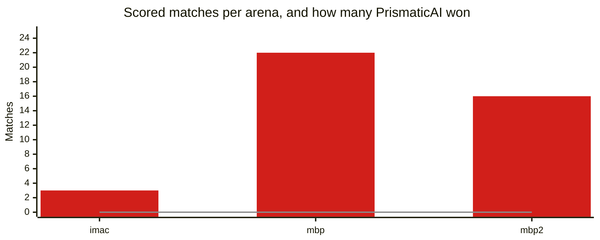

# battle-20261120T200020-fb84335d

Derived from `battle-20261120T200020-fb84335d.json` by `tools/research/ai-battle/battle.py report`; do not edit.

- Edition `fb84335dc782cb22`: PrismaticAI and referee at `962699034c20d90baeb9f617789ea6558cc6ff52`, base set `opengfx-8.0.tar`
- 20-year free-for-all from 1960, map 256x256 temperate, breakdowns 1
- 41 scored match(es) on `imac` (20261119-master-gdf1e05e7d8), `mbp` (20261120-master-m17653b726e), `mbp2` (20261119-master-gdf1e05e7d8)
- Replays: 0 of 0 identical to their original on another arena

| # | Contestant | Played | Wins | Points | Points/match | Avg rank | Avg final value | Squirrel errors | Matches with anomalies |
|---|---|---|---|---|---|---|---|---|---|
| 1 | AAAHogEx | 41 | 41 | 164 | 4.0 | 1.0 | 100.1 M | 0 | 0 |
| 2 | PrismaticAI GA g179.3 | 6 | 0 | 18 | 3.0 | 2.0 | 13.8 M | 0 | 2 |
| 3 | PrismaticAI | 6 | 0 | 18 | 3.0 | 2.0 | 13.8 M | 0 | 0 |
| 4 | PrismaticAI GA g179.brainSafe | 7 | 0 | 21 | 3.0 | 2.0 | 12.1 M | 0 | 2 |
| 5 | PrismaticAI GA g179.brainExplore | 8 | 0 | 23 | 2.875 | 2.12 | 13.7 M | 0 | 2 |
| 6 | PrismaticAI pre-g150 | 7 | 0 | 20 | 2.857 | 2.14 | 11.7 M | 0 | 1 |
| 7 | PrismaticAI GA g179.0 | 7 | 0 | 19 | 2.714 | 2.29 | 13.8 M | 0 | 3 |
| 8 | AdmiralAI | 41 | 0 | 85 | 2.073 | 2.93 | 5.3 M | 0 | 3 |
| 9 | LuDiAI AfterFix | 41 | 0 | 34 | 0.829 | 4.17 | 1.8 M | 0 | 1 |
| 10 | CivilAI | 41 | 0 | 8 | 0.195 | 4.8 | 729.4 k | 3660 | 8 |

```mermaid
---
config:
  xyChart:
    width: 900
    height: 360
  themeVariables:
    xyChart:
      plotColorPalette: "#d11f1a, #8a8a8a, #0b0b0b, #ece4d6"
---
xychart-beta
    title "Final company value per scored match: winner vs best PrismaticAI"
    x-axis ["m-0001", "m-0002", "m-0003", "m-0004", "m-0005", "m-0006", "m-0007", "m-0008", "m-0009", "m-0010", "m-0011", "m-0012", "m-0013", "m-0014", "m-0015", "m-0016", "m-0017", "m-0018", "m-0019", "m-0020", "m-0021", "m-0022", "m-0023", "m-0024", "m-0025", "m-0026", "m-0027", "m-0028", "m-0036", "m-0037", "m-0038", "m-0039", "m-0040", "m-0041", "m-0042", "m-0043", "m-0044", "m-0046", "m-0057", "m-0058", "m-0059"]
    %% series: Winner | Best PrismaticAI
    %% links: battle-20261120T200020-fb84335d.md?col=Match&filter=m-0001 | battle-20261120T200020-fb84335d.md?col=Match&filter=m-0002 | battle-20261120T200020-fb84335d.md?col=Match&filter=m-0003 | battle-20261120T200020-fb84335d.md?col=Match&filter=m-0004 | battle-20261120T200020-fb84335d.md?col=Match&filter=m-0005 | battle-20261120T200020-fb84335d.md?col=Match&filter=m-0006 | battle-20261120T200020-fb84335d.md?col=Match&filter=m-0007 | battle-20261120T200020-fb84335d.md?col=Match&filter=m-0008 | battle-20261120T200020-fb84335d.md?col=Match&filter=m-0009 | battle-20261120T200020-fb84335d.md?col=Match&filter=m-0010 | battle-20261120T200020-fb84335d.md?col=Match&filter=m-0011 | battle-20261120T200020-fb84335d.md?col=Match&filter=m-0012 | battle-20261120T200020-fb84335d.md?col=Match&filter=m-0013 | battle-20261120T200020-fb84335d.md?col=Match&filter=m-0014 | battle-20261120T200020-fb84335d.md?col=Match&filter=m-0015 | battle-20261120T200020-fb84335d.md?col=Match&filter=m-0016 | battle-20261120T200020-fb84335d.md?col=Match&filter=m-0017 | battle-20261120T200020-fb84335d.md?col=Match&filter=m-0018 | battle-20261120T200020-fb84335d.md?col=Match&filter=m-0019 | battle-20261120T200020-fb84335d.md?col=Match&filter=m-0020 | battle-20261120T200020-fb84335d.md?col=Match&filter=m-0021 | battle-20261120T200020-fb84335d.md?col=Match&filter=m-0022 | battle-20261120T200020-fb84335d.md?col=Match&filter=m-0023 | battle-20261120T200020-fb84335d.md?col=Match&filter=m-0024 | battle-20261120T200020-fb84335d.md?col=Match&filter=m-0025 | battle-20261120T200020-fb84335d.md?col=Match&filter=m-0026 | battle-20261120T200020-fb84335d.md?col=Match&filter=m-0027 | battle-20261120T200020-fb84335d.md?col=Match&filter=m-0028 | battle-20261120T200020-fb84335d.md?col=Match&filter=m-0036 | battle-20261120T200020-fb84335d.md?col=Match&filter=m-0037 | battle-20261120T200020-fb84335d.md?col=Match&filter=m-0038 | battle-20261120T200020-fb84335d.md?col=Match&filter=m-0039 | battle-20261120T200020-fb84335d.md?col=Match&filter=m-0040 | battle-20261120T200020-fb84335d.md?col=Match&filter=m-0041 | battle-20261120T200020-fb84335d.md?col=Match&filter=m-0042 | battle-20261120T200020-fb84335d.md?col=Match&filter=m-0043 | battle-20261120T200020-fb84335d.md?col=Match&filter=m-0044 | battle-20261120T200020-fb84335d.md?col=Match&filter=m-0046 | battle-20261120T200020-fb84335d.md?col=Match&filter=m-0057 | battle-20261120T200020-fb84335d.md?col=Match&filter=m-0058 | battle-20261120T200020-fb84335d.md?col=Match&filter=m-0059
    y-axis "Company value" 0 --> 148000000
    bar [90719883, 122121752, 118810239, 74963357, 97449213, 134249167, 131121482, 122202400, 110673447, 114757797, 110174484, 105962971, 97661992, 76005312, 101029380, 92336739, 107939112, 121053926, 119965543, 101562507, 106197495, 115229774, 134799923, 85439580, 94019648, 108264448, 78685378, 110858866, 79910481, 121339541, 83422282, 79690742, 99879313, 113998501, 79946920, 89107739, 86549646, 83945377, 63247333, 72504642, 67285562]
    line [9502185, 12540967, 8760252, 14115965, 9337025, 20655324, 19253835, 15820965, 15382001, 25429209, 15044949, 7972238, 5951493, 7472435, 9641553, 3459682, 6396302, 9938079, 12111939, 19475110, 9897358, 12121009, 12669363, 7721369, 3163483, 3691919, 4410175, 3786578, 15557441, 16849370, 17996802, 19140357, 16079105, 21308560, 20915903, 14911779, 19708287, 19677891, 17180461, 15217141, 18132618]
```

<!-- battle-charts:begin -->
<!-- derived from battle-20261120T200020-fb84335d.json by `battle.py render`; `battle.py check` fails when it is stale -->

<!-- battle-charts:end -->

| Match | Arena | Seed | Winner | Value | Last | Anomalies |
|---|---|---|---|---|---|---|
| m-0001 | mbp | 869342248 | AAAHogEx | 90.7 M | CivilAI | - |
| m-0002 | mbp | 869342248 | AAAHogEx | 122.1 M | CivilAI | PrismaticAI GA g179.0: fleet_drop:108->73 |
| m-0003 | mbp | 869342248 | AAAHogEx | 118.8 M | CivilAI | AdmiralAI: fleet_drop:504->348 |
| m-0004 | mbp | 869342248 | AAAHogEx | 75.0 M | CivilAI | PrismaticAI GA g179.brainExplore: fleet_drop:74->39; CivilAI: no_vehicles |
| m-0005 | mbp | 869342248 | AAAHogEx | 97.4 M | CivilAI | PrismaticAI GA g179.3: fleet_drop:109->60 |
| m-0006 | mbp | 1633033628 | AAAHogEx | 134.2 M | LuDiAI AfterFix | - |
| m-0007 | mbp | 1633033628 | AAAHogEx | 131.1 M | CivilAI | CivilAI: fleet_drop:58->39 |
| m-0008 | mbp | 1633033628 | AAAHogEx | 122.2 M | CivilAI | CivilAI: squirrel_errors:3660 |
| m-0009 | mbp | 1633033628 | AAAHogEx | 110.7 M | CivilAI | - |
| m-0010 | imac | 1633033628 | AAAHogEx | 114.8 M | LuDiAI AfterFix | CivilAI: fleet_drop:24->12 |
| m-0011 | imac | 1633033628 | AAAHogEx | 110.2 M | CivilAI | - |
| m-0012 | imac | 731425966 | AAAHogEx | 106.0 M | LuDiAI AfterFix | - |
| m-0013 | mbp2 | 731425966 | AAAHogEx | 97.7 M | CivilAI | - |
| m-0014 | mbp2 | 731425966 | AAAHogEx | 76.0 M | CivilAI | PrismaticAI GA g179.0: fleet_drop:84->53 |
| m-0015 | mbp2 | 731425966 | AAAHogEx | 101.0 M | CivilAI | PrismaticAI GA g179.brainSafe: fleet_drop:96->63 |
| m-0016 | mbp2 | 731425966 | AAAHogEx | 92.3 M | CivilAI | - |
| m-0017 | mbp2 | 731425966 | AAAHogEx | 107.9 M | CivilAI | PrismaticAI GA g179.3: fleet_drop:98->47 |
| m-0018 | mbp2 | 986496743 | AAAHogEx | 121.1 M | CivilAI | AdmiralAI: fleet_drop:164->97 |
| m-0019 | mbp2 | 986496743 | AAAHogEx | 120.0 M | CivilAI | CivilAI: fleet_drop:37->17 |
| m-0020 | mbp2 | 986496743 | AAAHogEx | 101.6 M | CivilAI | PrismaticAI GA g179.0: fleet_drop:103->56; CivilAI: fleet_drop:64->43 |
| m-0021 | mbp2 | 986496743 | AAAHogEx | 106.2 M | CivilAI | - |
| m-0022 | mbp2 | 986496743 | AAAHogEx | 115.2 M | CivilAI | - |
| m-0023 | mbp2 | 986496743 | AAAHogEx | 134.8 M | CivilAI | AdmiralAI: fleet_drop:185->124 |
| m-0024 | mbp2 | 1105117916 | AAAHogEx | 85.4 M | CivilAI | LuDiAI AfterFix: fleet_drop:92->55 |
| m-0025 | mbp2 | 1105117916 | AAAHogEx | 94.0 M | CivilAI | PrismaticAI pre-g150: fleet_drop:68->30 |
| m-0026 | mbp2 | 1105117916 | AAAHogEx | 108.3 M | CivilAI | CivilAI: fleet_drop:38->19 |
| m-0027 | mbp2 | 1105117916 | AAAHogEx | 78.7 M | CivilAI | PrismaticAI GA g179.brainSafe: fleet_drop:78->28 |
| m-0028 | mbp2 | 1105117916 | AAAHogEx | 110.9 M | CivilAI | PrismaticAI GA g179.brainExplore: fleet_drop:89->45 |
| m-0036 | mbp | 942463705 | AAAHogEx | 79.9 M | CivilAI | - |
| m-0037 | mbp | 942463705 | AAAHogEx | 121.3 M | CivilAI | - |
| m-0038 | mbp | 942463705 | AAAHogEx | 83.4 M | LuDiAI AfterFix | CivilAI: fleet_drop:65->43 |
| m-0039 | mbp | 942463705 | AAAHogEx | 79.7 M | LuDiAI AfterFix | - |
| m-0040 | mbp | 942463705 | AAAHogEx | 99.9 M | CivilAI | - |
| m-0041 | mbp | 942463705 | AAAHogEx | 114.0 M | CivilAI | - |
| m-0042 | mbp | 122954614 | AAAHogEx | 79.9 M | CivilAI | - |
| m-0043 | mbp | 122954614 | AAAHogEx | 89.1 M | LuDiAI AfterFix | - |
| m-0044 | mbp | 122954614 | AAAHogEx | 86.5 M | LuDiAI AfterFix | - |
| m-0046 | mbp | 122954614 | AAAHogEx | 83.9 M | LuDiAI AfterFix | - |
| m-0057 | mbp | 1474029284 | AAAHogEx | 63.2 M | CivilAI | - |
| m-0058 | mbp | 1474029284 | AAAHogEx | 72.5 M | CivilAI | - |
| m-0059 | mbp | 1474029284 | AAAHogEx | 67.3 M | CivilAI | - |
