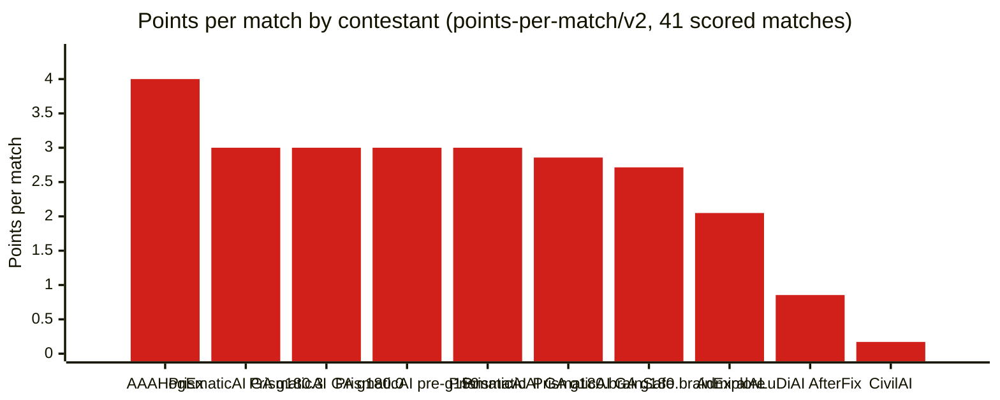
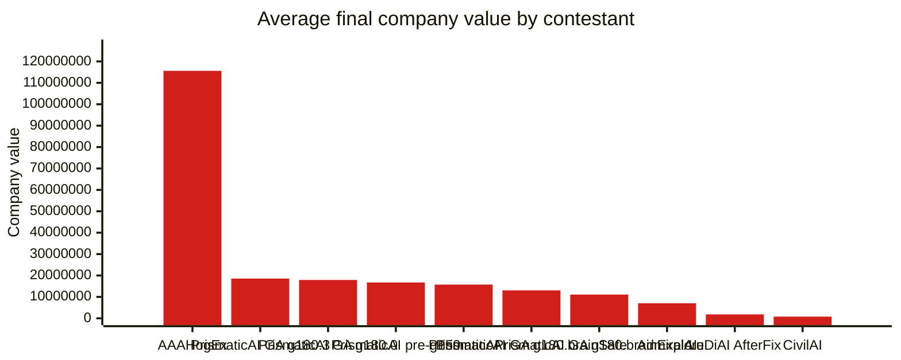
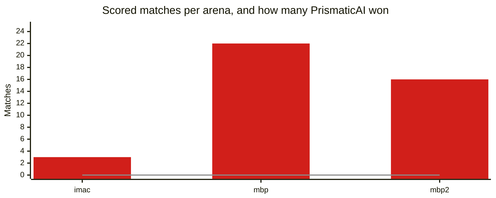

# battle-20261120T201132-b4f71f62

Derived from `battle-20261120T201132-b4f71f62.json` by `tools/research/ai-battle/battle.py report`; do not edit.

- Edition `b4f71f628ecbf40e`: PrismaticAI and referee at `962699034c20d90baeb9f617789ea6558cc6ff52`, base set `opengfx-8.0.tar`
- 20-year free-for-all from 1960, map 256x256 temperate, breakdowns 1
- 41 scored match(es) on `imac` (20261119-master-gdf1e05e7d8), `mbp` (20261120-master-m17653b726e), `mbp2` (20261119-master-gdf1e05e7d8)
- Replays: 0 of 2 identical to their original on another arena

| # | Contestant | Played | Wins | Points | Points/match | Avg rank | Avg final value | Squirrel errors | Matches with anomalies |
|---|---|---|---|---|---|---|---|---|---|
| 1 | AAAHogEx | 41 | 41 | 164 | 4.0 | 1.0 | 115.6 M | 0 | 0 |
| 2 | PrismaticAI GA g180.3 | 6 | 0 | 18 | 3.0 | 2.0 | 18.5 M | 0 | 1 |
| 3 | PrismaticAI GA g180.0 | 7 | 0 | 21 | 3.0 | 2.0 | 17.9 M | 0 | 3 |
| 4 | PrismaticAI pre-g150 | 8 | 0 | 24 | 3.0 | 2.0 | 16.7 M | 0 | 6 |
| 5 | PrismaticAI | 6 | 0 | 18 | 3.0 | 2.0 | 15.7 M | 0 | 0 |
| 6 | PrismaticAI GA g180.brainSafe | 7 | 0 | 20 | 2.857 | 2.14 | 13.1 M | 0 | 1 |
| 7 | PrismaticAI GA g180.brainExplore | 7 | 0 | 19 | 2.714 | 2.29 | 11.1 M | 0 | 1 |
| 8 | AdmiralAI | 41 | 0 | 84 | 2.049 | 2.95 | 7.0 M | 59 | 3 |
| 9 | LuDiAI AfterFix | 41 | 0 | 35 | 0.854 | 4.15 | 1.8 M | 0 | 1 |
| 10 | CivilAI | 41 | 0 | 7 | 0.171 | 4.83 | 784.0 k | 0 | 1 |

```mermaid
---
config:
  xyChart:
    width: 900
    height: 360
  themeVariables:
    xyChart:
      plotColorPalette: "#d11f1a, #8a8a8a, #0b0b0b, #ece4d6"
---
xychart-beta
    title "Final company value per scored match: winner vs best PrismaticAI"
    x-axis ["m-0001", "m-0002", "m-0003", "m-0004", "m-0005", "m-0006", "m-0007", "m-0008", "m-0009", "m-0010", "m-0011", "m-0012", "m-0013", "m-0014", "m-0015", "m-0016", "m-0017", "m-0018", "m-0019", "m-0020", "m-0021", "m-0022", "m-0023", "m-0024", "m-0025", "m-0026", "m-0027", "m-0028", "m-0036", "m-0037", "m-0038", "m-0039", "m-0040", "m-0041", "m-0042", "m-0043", "m-0044", "m-0045", "m-0046", "m-0049", "m-0053"]
    %% series: Winner | Best PrismaticAI
    %% links: battle-20261120T201132-b4f71f62.md?col=Match&filter=m-0001 | battle-20261120T201132-b4f71f62.md?col=Match&filter=m-0002 | battle-20261120T201132-b4f71f62.md?col=Match&filter=m-0003 | battle-20261120T201132-b4f71f62.md?col=Match&filter=m-0004 | battle-20261120T201132-b4f71f62.md?col=Match&filter=m-0005 | battle-20261120T201132-b4f71f62.md?col=Match&filter=m-0006 | battle-20261120T201132-b4f71f62.md?col=Match&filter=m-0007 | battle-20261120T201132-b4f71f62.md?col=Match&filter=m-0008 | battle-20261120T201132-b4f71f62.md?col=Match&filter=m-0009 | battle-20261120T201132-b4f71f62.md?col=Match&filter=m-0010 | battle-20261120T201132-b4f71f62.md?col=Match&filter=m-0011 | battle-20261120T201132-b4f71f62.md?col=Match&filter=m-0012 | battle-20261120T201132-b4f71f62.md?col=Match&filter=m-0013 | battle-20261120T201132-b4f71f62.md?col=Match&filter=m-0014 | battle-20261120T201132-b4f71f62.md?col=Match&filter=m-0015 | battle-20261120T201132-b4f71f62.md?col=Match&filter=m-0016 | battle-20261120T201132-b4f71f62.md?col=Match&filter=m-0017 | battle-20261120T201132-b4f71f62.md?col=Match&filter=m-0018 | battle-20261120T201132-b4f71f62.md?col=Match&filter=m-0019 | battle-20261120T201132-b4f71f62.md?col=Match&filter=m-0020 | battle-20261120T201132-b4f71f62.md?col=Match&filter=m-0021 | battle-20261120T201132-b4f71f62.md?col=Match&filter=m-0022 | battle-20261120T201132-b4f71f62.md?col=Match&filter=m-0023 | battle-20261120T201132-b4f71f62.md?col=Match&filter=m-0024 | battle-20261120T201132-b4f71f62.md?col=Match&filter=m-0025 | battle-20261120T201132-b4f71f62.md?col=Match&filter=m-0026 | battle-20261120T201132-b4f71f62.md?col=Match&filter=m-0027 | battle-20261120T201132-b4f71f62.md?col=Match&filter=m-0028 | battle-20261120T201132-b4f71f62.md?col=Match&filter=m-0036 | battle-20261120T201132-b4f71f62.md?col=Match&filter=m-0037 | battle-20261120T201132-b4f71f62.md?col=Match&filter=m-0038 | battle-20261120T201132-b4f71f62.md?col=Match&filter=m-0039 | battle-20261120T201132-b4f71f62.md?col=Match&filter=m-0040 | battle-20261120T201132-b4f71f62.md?col=Match&filter=m-0041 | battle-20261120T201132-b4f71f62.md?col=Match&filter=m-0042 | battle-20261120T201132-b4f71f62.md?col=Match&filter=m-0043 | battle-20261120T201132-b4f71f62.md?col=Match&filter=m-0044 | battle-20261120T201132-b4f71f62.md?col=Match&filter=m-0045 | battle-20261120T201132-b4f71f62.md?col=Match&filter=m-0046 | battle-20261120T201132-b4f71f62.md?col=Match&filter=m-0049 | battle-20261120T201132-b4f71f62.md?col=Match&filter=m-0053
    y-axis "Company value" 0 --> 169000000
    bar [93430882, 106267350, 105173667, 101810463, 112297547, 92359813, 71385136, 81187485, 97366556, 96816266, 73580005, 153514430, 137378171, 143892129, 134449014, 152552068, 138775323, 99192512, 111723101, 110247514, 92947590, 131747391, 121537648, 125415326, 106050596, 121405352, 110141493, 114551375, 130756672, 144209395, 117227240, 132680439, 114125398, 126068877, 131802503, 131237133, 135394429, 151112408, 127364961, 82319164, 78762700]
    line [19796400, 20551527, 14997843, 9518308, 25091453, 12312898, 19012885, 12301323, 9976460, 6029139, 9144474, 25801497, 19208048, 18276075, 22957333, 15062995, 19236893, 19040255, 15581140, 22485276, 10280925, 9746403, 16780917, 13573164, 9424930, 12586830, 8815718, 9089906, 12916900, 10945230, 12597080, 8963317, 9214061, 19847816, 10785240, 25324414, 26629629, 15389458, 18941478, 14550032, 21180249]
```

<!-- battle-charts:begin -->
<!-- derived from battle-20261120T201132-b4f71f62.json by `battle.py render`; `battle.py check` fails when it is stale -->

<!-- battle-charts:end -->

| Seed | Original | Replay | Arenas | Identical |
|---|---|---|---|---|
| 649407715 | m-0010 | m-0048 | imac / mbp | NO |
| 649407715 | m-0011 | m-0056 | imac / mbp | NO |

| Match | Arena | Seed | Winner | Value | Last | Anomalies |
|---|---|---|---|---|---|---|
| m-0001 | mbp | 63889335 | AAAHogEx | 93.4 M | LuDiAI AfterFix | - |
| m-0002 | mbp | 63889335 | AAAHogEx | 106.3 M | CivilAI | PrismaticAI GA g180.0: fleet_drop:182->94 |
| m-0003 | mbp | 63889335 | AAAHogEx | 105.2 M | CivilAI | - |
| m-0004 | mbp | 63889335 | AAAHogEx | 101.8 M | CivilAI | PrismaticAI GA g180.brainExplore: fleet_drop:144->82 |
| m-0005 | mbp | 63889335 | AAAHogEx | 112.3 M | LuDiAI AfterFix | PrismaticAI GA g180.3: fleet_drop:123->85 |
| m-0006 | mbp | 649407715 | AAAHogEx | 92.4 M | LuDiAI AfterFix | - |
| m-0007 | mbp | 649407715 | AAAHogEx | 71.4 M | CivilAI | PrismaticAI pre-g150: fleet_drop:106->50 |
| m-0008 | mbp | 649407715 | AAAHogEx | 81.2 M | LuDiAI AfterFix | LuDiAI AfterFix: fleet_drop:16->1 |
| m-0009 | mbp | 649407715 | AAAHogEx | 97.4 M | CivilAI | - |
| m-0010 | imac | 649407715 | AAAHogEx | 96.8 M | LuDiAI AfterFix | - |
| m-0011 | imac | 649407715 | AAAHogEx | 73.6 M | CivilAI | AdmiralAI: fleet_drop:173->120 |
| m-0012 | imac | 314837920 | AAAHogEx | 153.5 M | CivilAI | - |
| m-0013 | mbp2 | 314837920 | AAAHogEx | 137.4 M | CivilAI | PrismaticAI pre-g150: fleet_drop:173->116 |
| m-0014 | mbp2 | 314837920 | AAAHogEx | 143.9 M | CivilAI | PrismaticAI GA g180.0: fleet_drop:98->57 |
| m-0015 | mbp2 | 314837920 | AAAHogEx | 134.4 M | CivilAI | - |
| m-0016 | mbp2 | 314837920 | AAAHogEx | 152.6 M | CivilAI | - |
| m-0017 | mbp2 | 314837920 | AAAHogEx | 138.8 M | CivilAI | - |
| m-0018 | mbp2 | 1415283933 | AAAHogEx | 99.2 M | CivilAI | - |
| m-0019 | mbp2 | 1415283933 | AAAHogEx | 111.7 M | CivilAI | PrismaticAI pre-g150: fleet_drop:138->57 |
| m-0020 | mbp2 | 1415283933 | AAAHogEx | 110.2 M | CivilAI | - |
| m-0021 | mbp2 | 1415283933 | AAAHogEx | 92.9 M | CivilAI | PrismaticAI GA g180.brainSafe: fleet_drop:156->99 |
| m-0022 | mbp2 | 1415283933 | AAAHogEx | 131.7 M | CivilAI | - |
| m-0023 | mbp2 | 1415283933 | AAAHogEx | 121.5 M | CivilAI | - |
| m-0024 | mbp2 | 287014869 | AAAHogEx | 125.4 M | CivilAI | - |
| m-0025 | mbp2 | 287014869 | AAAHogEx | 106.1 M | CivilAI | PrismaticAI pre-g150: fleet_drop:111->55 |
| m-0026 | mbp2 | 287014869 | AAAHogEx | 121.4 M | CivilAI | - |
| m-0027 | mbp2 | 287014869 | AAAHogEx | 110.1 M | CivilAI | - |
| m-0028 | mbp2 | 287014869 | AAAHogEx | 114.6 M | CivilAI | - |
| m-0036 | mbp | 364442998 | AAAHogEx | 130.8 M | CivilAI | - |
| m-0037 | mbp | 364442998 | AAAHogEx | 144.2 M | CivilAI | - |
| m-0038 | mbp | 364442998 | AAAHogEx | 117.2 M | CivilAI | - |
| m-0039 | mbp | 364442998 | AAAHogEx | 132.7 M | CivilAI | - |
| m-0040 | mbp | 364442998 | AAAHogEx | 114.1 M | CivilAI | AdmiralAI: fleet_drop:278->185 |
| m-0041 | mbp | 364442998 | AAAHogEx | 126.1 M | CivilAI | - |
| m-0042 | mbp | 1772883224 | AAAHogEx | 131.8 M | CivilAI | - |
| m-0043 | mbp | 1772883224 | AAAHogEx | 131.2 M | LuDiAI AfterFix | PrismaticAI pre-g150: fleet_drop:131->61 |
| m-0044 | mbp | 1772883224 | AAAHogEx | 135.4 M | CivilAI | PrismaticAI GA g180.0: fleet_drop:98->61 |
| m-0045 | mbp | 1772883224 | AAAHogEx | 151.1 M | CivilAI | AdmiralAI: squirrel_errors:59 |
| m-0046 | mbp | 1772883224 | AAAHogEx | 127.4 M | LuDiAI AfterFix | - |
| m-0048 (replay) | mbp | 649407715 | AAAHogEx | 89.6 M | LuDiAI AfterFix | - |
| m-0049 | mbp | 856048038 | AAAHogEx | 82.3 M | CivilAI | PrismaticAI pre-g150: fleet_drop:69->39 |
| m-0053 | mbp | 856048038 | AAAHogEx | 78.8 M | CivilAI | CivilAI: fleet_drop:67->31 |
| m-0056 (replay) | mbp | 649407715 | AAAHogEx | 71.9 M | CivilAI | AdmiralAI: fleet_drop:180->116 |
