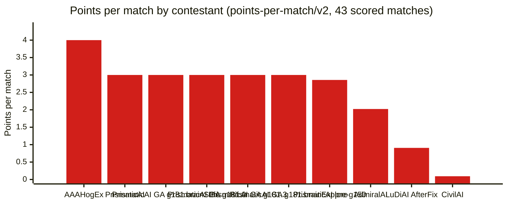
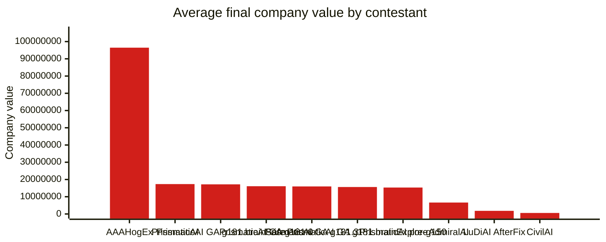
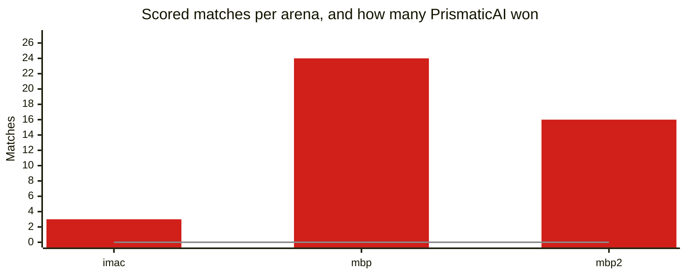

# battle-20261120T202127-ab12205e

Derived from `battle-20261120T202127-ab12205e.json` by `tools/research/ai-battle/battle.py report`; do not edit.

- Edition `ab12205e613771ae`: PrismaticAI and referee at `962699034c20d90baeb9f617789ea6558cc6ff52`, base set `opengfx-8.0.tar`
- 20-year free-for-all from 1960, map 256x256 temperate, breakdowns 1
- 43 scored match(es) on `imac` (20261119-master-gdf1e05e7d8), `mbp` (20261120-master-m17653b726e), `mbp2` (20261119-master-gdf1e05e7d8)
- Replays: 0 of 0 identical to their original on another arena

| # | Contestant | Played | Wins | Points | Points/match | Avg rank | Avg final value | Squirrel errors | Matches with anomalies |
|---|---|---|---|---|---|---|---|---|---|
| 1 | AAAHogEx | 43 | 43 | 172 | 4.0 | 1.0 | 96.5 M | 0 | 0 |
| 2 | PrismaticAI | 7 | 0 | 21 | 3.0 | 2.0 | 17.3 M | 0 | 0 |
| 3 | PrismaticAI GA g181.brainSafe | 7 | 0 | 21 | 3.0 | 2.0 | 17.2 M | 0 | 4 |
| 4 | PrismaticAI GA g181.0 | 7 | 0 | 21 | 3.0 | 2.0 | 16.1 M | 0 | 0 |
| 5 | PrismaticAI GA g181.3 | 7 | 0 | 21 | 3.0 | 2.0 | 16.0 M | 0 | 4 |
| 6 | PrismaticAI GA g181.brainExplore | 8 | 0 | 24 | 3.0 | 2.0 | 15.6 M | 0 | 0 |
| 7 | PrismaticAI pre-g150 | 7 | 0 | 20 | 2.857 | 2.14 | 15.3 M | 0 | 2 |
| 8 | AdmiralAI | 43 | 0 | 87 | 2.023 | 2.98 | 6.6 M | 72 | 4 |
| 9 | LuDiAI AfterFix | 43 | 0 | 39 | 0.907 | 4.09 | 1.8 M | 0 | 0 |
| 10 | CivilAI | 43 | 0 | 4 | 0.093 | 4.91 | 583.8 k | 7290 | 9 |

```mermaid
---
config:
  xyChart:
    width: 900
    height: 360
  themeVariables:
    xyChart:
      plotColorPalette: "#d11f1a, #8a8a8a, #0b0b0b, #ece4d6"
---
xychart-beta
    title "Final company value per scored match: winner vs best PrismaticAI"
    x-axis ["m-0001", "m-0002", "m-0003", "m-0004", "m-0005", "m-0006", "m-0007", "m-0008", "m-0009", "m-0010", "m-0011", "m-0012", "m-0013", "m-0014", "m-0015", "m-0016", "m-0017", "m-0018", "m-0019", "m-0020", "m-0021", "m-0022", "m-0023", "m-0024", "m-0025", "m-0026", "m-0027", "m-0028", "m-0036", "m-0037", "m-0038", "m-0039", "m-0040", "m-0041", "m-0042", "m-0043", "m-0044", "m-0045", "m-0046", "m-0047", "m-0052", "m-0053", "m-0054"]
    %% series: Winner | Best PrismaticAI
    %% links: battle-20261120T202127-ab12205e.md?col=Match&filter=m-0001 | battle-20261120T202127-ab12205e.md?col=Match&filter=m-0002 | battle-20261120T202127-ab12205e.md?col=Match&filter=m-0003 | battle-20261120T202127-ab12205e.md?col=Match&filter=m-0004 | battle-20261120T202127-ab12205e.md?col=Match&filter=m-0005 | battle-20261120T202127-ab12205e.md?col=Match&filter=m-0006 | battle-20261120T202127-ab12205e.md?col=Match&filter=m-0007 | battle-20261120T202127-ab12205e.md?col=Match&filter=m-0008 | battle-20261120T202127-ab12205e.md?col=Match&filter=m-0009 | battle-20261120T202127-ab12205e.md?col=Match&filter=m-0010 | battle-20261120T202127-ab12205e.md?col=Match&filter=m-0011 | battle-20261120T202127-ab12205e.md?col=Match&filter=m-0012 | battle-20261120T202127-ab12205e.md?col=Match&filter=m-0013 | battle-20261120T202127-ab12205e.md?col=Match&filter=m-0014 | battle-20261120T202127-ab12205e.md?col=Match&filter=m-0015 | battle-20261120T202127-ab12205e.md?col=Match&filter=m-0016 | battle-20261120T202127-ab12205e.md?col=Match&filter=m-0017 | battle-20261120T202127-ab12205e.md?col=Match&filter=m-0018 | battle-20261120T202127-ab12205e.md?col=Match&filter=m-0019 | battle-20261120T202127-ab12205e.md?col=Match&filter=m-0020 | battle-20261120T202127-ab12205e.md?col=Match&filter=m-0021 | battle-20261120T202127-ab12205e.md?col=Match&filter=m-0022 | battle-20261120T202127-ab12205e.md?col=Match&filter=m-0023 | battle-20261120T202127-ab12205e.md?col=Match&filter=m-0024 | battle-20261120T202127-ab12205e.md?col=Match&filter=m-0025 | battle-20261120T202127-ab12205e.md?col=Match&filter=m-0026 | battle-20261120T202127-ab12205e.md?col=Match&filter=m-0027 | battle-20261120T202127-ab12205e.md?col=Match&filter=m-0028 | battle-20261120T202127-ab12205e.md?col=Match&filter=m-0036 | battle-20261120T202127-ab12205e.md?col=Match&filter=m-0037 | battle-20261120T202127-ab12205e.md?col=Match&filter=m-0038 | battle-20261120T202127-ab12205e.md?col=Match&filter=m-0039 | battle-20261120T202127-ab12205e.md?col=Match&filter=m-0040 | battle-20261120T202127-ab12205e.md?col=Match&filter=m-0041 | battle-20261120T202127-ab12205e.md?col=Match&filter=m-0042 | battle-20261120T202127-ab12205e.md?col=Match&filter=m-0043 | battle-20261120T202127-ab12205e.md?col=Match&filter=m-0044 | battle-20261120T202127-ab12205e.md?col=Match&filter=m-0045 | battle-20261120T202127-ab12205e.md?col=Match&filter=m-0046 | battle-20261120T202127-ab12205e.md?col=Match&filter=m-0047 | battle-20261120T202127-ab12205e.md?col=Match&filter=m-0052 | battle-20261120T202127-ab12205e.md?col=Match&filter=m-0053 | battle-20261120T202127-ab12205e.md?col=Match&filter=m-0054
    y-axis "Company value" 0 --> 156000000
    bar [89102176, 99906427, 80464966, 66481769, 105902136, 92841075, 105640402, 112645485, 84827892, 91877290, 111643578, 100281059, 141689032, 98783723, 104708910, 131218713, 126619451, 98390312, 64139085, 81066825, 74402871, 87365926, 70933688, 114873402, 130561502, 83388131, 119229425, 114429551, 75447908, 78520686, 71122000, 78351787, 76563544, 81806687, 97087415, 115693005, 105239941, 99462543, 82267935, 104379784, 112027555, 99938717, 86597294]
    line [14301981, 13215317, 12997162, 14115687, 22033359, 11731447, 11602973, 16149918, 17611057, 18630072, 16575618, 17124484, 18880056, 13045326, 27315080, 15166046, 11695467, 17119279, 12920795, 18364860, 13978099, 18223185, 15941255, 16575510, 16636257, 19645812, 18197562, 20745647, 14281896, 13633159, 20023216, 12776212, 14244600, 15432810, 24589957, 19344560, 12241889, 17382061, 13958411, 18094225, 9981923, 12033167, 19934139]
```

<!-- battle-charts:begin -->
<!-- derived from battle-20261120T202127-ab12205e.json by `battle.py render`; `battle.py check` fails when it is stale -->

<!-- battle-charts:end -->

| Match | Arena | Seed | Winner | Value | Last | Anomalies |
|---|---|---|---|---|---|---|
| m-0001 | mbp | 601924314 | AAAHogEx | 89.1 M | CivilAI | - |
| m-0002 | mbp | 601924314 | AAAHogEx | 99.9 M | CivilAI | CivilAI: no_vehicles |
| m-0003 | mbp | 601924314 | AAAHogEx | 80.5 M | CivilAI | - |
| m-0004 | mbp | 601924314 | AAAHogEx | 66.5 M | CivilAI | - |
| m-0005 | mbp | 601924314 | AAAHogEx | 105.9 M | CivilAI | - |
| m-0006 | mbp | 687244628 | AAAHogEx | 92.8 M | LuDiAI AfterFix | - |
| m-0007 | mbp | 687244628 | AAAHogEx | 105.6 M | CivilAI | - |
| m-0008 | mbp | 687244628 | AAAHogEx | 112.6 M | CivilAI | - |
| m-0009 | mbp | 687244628 | AAAHogEx | 84.8 M | CivilAI | PrismaticAI GA g181.brainSafe: fleet_drop:108->53 |
| m-0010 | imac | 687244628 | AAAHogEx | 91.9 M | LuDiAI AfterFix | CivilAI: fleet_drop:54->25 |
| m-0011 | imac | 687244628 | AAAHogEx | 111.6 M | CivilAI | AdmiralAI: squirrel_errors:72 |
| m-0012 | imac | 755034673 | AAAHogEx | 100.3 M | CivilAI | - |
| m-0013 | mbp2 | 755034673 | AAAHogEx | 141.7 M | LuDiAI AfterFix | - |
| m-0014 | mbp2 | 755034673 | AAAHogEx | 98.8 M | CivilAI | - |
| m-0015 | mbp2 | 755034673 | AAAHogEx | 104.7 M | CivilAI | - |
| m-0016 | mbp2 | 755034673 | AAAHogEx | 131.2 M | CivilAI | - |
| m-0017 | mbp2 | 755034673 | AAAHogEx | 126.6 M | CivilAI | - |
| m-0018 | mbp2 | 1376484496 | AAAHogEx | 98.4 M | CivilAI | - |
| m-0019 | mbp2 | 1376484496 | AAAHogEx | 64.1 M | CivilAI | PrismaticAI pre-g150: fleet_drop:107->59 |
| m-0020 | mbp2 | 1376484496 | AAAHogEx | 81.1 M | LuDiAI AfterFix | - |
| m-0021 | mbp2 | 1376484496 | AAAHogEx | 74.4 M | CivilAI | PrismaticAI GA g181.brainSafe: fleet_drop:135->76 |
| m-0022 | mbp2 | 1376484496 | AAAHogEx | 87.4 M | CivilAI | - |
| m-0023 | mbp2 | 1376484496 | AAAHogEx | 70.9 M | CivilAI | PrismaticAI GA g181.3: fleet_drop:137->69; CivilAI: fleet_drop:21->11 |
| m-0024 | mbp2 | 919911559 | AAAHogEx | 114.9 M | CivilAI | - |
| m-0025 | mbp2 | 919911559 | AAAHogEx | 130.6 M | CivilAI | AdmiralAI: fleet_drop:196->127 |
| m-0026 | mbp2 | 919911559 | AAAHogEx | 83.4 M | CivilAI | - |
| m-0027 | mbp2 | 919911559 | AAAHogEx | 119.2 M | CivilAI | CivilAI: fleet_drop:56->36 |
| m-0028 | mbp2 | 919911559 | AAAHogEx | 114.4 M | CivilAI | - |
| m-0036 | mbp | 1996800467 | AAAHogEx | 75.4 M | CivilAI | AdmiralAI: fleet_drop:508->336; CivilAI: fleet_drop:23->13 |
| m-0037 | mbp | 1996800467 | AAAHogEx | 78.5 M | CivilAI | - |
| m-0038 | mbp | 1996800467 | AAAHogEx | 71.1 M | CivilAI | - |
| m-0039 | mbp | 1996800467 | AAAHogEx | 78.4 M | CivilAI | PrismaticAI GA g181.brainSafe: fleet_drop:143->51 |
| m-0040 | mbp | 1996800467 | AAAHogEx | 76.6 M | CivilAI | - |
| m-0041 | mbp | 1996800467 | AAAHogEx | 81.8 M | CivilAI | PrismaticAI GA g181.3: fleet_drop:139->35; CivilAI: fleet_drop:35->19 |
| m-0042 | mbp | 67171989 | AAAHogEx | 97.1 M | CivilAI | - |
| m-0043 | mbp | 67171989 | AAAHogEx | 115.7 M | CivilAI | PrismaticAI pre-g150: fleet_drop:152->80; CivilAI: squirrel_errors:3670 |
| m-0044 | mbp | 67171989 | AAAHogEx | 105.2 M | CivilAI | CivilAI: squirrel_errors:3620 |
| m-0045 | mbp | 67171989 | AAAHogEx | 99.5 M | CivilAI | PrismaticAI GA g181.brainSafe: fleet_drop:152->61 |
| m-0046 | mbp | 67171989 | AAAHogEx | 82.3 M | CivilAI | - |
| m-0047 | mbp | 67171989 | AAAHogEx | 104.4 M | CivilAI | PrismaticAI GA g181.3: fleet_drop:108->48 |
| m-0052 | mbp | 1717555688 | AAAHogEx | 112.0 M | CivilAI | - |
| m-0053 | mbp | 1717555688 | AAAHogEx | 99.9 M | CivilAI | PrismaticAI GA g181.3: fleet_drop:145->62; AdmiralAI: fleet_drop:135->89 |
| m-0054 | mbp | 223371442 | AAAHogEx | 86.6 M | CivilAI | CivilAI: no_vehicles |
