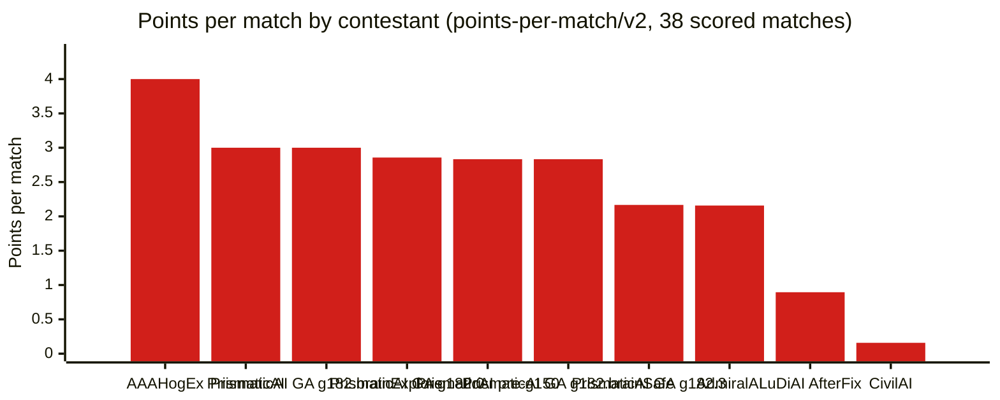
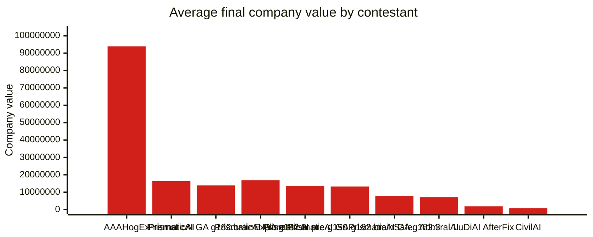
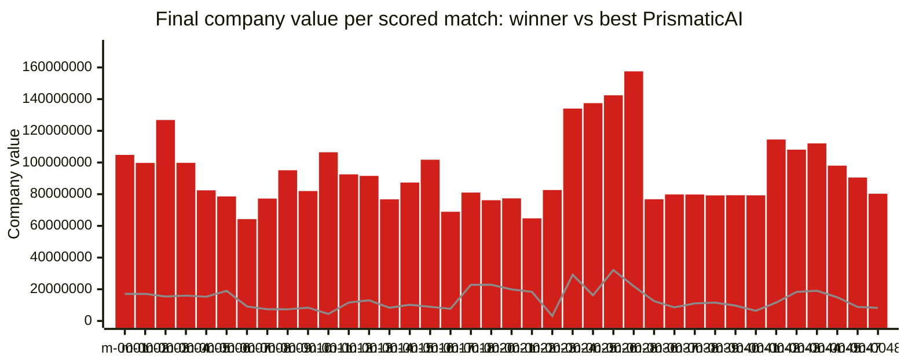
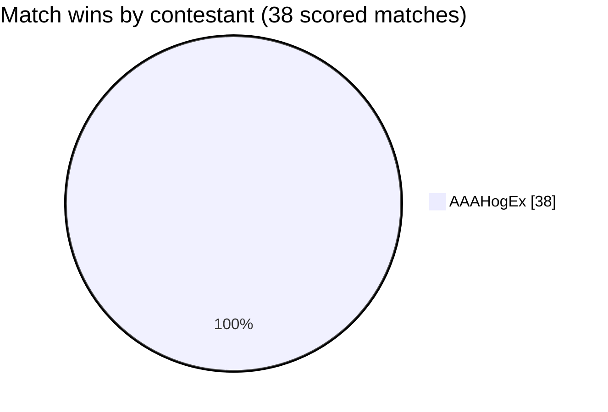
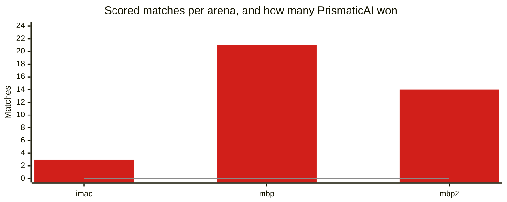

# battle-20261120T203109-ca419318

Derived from `battle-20261120T203109-ca419318.json` by `tools/research/ai-battle/battle.py report`; do not edit.

- Edition `ca4193180846e318`: PrismaticAI and referee at `962699034c20d90baeb9f617789ea6558cc6ff52`, base set `opengfx-8.0.tar`
- 20-year free-for-all from 1960, map 256x256 temperate, breakdowns 1
- 38 scored match(es) on `imac` (20261119-master-gdf1e05e7d8), `mbp` (20261120-master-m17653b726e), `mbp2` (20261119-master-gdf1e05e7d8)
- Replays: 0 of 0 identical to their original on another arena

| # | Contestant | Played | Wins | Points | Points/match | Avg rank | Avg final value | Squirrel errors | Matches with anomalies |
|---|---|---|---|---|---|---|---|---|---|
| 1 | AAAHogEx | 38 | 38 | 152 | 4.0 | 1.0 | 93.9 M | 0 | 0 |
| 2 | PrismaticAI | 7 | 0 | 21 | 3.0 | 2.0 | 16.4 M | 0 | 0 |
| 3 | PrismaticAI GA g182.brainExplore | 6 | 0 | 18 | 3.0 | 2.0 | 13.9 M | 0 | 0 |
| 4 | PrismaticAI GA g182.0 | 7 | 0 | 20 | 2.857 | 2.14 | 16.9 M | 0 | 4 |
| 5 | PrismaticAI pre-g150 | 6 | 0 | 17 | 2.833 | 2.17 | 13.7 M | 0 | 4 |
| 6 | PrismaticAI GA g182.brainSafe | 6 | 0 | 17 | 2.833 | 2.17 | 13.2 M | 0 | 2 |
| 7 | PrismaticAI GA g182.3 | 6 | 0 | 13 | 2.167 | 2.83 | 7.6 M | 0 | 1 |
| 8 | AdmiralAI | 38 | 0 | 82 | 2.158 | 2.84 | 7.1 M | 44 | 2 |
| 9 | LuDiAI AfterFix | 38 | 0 | 34 | 0.895 | 4.11 | 1.8 M | 0 | 1 |
| 10 | CivilAI | 38 | 0 | 6 | 0.158 | 4.84 | 695.7 k | 3665 | 4 |

<!-- battle-charts:begin -->
<!-- derived from battle-20261120T203109-ca419318.json by `battle.py render`; `battle.py check` fails when it is stale -->

<!-- battle-charts:end -->

| Match | Arena | Seed | Winner | Value | Last | Anomalies |
|---|---|---|---|---|---|---|
| m-0001 | mbp | 570046132 | AAAHogEx | 104.8 M | CivilAI | PrismaticAI pre-g150: fleet_drop:161->86; CivilAI: squirrel_errors:3665 |
| m-0002 | mbp | 570046132 | AAAHogEx | 99.7 M | CivilAI | - |
| m-0003 | mbp | 570046132 | AAAHogEx | 126.8 M | LuDiAI AfterFix | - |
| m-0004 | mbp | 570046132 | AAAHogEx | 99.8 M | CivilAI | - |
| m-0005 | mbp | 570046132 | AAAHogEx | 82.4 M | CivilAI | - |
| m-0006 | mbp | 1456217653 | AAAHogEx | 78.6 M | CivilAI | - |
| m-0007 | mbp | 1456217653 | AAAHogEx | 64.3 M | CivilAI | PrismaticAI pre-g150: fleet_drop:97->59 |
| m-0008 | mbp | 1456217653 | AAAHogEx | 77.2 M | CivilAI | LuDiAI AfterFix: fleet_drop:51->32 |
| m-0009 | mbp | 1456217653 | AAAHogEx | 95.1 M | LuDiAI AfterFix | - |
| m-0010 | imac | 1456217653 | AAAHogEx | 82.0 M | CivilAI | - |
| m-0011 | imac | 1456217653 | AAAHogEx | 106.5 M | LuDiAI AfterFix | PrismaticAI GA g182.3: fleet_drop:54->34 |
| m-0012 | imac | 408519889 | AAAHogEx | 92.5 M | CivilAI | - |
| m-0013 | mbp2 | 408519889 | AAAHogEx | 91.6 M | CivilAI | AdmiralAI: squirrel_errors:44; CivilAI: fleet_drop:60->40 |
| m-0014 | mbp2 | 408519889 | AAAHogEx | 76.8 M | CivilAI | PrismaticAI GA g182.0: fleet_drop:144->84 |
| m-0015 | mbp2 | 408519889 | AAAHogEx | 87.4 M | CivilAI | - |
| m-0016 | mbp2 | 408519889 | AAAHogEx | 101.8 M | CivilAI | - |
| m-0017 | mbp2 | 408519889 | AAAHogEx | 68.9 M | CivilAI | - |
| m-0018 | mbp2 | 170063108 | AAAHogEx | 81.0 M | CivilAI | AdmiralAI: fleet_drop:230->160 |
| m-0020 | mbp2 | 170063108 | AAAHogEx | 76.2 M | CivilAI | PrismaticAI GA g182.0: fleet_drop:164->82 |
| m-0021 | mbp2 | 170063108 | AAAHogEx | 77.4 M | CivilAI | - |
| m-0022 | mbp2 | 170063108 | AAAHogEx | 64.8 M | CivilAI | - |
| m-0023 | mbp2 | 170063108 | AAAHogEx | 82.6 M | CivilAI | - |
| m-0024 | mbp2 | 564351640 | AAAHogEx | 134.1 M | CivilAI | - |
| m-0025 | mbp2 | 564351640 | AAAHogEx | 137.5 M | LuDiAI AfterFix | PrismaticAI pre-g150: fleet_drop:95->42; CivilAI: fleet_drop:68->44 |
| m-0026 | mbp2 | 564351640 | AAAHogEx | 142.4 M | CivilAI | PrismaticAI GA g182.0: fleet_drop:127->71 |
| m-0028 | mbp2 | 564351640 | AAAHogEx | 157.5 M | CivilAI | - |
| m-0036 | mbp | 1464624274 | AAAHogEx | 76.8 M | CivilAI | - |
| m-0037 | mbp | 1464624274 | AAAHogEx | 79.8 M | CivilAI | - |
| m-0038 | mbp | 1464624274 | AAAHogEx | 79.8 M | CivilAI | - |
| m-0039 | mbp | 1464624274 | AAAHogEx | 79.2 M | LuDiAI AfterFix | PrismaticAI GA g182.brainSafe: fleet_drop:109->66 |
| m-0040 | mbp | 1464624274 | AAAHogEx | 79.3 M | LuDiAI AfterFix | - |
| m-0041 | mbp | 1464624274 | AAAHogEx | 79.3 M | CivilAI | - |
| m-0042 | mbp | 1146025062 | AAAHogEx | 114.5 M | CivilAI | - |
| m-0043 | mbp | 1146025062 | AAAHogEx | 108.1 M | CivilAI | PrismaticAI pre-g150: fleet_drop:113->75 |
| m-0044 | mbp | 1146025062 | AAAHogEx | 112.1 M | CivilAI | PrismaticAI GA g182.0: fleet_drop:126->68 |
| m-0045 | mbp | 1146025062 | AAAHogEx | 98.0 M | CivilAI | PrismaticAI GA g182.brainSafe: fleet_drop:127->60 |
| m-0047 | mbp | 1146025062 | AAAHogEx | 90.5 M | CivilAI | CivilAI: no_vehicles |
| m-0048 | mbp | 1901650442 | AAAHogEx | 80.3 M | CivilAI | - |
