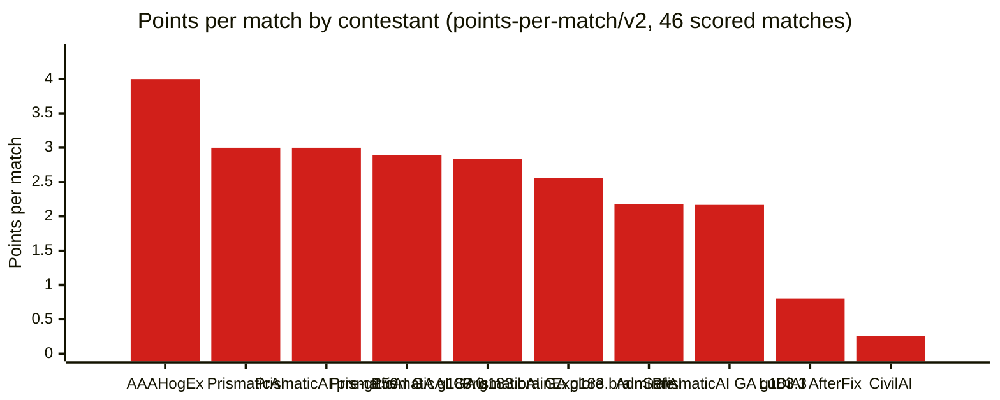
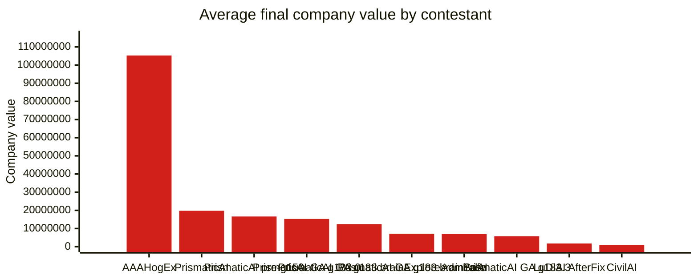
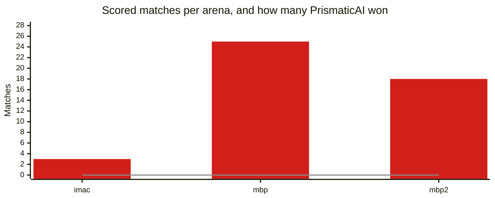

# battle-20261120T204348-6a845f7b

Derived from `battle-20261120T204348-6a845f7b.json` by `tools/research/ai-battle/battle.py report`; do not edit.

- Edition `6a845f7bfc44e97a`: PrismaticAI and referee at `962699034c20d90baeb9f617789ea6558cc6ff52`, base set `opengfx-8.0.tar`
- 20-year free-for-all from 1960, map 256x256 temperate, breakdowns 1
- 46 scored match(es) on `imac` (20261119-master-gdf1e05e7d8), `mbp` (20261120-master-m17653b726e), `mbp2` (20261119-master-gdf1e05e7d8)
- Replays: 1 of 2 identical to their original on another arena

| # | Contestant | Played | Wins | Points | Points/match | Avg rank | Avg final value | Squirrel errors | Matches with anomalies |
|---|---|---|---|---|---|---|---|---|---|
| 1 | AAAHogEx | 46 | 46 | 184 | 4.0 | 1.0 | 105.3 M | 0 | 0 |
| 2 | PrismaticAI | 6 | 0 | 18 | 3.0 | 2.0 | 19.8 M | 0 | 0 |
| 3 | PrismaticAI pre-g150 | 10 | 0 | 30 | 3.0 | 2.0 | 16.6 M | 0 | 6 |
| 4 | PrismaticAI GA g183.0 | 9 | 0 | 26 | 2.889 | 2.11 | 15.3 M | 0 | 0 |
| 5 | PrismaticAI GA g183.brainExplore | 6 | 0 | 17 | 2.833 | 2.17 | 12.5 M | 0 | 1 |
| 6 | PrismaticAI GA g183.brainSafe | 9 | 0 | 23 | 2.556 | 2.44 | 7.1 M | 0 | 1 |
| 7 | AdmiralAI | 46 | 0 | 100 | 2.174 | 2.83 | 6.9 M | 47 | 3 |
| 8 | PrismaticAI GA g183.3 | 6 | 0 | 13 | 2.167 | 2.83 | 5.7 M | 0 | 2 |
| 9 | LuDiAI AfterFix | 46 | 0 | 37 | 0.804 | 4.2 | 1.7 M | 0 | 1 |
| 10 | CivilAI | 46 | 0 | 12 | 0.261 | 4.74 | 841.1 k | 3987 | 5 |

```mermaid
---
config:
  xyChart:
    width: 900
    height: 360
  themeVariables:
    xyChart:
      plotColorPalette: "#d11f1a, #8a8a8a, #0b0b0b, #ece4d6"
---
xychart-beta
    title "Final company value per scored match: winner vs best PrismaticAI"
    x-axis ["m-0001", "m-0002", "m-0003", "m-0004", "m-0005", "m-0006", "m-0007", "m-0008", "m-0009", "m-0010", "m-0011", "m-0012", "m-0013", "m-0014", "m-0015", "m-0016", "m-0017", "m-0018", "m-0019", "m-0020", "m-0021", "m-0022", "m-0023", "m-0024", "m-0025", "m-0026", "m-0027", "m-0028", "m-0036", "m-0037", "m-0038", "m-0039", "m-0040", "m-0041", "m-0042", "m-0043", "m-0044", "m-0045", "m-0047", "m-0049", "m-0050", "m-0051", "m-0055", "m-0061", "m-0062", "m-0063"]
    %% series: Winner | Best PrismaticAI
    %% links: battle-20261120T204348-6a845f7b.md?col=Match&filter=m-0001 | battle-20261120T204348-6a845f7b.md?col=Match&filter=m-0002 | battle-20261120T204348-6a845f7b.md?col=Match&filter=m-0003 | battle-20261120T204348-6a845f7b.md?col=Match&filter=m-0004 | battle-20261120T204348-6a845f7b.md?col=Match&filter=m-0005 | battle-20261120T204348-6a845f7b.md?col=Match&filter=m-0006 | battle-20261120T204348-6a845f7b.md?col=Match&filter=m-0007 | battle-20261120T204348-6a845f7b.md?col=Match&filter=m-0008 | battle-20261120T204348-6a845f7b.md?col=Match&filter=m-0009 | battle-20261120T204348-6a845f7b.md?col=Match&filter=m-0010 | battle-20261120T204348-6a845f7b.md?col=Match&filter=m-0011 | battle-20261120T204348-6a845f7b.md?col=Match&filter=m-0012 | battle-20261120T204348-6a845f7b.md?col=Match&filter=m-0013 | battle-20261120T204348-6a845f7b.md?col=Match&filter=m-0014 | battle-20261120T204348-6a845f7b.md?col=Match&filter=m-0015 | battle-20261120T204348-6a845f7b.md?col=Match&filter=m-0016 | battle-20261120T204348-6a845f7b.md?col=Match&filter=m-0017 | battle-20261120T204348-6a845f7b.md?col=Match&filter=m-0018 | battle-20261120T204348-6a845f7b.md?col=Match&filter=m-0019 | battle-20261120T204348-6a845f7b.md?col=Match&filter=m-0020 | battle-20261120T204348-6a845f7b.md?col=Match&filter=m-0021 | battle-20261120T204348-6a845f7b.md?col=Match&filter=m-0022 | battle-20261120T204348-6a845f7b.md?col=Match&filter=m-0023 | battle-20261120T204348-6a845f7b.md?col=Match&filter=m-0024 | battle-20261120T204348-6a845f7b.md?col=Match&filter=m-0025 | battle-20261120T204348-6a845f7b.md?col=Match&filter=m-0026 | battle-20261120T204348-6a845f7b.md?col=Match&filter=m-0027 | battle-20261120T204348-6a845f7b.md?col=Match&filter=m-0028 | battle-20261120T204348-6a845f7b.md?col=Match&filter=m-0036 | battle-20261120T204348-6a845f7b.md?col=Match&filter=m-0037 | battle-20261120T204348-6a845f7b.md?col=Match&filter=m-0038 | battle-20261120T204348-6a845f7b.md?col=Match&filter=m-0039 | battle-20261120T204348-6a845f7b.md?col=Match&filter=m-0040 | battle-20261120T204348-6a845f7b.md?col=Match&filter=m-0041 | battle-20261120T204348-6a845f7b.md?col=Match&filter=m-0042 | battle-20261120T204348-6a845f7b.md?col=Match&filter=m-0043 | battle-20261120T204348-6a845f7b.md?col=Match&filter=m-0044 | battle-20261120T204348-6a845f7b.md?col=Match&filter=m-0045 | battle-20261120T204348-6a845f7b.md?col=Match&filter=m-0047 | battle-20261120T204348-6a845f7b.md?col=Match&filter=m-0049 | battle-20261120T204348-6a845f7b.md?col=Match&filter=m-0050 | battle-20261120T204348-6a845f7b.md?col=Match&filter=m-0051 | battle-20261120T204348-6a845f7b.md?col=Match&filter=m-0055 | battle-20261120T204348-6a845f7b.md?col=Match&filter=m-0061 | battle-20261120T204348-6a845f7b.md?col=Match&filter=m-0062 | battle-20261120T204348-6a845f7b.md?col=Match&filter=m-0063
    y-axis "Company value" 0 --> 169000000
    bar [120450642, 128993813, 81034430, 131858959, 104942178, 96445975, 115197560, 116196948, 149526976, 135849342, 142151277, 79683304, 93658482, 97269355, 76483206, 70350386, 87937014, 121234264, 117806918, 112766640, 115906389, 129044594, 102648447, 58624672, 77909258, 74641012, 63220786, 63106909, 114061827, 115872039, 153905844, 143916666, 124063912, 109312474, 120005617, 114178379, 97144303, 113381551, 119534141, 102925595, 130253646, 91603877, 75071506, 85480728, 92688233, 74397712]
    line [10865638, 11222015, 5379420, 8847027, 8790855, 28178474, 28266556, 25447778, 5864582, 13741179, 8579290, 19130080, 15246228, 14272121, 3801710, 10931685, 4541930, 14961026, 18236614, 13447274, 6217508, 9271700, 4096060, 18196022, 15191309, 7407641, 8113682, 12761972, 26846136, 13585514, 20334017, 11165214, 19260183, 6709304, 11335617, 13113581, 7266723, 8483984, 1494321, 15843939, 22207416, 9919312, 16337128, 19510443, 15860623, 5051897]
```

<!-- battle-charts:begin -->
<!-- derived from battle-20261120T204348-6a845f7b.json by `battle.py render`; `battle.py check` fails when it is stale -->

<!-- battle-charts:end -->

| Seed | Original | Replay | Arenas | Identical |
|---|---|---|---|---|
| 1229453663 | m-0012 | m-0048 | imac / mbp | NO |
| 1229453663 | m-0013 | m-0064 | mbp2 / mbp | yes |

| Match | Arena | Seed | Winner | Value | Last | Anomalies |
|---|---|---|---|---|---|---|
| m-0001 | mbp | 1945356296 | AAAHogEx | 120.5 M | CivilAI | AdmiralAI: fleet_drop:209->126 |
| m-0002 | mbp | 1945356296 | AAAHogEx | 129.0 M | CivilAI | CivilAI: squirrel_errors:3955 |
| m-0003 | mbp | 1945356296 | AAAHogEx | 81.0 M | CivilAI | - |
| m-0004 | mbp | 1945356296 | AAAHogEx | 131.9 M | CivilAI | CivilAI: squirrel_errors:32 |
| m-0005 | mbp | 1945356296 | AAAHogEx | 104.9 M | CivilAI | PrismaticAI GA g183.3: fleet_drop:244->166 |
| m-0006 | mbp | 1735688746 | AAAHogEx | 96.4 M | LuDiAI AfterFix | LuDiAI AfterFix: fleet_drop:41->16 |
| m-0007 | mbp | 1735688746 | AAAHogEx | 115.2 M | CivilAI | PrismaticAI pre-g150: fleet_drop:135->75 |
| m-0008 | mbp | 1735688746 | AAAHogEx | 116.2 M | CivilAI | - |
| m-0009 | mbp | 1735688746 | AAAHogEx | 149.5 M | CivilAI | - |
| m-0010 | imac | 1735688746 | AAAHogEx | 135.8 M | CivilAI | PrismaticAI GA g183.brainExplore: fleet_drop:206->130 |
| m-0011 | imac | 1735688746 | AAAHogEx | 142.2 M | CivilAI | - |
| m-0012 | imac | 1229453663 | AAAHogEx | 79.7 M | CivilAI | - |
| m-0013 | mbp2 | 1229453663 | AAAHogEx | 93.7 M | CivilAI | PrismaticAI pre-g150: fleet_drop:113->74 |
| m-0014 | mbp2 | 1229453663 | AAAHogEx | 97.3 M | LuDiAI AfterFix | - |
| m-0015 | mbp2 | 1229453663 | AAAHogEx | 76.5 M | CivilAI | - |
| m-0016 | mbp2 | 1229453663 | AAAHogEx | 70.4 M | CivilAI | - |
| m-0017 | mbp2 | 1229453663 | AAAHogEx | 87.9 M | LuDiAI AfterFix | AdmiralAI: squirrel_errors:47 |
| m-0018 | mbp2 | 156616864 | AAAHogEx | 121.2 M | CivilAI | - |
| m-0019 | mbp2 | 156616864 | AAAHogEx | 117.8 M | CivilAI | CivilAI: fleet_drop:33->18 |
| m-0020 | mbp2 | 156616864 | AAAHogEx | 112.8 M | CivilAI | - |
| m-0021 | mbp2 | 156616864 | AAAHogEx | 115.9 M | CivilAI | - |
| m-0022 | mbp2 | 156616864 | AAAHogEx | 129.0 M | CivilAI | - |
| m-0023 | mbp2 | 156616864 | AAAHogEx | 102.6 M | CivilAI | - |
| m-0024 | mbp2 | 19626290 | AAAHogEx | 58.6 M | CivilAI | - |
| m-0025 | mbp2 | 19626290 | AAAHogEx | 77.9 M | CivilAI | PrismaticAI pre-g150: fleet_drop:75->49; CivilAI: fleet_drop:103->69 |
| m-0026 | mbp2 | 19626290 | AAAHogEx | 74.6 M | LuDiAI AfterFix | - |
| m-0027 | mbp2 | 19626290 | AAAHogEx | 63.2 M | LuDiAI AfterFix | - |
| m-0028 | mbp2 | 19626290 | AAAHogEx | 63.1 M | LuDiAI AfterFix | - |
| m-0036 | mbp | 1262910369 | AAAHogEx | 114.1 M | CivilAI | CivilAI: fleet_drop:112->39 |
| m-0037 | mbp | 1262910369 | AAAHogEx | 115.9 M | CivilAI | - |
| m-0038 | mbp | 1262910369 | AAAHogEx | 153.9 M | CivilAI | - |
| m-0039 | mbp | 1262910369 | AAAHogEx | 143.9 M | AdmiralAI | - |
| m-0040 | mbp | 1262910369 | AAAHogEx | 124.1 M | CivilAI | - |
| m-0041 | mbp | 1262910369 | AAAHogEx | 109.3 M | CivilAI | - |
| m-0042 | mbp | 1270266846 | AAAHogEx | 120.0 M | LuDiAI AfterFix | - |
| m-0043 | mbp | 1270266846 | AAAHogEx | 114.2 M | LuDiAI AfterFix | - |
| m-0044 | mbp | 1270266846 | AAAHogEx | 97.1 M | CivilAI | - |
| m-0045 | mbp | 1270266846 | AAAHogEx | 113.4 M | CivilAI | PrismaticAI GA g183.brainSafe: fleet_drop:69->46 |
| m-0047 | mbp2 | 1270266846 | AAAHogEx | 119.5 M | LuDiAI AfterFix | PrismaticAI GA g183.3: fleet_drop:138->62 |
| m-0048 (replay) | mbp | 1229453663 | AAAHogEx | 77.4 M | CivilAI | - |
| m-0049 | mbp | 1813368037 | AAAHogEx | 102.9 M | CivilAI | PrismaticAI pre-g150: fleet_drop:114->62 |
| m-0050 | mbp | 1813368037 | AAAHogEx | 130.3 M | CivilAI | - |
| m-0051 | mbp | 1813368037 | AAAHogEx | 91.6 M | CivilAI | AdmiralAI: fleet_drop:142->72 |
| m-0055 | mbp2 | 81299823 | AAAHogEx | 75.1 M | LuDiAI AfterFix | PrismaticAI pre-g150: fleet_drop:79->54 |
| m-0061 | mbp | 334824352 | AAAHogEx | 85.5 M | LuDiAI AfterFix | PrismaticAI pre-g150: fleet_drop:121->76 |
| m-0062 | mbp | 334824352 | AAAHogEx | 92.7 M | CivilAI | - |
| m-0063 | mbp | 334824352 | AAAHogEx | 74.4 M | CivilAI | - |
| m-0064 (replay) | mbp | 1229453663 | AAAHogEx | 93.7 M | CivilAI | PrismaticAI pre-g150: fleet_drop:113->74 |
