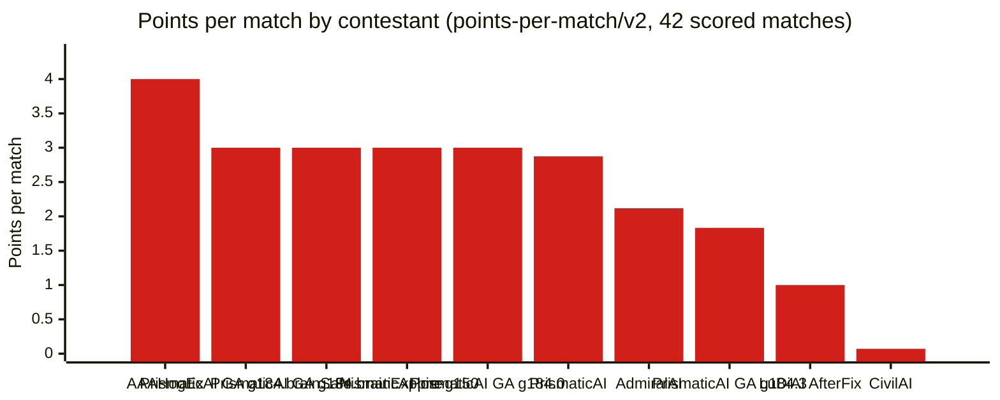
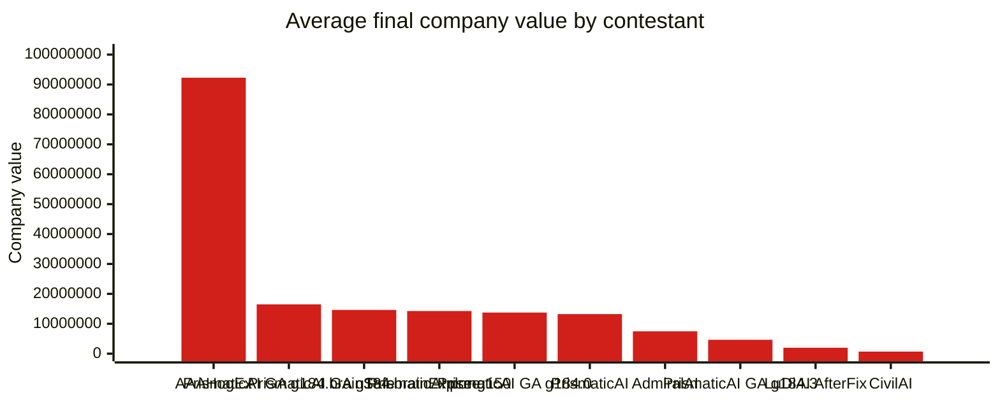
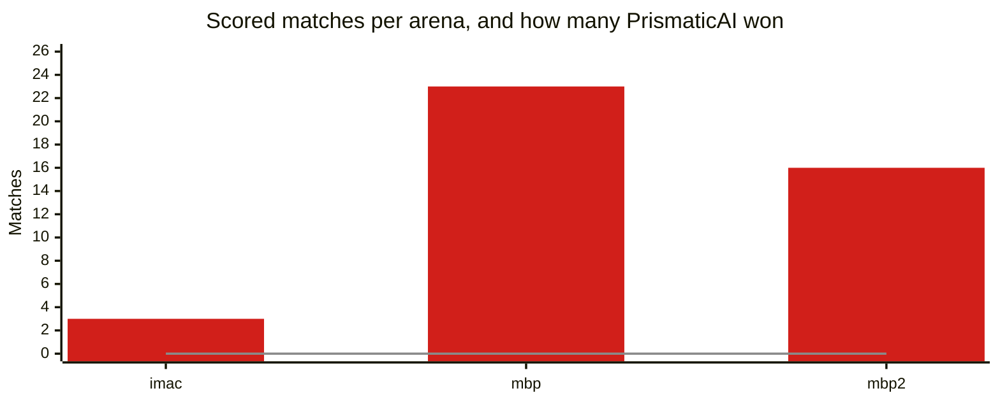

# battle-20261120T205408-365f5316

Derived from `battle-20261120T205408-365f5316.json` by `tools/research/ai-battle/battle.py report`; do not edit.

- Edition `365f53163ddf7dac`: PrismaticAI and referee at `962699034c20d90baeb9f617789ea6558cc6ff52`, base set `opengfx-8.0.tar`
- 20-year free-for-all from 1960, map 256x256 temperate, breakdowns 1
- 42 scored match(es) on `imac` (20261119-master-gdf1e05e7d8), `mbp` (20261120-master-m17653b726e), `mbp2` (20261119-master-gdf1e05e7d8)
- Replays: 1 of 1 identical to their original on another arena

| # | Contestant | Played | Wins | Points | Points/match | Avg rank | Avg final value | Squirrel errors | Matches with anomalies |
|---|---|---|---|---|---|---|---|---|---|
| 1 | AAAHogEx | 42 | 42 | 168 | 4.0 | 1.0 | 92.3 M | 0 | 0 |
| 2 | PrismaticAI GA g184.brainSafe | 6 | 0 | 18 | 3.0 | 2.0 | 16.5 M | 0 | 1 |
| 3 | PrismaticAI GA g184.brainExplore | 7 | 0 | 21 | 3.0 | 2.0 | 14.6 M | 0 | 3 |
| 4 | PrismaticAI pre-g150 | 8 | 0 | 24 | 3.0 | 2.0 | 14.2 M | 0 | 3 |
| 5 | PrismaticAI GA g184.0 | 7 | 0 | 21 | 3.0 | 2.0 | 13.7 M | 0 | 0 |
| 6 | PrismaticAI | 8 | 0 | 23 | 2.875 | 2.12 | 13.2 M | 0 | 0 |
| 7 | AdmiralAI | 42 | 0 | 89 | 2.119 | 2.88 | 7.5 M | 44 | 7 |
| 8 | PrismaticAI GA g184.3 | 6 | 0 | 11 | 1.833 | 3.17 | 4.6 M | 0 | 3 |
| 9 | LuDiAI AfterFix | 42 | 0 | 42 | 1.0 | 4.0 | 2.0 M | 0 | 0 |
| 10 | CivilAI | 42 | 0 | 3 | 0.071 | 4.93 | 693.3 k | 0 | 5 |

```mermaid
---
config:
  xyChart:
    width: 900
    height: 360
  themeVariables:
    xyChart:
      plotColorPalette: "#d11f1a, #8a8a8a, #0b0b0b, #ece4d6"
---
xychart-beta
    title "Final company value per scored match: winner vs best PrismaticAI"
    x-axis ["m-0001", "m-0002", "m-0003", "m-0004", "m-0005", "m-0006", "m-0007", "m-0008", "m-0009", "m-0010", "m-0011", "m-0012", "m-0013", "m-0014", "m-0015", "m-0016", "m-0017", "m-0018", "m-0019", "m-0020", "m-0021", "m-0022", "m-0023", "m-0024", "m-0025", "m-0026", "m-0027", "m-0028", "m-0036", "m-0037", "m-0038", "m-0039", "m-0040", "m-0041", "m-0042", "m-0043", "m-0044", "m-0046", "m-0053", "m-0054", "m-0055", "m-0066"]
    %% series: Winner | Best PrismaticAI
    %% links: battle-20261120T205408-365f5316.md?col=Match&filter=m-0001 | battle-20261120T205408-365f5316.md?col=Match&filter=m-0002 | battle-20261120T205408-365f5316.md?col=Match&filter=m-0003 | battle-20261120T205408-365f5316.md?col=Match&filter=m-0004 | battle-20261120T205408-365f5316.md?col=Match&filter=m-0005 | battle-20261120T205408-365f5316.md?col=Match&filter=m-0006 | battle-20261120T205408-365f5316.md?col=Match&filter=m-0007 | battle-20261120T205408-365f5316.md?col=Match&filter=m-0008 | battle-20261120T205408-365f5316.md?col=Match&filter=m-0009 | battle-20261120T205408-365f5316.md?col=Match&filter=m-0010 | battle-20261120T205408-365f5316.md?col=Match&filter=m-0011 | battle-20261120T205408-365f5316.md?col=Match&filter=m-0012 | battle-20261120T205408-365f5316.md?col=Match&filter=m-0013 | battle-20261120T205408-365f5316.md?col=Match&filter=m-0014 | battle-20261120T205408-365f5316.md?col=Match&filter=m-0015 | battle-20261120T205408-365f5316.md?col=Match&filter=m-0016 | battle-20261120T205408-365f5316.md?col=Match&filter=m-0017 | battle-20261120T205408-365f5316.md?col=Match&filter=m-0018 | battle-20261120T205408-365f5316.md?col=Match&filter=m-0019 | battle-20261120T205408-365f5316.md?col=Match&filter=m-0020 | battle-20261120T205408-365f5316.md?col=Match&filter=m-0021 | battle-20261120T205408-365f5316.md?col=Match&filter=m-0022 | battle-20261120T205408-365f5316.md?col=Match&filter=m-0023 | battle-20261120T205408-365f5316.md?col=Match&filter=m-0024 | battle-20261120T205408-365f5316.md?col=Match&filter=m-0025 | battle-20261120T205408-365f5316.md?col=Match&filter=m-0026 | battle-20261120T205408-365f5316.md?col=Match&filter=m-0027 | battle-20261120T205408-365f5316.md?col=Match&filter=m-0028 | battle-20261120T205408-365f5316.md?col=Match&filter=m-0036 | battle-20261120T205408-365f5316.md?col=Match&filter=m-0037 | battle-20261120T205408-365f5316.md?col=Match&filter=m-0038 | battle-20261120T205408-365f5316.md?col=Match&filter=m-0039 | battle-20261120T205408-365f5316.md?col=Match&filter=m-0040 | battle-20261120T205408-365f5316.md?col=Match&filter=m-0041 | battle-20261120T205408-365f5316.md?col=Match&filter=m-0042 | battle-20261120T205408-365f5316.md?col=Match&filter=m-0043 | battle-20261120T205408-365f5316.md?col=Match&filter=m-0044 | battle-20261120T205408-365f5316.md?col=Match&filter=m-0046 | battle-20261120T205408-365f5316.md?col=Match&filter=m-0053 | battle-20261120T205408-365f5316.md?col=Match&filter=m-0054 | battle-20261120T205408-365f5316.md?col=Match&filter=m-0055 | battle-20261120T205408-365f5316.md?col=Match&filter=m-0066
    y-axis "Company value" 0 --> 167000000
    bar [62436395, 94195244, 76400449, 63746590, 92783434, 145747418, 137337524, 142500428, 133997108, 125332110, 126407388, 72174663, 90008998, 60758520, 72241229, 98356084, 80457528, 45678586, 61073135, 60001006, 70812058, 54105791, 73348777, 114466248, 75165759, 87986967, 89420064, 91222007, 71418943, 85310962, 83029854, 71103214, 82298710, 89225495, 127665747, 120491106, 124239796, 151962458, 100047039, 89901801, 80033823, 100550210]
    line [13901928, 14678043, 14799163, 18904405, 4513262, 15411460, 21731980, 16936231, 23164000, 22194974, 7538474, 9064613, 9078512, 9133734, 19233951, 6784207, 2572933, 10027427, 10208355, 5840596, 13622795, 8651909, 8125090, 16610709, 11349244, 13930763, 15674659, 18926221, 12093826, 13114250, 13511408, 12449932, 14680012, 2987176, 17581519, 15589304, 22198599, 12210942, 2117462, 12753851, 19020923, 12296837]
```

<!-- battle-charts:begin -->
<!-- derived from battle-20261120T205408-365f5316.json by `battle.py render`; `battle.py check` fails when it is stale -->

<!-- battle-charts:end -->

| Seed | Original | Replay | Arenas | Identical |
|---|---|---|---|---|
| 69306004 | m-0013 | m-0056 | mbp2 / mbp | yes |

| Match | Arena | Seed | Winner | Value | Last | Anomalies |
|---|---|---|---|---|---|---|
| m-0001 | mbp | 1547329093 | AAAHogEx | 62.4 M | CivilAI | AdmiralAI: fleet_drop:289->193 |
| m-0002 | mbp | 1547329093 | AAAHogEx | 94.2 M | CivilAI | - |
| m-0003 | mbp | 1547329093 | AAAHogEx | 76.4 M | CivilAI | CivilAI: fleet_drop:42->23 |
| m-0004 | mbp | 1547329093 | AAAHogEx | 63.7 M | CivilAI | PrismaticAI GA g184.brainExplore: fleet_drop:97->67; AdmiralAI: fleet_drop:54->35 |
| m-0005 | mbp | 1547329093 | AAAHogEx | 92.8 M | CivilAI | AdmiralAI: fleet_drop:199->130; PrismaticAI GA g184.3: fleet_drop:120->80 |
| m-0006 | mbp | 1511799408 | AAAHogEx | 145.7 M | CivilAI | - |
| m-0007 | mbp | 1511799408 | AAAHogEx | 137.3 M | CivilAI | PrismaticAI pre-g150: fleet_drop:86->60 |
| m-0008 | mbp | 1511799408 | AAAHogEx | 142.5 M | CivilAI | - |
| m-0009 | mbp | 1511799408 | AAAHogEx | 134.0 M | CivilAI | PrismaticAI GA g184.brainSafe: fleet_drop:112->72; CivilAI: fleet_drop:40->21 |
| m-0010 | imac | 1511799408 | AAAHogEx | 125.3 M | LuDiAI AfterFix | - |
| m-0011 | imac | 1511799408 | AAAHogEx | 126.4 M | CivilAI | PrismaticAI GA g184.3: fleet_drop:151->81; CivilAI: fleet_drop:50->18 |
| m-0012 | imac | 69306004 | AAAHogEx | 72.2 M | CivilAI | - |
| m-0013 | mbp2 | 69306004 | AAAHogEx | 90.0 M | CivilAI | - |
| m-0014 | mbp2 | 69306004 | AAAHogEx | 60.8 M | CivilAI | CivilAI: fleet_drop:51->28 |
| m-0015 | mbp2 | 69306004 | AAAHogEx | 72.2 M | CivilAI | - |
| m-0016 | mbp2 | 69306004 | AAAHogEx | 98.4 M | CivilAI | - |
| m-0017 | mbp2 | 69306004 | AAAHogEx | 80.5 M | CivilAI | - |
| m-0018 | mbp2 | 273271211 | AAAHogEx | 45.7 M | LuDiAI AfterFix | - |
| m-0019 | mbp2 | 273271211 | AAAHogEx | 61.1 M | CivilAI | AdmiralAI: fleet_drop:212->148 |
| m-0020 | mbp2 | 273271211 | AAAHogEx | 60.0 M | CivilAI | - |
| m-0021 | mbp2 | 273271211 | AAAHogEx | 70.8 M | CivilAI | AdmiralAI: fleet_drop:134->85 |
| m-0022 | mbp2 | 273271211 | AAAHogEx | 54.1 M | CivilAI | - |
| m-0023 | mbp2 | 273271211 | AAAHogEx | 73.3 M | LuDiAI AfterFix | - |
| m-0024 | mbp2 | 492690544 | AAAHogEx | 114.5 M | CivilAI | - |
| m-0025 | mbp2 | 492690544 | AAAHogEx | 75.2 M | CivilAI | - |
| m-0026 | mbp2 | 492690544 | AAAHogEx | 88.0 M | CivilAI | CivilAI: fleet_drop:64->43 |
| m-0027 | mbp2 | 492690544 | AAAHogEx | 89.4 M | CivilAI | - |
| m-0028 | mbp2 | 492690544 | AAAHogEx | 91.2 M | CivilAI | - |
| m-0036 | mbp | 827113672 | AAAHogEx | 71.4 M | CivilAI | - |
| m-0037 | mbp | 827113672 | AAAHogEx | 85.3 M | CivilAI | PrismaticAI pre-g150: fleet_drop:93->39 |
| m-0038 | mbp | 827113672 | AAAHogEx | 83.0 M | CivilAI | AdmiralAI: fleet_drop:282->183 |
| m-0039 | mbp | 827113672 | AAAHogEx | 71.1 M | CivilAI | AdmiralAI: squirrel_errors:44 |
| m-0040 | mbp | 827113672 | AAAHogEx | 82.3 M | CivilAI | PrismaticAI GA g184.brainExplore: fleet_drop:84->40 |
| m-0041 | mbp | 827113672 | AAAHogEx | 89.2 M | CivilAI | PrismaticAI GA g184.3: fleet_drop:105->53 |
| m-0042 | mbp | 852210195 | AAAHogEx | 127.7 M | CivilAI | - |
| m-0043 | mbp | 852210195 | AAAHogEx | 120.5 M | CivilAI | PrismaticAI pre-g150: fleet_drop:96->61 |
| m-0044 | mbp | 852210195 | AAAHogEx | 124.2 M | CivilAI | - |
| m-0046 | mbp | 852210195 | AAAHogEx | 152.0 M | CivilAI | PrismaticAI GA g184.brainExplore: fleet_drop:123->62 |
| m-0053 | mbp | 178872634 | AAAHogEx | 100.0 M | CivilAI | - |
| m-0054 | mbp | 71965536 | AAAHogEx | 89.9 M | CivilAI | - |
| m-0055 | mbp | 71965536 | AAAHogEx | 80.0 M | CivilAI | - |
| m-0056 (replay) | mbp | 69306004 | AAAHogEx | 90.0 M | CivilAI | - |
| m-0066 | mbp | 283240322 | AAAHogEx | 100.6 M | CivilAI | - |
