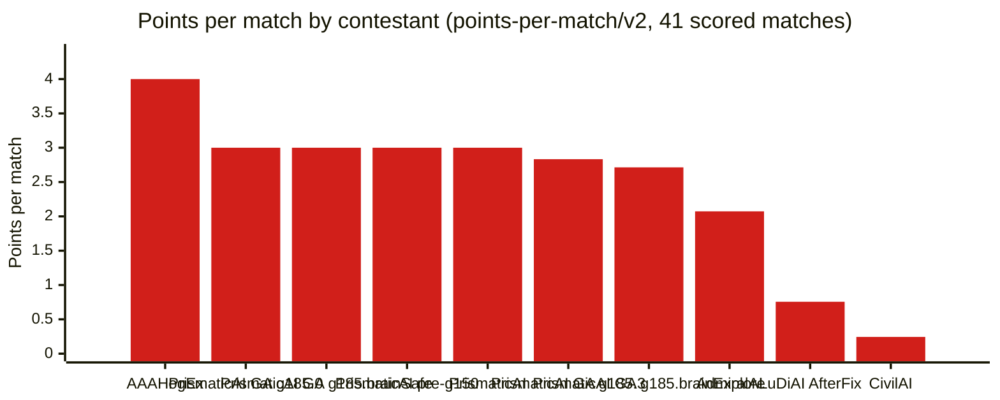
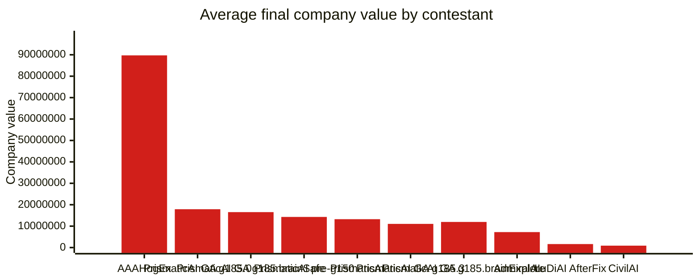
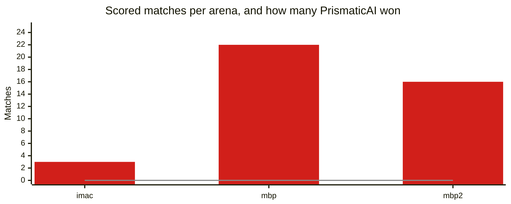

# battle-20261120T210353-63a7dcf3

Derived from `battle-20261120T210353-63a7dcf3.json` by `tools/research/ai-battle/battle.py report`; do not edit.

- Edition `63a7dcf37421319c`: PrismaticAI and referee at `962699034c20d90baeb9f617789ea6558cc6ff52`, base set `opengfx-8.0.tar`
- 20-year free-for-all from 1960, map 256x256 temperate, breakdowns 1
- 41 scored match(es) on `imac` (20261119-master-gdf1e05e7d8), `mbp` (20261120-master-m17653b726e), `mbp2` (20261119-master-gdf1e05e7d8)
- Replays: 0 of 0 identical to their original on another arena

| # | Contestant | Played | Wins | Points | Points/match | Avg rank | Avg final value | Squirrel errors | Matches with anomalies |
|---|---|---|---|---|---|---|---|---|---|
| 1 | AAAHogEx | 41 | 41 | 164 | 4.0 | 1.0 | 89.7 M | 0 | 0 |
| 2 | PrismaticAI GA g185.0 | 8 | 0 | 24 | 3.0 | 2.0 | 17.9 M | 0 | 2 |
| 3 | PrismaticAI GA g185.brainSafe | 7 | 0 | 21 | 3.0 | 2.0 | 16.5 M | 0 | 3 |
| 4 | PrismaticAI pre-g150 | 7 | 0 | 21 | 3.0 | 2.0 | 14.3 M | 0 | 4 |
| 5 | PrismaticAI | 6 | 0 | 18 | 3.0 | 2.0 | 13.2 M | 0 | 0 |
| 6 | PrismaticAI GA g185.3 | 6 | 0 | 17 | 2.833 | 2.17 | 11.1 M | 0 | 3 |
| 7 | PrismaticAI GA g185.brainExplore | 7 | 0 | 19 | 2.714 | 2.29 | 12.0 M | 0 | 1 |
| 8 | AdmiralAI | 41 | 0 | 85 | 2.073 | 2.93 | 7.2 M | 0 | 0 |
| 9 | LuDiAI AfterFix | 41 | 0 | 31 | 0.756 | 4.24 | 1.6 M | 0 | 1 |
| 10 | CivilAI | 41 | 0 | 10 | 0.244 | 4.76 | 892.4 k | 0 | 6 |

```mermaid
---
config:
  xyChart:
    width: 900
    height: 360
  themeVariables:
    xyChart:
      plotColorPalette: "#d11f1a, #8a8a8a, #0b0b0b, #ece4d6"
---
xychart-beta
    title "Final company value per scored match: winner vs best PrismaticAI"
    x-axis ["m-0001", "m-0002", "m-0003", "m-0004", "m-0005", "m-0006", "m-0007", "m-0008", "m-0009", "m-0010", "m-0011", "m-0012", "m-0013", "m-0014", "m-0015", "m-0016", "m-0017", "m-0018", "m-0019", "m-0020", "m-0021", "m-0022", "m-0023", "m-0024", "m-0025", "m-0026", "m-0027", "m-0028", "m-0036", "m-0037", "m-0038", "m-0039", "m-0040", "m-0041", "m-0042", "m-0043", "m-0044", "m-0046", "m-0047", "m-0050", "m-0051"]
    %% series: Winner | Best PrismaticAI
    %% links: battle-20261120T210353-63a7dcf3.md?col=Match&filter=m-0001 | battle-20261120T210353-63a7dcf3.md?col=Match&filter=m-0002 | battle-20261120T210353-63a7dcf3.md?col=Match&filter=m-0003 | battle-20261120T210353-63a7dcf3.md?col=Match&filter=m-0004 | battle-20261120T210353-63a7dcf3.md?col=Match&filter=m-0005 | battle-20261120T210353-63a7dcf3.md?col=Match&filter=m-0006 | battle-20261120T210353-63a7dcf3.md?col=Match&filter=m-0007 | battle-20261120T210353-63a7dcf3.md?col=Match&filter=m-0008 | battle-20261120T210353-63a7dcf3.md?col=Match&filter=m-0009 | battle-20261120T210353-63a7dcf3.md?col=Match&filter=m-0010 | battle-20261120T210353-63a7dcf3.md?col=Match&filter=m-0011 | battle-20261120T210353-63a7dcf3.md?col=Match&filter=m-0012 | battle-20261120T210353-63a7dcf3.md?col=Match&filter=m-0013 | battle-20261120T210353-63a7dcf3.md?col=Match&filter=m-0014 | battle-20261120T210353-63a7dcf3.md?col=Match&filter=m-0015 | battle-20261120T210353-63a7dcf3.md?col=Match&filter=m-0016 | battle-20261120T210353-63a7dcf3.md?col=Match&filter=m-0017 | battle-20261120T210353-63a7dcf3.md?col=Match&filter=m-0018 | battle-20261120T210353-63a7dcf3.md?col=Match&filter=m-0019 | battle-20261120T210353-63a7dcf3.md?col=Match&filter=m-0020 | battle-20261120T210353-63a7dcf3.md?col=Match&filter=m-0021 | battle-20261120T210353-63a7dcf3.md?col=Match&filter=m-0022 | battle-20261120T210353-63a7dcf3.md?col=Match&filter=m-0023 | battle-20261120T210353-63a7dcf3.md?col=Match&filter=m-0024 | battle-20261120T210353-63a7dcf3.md?col=Match&filter=m-0025 | battle-20261120T210353-63a7dcf3.md?col=Match&filter=m-0026 | battle-20261120T210353-63a7dcf3.md?col=Match&filter=m-0027 | battle-20261120T210353-63a7dcf3.md?col=Match&filter=m-0028 | battle-20261120T210353-63a7dcf3.md?col=Match&filter=m-0036 | battle-20261120T210353-63a7dcf3.md?col=Match&filter=m-0037 | battle-20261120T210353-63a7dcf3.md?col=Match&filter=m-0038 | battle-20261120T210353-63a7dcf3.md?col=Match&filter=m-0039 | battle-20261120T210353-63a7dcf3.md?col=Match&filter=m-0040 | battle-20261120T210353-63a7dcf3.md?col=Match&filter=m-0041 | battle-20261120T210353-63a7dcf3.md?col=Match&filter=m-0042 | battle-20261120T210353-63a7dcf3.md?col=Match&filter=m-0043 | battle-20261120T210353-63a7dcf3.md?col=Match&filter=m-0044 | battle-20261120T210353-63a7dcf3.md?col=Match&filter=m-0046 | battle-20261120T210353-63a7dcf3.md?col=Match&filter=m-0047 | battle-20261120T210353-63a7dcf3.md?col=Match&filter=m-0050 | battle-20261120T210353-63a7dcf3.md?col=Match&filter=m-0051
    y-axis "Company value" 0 --> 170000000
    bar [154781022, 153514973, 123917132, 113809264, 112811469, 79846139, 78391711, 80139503, 44030535, 66594865, 79589777, 70707078, 51249286, 75489045, 60516857, 59565013, 59109406, 86604976, 82974238, 64913460, 90135841, 111688882, 66364935, 59321241, 98453182, 98003631, 93285502, 70329355, 87863795, 87878019, 96361292, 87027743, 97468672, 81022313, 119758912, 109560352, 114075704, 127715358, 105131724, 95223605, 83077829]
    line [18581043, 29950980, 26706060, 16549968, 22287989, 12755472, 12599067, 17757737, 17935160, 7942239, 7893260, 10159080, 11946923, 5756864, 10726293, 10067868, 5670111, 15838494, 11904551, 18654166, 10836582, 8285488, 12584691, 13101745, 15171860, 15560316, 10900699, 11957334, 11110283, 12893994, 13343402, 16648647, 17105545, 10005239, 16523157, 16994422, 15823758, 11829559, 7868572, 26361385, 22074692]
```

<!-- battle-charts:begin -->
<!-- derived from battle-20261120T210353-63a7dcf3.json by `battle.py render`; `battle.py check` fails when it is stale -->

<!-- battle-charts:end -->

| Match | Arena | Seed | Winner | Value | Last | Anomalies |
|---|---|---|---|---|---|---|
| m-0001 | mbp | 1237247392 | AAAHogEx | 154.8 M | CivilAI | PrismaticAI pre-g150: fleet_drop:125->82 |
| m-0002 | mbp | 1237247392 | AAAHogEx | 153.5 M | CivilAI | - |
| m-0003 | mbp | 1237247392 | AAAHogEx | 123.9 M | CivilAI | PrismaticAI GA g185.brainSafe: fleet_drop:145->95 |
| m-0004 | mbp | 1237247392 | AAAHogEx | 113.8 M | CivilAI | - |
| m-0005 | mbp | 1237247392 | AAAHogEx | 112.8 M | CivilAI | PrismaticAI GA g185.3: fleet_drop:145->99 |
| m-0006 | mbp | 249312473 | AAAHogEx | 79.8 M | CivilAI | CivilAI: no_vehicles |
| m-0007 | mbp | 249312473 | AAAHogEx | 78.4 M | LuDiAI AfterFix | - |
| m-0008 | mbp | 249312473 | AAAHogEx | 80.1 M | CivilAI | - |
| m-0009 | mbp | 249312473 | AAAHogEx | 44.0 M | CivilAI | CivilAI: fleet_drop:17->10 |
| m-0010 | imac | 249312473 | AAAHogEx | 66.6 M | CivilAI | - |
| m-0011 | imac | 249312473 | AAAHogEx | 79.6 M | CivilAI | - |
| m-0012 | imac | 285304935 | AAAHogEx | 70.7 M | CivilAI | - |
| m-0013 | mbp2 | 285304935 | AAAHogEx | 51.2 M | CivilAI | PrismaticAI pre-g150: fleet_drop:89->59 |
| m-0014 | mbp2 | 285304935 | AAAHogEx | 75.5 M | CivilAI | PrismaticAI GA g185.0: fleet_drop:69->45; CivilAI: fleet_drop:25->10 |
| m-0015 | mbp2 | 285304935 | AAAHogEx | 60.5 M | CivilAI | - |
| m-0016 | mbp2 | 285304935 | AAAHogEx | 59.6 M | CivilAI | PrismaticAI GA g185.brainExplore: fleet_drop:76->34 |
| m-0017 | mbp2 | 285304935 | AAAHogEx | 59.1 M | CivilAI | PrismaticAI GA g185.3: fleet_drop:50->30 |
| m-0018 | mbp2 | 565384112 | AAAHogEx | 86.6 M | CivilAI | - |
| m-0019 | mbp2 | 565384112 | AAAHogEx | 83.0 M | LuDiAI AfterFix | PrismaticAI pre-g150: fleet_drop:101->57 |
| m-0020 | mbp2 | 565384112 | AAAHogEx | 64.9 M | LuDiAI AfterFix | - |
| m-0021 | mbp2 | 565384112 | AAAHogEx | 90.1 M | CivilAI | PrismaticAI GA g185.brainSafe: fleet_drop:92->49; LuDiAI AfterFix: fleet_drop:133->92 |
| m-0022 | mbp2 | 565384112 | AAAHogEx | 111.7 M | LuDiAI AfterFix | - |
| m-0023 | mbp2 | 565384112 | AAAHogEx | 66.4 M | CivilAI | PrismaticAI GA g185.3: fleet_drop:122->62 |
| m-0024 | mbp2 | 1080582201 | AAAHogEx | 59.3 M | CivilAI | - |
| m-0025 | mbp2 | 1080582201 | AAAHogEx | 98.5 M | LuDiAI AfterFix | PrismaticAI pre-g150: fleet_drop:82->47 |
| m-0026 | mbp2 | 1080582201 | AAAHogEx | 98.0 M | LuDiAI AfterFix | - |
| m-0027 | mbp2 | 1080582201 | AAAHogEx | 93.3 M | LuDiAI AfterFix | - |
| m-0028 | mbp2 | 1080582201 | AAAHogEx | 70.3 M | LuDiAI AfterFix | CivilAI: fleet_drop:45->26 |
| m-0036 | mbp | 1493568378 | AAAHogEx | 87.9 M | CivilAI | - |
| m-0037 | mbp | 1493568378 | AAAHogEx | 87.9 M | CivilAI | - |
| m-0038 | mbp | 1493568378 | AAAHogEx | 96.4 M | CivilAI | PrismaticAI GA g185.0: fleet_drop:78->52 |
| m-0039 | mbp | 1493568378 | AAAHogEx | 87.0 M | LuDiAI AfterFix | - |
| m-0040 | mbp | 1493568378 | AAAHogEx | 97.5 M | CivilAI | CivilAI: fleet_drop:18->8 |
| m-0041 | mbp | 1493568378 | AAAHogEx | 81.0 M | CivilAI | - |
| m-0042 | mbp | 1968143075 | AAAHogEx | 119.8 M | CivilAI | - |
| m-0043 | mbp | 1968143075 | AAAHogEx | 109.6 M | CivilAI | - |
| m-0044 | mbp | 1968143075 | AAAHogEx | 114.1 M | LuDiAI AfterFix | - |
| m-0046 | mbp | 1968143075 | AAAHogEx | 127.7 M | CivilAI | - |
| m-0047 | mbp | 1968143075 | AAAHogEx | 105.1 M | CivilAI | - |
| m-0050 | mbp | 1706294012 | AAAHogEx | 95.2 M | CivilAI | - |
| m-0051 | mbp | 1706294012 | AAAHogEx | 83.1 M | CivilAI | PrismaticAI GA g185.brainSafe: fleet_drop:108->74; CivilAI: fleet_drop:42->27 |
