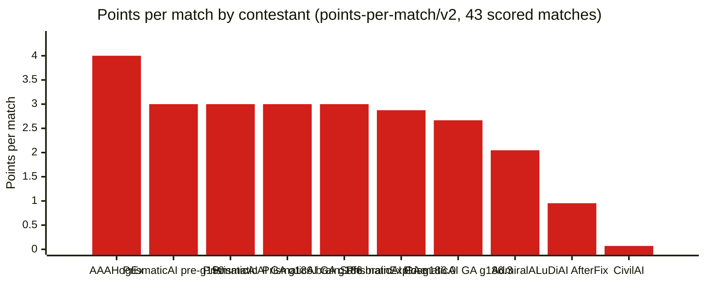
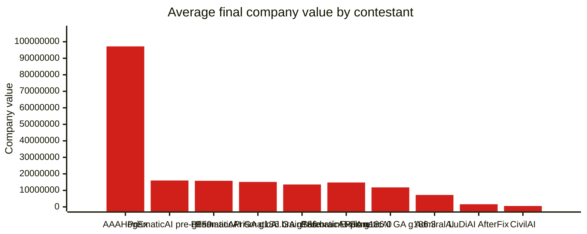
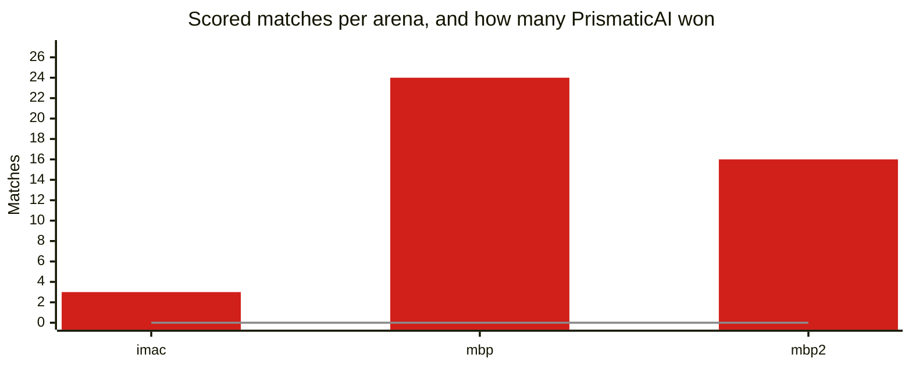

# battle-20261120T211437-8076d17a

Derived from `battle-20261120T211437-8076d17a.json` by `tools/research/ai-battle/battle.py report`; do not edit.

- Edition `8076d17a7e52d849`: PrismaticAI and referee at `962699034c20d90baeb9f617789ea6558cc6ff52`, base set `opengfx-8.0.tar`
- 20-year free-for-all from 1960, map 256x256 temperate, breakdowns 1
- 43 scored match(es) on `imac` (20261119-master-gdf1e05e7d8), `mbp` (20261120-master-m17653b726e), `mbp2` (20261119-master-gdf1e05e7d8)
- Replays: 0 of 2 identical to their original on another arena

| # | Contestant | Played | Wins | Points | Points/match | Avg rank | Avg final value | Squirrel errors | Matches with anomalies |
|---|---|---|---|---|---|---|---|---|---|
| 1 | AAAHogEx | 43 | 43 | 172 | 4.0 | 1.0 | 97.2 M | 0 | 0 |
| 2 | PrismaticAI pre-g150 | 8 | 0 | 24 | 3.0 | 2.0 | 16.0 M | 0 | 4 |
| 3 | PrismaticAI | 6 | 0 | 18 | 3.0 | 2.0 | 15.8 M | 0 | 0 |
| 4 | PrismaticAI GA g186.brainSafe | 8 | 0 | 24 | 3.0 | 2.0 | 15.1 M | 0 | 3 |
| 5 | PrismaticAI GA g186.brainExplore | 7 | 0 | 21 | 3.0 | 2.0 | 13.6 M | 0 | 3 |
| 6 | PrismaticAI GA g186.0 | 8 | 0 | 23 | 2.875 | 2.12 | 14.8 M | 0 | 2 |
| 7 | PrismaticAI GA g186.3 | 6 | 0 | 16 | 2.667 | 2.33 | 11.8 M | 0 | 3 |
| 8 | AdmiralAI | 43 | 0 | 88 | 2.047 | 2.95 | 7.2 M | 59 | 2 |
| 9 | LuDiAI AfterFix | 43 | 0 | 41 | 0.953 | 4.05 | 1.6 M | 0 | 2 |
| 10 | CivilAI | 43 | 0 | 3 | 0.07 | 4.93 | 534.6 k | 0 | 3 |

```mermaid
---
config:
  xyChart:
    width: 900
    height: 360
  themeVariables:
    xyChart:
      plotColorPalette: "#d11f1a, #8a8a8a, #0b0b0b, #ece4d6"
---
xychart-beta
    title "Final company value per scored match: winner vs best PrismaticAI"
    x-axis ["m-0001", "m-0002", "m-0003", "m-0004", "m-0005", "m-0006", "m-0007", "m-0008", "m-0009", "m-0010", "m-0011", "m-0012", "m-0013", "m-0014", "m-0015", "m-0016", "m-0017", "m-0018", "m-0019", "m-0020", "m-0021", "m-0022", "m-0023", "m-0024", "m-0025", "m-0026", "m-0027", "m-0028", "m-0036", "m-0037", "m-0038", "m-0039", "m-0040", "m-0041", "m-0042", "m-0043", "m-0044", "m-0045", "m-0047", "m-0049", "m-0050", "m-0057", "m-0058"]
    %% series: Winner | Best PrismaticAI
    %% links: battle-20261120T211437-8076d17a.md?col=Match&filter=m-0001 | battle-20261120T211437-8076d17a.md?col=Match&filter=m-0002 | battle-20261120T211437-8076d17a.md?col=Match&filter=m-0003 | battle-20261120T211437-8076d17a.md?col=Match&filter=m-0004 | battle-20261120T211437-8076d17a.md?col=Match&filter=m-0005 | battle-20261120T211437-8076d17a.md?col=Match&filter=m-0006 | battle-20261120T211437-8076d17a.md?col=Match&filter=m-0007 | battle-20261120T211437-8076d17a.md?col=Match&filter=m-0008 | battle-20261120T211437-8076d17a.md?col=Match&filter=m-0009 | battle-20261120T211437-8076d17a.md?col=Match&filter=m-0010 | battle-20261120T211437-8076d17a.md?col=Match&filter=m-0011 | battle-20261120T211437-8076d17a.md?col=Match&filter=m-0012 | battle-20261120T211437-8076d17a.md?col=Match&filter=m-0013 | battle-20261120T211437-8076d17a.md?col=Match&filter=m-0014 | battle-20261120T211437-8076d17a.md?col=Match&filter=m-0015 | battle-20261120T211437-8076d17a.md?col=Match&filter=m-0016 | battle-20261120T211437-8076d17a.md?col=Match&filter=m-0017 | battle-20261120T211437-8076d17a.md?col=Match&filter=m-0018 | battle-20261120T211437-8076d17a.md?col=Match&filter=m-0019 | battle-20261120T211437-8076d17a.md?col=Match&filter=m-0020 | battle-20261120T211437-8076d17a.md?col=Match&filter=m-0021 | battle-20261120T211437-8076d17a.md?col=Match&filter=m-0022 | battle-20261120T211437-8076d17a.md?col=Match&filter=m-0023 | battle-20261120T211437-8076d17a.md?col=Match&filter=m-0024 | battle-20261120T211437-8076d17a.md?col=Match&filter=m-0025 | battle-20261120T211437-8076d17a.md?col=Match&filter=m-0026 | battle-20261120T211437-8076d17a.md?col=Match&filter=m-0027 | battle-20261120T211437-8076d17a.md?col=Match&filter=m-0028 | battle-20261120T211437-8076d17a.md?col=Match&filter=m-0036 | battle-20261120T211437-8076d17a.md?col=Match&filter=m-0037 | battle-20261120T211437-8076d17a.md?col=Match&filter=m-0038 | battle-20261120T211437-8076d17a.md?col=Match&filter=m-0039 | battle-20261120T211437-8076d17a.md?col=Match&filter=m-0040 | battle-20261120T211437-8076d17a.md?col=Match&filter=m-0041 | battle-20261120T211437-8076d17a.md?col=Match&filter=m-0042 | battle-20261120T211437-8076d17a.md?col=Match&filter=m-0043 | battle-20261120T211437-8076d17a.md?col=Match&filter=m-0044 | battle-20261120T211437-8076d17a.md?col=Match&filter=m-0045 | battle-20261120T211437-8076d17a.md?col=Match&filter=m-0047 | battle-20261120T211437-8076d17a.md?col=Match&filter=m-0049 | battle-20261120T211437-8076d17a.md?col=Match&filter=m-0050 | battle-20261120T211437-8076d17a.md?col=Match&filter=m-0057 | battle-20261120T211437-8076d17a.md?col=Match&filter=m-0058
    y-axis "Company value" 0 --> 142000000
    bar [88706533, 108254975, 100666892, 106746266, 86854032, 90040421, 92558370, 93298211, 96974108, 85727860, 116357438, 125504326, 105857312, 89100717, 105149197, 94049885, 76900567, 93001755, 73862238, 76803707, 66353723, 80114732, 70667443, 117509758, 109227527, 125889183, 120596992, 128941043, 85095526, 95163927, 79059309, 99160300, 79453724, 65884402, 122232799, 103989269, 114797407, 99483097, 111379320, 92019250, 91693079, 97853189, 116351794]
    line [17518399, 19385948, 21170784, 17420801, 16177795, 8497668, 10674325, 10523202, 11504265, 10893086, 8146015, 18483172, 12719929, 14062215, 14662134, 12703058, 13017770, 12315154, 11155169, 18610188, 14109133, 13548105, 10340089, 17276300, 17221127, 14199924, 14125723, 10730572, 21875522, 22188462, 17818645, 19785300, 15117362, 18927198, 16426740, 21342023, 4529652, 8371578, 4238630, 15042436, 19148601, 17148024, 14503330]
```

<!-- battle-charts:begin -->
<!-- derived from battle-20261120T211437-8076d17a.json by `battle.py render`; `battle.py check` fails when it is stale -->

<!-- battle-charts:end -->

| Seed | Original | Replay | Arenas | Identical |
|---|---|---|---|---|
| 1619026905 | m-0012 | m-0048 | imac / mbp | NO |
| 1202796076 | m-0010 | m-0056 | imac / mbp | NO |

| Match | Arena | Seed | Winner | Value | Last | Anomalies |
|---|---|---|---|---|---|---|
| m-0001 | mbp | 1500857744 | AAAHogEx | 88.7 M | LuDiAI AfterFix | PrismaticAI pre-g150: fleet_drop:86->41 |
| m-0002 | mbp | 1500857744 | AAAHogEx | 108.3 M | LuDiAI AfterFix | - |
| m-0003 | mbp | 1500857744 | AAAHogEx | 100.7 M | CivilAI | - |
| m-0004 | mbp | 1500857744 | AAAHogEx | 106.7 M | CivilAI | - |
| m-0005 | mbp | 1500857744 | AAAHogEx | 86.9 M | CivilAI | CivilAI: fleet_drop:47->32 |
| m-0006 | mbp | 1202796076 | AAAHogEx | 90.0 M | CivilAI | - |
| m-0007 | mbp | 1202796076 | AAAHogEx | 92.6 M | CivilAI | PrismaticAI pre-g150: fleet_drop:56->28 |
| m-0008 | mbp | 1202796076 | AAAHogEx | 93.3 M | CivilAI | PrismaticAI GA g186.0: fleet_drop:62->30 |
| m-0009 | mbp | 1202796076 | AAAHogEx | 97.0 M | CivilAI | PrismaticAI GA g186.brainSafe: fleet_drop:97->50 |
| m-0010 | imac | 1202796076 | AAAHogEx | 85.7 M | LuDiAI AfterFix | PrismaticAI GA g186.brainExplore: fleet_drop:99->51 |
| m-0011 | imac | 1202796076 | AAAHogEx | 116.4 M | CivilAI | PrismaticAI GA g186.3: fleet_drop:65->33 |
| m-0012 | imac | 1619026905 | AAAHogEx | 125.5 M | CivilAI | LuDiAI AfterFix: fleet_drop:13->9 |
| m-0013 | mbp2 | 1619026905 | AAAHogEx | 105.9 M | CivilAI | PrismaticAI pre-g150: fleet_drop:80->41 |
| m-0014 | mbp2 | 1619026905 | AAAHogEx | 89.1 M | CivilAI | PrismaticAI GA g186.0: fleet_drop:80->51; LuDiAI AfterFix: fleet_drop:63->38 |
| m-0015 | mbp2 | 1619026905 | AAAHogEx | 105.1 M | CivilAI | - |
| m-0016 | mbp2 | 1619026905 | AAAHogEx | 94.0 M | CivilAI | PrismaticAI GA g186.brainExplore: fleet_drop:59->38 |
| m-0017 | mbp2 | 1619026905 | AAAHogEx | 76.9 M | CivilAI | PrismaticAI GA g186.3: fleet_drop:76->41 |
| m-0018 | mbp2 | 723064330 | AAAHogEx | 93.0 M | CivilAI | CivilAI: fleet_drop:44->19 |
| m-0019 | mbp2 | 723064330 | AAAHogEx | 73.9 M | CivilAI | - |
| m-0020 | mbp2 | 723064330 | AAAHogEx | 76.8 M | CivilAI | - |
| m-0021 | mbp2 | 723064330 | AAAHogEx | 66.4 M | CivilAI | - |
| m-0022 | mbp2 | 723064330 | AAAHogEx | 80.1 M | CivilAI | - |
| m-0023 | mbp2 | 723064330 | AAAHogEx | 70.7 M | CivilAI | PrismaticAI GA g186.3: fleet_drop:90->60 |
| m-0024 | mbp2 | 83615359 | AAAHogEx | 117.5 M | CivilAI | - |
| m-0025 | mbp2 | 83615359 | AAAHogEx | 109.2 M | CivilAI | PrismaticAI pre-g150: fleet_drop:107->60 |
| m-0026 | mbp2 | 83615359 | AAAHogEx | 125.9 M | CivilAI | AdmiralAI: fleet_drop:392->224 |
| m-0027 | mbp2 | 83615359 | AAAHogEx | 120.6 M | CivilAI | PrismaticAI GA g186.brainSafe: fleet_drop:116->76 |
| m-0028 | mbp2 | 83615359 | AAAHogEx | 128.9 M | CivilAI | PrismaticAI GA g186.brainExplore: fleet_drop:93->65 |
| m-0036 | mbp | 945993761 | AAAHogEx | 85.1 M | CivilAI | - |
| m-0037 | mbp | 945993761 | AAAHogEx | 95.2 M | CivilAI | - |
| m-0038 | mbp | 945993761 | AAAHogEx | 79.1 M | CivilAI | - |
| m-0039 | mbp | 945993761 | AAAHogEx | 99.2 M | CivilAI | PrismaticAI GA g186.brainSafe: fleet_drop:172->104; AdmiralAI: squirrel_errors:59 |
| m-0040 | mbp | 945993761 | AAAHogEx | 79.5 M | CivilAI | - |
| m-0041 | mbp | 945993761 | AAAHogEx | 65.9 M | CivilAI | - |
| m-0042 | mbp | 1857897559 | AAAHogEx | 122.2 M | CivilAI | - |
| m-0043 | mbp | 1857897559 | AAAHogEx | 104.0 M | CivilAI | - |
| m-0044 | mbp | 1857897559 | AAAHogEx | 114.8 M | CivilAI | - |
| m-0045 | mbp | 1857897559 | AAAHogEx | 99.5 M | CivilAI | - |
| m-0047 | mbp | 1857897559 | AAAHogEx | 111.4 M | CivilAI | - |
| m-0048 (replay) | mbp | 1619026905 | AAAHogEx | 124.0 M | CivilAI | - |
| m-0049 | mbp | 704747395 | AAAHogEx | 92.0 M | CivilAI | - |
| m-0050 | mbp | 704747395 | AAAHogEx | 91.7 M | CivilAI | CivilAI: no_vehicles |
| m-0056 (replay) | mbp | 1202796076 | AAAHogEx | 83.3 M | CivilAI | CivilAI: fleet_drop:47->23 |
| m-0057 | mbp | 227237977 | AAAHogEx | 97.9 M | CivilAI | - |
| m-0058 | mbp | 227237977 | AAAHogEx | 116.4 M | CivilAI | - |
