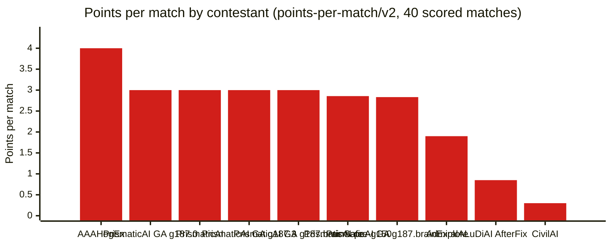
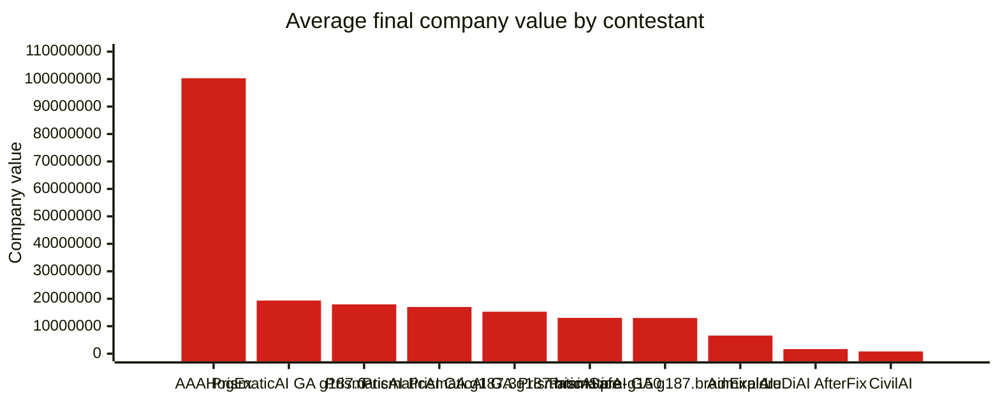
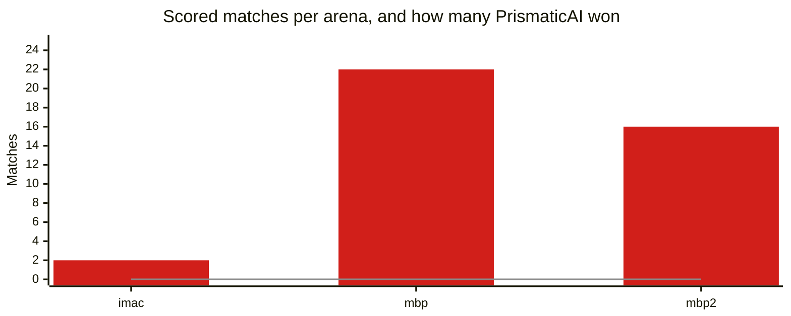

# battle-20261120T212444-c60f63bd

Derived from `battle-20261120T212444-c60f63bd.json` by `tools/research/ai-battle/battle.py report`; do not edit.

- Edition `c60f63bdbfb25b96`: PrismaticAI and referee at `962699034c20d90baeb9f617789ea6558cc6ff52`, base set `opengfx-8.0.tar`
- 20-year free-for-all from 1960, map 256x256 temperate, breakdowns 1
- 40 scored match(es) on `imac` (20261119-master-gdf1e05e7d8), `mbp` (20261120-master-m17653b726e), `mbp2` (20261119-master-gdf1e05e7d8)
- Replays: 0 of 0 identical to their original on another arena

| # | Contestant | Played | Wins | Points | Points/match | Avg rank | Avg final value | Squirrel errors | Matches with anomalies |
|---|---|---|---|---|---|---|---|---|---|
| 1 | AAAHogEx | 40 | 40 | 160 | 4.0 | 1.0 | 100.3 M | 0 | 0 |
| 2 | PrismaticAI GA g187.0 | 8 | 0 | 24 | 3.0 | 2.0 | 19.3 M | 0 | 5 |
| 3 | PrismaticAI | 6 | 0 | 18 | 3.0 | 2.0 | 18.0 M | 0 | 0 |
| 4 | PrismaticAI GA g187.3 | 6 | 0 | 18 | 3.0 | 2.0 | 17.0 M | 0 | 2 |
| 5 | PrismaticAI GA g187.brainSafe | 7 | 0 | 21 | 3.0 | 2.0 | 15.3 M | 0 | 3 |
| 6 | PrismaticAI pre-g150 | 7 | 0 | 20 | 2.857 | 2.14 | 13.0 M | 0 | 1 |
| 7 | PrismaticAI GA g187.brainExplore | 6 | 0 | 17 | 2.833 | 2.17 | 13.0 M | 0 | 2 |
| 8 | AdmiralAI | 40 | 0 | 76 | 1.9 | 3.1 | 6.6 M | 91 | 5 |
| 9 | LuDiAI AfterFix | 40 | 0 | 34 | 0.85 | 4.15 | 1.7 M | 0 | 4 |
| 10 | CivilAI | 40 | 0 | 12 | 0.3 | 4.7 | 819.5 k | 0 | 6 |

```mermaid
---
config:
  xyChart:
    width: 900
    height: 360
  themeVariables:
    xyChart:
      plotColorPalette: "#d11f1a, #8a8a8a, #0b0b0b, #ece4d6"
---
xychart-beta
    title "Final company value per scored match: winner vs best PrismaticAI"
    x-axis ["m-0001", "m-0002", "m-0003", "m-0004", "m-0005", "m-0006", "m-0007", "m-0008", "m-0009", "m-0011", "m-0012", "m-0013", "m-0014", "m-0015", "m-0016", "m-0017", "m-0018", "m-0019", "m-0020", "m-0021", "m-0022", "m-0023", "m-0024", "m-0025", "m-0026", "m-0027", "m-0028", "m-0036", "m-0037", "m-0038", "m-0039", "m-0040", "m-0041", "m-0042", "m-0043", "m-0044", "m-0050", "m-0051", "m-0052", "m-0053"]
    %% series: Winner | Best PrismaticAI
    %% links: battle-20261120T212444-c60f63bd.md?col=Match&filter=m-0001 | battle-20261120T212444-c60f63bd.md?col=Match&filter=m-0002 | battle-20261120T212444-c60f63bd.md?col=Match&filter=m-0003 | battle-20261120T212444-c60f63bd.md?col=Match&filter=m-0004 | battle-20261120T212444-c60f63bd.md?col=Match&filter=m-0005 | battle-20261120T212444-c60f63bd.md?col=Match&filter=m-0006 | battle-20261120T212444-c60f63bd.md?col=Match&filter=m-0007 | battle-20261120T212444-c60f63bd.md?col=Match&filter=m-0008 | battle-20261120T212444-c60f63bd.md?col=Match&filter=m-0009 | battle-20261120T212444-c60f63bd.md?col=Match&filter=m-0011 | battle-20261120T212444-c60f63bd.md?col=Match&filter=m-0012 | battle-20261120T212444-c60f63bd.md?col=Match&filter=m-0013 | battle-20261120T212444-c60f63bd.md?col=Match&filter=m-0014 | battle-20261120T212444-c60f63bd.md?col=Match&filter=m-0015 | battle-20261120T212444-c60f63bd.md?col=Match&filter=m-0016 | battle-20261120T212444-c60f63bd.md?col=Match&filter=m-0017 | battle-20261120T212444-c60f63bd.md?col=Match&filter=m-0018 | battle-20261120T212444-c60f63bd.md?col=Match&filter=m-0019 | battle-20261120T212444-c60f63bd.md?col=Match&filter=m-0020 | battle-20261120T212444-c60f63bd.md?col=Match&filter=m-0021 | battle-20261120T212444-c60f63bd.md?col=Match&filter=m-0022 | battle-20261120T212444-c60f63bd.md?col=Match&filter=m-0023 | battle-20261120T212444-c60f63bd.md?col=Match&filter=m-0024 | battle-20261120T212444-c60f63bd.md?col=Match&filter=m-0025 | battle-20261120T212444-c60f63bd.md?col=Match&filter=m-0026 | battle-20261120T212444-c60f63bd.md?col=Match&filter=m-0027 | battle-20261120T212444-c60f63bd.md?col=Match&filter=m-0028 | battle-20261120T212444-c60f63bd.md?col=Match&filter=m-0036 | battle-20261120T212444-c60f63bd.md?col=Match&filter=m-0037 | battle-20261120T212444-c60f63bd.md?col=Match&filter=m-0038 | battle-20261120T212444-c60f63bd.md?col=Match&filter=m-0039 | battle-20261120T212444-c60f63bd.md?col=Match&filter=m-0040 | battle-20261120T212444-c60f63bd.md?col=Match&filter=m-0041 | battle-20261120T212444-c60f63bd.md?col=Match&filter=m-0042 | battle-20261120T212444-c60f63bd.md?col=Match&filter=m-0043 | battle-20261120T212444-c60f63bd.md?col=Match&filter=m-0044 | battle-20261120T212444-c60f63bd.md?col=Match&filter=m-0050 | battle-20261120T212444-c60f63bd.md?col=Match&filter=m-0051 | battle-20261120T212444-c60f63bd.md?col=Match&filter=m-0052 | battle-20261120T212444-c60f63bd.md?col=Match&filter=m-0053
    y-axis "Company value" 0 --> 175000000
    bar [91277960, 86300766, 96926602, 99996085, 100668030, 111154367, 158822251, 100197133, 129887461, 137835861, 69363390, 74466854, 67104877, 87498422, 71437245, 76314915, 87584556, 100524263, 81038279, 87860653, 89622078, 93002564, 104529372, 115956946, 114791906, 106228200, 121862276, 74663334, 77479267, 93061545, 87261086, 72419506, 65037749, 130012933, 151827155, 149914536, 120924199, 92742363, 134901609, 99823574]
    line [8796964, 15917765, 8577995, 4259796, 16698549, 13744871, 15876205, 22353990, 17343661, 19635265, 15871620, 9523988, 20106582, 15784280, 10882380, 14594645, 18292064, 11856147, 15560649, 14573773, 15553350, 14468347, 13541650, 11800151, 17938795, 10716903, 12567418, 17394684, 16995262, 15209660, 22141089, 20019666, 17745692, 28897512, 16421284, 25604629, 22068477, 17772680, 14662685, 18752260]
```

<!-- battle-charts:begin -->
<!-- derived from battle-20261120T212444-c60f63bd.json by `battle.py render`; `battle.py check` fails when it is stale -->

<!-- battle-charts:end -->

| Match | Arena | Seed | Winner | Value | Last | Anomalies |
|---|---|---|---|---|---|---|
| m-0001 | mbp | 652067458 | AAAHogEx | 91.3 M | CivilAI | - |
| m-0002 | mbp | 652067458 | AAAHogEx | 86.3 M | CivilAI | PrismaticAI GA g187.0: fleet_drop:77->48; CivilAI: fleet_drop:29->20 |
| m-0003 | mbp | 652067458 | AAAHogEx | 96.9 M | CivilAI | - |
| m-0004 | mbp | 652067458 | AAAHogEx | 100.0 M | CivilAI | - |
| m-0005 | mbp | 652067458 | AAAHogEx | 100.7 M | CivilAI | PrismaticAI GA g187.3: fleet_drop:152->63 |
| m-0006 | mbp | 570053790 | AAAHogEx | 111.2 M | CivilAI | - |
| m-0007 | mbp | 570053790 | AAAHogEx | 158.8 M | CivilAI | LuDiAI AfterFix: fleet_drop:62->35 |
| m-0008 | mbp | 570053790 | AAAHogEx | 100.2 M | LuDiAI AfterFix | PrismaticAI GA g187.0: fleet_drop:189->90 |
| m-0009 | mbp | 570053790 | AAAHogEx | 129.9 M | CivilAI | PrismaticAI GA g187.brainSafe: fleet_drop:114->62 |
| m-0011 | imac | 570053790 | AAAHogEx | 137.8 M | AdmiralAI | - |
| m-0012 | imac | 72483647 | AAAHogEx | 69.4 M | CivilAI | - |
| m-0013 | mbp2 | 72483647 | AAAHogEx | 74.5 M | LuDiAI AfterFix | PrismaticAI pre-g150: fleet_drop:118->62; LuDiAI AfterFix: fleet_drop:49->29 |
| m-0014 | mbp2 | 72483647 | AAAHogEx | 67.1 M | CivilAI | PrismaticAI GA g187.0: fleet_drop:90->59 |
| m-0015 | mbp2 | 72483647 | AAAHogEx | 87.5 M | CivilAI | PrismaticAI GA g187.brainSafe: fleet_drop:98->63 |
| m-0016 | mbp2 | 72483647 | AAAHogEx | 71.4 M | CivilAI | PrismaticAI GA g187.brainExplore: fleet_drop:122->52; CivilAI: fleet_drop:70->33 |
| m-0017 | mbp2 | 72483647 | AAAHogEx | 76.3 M | CivilAI | PrismaticAI GA g187.3: fleet_drop:108->59 |
| m-0018 | mbp2 | 186999630 | AAAHogEx | 87.6 M | CivilAI | - |
| m-0019 | mbp2 | 186999630 | AAAHogEx | 100.5 M | LuDiAI AfterFix | - |
| m-0020 | mbp2 | 186999630 | AAAHogEx | 81.0 M | CivilAI | - |
| m-0021 | mbp2 | 186999630 | AAAHogEx | 87.9 M | CivilAI | CivilAI: fleet_drop:76->47 |
| m-0022 | mbp2 | 186999630 | AAAHogEx | 89.6 M | CivilAI | - |
| m-0023 | mbp2 | 186999630 | AAAHogEx | 93.0 M | LuDiAI AfterFix | AdmiralAI: squirrel_errors:47 |
| m-0024 | mbp2 | 614508730 | AAAHogEx | 104.5 M | LuDiAI AfterFix | LuDiAI AfterFix: fleet_drop:40->12 |
| m-0025 | mbp2 | 614508730 | AAAHogEx | 116.0 M | LuDiAI AfterFix | AdmiralAI: fleet_drop:172->112 |
| m-0026 | mbp2 | 614508730 | AAAHogEx | 114.8 M | CivilAI | PrismaticAI GA g187.0: fleet_drop:156->67 |
| m-0027 | mbp2 | 614508730 | AAAHogEx | 106.2 M | LuDiAI AfterFix | LuDiAI AfterFix: fleet_drop:92->61 |
| m-0028 | mbp2 | 614508730 | AAAHogEx | 121.9 M | CivilAI | CivilAI: fleet_drop:26->6 |
| m-0036 | mbp | 1627789933 | AAAHogEx | 74.7 M | CivilAI | - |
| m-0037 | mbp | 1627789933 | AAAHogEx | 77.5 M | CivilAI | CivilAI: no_vehicles |
| m-0038 | mbp | 1627789933 | AAAHogEx | 93.1 M | CivilAI | - |
| m-0039 | mbp | 1627789933 | AAAHogEx | 87.3 M | CivilAI | - |
| m-0040 | mbp | 1627789933 | AAAHogEx | 72.4 M | LuDiAI AfterFix | AdmiralAI: fleet_drop:397->265 |
| m-0041 | mbp | 1627789933 | AAAHogEx | 65.0 M | CivilAI | - |
| m-0042 | mbp | 997632849 | AAAHogEx | 130.0 M | CivilAI | - |
| m-0043 | mbp | 997632849 | AAAHogEx | 151.8 M | CivilAI | AdmiralAI: squirrel_errors:44 |
| m-0044 | mbp | 997632849 | AAAHogEx | 149.9 M | CivilAI | - |
| m-0050 | mbp | 124857738 | AAAHogEx | 120.9 M | AdmiralAI | PrismaticAI GA g187.0: fleet_drop:108->75 |
| m-0051 | mbp | 124857738 | AAAHogEx | 92.7 M | CivilAI | PrismaticAI GA g187.brainSafe: fleet_drop:77->51; CivilAI: fleet_drop:45->29 |
| m-0052 | mbp | 124857738 | AAAHogEx | 134.9 M | CivilAI | PrismaticAI GA g187.brainExplore: fleet_drop:92->40 |
| m-0053 | mbp | 124857738 | AAAHogEx | 99.8 M | CivilAI | AdmiralAI: fleet_drop:300->183 |
