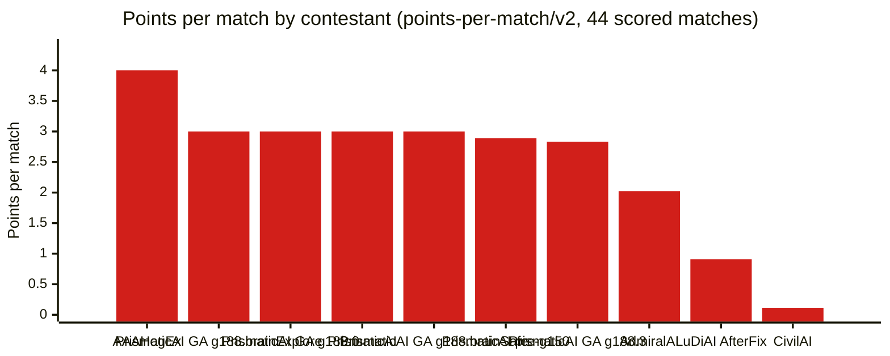
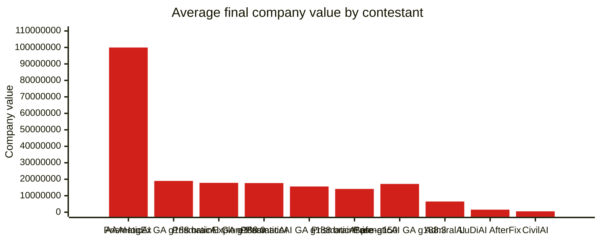
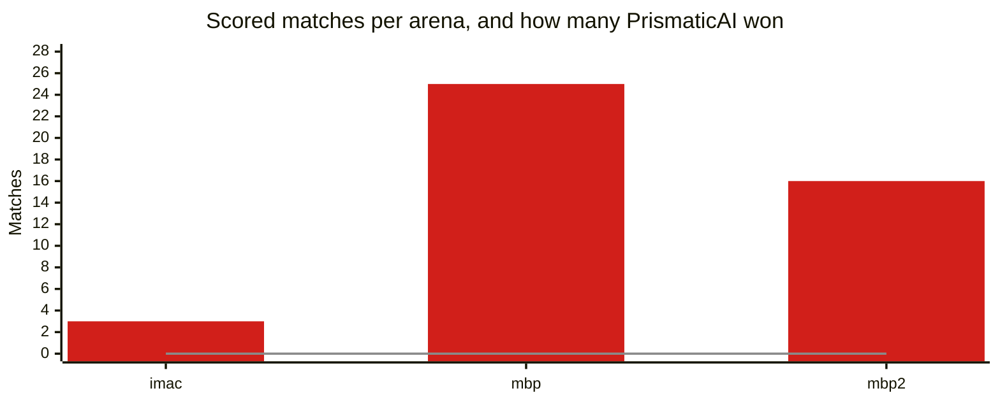

# battle-20261120T213508-1e2eaaba

Derived from `battle-20261120T213508-1e2eaaba.json` by `tools/research/ai-battle/battle.py report`; do not edit.

- Edition `1e2eaabad625b1c8`: PrismaticAI and referee at `962699034c20d90baeb9f617789ea6558cc6ff52`, base set `opengfx-8.0.tar`
- 20-year free-for-all from 1960, map 256x256 temperate, breakdowns 1
- 44 scored match(es) on `imac` (20261119-master-gdf1e05e7d8), `mbp` (20261120-master-m17653b726e), `mbp2` (20261119-master-gdf1e05e7d8)
- Replays: 0 of 1 identical to their original on another arena

| # | Contestant | Played | Wins | Points | Points/match | Avg rank | Avg final value | Squirrel errors | Matches with anomalies |
|---|---|---|---|---|---|---|---|---|---|
| 1 | AAAHogEx | 44 | 44 | 176 | 4.0 | 1.0 | 99.9 M | 0 | 0 |
| 2 | PrismaticAI GA g188.brainExplore | 7 | 0 | 21 | 3.0 | 2.0 | 19.0 M | 0 | 0 |
| 3 | PrismaticAI GA g188.0 | 7 | 0 | 21 | 3.0 | 2.0 | 17.8 M | 0 | 5 |
| 4 | PrismaticAI | 7 | 0 | 21 | 3.0 | 2.0 | 17.7 M | 0 | 0 |
| 5 | PrismaticAI GA g188.brainSafe | 8 | 0 | 24 | 3.0 | 2.0 | 15.6 M | 0 | 2 |
| 6 | PrismaticAI pre-g150 | 9 | 0 | 26 | 2.889 | 2.11 | 14.1 M | 0 | 2 |
| 7 | PrismaticAI GA g188.3 | 6 | 0 | 17 | 2.833 | 2.17 | 17.2 M | 0 | 4 |
| 8 | AdmiralAI | 44 | 0 | 89 | 2.023 | 2.98 | 6.5 M | 0 | 5 |
| 9 | LuDiAI AfterFix | 44 | 0 | 40 | 0.909 | 4.09 | 1.5 M | 0 | 1 |
| 10 | CivilAI | 44 | 0 | 5 | 0.114 | 4.89 | 520.7 k | 0 | 5 |

```mermaid
---
config:
  xyChart:
    width: 900
    height: 360
  themeVariables:
    xyChart:
      plotColorPalette: "#d11f1a, #8a8a8a, #0b0b0b, #ece4d6"
---
xychart-beta
    title "Final company value per scored match: winner vs best PrismaticAI"
    x-axis ["m-0001", "m-0002", "m-0003", "m-0004", "m-0005", "m-0006", "m-0007", "m-0008", "m-0009", "m-0010", "m-0011", "m-0012", "m-0013", "m-0014", "m-0015", "m-0016", "m-0017", "m-0018", "m-0019", "m-0020", "m-0021", "m-0022", "m-0023", "m-0024", "m-0025", "m-0026", "m-0027", "m-0028", "m-0036", "m-0037", "m-0038", "m-0039", "m-0040", "m-0041", "m-0042", "m-0043", "m-0044", "m-0045", "m-0053", "m-0054", "m-0055", "m-0057", "m-0058", "m-0067"]
    %% series: Winner | Best PrismaticAI
    %% links: battle-20261120T213508-1e2eaaba.md?col=Match&filter=m-0001 | battle-20261120T213508-1e2eaaba.md?col=Match&filter=m-0002 | battle-20261120T213508-1e2eaaba.md?col=Match&filter=m-0003 | battle-20261120T213508-1e2eaaba.md?col=Match&filter=m-0004 | battle-20261120T213508-1e2eaaba.md?col=Match&filter=m-0005 | battle-20261120T213508-1e2eaaba.md?col=Match&filter=m-0006 | battle-20261120T213508-1e2eaaba.md?col=Match&filter=m-0007 | battle-20261120T213508-1e2eaaba.md?col=Match&filter=m-0008 | battle-20261120T213508-1e2eaaba.md?col=Match&filter=m-0009 | battle-20261120T213508-1e2eaaba.md?col=Match&filter=m-0010 | battle-20261120T213508-1e2eaaba.md?col=Match&filter=m-0011 | battle-20261120T213508-1e2eaaba.md?col=Match&filter=m-0012 | battle-20261120T213508-1e2eaaba.md?col=Match&filter=m-0013 | battle-20261120T213508-1e2eaaba.md?col=Match&filter=m-0014 | battle-20261120T213508-1e2eaaba.md?col=Match&filter=m-0015 | battle-20261120T213508-1e2eaaba.md?col=Match&filter=m-0016 | battle-20261120T213508-1e2eaaba.md?col=Match&filter=m-0017 | battle-20261120T213508-1e2eaaba.md?col=Match&filter=m-0018 | battle-20261120T213508-1e2eaaba.md?col=Match&filter=m-0019 | battle-20261120T213508-1e2eaaba.md?col=Match&filter=m-0020 | battle-20261120T213508-1e2eaaba.md?col=Match&filter=m-0021 | battle-20261120T213508-1e2eaaba.md?col=Match&filter=m-0022 | battle-20261120T213508-1e2eaaba.md?col=Match&filter=m-0023 | battle-20261120T213508-1e2eaaba.md?col=Match&filter=m-0024 | battle-20261120T213508-1e2eaaba.md?col=Match&filter=m-0025 | battle-20261120T213508-1e2eaaba.md?col=Match&filter=m-0026 | battle-20261120T213508-1e2eaaba.md?col=Match&filter=m-0027 | battle-20261120T213508-1e2eaaba.md?col=Match&filter=m-0028 | battle-20261120T213508-1e2eaaba.md?col=Match&filter=m-0036 | battle-20261120T213508-1e2eaaba.md?col=Match&filter=m-0037 | battle-20261120T213508-1e2eaaba.md?col=Match&filter=m-0038 | battle-20261120T213508-1e2eaaba.md?col=Match&filter=m-0039 | battle-20261120T213508-1e2eaaba.md?col=Match&filter=m-0040 | battle-20261120T213508-1e2eaaba.md?col=Match&filter=m-0041 | battle-20261120T213508-1e2eaaba.md?col=Match&filter=m-0042 | battle-20261120T213508-1e2eaaba.md?col=Match&filter=m-0043 | battle-20261120T213508-1e2eaaba.md?col=Match&filter=m-0044 | battle-20261120T213508-1e2eaaba.md?col=Match&filter=m-0045 | battle-20261120T213508-1e2eaaba.md?col=Match&filter=m-0053 | battle-20261120T213508-1e2eaaba.md?col=Match&filter=m-0054 | battle-20261120T213508-1e2eaaba.md?col=Match&filter=m-0055 | battle-20261120T213508-1e2eaaba.md?col=Match&filter=m-0057 | battle-20261120T213508-1e2eaaba.md?col=Match&filter=m-0058 | battle-20261120T213508-1e2eaaba.md?col=Match&filter=m-0067
    y-axis "Company value" 0 --> 154000000
    bar [102718414, 99120749, 122813011, 87425738, 99989193, 95469456, 80514660, 79772841, 98686890, 84788160, 84686462, 131003710, 117183781, 127635698, 132544234, 140025681, 116665582, 105107222, 110876540, 116598580, 107131098, 106605564, 101987421, 104997838, 116185300, 104324605, 88847457, 125017537, 112202301, 108305369, 96075322, 75046947, 103157061, 105331887, 71233999, 78013876, 84410563, 73828440, 115232577, 58979332, 84936663, 81913720, 68512709, 91823859]
    line [16627813, 16369160, 14255680, 19225769, 18590873, 19104647, 14238886, 17423520, 17340385, 22830283, 17411127, 14307520, 8861974, 14006778, 15105341, 14790699, 11009169, 27605644, 18088250, 29167330, 16681932, 26126408, 20551461, 13717365, 10786883, 14288224, 17201513, 11725984, 20560818, 16251164, 22356756, 18476115, 21566633, 15216332, 11712058, 11384200, 11058766, 10337217, 20169759, 16673671, 17856810, 15501324, 16620231, 12942960]
```

<!-- battle-charts:begin -->
<!-- derived from battle-20261120T213508-1e2eaaba.json by `battle.py render`; `battle.py check` fails when it is stale -->

<!-- battle-charts:end -->

| Seed | Original | Replay | Arenas | Identical |
|---|---|---|---|---|
| 320061714 | m-0010 | m-0056 | imac / mbp | NO |

| Match | Arena | Seed | Winner | Value | Last | Anomalies |
|---|---|---|---|---|---|---|
| m-0001 | mbp | 1213571255 | AAAHogEx | 102.7 M | CivilAI | PrismaticAI pre-g150: fleet_drop:95->55 |
| m-0002 | mbp | 1213571255 | AAAHogEx | 99.1 M | CivilAI | PrismaticAI GA g188.0: fleet_drop:122->80 |
| m-0003 | mbp | 1213571255 | AAAHogEx | 122.8 M | CivilAI | CivilAI: no_vehicles |
| m-0004 | mbp | 1213571255 | AAAHogEx | 87.4 M | CivilAI | AdmiralAI: fleet_drop:187->130 |
| m-0005 | mbp | 1213571255 | AAAHogEx | 100.0 M | CivilAI | PrismaticAI GA g188.3: fleet_drop:122->52 |
| m-0006 | mbp | 320061714 | AAAHogEx | 95.5 M | CivilAI | - |
| m-0007 | mbp | 320061714 | AAAHogEx | 80.5 M | CivilAI | - |
| m-0008 | mbp | 320061714 | AAAHogEx | 79.8 M | CivilAI | - |
| m-0009 | mbp | 320061714 | AAAHogEx | 98.7 M | CivilAI | - |
| m-0010 | imac | 320061714 | AAAHogEx | 84.8 M | CivilAI | - |
| m-0011 | imac | 320061714 | AAAHogEx | 84.7 M | CivilAI | - |
| m-0012 | imac | 1554639413 | AAAHogEx | 131.0 M | CivilAI | - |
| m-0013 | mbp2 | 1554639413 | AAAHogEx | 117.2 M | CivilAI | PrismaticAI pre-g150: fleet_drop:89->43 |
| m-0014 | mbp2 | 1554639413 | AAAHogEx | 127.6 M | CivilAI | PrismaticAI GA g188.0: fleet_drop:104->67 |
| m-0015 | mbp2 | 1554639413 | AAAHogEx | 132.5 M | CivilAI | - |
| m-0016 | mbp2 | 1554639413 | AAAHogEx | 140.0 M | CivilAI | - |
| m-0017 | mbp2 | 1554639413 | AAAHogEx | 116.7 M | CivilAI | PrismaticAI GA g188.3: fleet_drop:70->44 |
| m-0018 | mbp2 | 1462693169 | AAAHogEx | 105.1 M | CivilAI | - |
| m-0019 | mbp2 | 1462693169 | AAAHogEx | 110.9 M | CivilAI | CivilAI: fleet_drop:10->3 |
| m-0020 | mbp2 | 1462693169 | AAAHogEx | 116.6 M | CivilAI | PrismaticAI GA g188.0: fleet_drop:90->59 |
| m-0021 | mbp2 | 1462693169 | AAAHogEx | 107.1 M | CivilAI | - |
| m-0022 | mbp2 | 1462693169 | AAAHogEx | 106.6 M | CivilAI | - |
| m-0023 | mbp2 | 1462693169 | AAAHogEx | 102.0 M | CivilAI | CivilAI: fleet_drop:13->9 |
| m-0024 | mbp2 | 967247031 | AAAHogEx | 105.0 M | CivilAI | - |
| m-0025 | mbp2 | 967247031 | AAAHogEx | 116.2 M | CivilAI | - |
| m-0026 | mbp2 | 967247031 | AAAHogEx | 104.3 M | CivilAI | - |
| m-0027 | mbp2 | 967247031 | AAAHogEx | 88.8 M | CivilAI | PrismaticAI GA g188.brainSafe: fleet_drop:68->46 |
| m-0028 | mbp2 | 967247031 | AAAHogEx | 125.0 M | CivilAI | CivilAI: fleet_drop:27->5 |
| m-0036 | mbp | 274699223 | AAAHogEx | 112.2 M | CivilAI | AdmiralAI: fleet_drop:428->270 |
| m-0037 | mbp | 274699223 | AAAHogEx | 108.3 M | CivilAI | - |
| m-0038 | mbp | 274699223 | AAAHogEx | 96.1 M | CivilAI | PrismaticAI GA g188.0: fleet_drop:114->75 |
| m-0039 | mbp | 274699223 | AAAHogEx | 75.0 M | CivilAI | - |
| m-0040 | mbp | 274699223 | AAAHogEx | 103.2 M | CivilAI | - |
| m-0041 | mbp | 274699223 | AAAHogEx | 105.3 M | CivilAI | PrismaticAI GA g188.3: fleet_drop:101->63; AdmiralAI: fleet_drop:335->168 |
| m-0042 | mbp | 1250710776 | AAAHogEx | 71.2 M | LuDiAI AfterFix | LuDiAI AfterFix: fleet_drop:24->15 |
| m-0043 | mbp | 1250710776 | AAAHogEx | 78.0 M | LuDiAI AfterFix | - |
| m-0044 | mbp | 1250710776 | AAAHogEx | 84.4 M | CivilAI | PrismaticAI GA g188.0: fleet_drop:84->53 |
| m-0045 | mbp | 1250710776 | AAAHogEx | 73.8 M | CivilAI | PrismaticAI GA g188.brainSafe: fleet_drop:60->35 |
| m-0053 | mbp | 1538848417 | AAAHogEx | 115.2 M | CivilAI | PrismaticAI GA g188.3: fleet_drop:84->57 |
| m-0054 | mbp | 85663351 | AAAHogEx | 59.0 M | CivilAI | AdmiralAI: fleet_drop:376->253 |
| m-0055 | mbp | 85663351 | AAAHogEx | 84.9 M | LuDiAI AfterFix | - |
| m-0056 (replay) | mbp | 320061714 | AAAHogEx | 76.9 M | CivilAI | - |
| m-0057 | mbp | 85663351 | AAAHogEx | 81.9 M | LuDiAI AfterFix | - |
| m-0058 | mbp | 85663351 | AAAHogEx | 68.5 M | LuDiAI AfterFix | AdmiralAI: fleet_drop:248->159 |
| m-0067 | mbp | 1023175987 | AAAHogEx | 91.8 M | CivilAI | CivilAI: no_vehicles |
