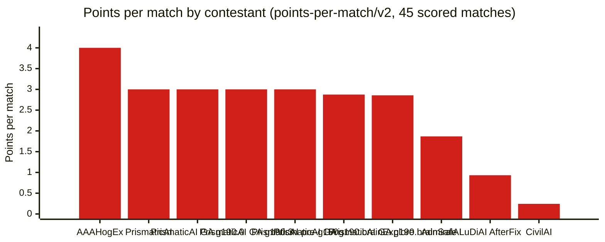
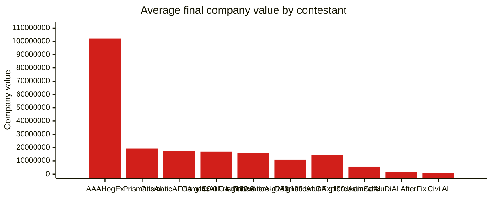
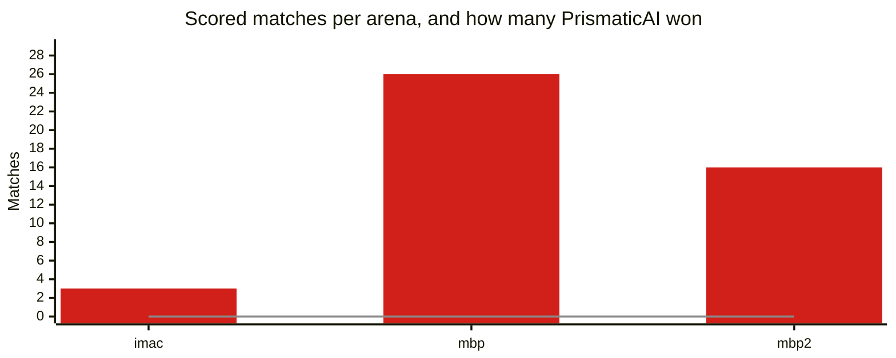

# battle-20261120T215544-5bcc8812

Derived from `battle-20261120T215544-5bcc8812.json` by `tools/research/ai-battle/battle.py report`; do not edit.

- Edition `5bcc8812c12a50f2`: PrismaticAI and referee at `962699034c20d90baeb9f617789ea6558cc6ff52`, base set `opengfx-8.0.tar`
- 20-year free-for-all from 1960, map 256x256 temperate, breakdowns 1
- 45 scored match(es) on `imac` (20261119-master-gdf1e05e7d8), `mbp` (20261120-master-m17653b726e), `mbp2` (20261119-master-gdf1e05e7d8)
- Replays: 0 of 1 identical to their original on another arena

| # | Contestant | Played | Wins | Points | Points/match | Avg rank | Avg final value | Squirrel errors | Matches with anomalies |
|---|---|---|---|---|---|---|---|---|---|
| 1 | AAAHogEx | 45 | 45 | 180 | 4.0 | 1.0 | 102.2 M | 0 | 0 |
| 2 | PrismaticAI | 7 | 0 | 21 | 3.0 | 2.0 | 19.3 M | 0 | 0 |
| 3 | PrismaticAI GA g190.0 | 8 | 0 | 24 | 3.0 | 2.0 | 17.3 M | 0 | 2 |
| 4 | PrismaticAI GA g190.3 | 6 | 0 | 18 | 3.0 | 2.0 | 17.1 M | 0 | 1 |
| 5 | PrismaticAI pre-g150 | 9 | 0 | 27 | 3.0 | 2.0 | 15.9 M | 0 | 6 |
| 6 | PrismaticAI GA g190.brainExplore | 8 | 0 | 23 | 2.875 | 2.12 | 10.9 M | 0 | 1 |
| 7 | PrismaticAI GA g190.brainSafe | 7 | 0 | 20 | 2.857 | 2.14 | 14.6 M | 0 | 3 |
| 8 | AdmiralAI | 45 | 0 | 84 | 1.867 | 3.13 | 5.7 M | 47 | 3 |
| 9 | LuDiAI AfterFix | 45 | 0 | 42 | 0.933 | 4.07 | 1.7 M | 0 | 1 |
| 10 | CivilAI | 45 | 0 | 11 | 0.244 | 4.76 | 730.7 k | 33 | 13 |

```mermaid
---
config:
  xyChart:
    width: 900
    height: 360
  themeVariables:
    xyChart:
      plotColorPalette: "#d11f1a, #8a8a8a, #0b0b0b, #ece4d6"
---
xychart-beta
    title "Final company value per scored match: winner vs best PrismaticAI"
    x-axis ["m-0001", "m-0002", "m-0003", "m-0004", "m-0005", "m-0006", "m-0007", "m-0008", "m-0009", "m-0010", "m-0011", "m-0012", "m-0013", "m-0014", "m-0015", "m-0016", "m-0017", "m-0018", "m-0019", "m-0020", "m-0021", "m-0022", "m-0023", "m-0024", "m-0025", "m-0026", "m-0027", "m-0028", "m-0036", "m-0037", "m-0038", "m-0039", "m-0040", "m-0041", "m-0042", "m-0043", "m-0044", "m-0055", "m-0057", "m-0058", "m-0066", "m-0067", "m-0068", "m-0070", "m-0071"]
    %% series: Winner | Best PrismaticAI
    %% links: battle-20261120T215544-5bcc8812.md?col=Match&filter=m-0001 | battle-20261120T215544-5bcc8812.md?col=Match&filter=m-0002 | battle-20261120T215544-5bcc8812.md?col=Match&filter=m-0003 | battle-20261120T215544-5bcc8812.md?col=Match&filter=m-0004 | battle-20261120T215544-5bcc8812.md?col=Match&filter=m-0005 | battle-20261120T215544-5bcc8812.md?col=Match&filter=m-0006 | battle-20261120T215544-5bcc8812.md?col=Match&filter=m-0007 | battle-20261120T215544-5bcc8812.md?col=Match&filter=m-0008 | battle-20261120T215544-5bcc8812.md?col=Match&filter=m-0009 | battle-20261120T215544-5bcc8812.md?col=Match&filter=m-0010 | battle-20261120T215544-5bcc8812.md?col=Match&filter=m-0011 | battle-20261120T215544-5bcc8812.md?col=Match&filter=m-0012 | battle-20261120T215544-5bcc8812.md?col=Match&filter=m-0013 | battle-20261120T215544-5bcc8812.md?col=Match&filter=m-0014 | battle-20261120T215544-5bcc8812.md?col=Match&filter=m-0015 | battle-20261120T215544-5bcc8812.md?col=Match&filter=m-0016 | battle-20261120T215544-5bcc8812.md?col=Match&filter=m-0017 | battle-20261120T215544-5bcc8812.md?col=Match&filter=m-0018 | battle-20261120T215544-5bcc8812.md?col=Match&filter=m-0019 | battle-20261120T215544-5bcc8812.md?col=Match&filter=m-0020 | battle-20261120T215544-5bcc8812.md?col=Match&filter=m-0021 | battle-20261120T215544-5bcc8812.md?col=Match&filter=m-0022 | battle-20261120T215544-5bcc8812.md?col=Match&filter=m-0023 | battle-20261120T215544-5bcc8812.md?col=Match&filter=m-0024 | battle-20261120T215544-5bcc8812.md?col=Match&filter=m-0025 | battle-20261120T215544-5bcc8812.md?col=Match&filter=m-0026 | battle-20261120T215544-5bcc8812.md?col=Match&filter=m-0027 | battle-20261120T215544-5bcc8812.md?col=Match&filter=m-0028 | battle-20261120T215544-5bcc8812.md?col=Match&filter=m-0036 | battle-20261120T215544-5bcc8812.md?col=Match&filter=m-0037 | battle-20261120T215544-5bcc8812.md?col=Match&filter=m-0038 | battle-20261120T215544-5bcc8812.md?col=Match&filter=m-0039 | battle-20261120T215544-5bcc8812.md?col=Match&filter=m-0040 | battle-20261120T215544-5bcc8812.md?col=Match&filter=m-0041 | battle-20261120T215544-5bcc8812.md?col=Match&filter=m-0042 | battle-20261120T215544-5bcc8812.md?col=Match&filter=m-0043 | battle-20261120T215544-5bcc8812.md?col=Match&filter=m-0044 | battle-20261120T215544-5bcc8812.md?col=Match&filter=m-0055 | battle-20261120T215544-5bcc8812.md?col=Match&filter=m-0057 | battle-20261120T215544-5bcc8812.md?col=Match&filter=m-0058 | battle-20261120T215544-5bcc8812.md?col=Match&filter=m-0066 | battle-20261120T215544-5bcc8812.md?col=Match&filter=m-0067 | battle-20261120T215544-5bcc8812.md?col=Match&filter=m-0068 | battle-20261120T215544-5bcc8812.md?col=Match&filter=m-0070 | battle-20261120T215544-5bcc8812.md?col=Match&filter=m-0071
    y-axis "Company value" 0 --> 183000000
    bar [140566720, 125763938, 122059960, 166547552, 146372385, 103826097, 90637175, 94274343, 93160199, 80099628, 91920054, 83107335, 63031306, 66790237, 74571775, 84500143, 82179409, 109883176, 123327204, 124982406, 108223794, 98332895, 113127685, 80236687, 74431888, 89857990, 69475602, 87123117, 106107876, 108518784, 104057754, 84029198, 104594575, 114935225, 89409153, 78311485, 101272440, 88133841, 88836587, 100251091, 129212394, 146764048, 124671082, 111159737, 129643843]
    line [17386357, 22597187, 15714571, 9860489, 24840256, 18736321, 11994709, 19208861, 13421205, 12180216, 16925148, 16469091, 17278710, 13056987, 5052814, 6793545, 11916830, 17267521, 16340999, 19262582, 14605677, 14697291, 20426092, 18737001, 14778582, 16769279, 16938744, 10982698, 21950752, 12003385, 12480394, 17100408, 11989480, 12400467, 23005443, 20571486, 16909641, 18971749, 19258183, 9554926, 18896390, 13427984, 18223449, 11456706, 16163145]
```

<!-- battle-charts:begin -->
<!-- derived from battle-20261120T215544-5bcc8812.json by `battle.py render`; `battle.py check` fails when it is stale -->

<!-- battle-charts:end -->

| Seed | Original | Replay | Arenas | Identical |
|---|---|---|---|---|
| 646232951 | m-0011 | m-0056 | imac / mbp | NO |

| Match | Arena | Seed | Winner | Value | Last | Anomalies |
|---|---|---|---|---|---|---|
| m-0001 | mbp | 316160304 | AAAHogEx | 140.6 M | CivilAI | PrismaticAI pre-g150: fleet_drop:147->70; CivilAI: fleet_drop:10->5 |
| m-0002 | mbp | 316160304 | AAAHogEx | 125.8 M | CivilAI | CivilAI: fleet_drop:45->15 |
| m-0003 | mbp | 316160304 | AAAHogEx | 122.1 M | CivilAI | - |
| m-0004 | mbp | 316160304 | AAAHogEx | 166.5 M | CivilAI | - |
| m-0005 | mbp | 316160304 | AAAHogEx | 146.4 M | CivilAI | PrismaticAI GA g190.3: fleet_drop:113->79; CivilAI: fleet_drop:38->17 |
| m-0006 | mbp | 646232951 | AAAHogEx | 103.8 M | CivilAI | - |
| m-0007 | mbp | 646232951 | AAAHogEx | 90.6 M | LuDiAI AfterFix | CivilAI: squirrel_errors:33 |
| m-0008 | mbp | 646232951 | AAAHogEx | 94.3 M | CivilAI | - |
| m-0009 | mbp | 646232951 | AAAHogEx | 93.2 M | CivilAI | - |
| m-0010 | imac | 646232951 | AAAHogEx | 80.1 M | CivilAI | CivilAI: fleet_drop:64->35 |
| m-0011 | imac | 646232951 | AAAHogEx | 91.9 M | LuDiAI AfterFix | LuDiAI AfterFix: fleet_drop:34->19 |
| m-0012 | imac | 859580875 | AAAHogEx | 83.1 M | CivilAI | - |
| m-0013 | mbp2 | 859580875 | AAAHogEx | 63.0 M | CivilAI | PrismaticAI pre-g150: fleet_drop:66->41; AdmiralAI: squirrel_errors:47 |
| m-0014 | mbp2 | 859580875 | AAAHogEx | 66.8 M | CivilAI | PrismaticAI GA g190.0: fleet_drop:108->68 |
| m-0015 | mbp2 | 859580875 | AAAHogEx | 74.6 M | CivilAI | PrismaticAI GA g190.brainSafe: fleet_drop:45->26 |
| m-0016 | mbp2 | 859580875 | AAAHogEx | 84.5 M | CivilAI | PrismaticAI GA g190.brainExplore: fleet_drop:66->28; CivilAI: fleet_drop:47->18 |
| m-0017 | mbp2 | 859580875 | AAAHogEx | 82.2 M | CivilAI | - |
| m-0018 | mbp2 | 247045828 | AAAHogEx | 109.9 M | CivilAI | CivilAI: fleet_drop:76->27 |
| m-0019 | mbp2 | 247045828 | AAAHogEx | 123.3 M | AdmiralAI | PrismaticAI pre-g150: fleet_drop:129->83; CivilAI: fleet_drop:11->6 |
| m-0020 | mbp2 | 247045828 | AAAHogEx | 125.0 M | CivilAI | CivilAI: fleet_drop:40->18 |
| m-0021 | mbp2 | 247045828 | AAAHogEx | 108.2 M | LuDiAI AfterFix | PrismaticAI GA g190.brainSafe: fleet_drop:121->57 |
| m-0022 | mbp2 | 247045828 | AAAHogEx | 98.3 M | LuDiAI AfterFix | CivilAI: fleet_drop:88->55 |
| m-0023 | mbp2 | 247045828 | AAAHogEx | 113.1 M | CivilAI | - |
| m-0024 | mbp2 | 81991685 | AAAHogEx | 80.2 M | LuDiAI AfterFix | AdmiralAI: fleet_drop:252->172 |
| m-0025 | mbp2 | 81991685 | AAAHogEx | 74.4 M | CivilAI | CivilAI: fleet_drop:104->46 |
| m-0026 | mbp2 | 81991685 | AAAHogEx | 89.9 M | CivilAI | - |
| m-0027 | mbp2 | 81991685 | AAAHogEx | 69.5 M | CivilAI | - |
| m-0028 | mbp2 | 81991685 | AAAHogEx | 87.1 M | CivilAI | - |
| m-0036 | mbp | 1774018092 | AAAHogEx | 106.1 M | CivilAI | CivilAI: fleet_drop:201->128 |
| m-0037 | mbp | 1774018092 | AAAHogEx | 108.5 M | LuDiAI AfterFix | PrismaticAI pre-g150: fleet_drop:131->89 |
| m-0038 | mbp | 1774018092 | AAAHogEx | 104.1 M | AdmiralAI | - |
| m-0039 | mbp | 1774018092 | AAAHogEx | 84.0 M | CivilAI | - |
| m-0040 | mbp | 1774018092 | AAAHogEx | 104.6 M | CivilAI | - |
| m-0041 | mbp | 1774018092 | AAAHogEx | 114.9 M | CivilAI | - |
| m-0042 | mbp | 156230573 | AAAHogEx | 89.4 M | CivilAI | - |
| m-0043 | mbp | 156230573 | AAAHogEx | 78.3 M | CivilAI | PrismaticAI pre-g150: fleet_drop:95->52 |
| m-0044 | mbp | 156230573 | AAAHogEx | 101.3 M | CivilAI | - |
| m-0055 | mbp | 1321812379 | AAAHogEx | 88.1 M | CivilAI | PrismaticAI pre-g150: fleet_drop:109->66; AdmiralAI: fleet_drop:113->75 |
| m-0056 (replay) | mbp | 646232951 | AAAHogEx | 82.4 M | LuDiAI AfterFix | - |
| m-0057 | mbp | 1321812379 | AAAHogEx | 88.8 M | CivilAI | PrismaticAI GA g190.brainSafe: fleet_drop:123->77; CivilAI: fleet_drop:54->35 |
| m-0058 | mbp | 1321812379 | AAAHogEx | 100.3 M | CivilAI | - |
| m-0066 | mbp | 1566187681 | AAAHogEx | 129.2 M | CivilAI | - |
| m-0067 | mbp | 1566187681 | AAAHogEx | 146.8 M | CivilAI | - |
| m-0068 | mbp | 1566187681 | AAAHogEx | 124.7 M | LuDiAI AfterFix | PrismaticAI GA g190.0: fleet_drop:110->52 |
| m-0070 | mbp | 1566187681 | AAAHogEx | 111.2 M | CivilAI | - |
| m-0071 | mbp | 1566187681 | AAAHogEx | 129.6 M | LuDiAI AfterFix | - |
