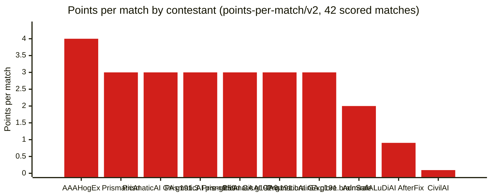
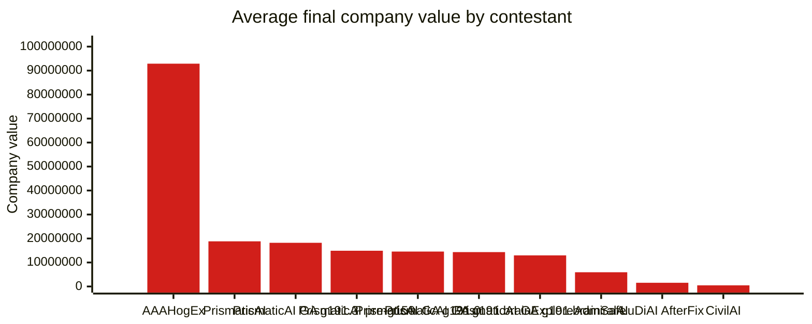
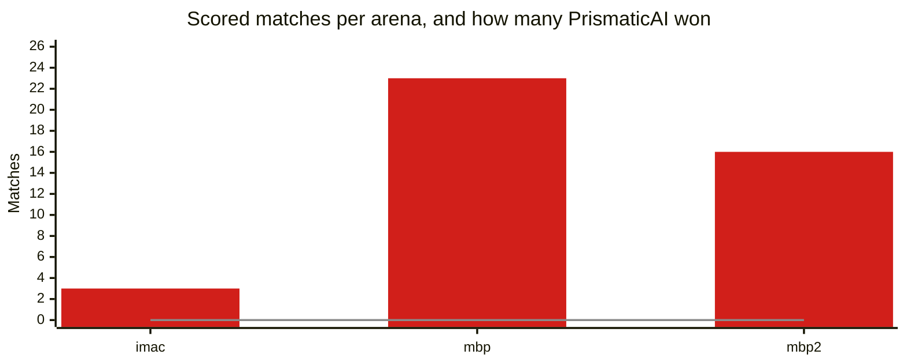

# battle-20261120T220501-1b7b460b

Derived from `battle-20261120T220501-1b7b460b.json` by `tools/research/ai-battle/battle.py report`; do not edit.

- Edition `1b7b460bf073b4f6`: PrismaticAI and referee at `962699034c20d90baeb9f617789ea6558cc6ff52`, base set `opengfx-8.0.tar`
- 20-year free-for-all from 1960, map 256x256 temperate, breakdowns 1
- 42 scored match(es) on `imac` (20261119-master-gdf1e05e7d8), `mbp` (20261120-master-m17653b726e), `mbp2` (20261119-master-gdf1e05e7d8)
- Replays: 0 of 1 identical to their original on another arena

| # | Contestant | Played | Wins | Points | Points/match | Avg rank | Avg final value | Squirrel errors | Matches with anomalies |
|---|---|---|---|---|---|---|---|---|---|
| 1 | AAAHogEx | 42 | 42 | 168 | 4.0 | 1.0 | 92.9 M | 0 | 0 |
| 2 | PrismaticAI | 6 | 0 | 18 | 3.0 | 2.0 | 18.8 M | 0 | 0 |
| 3 | PrismaticAI GA g191.3 | 6 | 0 | 18 | 3.0 | 2.0 | 18.2 M | 0 | 0 |
| 4 | PrismaticAI pre-g150 | 8 | 0 | 24 | 3.0 | 2.0 | 14.9 M | 0 | 2 |
| 5 | PrismaticAI GA g191.0 | 8 | 0 | 24 | 3.0 | 2.0 | 14.6 M | 0 | 2 |
| 6 | PrismaticAI GA g191.brainExplore | 7 | 0 | 21 | 3.0 | 2.0 | 14.3 M | 0 | 2 |
| 7 | PrismaticAI GA g191.brainSafe | 7 | 0 | 21 | 3.0 | 2.0 | 13.0 M | 0 | 2 |
| 8 | AdmiralAI | 42 | 0 | 84 | 2.0 | 3.0 | 5.9 M | 59 | 5 |
| 9 | LuDiAI AfterFix | 42 | 0 | 38 | 0.905 | 4.1 | 1.5 M | 0 | 3 |
| 10 | CivilAI | 42 | 0 | 4 | 0.095 | 4.9 | 464.6 k | 0 | 10 |

```mermaid
---
config:
  xyChart:
    width: 900
    height: 360
  themeVariables:
    xyChart:
      plotColorPalette: "#d11f1a, #8a8a8a, #0b0b0b, #ece4d6"
---
xychart-beta
    title "Final company value per scored match: winner vs best PrismaticAI"
    x-axis ["m-0001", "m-0002", "m-0003", "m-0004", "m-0005", "m-0006", "m-0007", "m-0008", "m-0009", "m-0010", "m-0011", "m-0012", "m-0013", "m-0014", "m-0015", "m-0016", "m-0017", "m-0018", "m-0019", "m-0020", "m-0021", "m-0022", "m-0023", "m-0024", "m-0025", "m-0026", "m-0027", "m-0028", "m-0036", "m-0037", "m-0038", "m-0039", "m-0040", "m-0041", "m-0042", "m-0043", "m-0044", "m-0047", "m-0049", "m-0050", "m-0051", "m-0052"]
    %% series: Winner | Best PrismaticAI
    %% links: battle-20261120T220501-1b7b460b.md?col=Match&filter=m-0001 | battle-20261120T220501-1b7b460b.md?col=Match&filter=m-0002 | battle-20261120T220501-1b7b460b.md?col=Match&filter=m-0003 | battle-20261120T220501-1b7b460b.md?col=Match&filter=m-0004 | battle-20261120T220501-1b7b460b.md?col=Match&filter=m-0005 | battle-20261120T220501-1b7b460b.md?col=Match&filter=m-0006 | battle-20261120T220501-1b7b460b.md?col=Match&filter=m-0007 | battle-20261120T220501-1b7b460b.md?col=Match&filter=m-0008 | battle-20261120T220501-1b7b460b.md?col=Match&filter=m-0009 | battle-20261120T220501-1b7b460b.md?col=Match&filter=m-0010 | battle-20261120T220501-1b7b460b.md?col=Match&filter=m-0011 | battle-20261120T220501-1b7b460b.md?col=Match&filter=m-0012 | battle-20261120T220501-1b7b460b.md?col=Match&filter=m-0013 | battle-20261120T220501-1b7b460b.md?col=Match&filter=m-0014 | battle-20261120T220501-1b7b460b.md?col=Match&filter=m-0015 | battle-20261120T220501-1b7b460b.md?col=Match&filter=m-0016 | battle-20261120T220501-1b7b460b.md?col=Match&filter=m-0017 | battle-20261120T220501-1b7b460b.md?col=Match&filter=m-0018 | battle-20261120T220501-1b7b460b.md?col=Match&filter=m-0019 | battle-20261120T220501-1b7b460b.md?col=Match&filter=m-0020 | battle-20261120T220501-1b7b460b.md?col=Match&filter=m-0021 | battle-20261120T220501-1b7b460b.md?col=Match&filter=m-0022 | battle-20261120T220501-1b7b460b.md?col=Match&filter=m-0023 | battle-20261120T220501-1b7b460b.md?col=Match&filter=m-0024 | battle-20261120T220501-1b7b460b.md?col=Match&filter=m-0025 | battle-20261120T220501-1b7b460b.md?col=Match&filter=m-0026 | battle-20261120T220501-1b7b460b.md?col=Match&filter=m-0027 | battle-20261120T220501-1b7b460b.md?col=Match&filter=m-0028 | battle-20261120T220501-1b7b460b.md?col=Match&filter=m-0036 | battle-20261120T220501-1b7b460b.md?col=Match&filter=m-0037 | battle-20261120T220501-1b7b460b.md?col=Match&filter=m-0038 | battle-20261120T220501-1b7b460b.md?col=Match&filter=m-0039 | battle-20261120T220501-1b7b460b.md?col=Match&filter=m-0040 | battle-20261120T220501-1b7b460b.md?col=Match&filter=m-0041 | battle-20261120T220501-1b7b460b.md?col=Match&filter=m-0042 | battle-20261120T220501-1b7b460b.md?col=Match&filter=m-0043 | battle-20261120T220501-1b7b460b.md?col=Match&filter=m-0044 | battle-20261120T220501-1b7b460b.md?col=Match&filter=m-0047 | battle-20261120T220501-1b7b460b.md?col=Match&filter=m-0049 | battle-20261120T220501-1b7b460b.md?col=Match&filter=m-0050 | battle-20261120T220501-1b7b460b.md?col=Match&filter=m-0051 | battle-20261120T220501-1b7b460b.md?col=Match&filter=m-0052
    y-axis "Company value" 0 --> 163000000
    bar [96563663, 102323998, 95525263, 107248552, 103579693, 71368886, 75243835, 64528839, 66392462, 73349831, 70573216, 94703899, 94749723, 120226642, 86747661, 97896430, 95212309, 72140934, 82757091, 79924957, 63563415, 69891980, 69243409, 97262582, 99379813, 117492580, 148415660, 129127988, 92734798, 82804276, 87498395, 90685976, 102258131, 82357925, 141397436, 131782847, 117335823, 105284515, 67194486, 89209708, 87423606, 77739727]
    line [8394399, 9180243, 14068995, 14319006, 12319827, 19362420, 12534968, 16930112, 13703494, 16993971, 15555753, 17146945, 17220460, 18065821, 16839285, 13069257, 18393094, 20195694, 19042562, 18663125, 16897688, 20922705, 21847671, 15154322, 16370766, 9172505, 5937038, 7945742, 19350550, 11436099, 17154543, 14005238, 19301409, 15115523, 21687780, 24544625, 21029385, 26004120, 9625775, 6245919, 9234782, 7734597]
```

<!-- battle-charts:begin -->
<!-- derived from battle-20261120T220501-1b7b460b.json by `battle.py render`; `battle.py check` fails when it is stale -->

<!-- battle-charts:end -->

| Seed | Original | Replay | Arenas | Identical |
|---|---|---|---|---|
| 1948381325 | m-0011 | m-0048 | imac / mbp | NO |

| Match | Arena | Seed | Winner | Value | Last | Anomalies |
|---|---|---|---|---|---|---|
| m-0001 | mbp | 439573211 | AAAHogEx | 96.6 M | LuDiAI AfterFix | LuDiAI AfterFix: fleet_drop:31->17 |
| m-0002 | mbp | 439573211 | AAAHogEx | 102.3 M | CivilAI | PrismaticAI GA g191.0: fleet_drop:100->66 |
| m-0003 | mbp | 439573211 | AAAHogEx | 95.5 M | CivilAI | AdmiralAI: squirrel_errors:59 |
| m-0004 | mbp | 439573211 | AAAHogEx | 107.2 M | CivilAI | - |
| m-0005 | mbp | 439573211 | AAAHogEx | 103.6 M | LuDiAI AfterFix | - |
| m-0006 | mbp | 1948381325 | AAAHogEx | 71.4 M | CivilAI | AdmiralAI: fleet_drop:375->225 |
| m-0007 | mbp | 1948381325 | AAAHogEx | 75.2 M | CivilAI | - |
| m-0008 | mbp | 1948381325 | AAAHogEx | 64.5 M | CivilAI | - |
| m-0009 | mbp | 1948381325 | AAAHogEx | 66.4 M | CivilAI | PrismaticAI GA g191.brainSafe: fleet_drop:151->95 |
| m-0010 | imac | 1948381325 | AAAHogEx | 73.3 M | CivilAI | PrismaticAI GA g191.brainExplore: fleet_drop:127->70; AdmiralAI: fleet_drop:295->184 |
| m-0011 | imac | 1948381325 | AAAHogEx | 70.6 M | CivilAI | CivilAI: fleet_drop:11->6 |
| m-0012 | imac | 74428387 | AAAHogEx | 94.7 M | CivilAI | CivilAI: fleet_drop:16->8 |
| m-0013 | mbp2 | 74428387 | AAAHogEx | 94.7 M | CivilAI | PrismaticAI pre-g150: fleet_drop:153->71 |
| m-0014 | mbp2 | 74428387 | AAAHogEx | 120.2 M | LuDiAI AfterFix | - |
| m-0015 | mbp2 | 74428387 | AAAHogEx | 86.7 M | CivilAI | - |
| m-0016 | mbp2 | 74428387 | AAAHogEx | 97.9 M | CivilAI | - |
| m-0017 | mbp2 | 74428387 | AAAHogEx | 95.2 M | CivilAI | - |
| m-0018 | mbp2 | 796830138 | AAAHogEx | 72.1 M | CivilAI | CivilAI: fleet_drop:46->26 |
| m-0019 | mbp2 | 796830138 | AAAHogEx | 82.8 M | CivilAI | CivilAI: fleet_drop:32->4 |
| m-0020 | mbp2 | 796830138 | AAAHogEx | 79.9 M | CivilAI | - |
| m-0021 | mbp2 | 796830138 | AAAHogEx | 63.6 M | CivilAI | - |
| m-0022 | mbp2 | 796830138 | AAAHogEx | 69.9 M | CivilAI | - |
| m-0023 | mbp2 | 796830138 | AAAHogEx | 69.2 M | CivilAI | - |
| m-0024 | mbp2 | 1679205626 | AAAHogEx | 97.3 M | CivilAI | - |
| m-0025 | mbp2 | 1679205626 | AAAHogEx | 99.4 M | CivilAI | - |
| m-0026 | mbp2 | 1679205626 | AAAHogEx | 117.5 M | CivilAI | - |
| m-0027 | mbp2 | 1679205626 | AAAHogEx | 148.4 M | CivilAI | PrismaticAI GA g191.brainSafe: fleet_drop:152->101 |
| m-0028 | mbp2 | 1679205626 | AAAHogEx | 129.1 M | CivilAI | AdmiralAI: fleet_drop:244->124; LuDiAI AfterFix: fleet_drop:131->76; CivilAI: fleet_drop:28->14 |
| m-0036 | mbp | 250684332 | AAAHogEx | 92.7 M | CivilAI | - |
| m-0037 | mbp | 250684332 | AAAHogEx | 82.8 M | CivilAI | PrismaticAI pre-g150: fleet_drop:64->35; CivilAI: no_vehicles |
| m-0038 | mbp | 250684332 | AAAHogEx | 87.5 M | CivilAI | LuDiAI AfterFix: fleet_drop:27->12; CivilAI: no_vehicles |
| m-0039 | mbp | 250684332 | AAAHogEx | 90.7 M | CivilAI | - |
| m-0040 | mbp | 250684332 | AAAHogEx | 102.3 M | CivilAI | PrismaticAI GA g191.brainExplore: fleet_drop:114->63 |
| m-0041 | mbp | 250684332 | AAAHogEx | 82.4 M | CivilAI | AdmiralAI: fleet_drop:316->184 |
| m-0042 | mbp | 1654345648 | AAAHogEx | 141.4 M | LuDiAI AfterFix | - |
| m-0043 | mbp | 1654345648 | AAAHogEx | 131.8 M | CivilAI | - |
| m-0044 | mbp | 1654345648 | AAAHogEx | 117.3 M | CivilAI | - |
| m-0047 | mbp | 1654345648 | AAAHogEx | 105.3 M | CivilAI | - |
| m-0048 (replay) | mbp | 1948381325 | AAAHogEx | 76.3 M | CivilAI | - |
| m-0049 | mbp | 931732418 | AAAHogEx | 67.2 M | CivilAI | CivilAI: no_vehicles |
| m-0050 | mbp | 931732418 | AAAHogEx | 89.2 M | CivilAI | PrismaticAI GA g191.0: fleet_drop:42->16; CivilAI: no_vehicles |
| m-0051 | mbp | 931732418 | AAAHogEx | 87.4 M | CivilAI | - |
| m-0052 | mbp | 931732418 | AAAHogEx | 77.7 M | CivilAI | CivilAI: no_vehicles |
