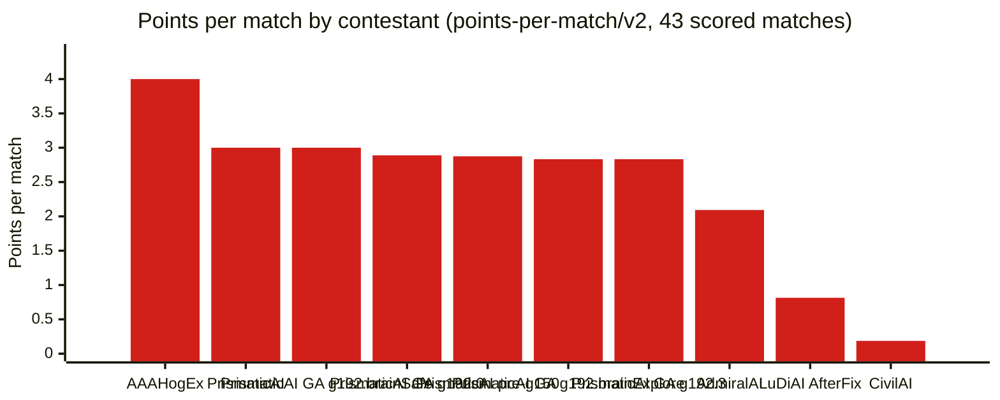
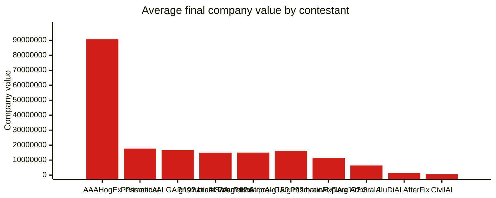
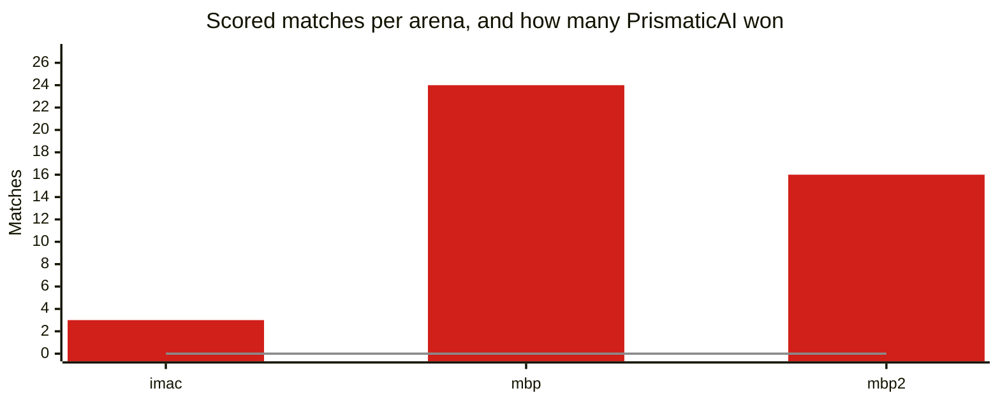

# battle-20261120T221524-7417fd86

Derived from `battle-20261120T221524-7417fd86.json` by `tools/research/ai-battle/battle.py report`; do not edit.

- Edition `7417fd8619784707`: PrismaticAI and referee at `962699034c20d90baeb9f617789ea6558cc6ff52`, base set `opengfx-8.0.tar`
- 20-year free-for-all from 1960, map 256x256 temperate, breakdowns 1
- 43 scored match(es) on `imac` (20261119-master-gdf1e05e7d8), `mbp` (20261120-master-m17653b726e), `mbp2` (20261119-master-gdf1e05e7d8)
- Replays: 1 of 2 identical to their original on another arena

| # | Contestant | Played | Wins | Points | Points/match | Avg rank | Avg final value | Squirrel errors | Matches with anomalies |
|---|---|---|---|---|---|---|---|---|---|
| 1 | AAAHogEx | 43 | 43 | 172 | 4.0 | 1.0 | 90.7 M | 0 | 0 |
| 2 | PrismaticAI | 7 | 0 | 21 | 3.0 | 2.0 | 17.6 M | 0 | 0 |
| 3 | PrismaticAI GA g192.brainSafe | 7 | 0 | 21 | 3.0 | 2.0 | 16.8 M | 0 | 2 |
| 4 | PrismaticAI GA g192.0 | 9 | 0 | 26 | 2.889 | 2.11 | 14.9 M | 0 | 0 |
| 5 | PrismaticAI pre-g150 | 8 | 0 | 23 | 2.875 | 2.12 | 15.0 M | 0 | 4 |
| 6 | PrismaticAI GA g192.brainExplore | 6 | 0 | 17 | 2.833 | 2.17 | 16.0 M | 0 | 1 |
| 7 | PrismaticAI GA g192.3 | 6 | 0 | 17 | 2.833 | 2.17 | 11.4 M | 0 | 0 |
| 8 | AdmiralAI | 43 | 0 | 90 | 2.093 | 2.91 | 6.4 M | 44 | 5 |
| 9 | LuDiAI AfterFix | 43 | 0 | 35 | 0.814 | 4.19 | 1.4 M | 0 | 4 |
| 10 | CivilAI | 43 | 0 | 8 | 0.186 | 4.81 | 554.4 k | 0 | 6 |

```mermaid
---
config:
  xyChart:
    width: 900
    height: 360
  themeVariables:
    xyChart:
      plotColorPalette: "#d11f1a, #8a8a8a, #0b0b0b, #ece4d6"
---
xychart-beta
    title "Final company value per scored match: winner vs best PrismaticAI"
    x-axis ["m-0001", "m-0002", "m-0003", "m-0004", "m-0005", "m-0006", "m-0007", "m-0008", "m-0009", "m-0010", "m-0011", "m-0012", "m-0013", "m-0014", "m-0015", "m-0016", "m-0017", "m-0018", "m-0019", "m-0020", "m-0021", "m-0022", "m-0023", "m-0024", "m-0025", "m-0026", "m-0027", "m-0028", "m-0036", "m-0037", "m-0038", "m-0039", "m-0040", "m-0041", "m-0042", "m-0043", "m-0044", "m-0049", "m-0050", "m-0062", "m-0063", "m-0065", "m-0066"]
    %% series: Winner | Best PrismaticAI
    %% links: battle-20261120T221524-7417fd86.md?col=Match&filter=m-0001 | battle-20261120T221524-7417fd86.md?col=Match&filter=m-0002 | battle-20261120T221524-7417fd86.md?col=Match&filter=m-0003 | battle-20261120T221524-7417fd86.md?col=Match&filter=m-0004 | battle-20261120T221524-7417fd86.md?col=Match&filter=m-0005 | battle-20261120T221524-7417fd86.md?col=Match&filter=m-0006 | battle-20261120T221524-7417fd86.md?col=Match&filter=m-0007 | battle-20261120T221524-7417fd86.md?col=Match&filter=m-0008 | battle-20261120T221524-7417fd86.md?col=Match&filter=m-0009 | battle-20261120T221524-7417fd86.md?col=Match&filter=m-0010 | battle-20261120T221524-7417fd86.md?col=Match&filter=m-0011 | battle-20261120T221524-7417fd86.md?col=Match&filter=m-0012 | battle-20261120T221524-7417fd86.md?col=Match&filter=m-0013 | battle-20261120T221524-7417fd86.md?col=Match&filter=m-0014 | battle-20261120T221524-7417fd86.md?col=Match&filter=m-0015 | battle-20261120T221524-7417fd86.md?col=Match&filter=m-0016 | battle-20261120T221524-7417fd86.md?col=Match&filter=m-0017 | battle-20261120T221524-7417fd86.md?col=Match&filter=m-0018 | battle-20261120T221524-7417fd86.md?col=Match&filter=m-0019 | battle-20261120T221524-7417fd86.md?col=Match&filter=m-0020 | battle-20261120T221524-7417fd86.md?col=Match&filter=m-0021 | battle-20261120T221524-7417fd86.md?col=Match&filter=m-0022 | battle-20261120T221524-7417fd86.md?col=Match&filter=m-0023 | battle-20261120T221524-7417fd86.md?col=Match&filter=m-0024 | battle-20261120T221524-7417fd86.md?col=Match&filter=m-0025 | battle-20261120T221524-7417fd86.md?col=Match&filter=m-0026 | battle-20261120T221524-7417fd86.md?col=Match&filter=m-0027 | battle-20261120T221524-7417fd86.md?col=Match&filter=m-0028 | battle-20261120T221524-7417fd86.md?col=Match&filter=m-0036 | battle-20261120T221524-7417fd86.md?col=Match&filter=m-0037 | battle-20261120T221524-7417fd86.md?col=Match&filter=m-0038 | battle-20261120T221524-7417fd86.md?col=Match&filter=m-0039 | battle-20261120T221524-7417fd86.md?col=Match&filter=m-0040 | battle-20261120T221524-7417fd86.md?col=Match&filter=m-0041 | battle-20261120T221524-7417fd86.md?col=Match&filter=m-0042 | battle-20261120T221524-7417fd86.md?col=Match&filter=m-0043 | battle-20261120T221524-7417fd86.md?col=Match&filter=m-0044 | battle-20261120T221524-7417fd86.md?col=Match&filter=m-0049 | battle-20261120T221524-7417fd86.md?col=Match&filter=m-0050 | battle-20261120T221524-7417fd86.md?col=Match&filter=m-0062 | battle-20261120T221524-7417fd86.md?col=Match&filter=m-0063 | battle-20261120T221524-7417fd86.md?col=Match&filter=m-0065 | battle-20261120T221524-7417fd86.md?col=Match&filter=m-0066
    y-axis "Company value" 0 --> 152000000
    bar [87139718, 98096244, 92162577, 94743209, 86719247, 73987931, 78281239, 77764332, 85041186, 63900524, 85471803, 73892244, 70661078, 77741688, 75531457, 71706899, 66446956, 98337848, 71063379, 75744656, 70680136, 91639205, 83311333, 94746081, 82204935, 79582464, 107249774, 95099324, 116274951, 114931991, 116210938, 104982493, 97634487, 102144097, 117678245, 106737806, 110094472, 70687301, 63660327, 123321707, 122516411, 138274056, 86283081]
    line [13310086, 16018359, 20905706, 25157237, 10381481, 20850328, 16990130, 16023339, 14061421, 20749716, 9128343, 10496764, 13163054, 15350813, 15214736, 10401806, 7745254, 19893813, 20091169, 17346959, 13024878, 7036283, 10452556, 15667839, 11030180, 12261181, 14088438, 16943290, 16322168, 15041863, 11627691, 15637282, 15781587, 14499539, 20297794, 17642313, 23660416, 12945133, 7921917, 13980423, 24845594, 16273982, 20004196]
```

<!-- battle-charts:begin -->
<!-- derived from battle-20261120T221524-7417fd86.json by `battle.py render`; `battle.py check` fails when it is stale -->

<!-- battle-charts:end -->

| Seed | Original | Replay | Arenas | Identical |
|---|---|---|---|---|
| 633156950 | m-0013 | m-0048 | mbp2 / mbp | yes |
| 700890734 | m-0011 | m-0064 | imac / mbp | NO |

| Match | Arena | Seed | Winner | Value | Last | Anomalies |
|---|---|---|---|---|---|---|
| m-0001 | mbp | 645145998 | AAAHogEx | 87.1 M | CivilAI | PrismaticAI pre-g150: fleet_drop:96->53 |
| m-0002 | mbp | 645145998 | AAAHogEx | 98.1 M | CivilAI | - |
| m-0003 | mbp | 645145998 | AAAHogEx | 92.2 M | CivilAI | - |
| m-0004 | mbp | 645145998 | AAAHogEx | 94.7 M | CivilAI | AdmiralAI: fleet_drop:362->224; CivilAI: fleet_drop:52->28 |
| m-0005 | mbp | 645145998 | AAAHogEx | 86.7 M | CivilAI | - |
| m-0006 | mbp | 700890734 | AAAHogEx | 74.0 M | CivilAI | AdmiralAI: fleet_drop:221->129 |
| m-0007 | mbp | 700890734 | AAAHogEx | 78.3 M | CivilAI | - |
| m-0008 | mbp | 700890734 | AAAHogEx | 77.8 M | CivilAI | AdmiralAI: fleet_drop:248->170; CivilAI: fleet_drop:137->41 |
| m-0009 | mbp | 700890734 | AAAHogEx | 85.0 M | CivilAI | PrismaticAI GA g192.brainSafe: fleet_drop:93->57 |
| m-0010 | imac | 700890734 | AAAHogEx | 63.9 M | CivilAI | - |
| m-0011 | imac | 700890734 | AAAHogEx | 85.5 M | CivilAI | - |
| m-0012 | imac | 633156950 | AAAHogEx | 73.9 M | CivilAI | LuDiAI AfterFix: fleet_drop:72->44 |
| m-0013 | mbp2 | 633156950 | AAAHogEx | 70.7 M | CivilAI | PrismaticAI pre-g150: fleet_drop:51->28; CivilAI: fleet_drop:30->14 |
| m-0014 | mbp2 | 633156950 | AAAHogEx | 77.7 M | CivilAI | - |
| m-0015 | mbp2 | 633156950 | AAAHogEx | 75.5 M | LuDiAI AfterFix | CivilAI: fleet_drop:60->23 |
| m-0016 | mbp2 | 633156950 | AAAHogEx | 71.7 M | CivilAI | - |
| m-0017 | mbp2 | 633156950 | AAAHogEx | 66.4 M | CivilAI | CivilAI: fleet_drop:51->20 |
| m-0018 | mbp2 | 360969018 | AAAHogEx | 98.3 M | CivilAI | - |
| m-0019 | mbp2 | 360969018 | AAAHogEx | 71.1 M | CivilAI | - |
| m-0020 | mbp2 | 360969018 | AAAHogEx | 75.7 M | LuDiAI AfterFix | - |
| m-0021 | mbp2 | 360969018 | AAAHogEx | 70.7 M | CivilAI | - |
| m-0022 | mbp2 | 360969018 | AAAHogEx | 91.6 M | LuDiAI AfterFix | PrismaticAI GA g192.brainExplore: fleet_drop:83->44 |
| m-0023 | mbp2 | 360969018 | AAAHogEx | 83.3 M | CivilAI | - |
| m-0024 | mbp2 | 885016316 | AAAHogEx | 94.7 M | LuDiAI AfterFix | - |
| m-0025 | mbp2 | 885016316 | AAAHogEx | 82.2 M | LuDiAI AfterFix | - |
| m-0026 | mbp2 | 885016316 | AAAHogEx | 79.6 M | CivilAI | LuDiAI AfterFix: fleet_drop:103->62 |
| m-0027 | mbp2 | 885016316 | AAAHogEx | 107.2 M | CivilAI | PrismaticAI GA g192.brainSafe: fleet_drop:133->77 |
| m-0028 | mbp2 | 885016316 | AAAHogEx | 95.1 M | CivilAI | - |
| m-0036 | mbp | 294386871 | AAAHogEx | 116.3 M | CivilAI | - |
| m-0037 | mbp | 294386871 | AAAHogEx | 114.9 M | CivilAI | PrismaticAI pre-g150: fleet_drop:86->60; CivilAI: fleet_drop:35->22 |
| m-0038 | mbp | 294386871 | AAAHogEx | 116.2 M | CivilAI | - |
| m-0039 | mbp | 294386871 | AAAHogEx | 105.0 M | CivilAI | LuDiAI AfterFix: fleet_drop:65->42 |
| m-0040 | mbp | 294386871 | AAAHogEx | 97.6 M | CivilAI | AdmiralAI: squirrel_errors:44 |
| m-0041 | mbp | 294386871 | AAAHogEx | 102.1 M | CivilAI | - |
| m-0042 | mbp | 1458525576 | AAAHogEx | 117.7 M | CivilAI | - |
| m-0043 | mbp | 1458525576 | AAAHogEx | 106.7 M | CivilAI | PrismaticAI pre-g150: fleet_drop:121->70 |
| m-0044 | mbp | 1458525576 | AAAHogEx | 110.1 M | LuDiAI AfterFix | - |
| m-0048 (replay) | mbp | 633156950 | AAAHogEx | 70.7 M | CivilAI | PrismaticAI pre-g150: fleet_drop:51->28; CivilAI: fleet_drop:30->14 |
| m-0049 | mbp | 1875735546 | AAAHogEx | 70.7 M | LuDiAI AfterFix | LuDiAI AfterFix: fleet_drop:20->13 |
| m-0050 | mbp | 1875735546 | AAAHogEx | 63.7 M | CivilAI | - |
| m-0062 | mbp | 1164168748 | AAAHogEx | 123.3 M | CivilAI | - |
| m-0063 | mbp | 1164168748 | AAAHogEx | 122.5 M | CivilAI | AdmiralAI: fleet_drop:246->118 |
| m-0064 (replay) | mbp | 700890734 | AAAHogEx | 92.9 M | CivilAI | - |
| m-0065 | mbp | 1164168748 | AAAHogEx | 138.3 M | CivilAI | - |
| m-0066 | mbp | 207530325 | AAAHogEx | 86.3 M | LuDiAI AfterFix | - |
