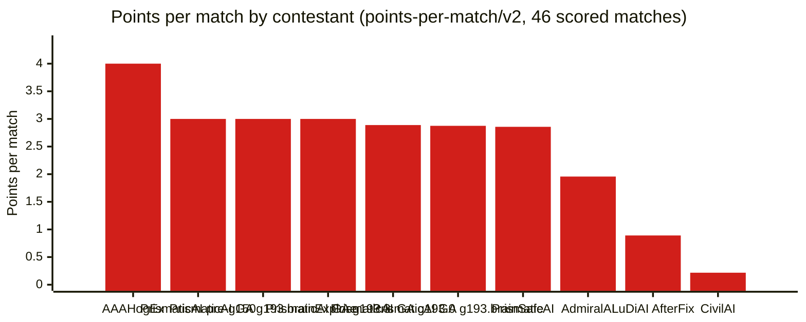
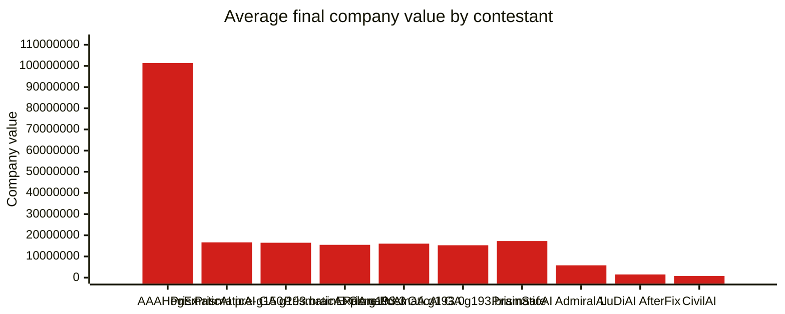
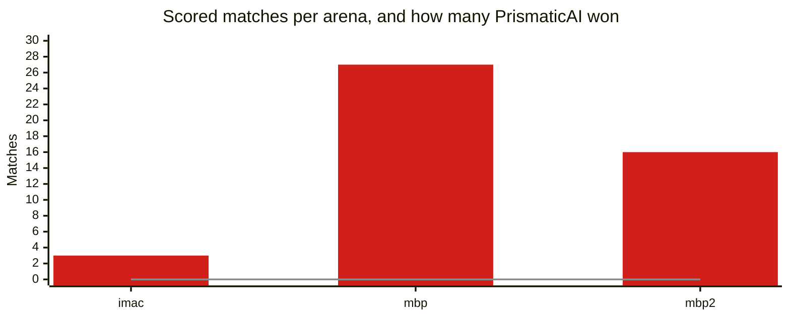

# battle-20261120T222603-04faaa7f

Derived from `battle-20261120T222603-04faaa7f.json` by `tools/research/ai-battle/battle.py report`; do not edit.

- Edition `04faaa7fb7098e64`: PrismaticAI and referee at `962699034c20d90baeb9f617789ea6558cc6ff52`, base set `opengfx-8.0.tar`
- 20-year free-for-all from 1960, map 256x256 temperate, breakdowns 1
- 46 scored match(es) on `imac` (20261119-master-gdf1e05e7d8), `mbp` (20261120-master-m17653b726e), `mbp2` (20261119-master-gdf1e05e7d8)
- Replays: 0 of 0 identical to their original on another arena

| # | Contestant | Played | Wins | Points | Points/match | Avg rank | Avg final value | Squirrel errors | Matches with anomalies |
|---|---|---|---|---|---|---|---|---|---|
| 1 | AAAHogEx | 46 | 46 | 184 | 4.0 | 1.0 | 101.4 M | 0 | 0 |
| 2 | PrismaticAI pre-g150 | 9 | 0 | 27 | 3.0 | 2.0 | 16.7 M | 0 | 5 |
| 3 | PrismaticAI GA g193.brainExplore | 7 | 0 | 21 | 3.0 | 2.0 | 16.5 M | 0 | 0 |
| 4 | PrismaticAI GA g193.3 | 6 | 0 | 18 | 3.0 | 2.0 | 15.5 M | 0 | 3 |
| 5 | PrismaticAI GA g193.0 | 9 | 0 | 26 | 2.889 | 2.11 | 16.0 M | 0 | 3 |
| 6 | PrismaticAI GA g193.brainSafe | 8 | 0 | 23 | 2.875 | 2.12 | 15.3 M | 0 | 0 |
| 7 | PrismaticAI | 7 | 0 | 20 | 2.857 | 2.14 | 17.3 M | 0 | 0 |
| 8 | AdmiralAI | 46 | 0 | 90 | 1.957 | 3.04 | 5.8 M | 62 | 1 |
| 9 | LuDiAI AfterFix | 46 | 0 | 41 | 0.891 | 4.11 | 1.5 M | 0 | 4 |
| 10 | CivilAI | 46 | 0 | 10 | 0.217 | 4.78 | 761.2 k | 0 | 6 |

```mermaid
---
config:
  xyChart:
    width: 900
    height: 360
  themeVariables:
    xyChart:
      plotColorPalette: "#d11f1a, #8a8a8a, #0b0b0b, #ece4d6"
---
xychart-beta
    title "Final company value per scored match: winner vs best PrismaticAI"
    x-axis ["m-0001", "m-0002", "m-0003", "m-0004", "m-0005", "m-0006", "m-0007", "m-0008", "m-0009", "m-0010", "m-0011", "m-0012", "m-0013", "m-0014", "m-0015", "m-0016", "m-0017", "m-0018", "m-0019", "m-0020", "m-0021", "m-0022", "m-0023", "m-0024", "m-0025", "m-0026", "m-0027", "m-0028", "m-0036", "m-0037", "m-0038", "m-0039", "m-0040", "m-0041", "m-0042", "m-0043", "m-0044", "m-0045", "m-0049", "m-0050", "m-0051", "m-0052", "m-0059", "m-0060", "m-0061", "m-0062"]
    %% series: Winner | Best PrismaticAI
    %% links: battle-20261120T222603-04faaa7f.md?col=Match&filter=m-0001 | battle-20261120T222603-04faaa7f.md?col=Match&filter=m-0002 | battle-20261120T222603-04faaa7f.md?col=Match&filter=m-0003 | battle-20261120T222603-04faaa7f.md?col=Match&filter=m-0004 | battle-20261120T222603-04faaa7f.md?col=Match&filter=m-0005 | battle-20261120T222603-04faaa7f.md?col=Match&filter=m-0006 | battle-20261120T222603-04faaa7f.md?col=Match&filter=m-0007 | battle-20261120T222603-04faaa7f.md?col=Match&filter=m-0008 | battle-20261120T222603-04faaa7f.md?col=Match&filter=m-0009 | battle-20261120T222603-04faaa7f.md?col=Match&filter=m-0010 | battle-20261120T222603-04faaa7f.md?col=Match&filter=m-0011 | battle-20261120T222603-04faaa7f.md?col=Match&filter=m-0012 | battle-20261120T222603-04faaa7f.md?col=Match&filter=m-0013 | battle-20261120T222603-04faaa7f.md?col=Match&filter=m-0014 | battle-20261120T222603-04faaa7f.md?col=Match&filter=m-0015 | battle-20261120T222603-04faaa7f.md?col=Match&filter=m-0016 | battle-20261120T222603-04faaa7f.md?col=Match&filter=m-0017 | battle-20261120T222603-04faaa7f.md?col=Match&filter=m-0018 | battle-20261120T222603-04faaa7f.md?col=Match&filter=m-0019 | battle-20261120T222603-04faaa7f.md?col=Match&filter=m-0020 | battle-20261120T222603-04faaa7f.md?col=Match&filter=m-0021 | battle-20261120T222603-04faaa7f.md?col=Match&filter=m-0022 | battle-20261120T222603-04faaa7f.md?col=Match&filter=m-0023 | battle-20261120T222603-04faaa7f.md?col=Match&filter=m-0024 | battle-20261120T222603-04faaa7f.md?col=Match&filter=m-0025 | battle-20261120T222603-04faaa7f.md?col=Match&filter=m-0026 | battle-20261120T222603-04faaa7f.md?col=Match&filter=m-0027 | battle-20261120T222603-04faaa7f.md?col=Match&filter=m-0028 | battle-20261120T222603-04faaa7f.md?col=Match&filter=m-0036 | battle-20261120T222603-04faaa7f.md?col=Match&filter=m-0037 | battle-20261120T222603-04faaa7f.md?col=Match&filter=m-0038 | battle-20261120T222603-04faaa7f.md?col=Match&filter=m-0039 | battle-20261120T222603-04faaa7f.md?col=Match&filter=m-0040 | battle-20261120T222603-04faaa7f.md?col=Match&filter=m-0041 | battle-20261120T222603-04faaa7f.md?col=Match&filter=m-0042 | battle-20261120T222603-04faaa7f.md?col=Match&filter=m-0043 | battle-20261120T222603-04faaa7f.md?col=Match&filter=m-0044 | battle-20261120T222603-04faaa7f.md?col=Match&filter=m-0045 | battle-20261120T222603-04faaa7f.md?col=Match&filter=m-0049 | battle-20261120T222603-04faaa7f.md?col=Match&filter=m-0050 | battle-20261120T222603-04faaa7f.md?col=Match&filter=m-0051 | battle-20261120T222603-04faaa7f.md?col=Match&filter=m-0052 | battle-20261120T222603-04faaa7f.md?col=Match&filter=m-0059 | battle-20261120T222603-04faaa7f.md?col=Match&filter=m-0060 | battle-20261120T222603-04faaa7f.md?col=Match&filter=m-0061 | battle-20261120T222603-04faaa7f.md?col=Match&filter=m-0062
    y-axis "Company value" 0 --> 153000000
    bar [139521463, 134872937, 112608246, 111485398, 87689307, 98108683, 97822193, 98424977, 88842009, 114408914, 91846439, 106400608, 107275964, 98183808, 88977738, 132300072, 95075919, 116428472, 113497411, 107139850, 102401821, 111944966, 98291400, 128680097, 109683998, 99150351, 104029394, 105643962, 95619598, 87477975, 70177077, 76031297, 73164934, 94334521, 119749069, 105878666, 91776459, 106628506, 70747727, 74938586, 84836398, 88597326, 96357136, 93477208, 117441989, 116295597]
    line [11258023, 4282140, 10223523, 11999747, 10161678, 14521498, 18949467, 19384369, 21942544, 17643326, 22930882, 25646201, 19759792, 20767400, 19511776, 17078623, 22023613, 7326910, 19620803, 12364514, 9296958, 12531513, 8829002, 21631761, 14298889, 16055739, 13895079, 24046358, 14658345, 11719237, 11210257, 11298643, 12736687, 15771222, 20647115, 19413026, 24351393, 19811858, 18406573, 16214307, 16338219, 19312801, 13241919, 16476290, 16513552, 19800697]
```

<!-- battle-charts:begin -->
<!-- derived from battle-20261120T222603-04faaa7f.json by `battle.py render`; `battle.py check` fails when it is stale -->

<!-- battle-charts:end -->

| Match | Arena | Seed | Winner | Value | Last | Anomalies |
|---|---|---|---|---|---|---|
| m-0001 | mbp | 1781821208 | AAAHogEx | 139.5 M | CivilAI | PrismaticAI pre-g150: fleet_drop:91->60 |
| m-0002 | mbp | 1781821208 | AAAHogEx | 134.9 M | CivilAI | PrismaticAI GA g193.0: fleet_drop:121->60 |
| m-0003 | mbp | 1781821208 | AAAHogEx | 112.6 M | CivilAI | - |
| m-0004 | mbp | 1781821208 | AAAHogEx | 111.5 M | LuDiAI AfterFix | - |
| m-0005 | mbp | 1781821208 | AAAHogEx | 87.7 M | CivilAI | PrismaticAI GA g193.3: fleet_drop:92->50 |
| m-0006 | mbp | 56380296 | AAAHogEx | 98.1 M | CivilAI | - |
| m-0007 | mbp | 56380296 | AAAHogEx | 97.8 M | CivilAI | - |
| m-0008 | mbp | 56380296 | AAAHogEx | 98.4 M | CivilAI | CivilAI: fleet_drop:57->36 |
| m-0009 | mbp | 56380296 | AAAHogEx | 88.8 M | CivilAI | - |
| m-0010 | imac | 56380296 | AAAHogEx | 114.4 M | CivilAI | CivilAI: fleet_drop:23->16 |
| m-0011 | imac | 56380296 | AAAHogEx | 91.8 M | CivilAI | PrismaticAI GA g193.3: fleet_drop:98->63; LuDiAI AfterFix: fleet_drop:80->52; CivilAI: fleet_drop:44->21 |
| m-0012 | imac | 801748842 | AAAHogEx | 106.4 M | CivilAI | - |
| m-0013 | mbp2 | 801748842 | AAAHogEx | 107.3 M | AdmiralAI | PrismaticAI pre-g150: fleet_drop:104->61; LuDiAI AfterFix: fleet_drop:65->32 |
| m-0014 | mbp2 | 801748842 | AAAHogEx | 98.2 M | CivilAI | PrismaticAI GA g193.0: fleet_drop:156->78 |
| m-0015 | mbp2 | 801748842 | AAAHogEx | 89.0 M | CivilAI | - |
| m-0016 | mbp2 | 801748842 | AAAHogEx | 132.3 M | CivilAI | - |
| m-0017 | mbp2 | 801748842 | AAAHogEx | 95.1 M | CivilAI | PrismaticAI GA g193.3: fleet_drop:148->74 |
| m-0018 | mbp2 | 1402235059 | AAAHogEx | 116.4 M | LuDiAI AfterFix | - |
| m-0019 | mbp2 | 1402235059 | AAAHogEx | 113.5 M | CivilAI | PrismaticAI pre-g150: fleet_drop:141->91 |
| m-0020 | mbp2 | 1402235059 | AAAHogEx | 107.1 M | CivilAI | - |
| m-0021 | mbp2 | 1402235059 | AAAHogEx | 102.4 M | CivilAI | - |
| m-0022 | mbp2 | 1402235059 | AAAHogEx | 111.9 M | CivilAI | - |
| m-0023 | mbp2 | 1402235059 | AAAHogEx | 98.3 M | LuDiAI AfterFix | - |
| m-0024 | mbp2 | 1218350355 | AAAHogEx | 128.7 M | LuDiAI AfterFix | - |
| m-0025 | mbp2 | 1218350355 | AAAHogEx | 109.7 M | LuDiAI AfterFix | PrismaticAI pre-g150: fleet_drop:126->69 |
| m-0026 | mbp2 | 1218350355 | AAAHogEx | 99.2 M | CivilAI | - |
| m-0027 | mbp2 | 1218350355 | AAAHogEx | 104.0 M | CivilAI | - |
| m-0028 | mbp2 | 1218350355 | AAAHogEx | 105.6 M | CivilAI | - |
| m-0036 | mbp | 826215624 | AAAHogEx | 95.6 M | CivilAI | - |
| m-0037 | mbp | 826215624 | AAAHogEx | 87.5 M | CivilAI | CivilAI: fleet_drop:58->24 |
| m-0038 | mbp | 826215624 | AAAHogEx | 70.2 M | LuDiAI AfterFix | - |
| m-0039 | mbp | 826215624 | AAAHogEx | 76.0 M | CivilAI | - |
| m-0040 | mbp | 826215624 | AAAHogEx | 73.2 M | LuDiAI AfterFix | - |
| m-0041 | mbp | 826215624 | AAAHogEx | 94.3 M | LuDiAI AfterFix | - |
| m-0042 | mbp | 900270538 | AAAHogEx | 119.7 M | CivilAI | LuDiAI AfterFix: fleet_drop:70->46; CivilAI: no_vehicles |
| m-0043 | mbp | 900270538 | AAAHogEx | 105.9 M | CivilAI | - |
| m-0044 | mbp | 900270538 | AAAHogEx | 91.8 M | CivilAI | PrismaticAI GA g193.0: fleet_drop:167->71 |
| m-0045 | mbp | 900270538 | AAAHogEx | 106.6 M | CivilAI | - |
| m-0049 | mbp | 504158414 | AAAHogEx | 70.7 M | CivilAI | PrismaticAI pre-g150: fleet_drop:84->42; LuDiAI AfterFix: fleet_drop:148->97 |
| m-0050 | mbp | 504158414 | AAAHogEx | 74.9 M | CivilAI | CivilAI: fleet_drop:35->19 |
| m-0051 | mbp | 504158414 | AAAHogEx | 84.8 M | CivilAI | - |
| m-0052 | mbp | 504158414 | AAAHogEx | 88.6 M | CivilAI | - |
| m-0059 | mbp | 877728619 | AAAHogEx | 96.4 M | CivilAI | - |
| m-0060 | mbp | 255366547 | AAAHogEx | 93.5 M | CivilAI | - |
| m-0061 | mbp | 255366547 | AAAHogEx | 117.4 M | CivilAI | AdmiralAI: squirrel_errors:62 |
| m-0062 | mbp | 255366547 | AAAHogEx | 116.3 M | CivilAI | - |
