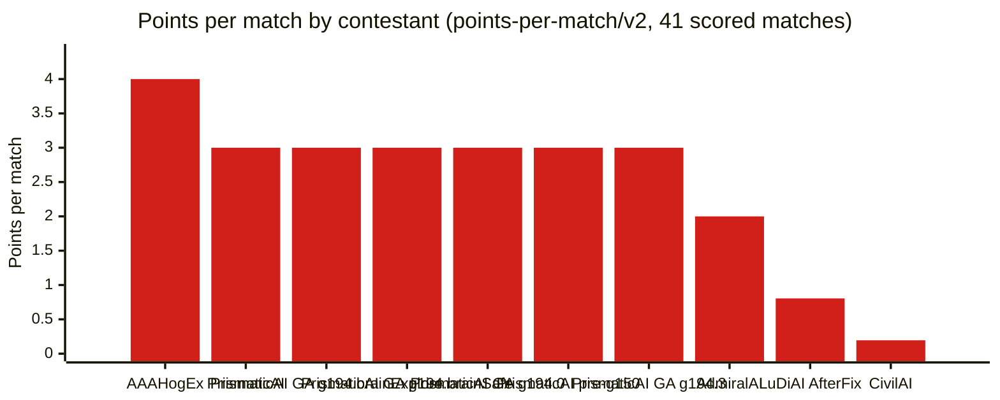
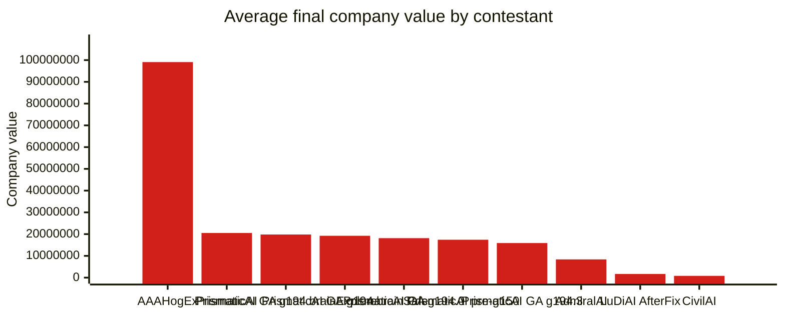
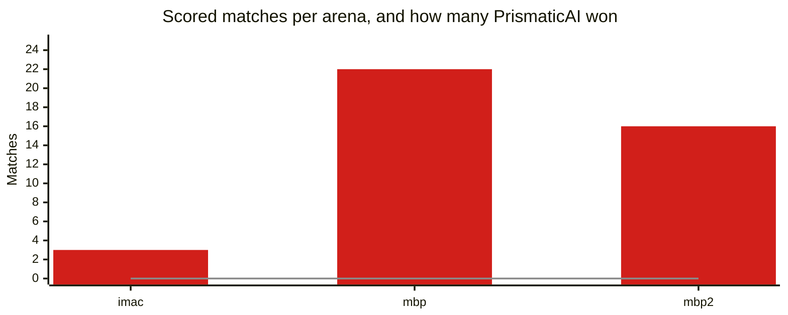

# battle-20261120T223546-bfd56767

Derived from `battle-20261120T223546-bfd56767.json` by `tools/research/ai-battle/battle.py report`; do not edit.

- Edition `bfd56767b2f94172`: PrismaticAI and referee at `962699034c20d90baeb9f617789ea6558cc6ff52`, base set `opengfx-8.0.tar`
- 20-year free-for-all from 1960, map 256x256 temperate, breakdowns 1
- 41 scored match(es) on `imac` (20261119-master-gdf1e05e7d8), `mbp` (20261120-master-m17653b726e), `mbp2` (20261119-master-gdf1e05e7d8)
- Replays: 0 of 0 identical to their original on another arena

| # | Contestant | Played | Wins | Points | Points/match | Avg rank | Avg final value | Squirrel errors | Matches with anomalies |
|---|---|---|---|---|---|---|---|---|---|
| 1 | AAAHogEx | 41 | 41 | 164 | 4.0 | 1.0 | 99.1 M | 0 | 0 |
| 2 | PrismaticAI | 6 | 0 | 18 | 3.0 | 2.0 | 20.5 M | 0 | 0 |
| 3 | PrismaticAI GA g194.brainExplore | 7 | 0 | 21 | 3.0 | 2.0 | 19.8 M | 0 | 4 |
| 4 | PrismaticAI GA g194.brainSafe | 7 | 0 | 21 | 3.0 | 2.0 | 19.2 M | 0 | 0 |
| 5 | PrismaticAI GA g194.0 | 7 | 0 | 21 | 3.0 | 2.0 | 18.1 M | 0 | 4 |
| 6 | PrismaticAI pre-g150 | 8 | 0 | 24 | 3.0 | 2.0 | 17.4 M | 0 | 4 |
| 7 | PrismaticAI GA g194.3 | 6 | 0 | 18 | 3.0 | 2.0 | 15.9 M | 0 | 4 |
| 8 | AdmiralAI | 41 | 0 | 82 | 2.0 | 3.0 | 8.4 M | 72 | 1 |
| 9 | LuDiAI AfterFix | 41 | 0 | 33 | 0.805 | 4.2 | 1.7 M | 0 | 3 |
| 10 | CivilAI | 41 | 0 | 8 | 0.195 | 4.8 | 814.5 k | 0 | 13 |

```mermaid
---
config:
  xyChart:
    width: 900
    height: 360
  themeVariables:
    xyChart:
      plotColorPalette: "#d11f1a, #8a8a8a, #0b0b0b, #ece4d6"
---
xychart-beta
    title "Final company value per scored match: winner vs best PrismaticAI"
    x-axis ["m-0001", "m-0002", "m-0003", "m-0004", "m-0005", "m-0006", "m-0007", "m-0008", "m-0009", "m-0010", "m-0011", "m-0012", "m-0013", "m-0014", "m-0015", "m-0016", "m-0017", "m-0018", "m-0019", "m-0020", "m-0021", "m-0022", "m-0023", "m-0024", "m-0025", "m-0026", "m-0027", "m-0028", "m-0036", "m-0037", "m-0038", "m-0039", "m-0040", "m-0041", "m-0042", "m-0043", "m-0044", "m-0045", "m-0046", "m-0047", "m-0055"]
    %% series: Winner | Best PrismaticAI
    %% links: battle-20261120T223546-bfd56767.md?col=Match&filter=m-0001 | battle-20261120T223546-bfd56767.md?col=Match&filter=m-0002 | battle-20261120T223546-bfd56767.md?col=Match&filter=m-0003 | battle-20261120T223546-bfd56767.md?col=Match&filter=m-0004 | battle-20261120T223546-bfd56767.md?col=Match&filter=m-0005 | battle-20261120T223546-bfd56767.md?col=Match&filter=m-0006 | battle-20261120T223546-bfd56767.md?col=Match&filter=m-0007 | battle-20261120T223546-bfd56767.md?col=Match&filter=m-0008 | battle-20261120T223546-bfd56767.md?col=Match&filter=m-0009 | battle-20261120T223546-bfd56767.md?col=Match&filter=m-0010 | battle-20261120T223546-bfd56767.md?col=Match&filter=m-0011 | battle-20261120T223546-bfd56767.md?col=Match&filter=m-0012 | battle-20261120T223546-bfd56767.md?col=Match&filter=m-0013 | battle-20261120T223546-bfd56767.md?col=Match&filter=m-0014 | battle-20261120T223546-bfd56767.md?col=Match&filter=m-0015 | battle-20261120T223546-bfd56767.md?col=Match&filter=m-0016 | battle-20261120T223546-bfd56767.md?col=Match&filter=m-0017 | battle-20261120T223546-bfd56767.md?col=Match&filter=m-0018 | battle-20261120T223546-bfd56767.md?col=Match&filter=m-0019 | battle-20261120T223546-bfd56767.md?col=Match&filter=m-0020 | battle-20261120T223546-bfd56767.md?col=Match&filter=m-0021 | battle-20261120T223546-bfd56767.md?col=Match&filter=m-0022 | battle-20261120T223546-bfd56767.md?col=Match&filter=m-0023 | battle-20261120T223546-bfd56767.md?col=Match&filter=m-0024 | battle-20261120T223546-bfd56767.md?col=Match&filter=m-0025 | battle-20261120T223546-bfd56767.md?col=Match&filter=m-0026 | battle-20261120T223546-bfd56767.md?col=Match&filter=m-0027 | battle-20261120T223546-bfd56767.md?col=Match&filter=m-0028 | battle-20261120T223546-bfd56767.md?col=Match&filter=m-0036 | battle-20261120T223546-bfd56767.md?col=Match&filter=m-0037 | battle-20261120T223546-bfd56767.md?col=Match&filter=m-0038 | battle-20261120T223546-bfd56767.md?col=Match&filter=m-0039 | battle-20261120T223546-bfd56767.md?col=Match&filter=m-0040 | battle-20261120T223546-bfd56767.md?col=Match&filter=m-0041 | battle-20261120T223546-bfd56767.md?col=Match&filter=m-0042 | battle-20261120T223546-bfd56767.md?col=Match&filter=m-0043 | battle-20261120T223546-bfd56767.md?col=Match&filter=m-0044 | battle-20261120T223546-bfd56767.md?col=Match&filter=m-0045 | battle-20261120T223546-bfd56767.md?col=Match&filter=m-0046 | battle-20261120T223546-bfd56767.md?col=Match&filter=m-0047 | battle-20261120T223546-bfd56767.md?col=Match&filter=m-0055
    y-axis "Company value" 0 --> 162000000
    bar [99367297, 117341903, 126098880, 98826988, 103925774, 114318403, 109379660, 125042566, 117773930, 115632030, 147189207, 100641881, 129998733, 120238413, 97708371, 103047702, 86002095, 109262313, 108009656, 95517333, 89932582, 110064323, 105071647, 91786094, 83084856, 105793342, 95104318, 80171002, 78530458, 70938126, 67893398, 79817635, 71192368, 71338714, 90795926, 75532411, 87704065, 90334091, 113981951, 94937602, 83110007]
    line [17039928, 16459353, 14443185, 12727844, 12018864, 20323686, 14672931, 14915490, 16547418, 19102763, 14890023, 26206122, 18240930, 19415075, 19114492, 25937164, 17860986, 17334729, 17937614, 17002445, 20964344, 17731850, 18185975, 28901749, 22365587, 17627385, 23727065, 20795520, 16816793, 20093161, 24806941, 26314078, 27306769, 19743536, 13561624, 12238114, 16764131, 13534458, 15098165, 12678902, 16774874]
```

<!-- battle-charts:begin -->
<!-- derived from battle-20261120T223546-bfd56767.json by `battle.py render`; `battle.py check` fails when it is stale -->

<!-- battle-charts:end -->

| Match | Arena | Seed | Winner | Value | Last | Anomalies |
|---|---|---|---|---|---|---|
| m-0001 | mbp | 652383189 | AAAHogEx | 99.4 M | CivilAI | - |
| m-0002 | mbp | 652383189 | AAAHogEx | 117.3 M | CivilAI | PrismaticAI GA g194.0: fleet_drop:112->57; CivilAI: fleet_drop:51->32 |
| m-0003 | mbp | 652383189 | AAAHogEx | 126.1 M | CivilAI | - |
| m-0004 | mbp | 652383189 | AAAHogEx | 98.8 M | CivilAI | PrismaticAI GA g194.brainExplore: fleet_drop:106->65 |
| m-0005 | mbp | 652383189 | AAAHogEx | 103.9 M | CivilAI | PrismaticAI GA g194.3: fleet_drop:119->61; CivilAI: fleet_drop:102->71 |
| m-0006 | mbp | 1600281953 | AAAHogEx | 114.3 M | CivilAI | - |
| m-0007 | mbp | 1600281953 | AAAHogEx | 109.4 M | LuDiAI AfterFix | CivilAI: fleet_drop:59->40 |
| m-0008 | mbp | 1600281953 | AAAHogEx | 125.0 M | LuDiAI AfterFix | - |
| m-0009 | mbp | 1600281953 | AAAHogEx | 117.8 M | CivilAI | - |
| m-0010 | imac | 1600281953 | AAAHogEx | 115.6 M | CivilAI | LuDiAI AfterFix: fleet_drop:41->25 |
| m-0011 | imac | 1600281953 | AAAHogEx | 147.2 M | LuDiAI AfterFix | CivilAI: fleet_drop:31->14 |
| m-0012 | imac | 1217899874 | AAAHogEx | 100.6 M | LuDiAI AfterFix | - |
| m-0013 | mbp2 | 1217899874 | AAAHogEx | 130.0 M | CivilAI | PrismaticAI pre-g150: fleet_drop:85->50 |
| m-0014 | mbp2 | 1217899874 | AAAHogEx | 120.2 M | LuDiAI AfterFix | PrismaticAI GA g194.0: fleet_drop:107->57 |
| m-0015 | mbp2 | 1217899874 | AAAHogEx | 97.7 M | CivilAI | CivilAI: fleet_drop:36->17 |
| m-0016 | mbp2 | 1217899874 | AAAHogEx | 103.0 M | CivilAI | PrismaticAI GA g194.brainExplore: fleet_drop:79->52; CivilAI: fleet_drop:23->10 |
| m-0017 | mbp2 | 1217899874 | AAAHogEx | 86.0 M | LuDiAI AfterFix | PrismaticAI GA g194.3: fleet_drop:87->38; LuDiAI AfterFix: fleet_drop:53->20 |
| m-0018 | mbp2 | 1077348905 | AAAHogEx | 109.3 M | CivilAI | - |
| m-0019 | mbp2 | 1077348905 | AAAHogEx | 108.0 M | CivilAI | PrismaticAI pre-g150: fleet_drop:77->47; CivilAI: fleet_drop:44->14 |
| m-0020 | mbp2 | 1077348905 | AAAHogEx | 95.5 M | CivilAI | PrismaticAI GA g194.0: fleet_drop:132->61 |
| m-0021 | mbp2 | 1077348905 | AAAHogEx | 89.9 M | CivilAI | - |
| m-0022 | mbp2 | 1077348905 | AAAHogEx | 110.1 M | CivilAI | - |
| m-0023 | mbp2 | 1077348905 | AAAHogEx | 105.1 M | CivilAI | PrismaticAI GA g194.3: fleet_drop:113->55; CivilAI: fleet_drop:39->27 |
| m-0024 | mbp2 | 258793633 | AAAHogEx | 91.8 M | CivilAI | - |
| m-0025 | mbp2 | 258793633 | AAAHogEx | 83.1 M | CivilAI | - |
| m-0026 | mbp2 | 258793633 | AAAHogEx | 105.8 M | LuDiAI AfterFix | - |
| m-0027 | mbp2 | 258793633 | AAAHogEx | 95.1 M | CivilAI | - |
| m-0028 | mbp2 | 258793633 | AAAHogEx | 80.2 M | CivilAI | PrismaticAI GA g194.brainExplore: fleet_drop:119->67 |
| m-0036 | mbp | 1466568760 | AAAHogEx | 78.5 M | CivilAI | - |
| m-0037 | mbp | 1466568760 | AAAHogEx | 70.9 M | CivilAI | - |
| m-0038 | mbp | 1466568760 | AAAHogEx | 67.9 M | CivilAI | AdmiralAI: squirrel_errors:72; CivilAI: fleet_drop:85->55 |
| m-0039 | mbp | 1466568760 | AAAHogEx | 79.8 M | CivilAI | CivilAI: fleet_drop:74->48 |
| m-0040 | mbp | 1466568760 | AAAHogEx | 71.2 M | CivilAI | - |
| m-0041 | mbp | 1466568760 | AAAHogEx | 71.3 M | CivilAI | LuDiAI AfterFix: fleet_drop:118->64 |
| m-0042 | mbp | 1208292178 | AAAHogEx | 90.8 M | LuDiAI AfterFix | - |
| m-0043 | mbp | 1208292178 | AAAHogEx | 75.5 M | CivilAI | PrismaticAI pre-g150: fleet_drop:92->42 |
| m-0044 | mbp | 1208292178 | AAAHogEx | 87.7 M | CivilAI | PrismaticAI GA g194.0: fleet_drop:65->36; CivilAI: fleet_drop:52->21 |
| m-0045 | mbp | 1208292178 | AAAHogEx | 90.3 M | CivilAI | - |
| m-0046 | mbp | 1208292178 | AAAHogEx | 114.0 M | CivilAI | PrismaticAI GA g194.brainExplore: fleet_drop:84->44 |
| m-0047 | mbp | 1208292178 | AAAHogEx | 94.9 M | CivilAI | PrismaticAI GA g194.3: fleet_drop:60->39; CivilAI: fleet_drop:55->27 |
| m-0055 | mbp | 1535036003 | AAAHogEx | 83.1 M | CivilAI | PrismaticAI pre-g150: fleet_drop:80->43; CivilAI: fleet_drop:24->3 |
