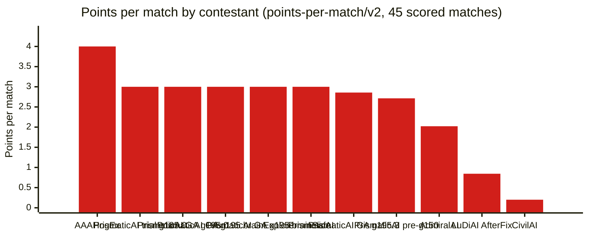
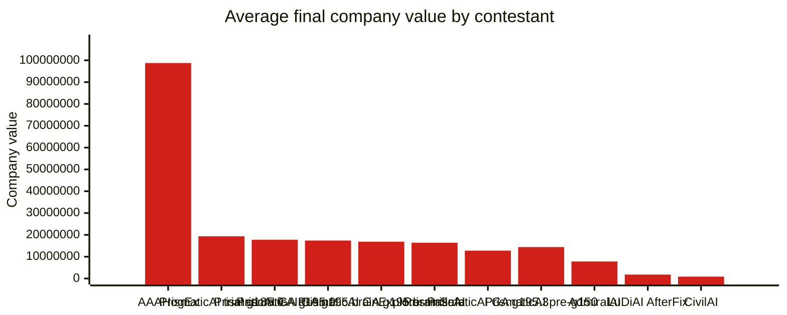
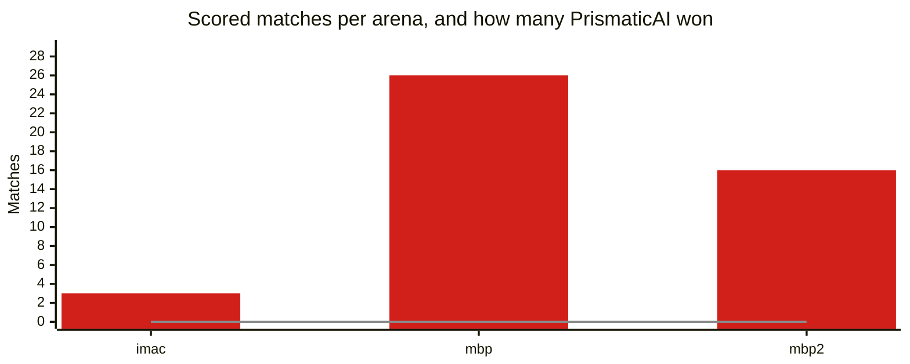

# battle-20261120T224629-cb37576d

Derived from `battle-20261120T224629-cb37576d.json` by `tools/research/ai-battle/battle.py report`; do not edit.

- Edition `cb37576d91b0ca0d`: PrismaticAI and referee at `962699034c20d90baeb9f617789ea6558cc6ff52`, base set `opengfx-8.0.tar`
- 20-year free-for-all from 1960, map 256x256 temperate, breakdowns 1
- 45 scored match(es) on `imac` (20261119-master-gdf1e05e7d8), `mbp` (20261120-master-m17653b726e), `mbp2` (20261119-master-gdf1e05e7d8)
- Replays: 0 of 1 identical to their original on another arena

| # | Contestant | Played | Wins | Points | Points/match | Avg rank | Avg final value | Squirrel errors | Matches with anomalies |
|---|---|---|---|---|---|---|---|---|---|
| 1 | AAAHogEx | 45 | 45 | 180 | 4.0 | 1.0 | 98.7 M | 0 | 1 |
| 2 | PrismaticAI trial g185.0 | 7 | 0 | 21 | 3.0 | 2.0 | 19.3 M | 0 | 2 |
| 3 | PrismaticAI GA g195.0 | 6 | 0 | 18 | 3.0 | 2.0 | 17.8 M | 0 | 1 |
| 4 | PrismaticAI GA g195.brainExplore | 7 | 0 | 21 | 3.0 | 2.0 | 17.4 M | 0 | 3 |
| 5 | PrismaticAI GA g195.brainSafe | 6 | 0 | 18 | 3.0 | 2.0 | 16.9 M | 0 | 0 |
| 6 | PrismaticAI | 5 | 0 | 15 | 3.0 | 2.0 | 16.4 M | 0 | 0 |
| 7 | PrismaticAI GA g195.3 | 7 | 0 | 20 | 2.857 | 2.14 | 12.8 M | 0 | 0 |
| 8 | PrismaticAI pre-g150 | 7 | 0 | 19 | 2.714 | 2.29 | 14.4 M | 0 | 4 |
| 9 | AdmiralAI | 45 | 0 | 91 | 2.022 | 2.98 | 7.8 M | 0 | 2 |
| 10 | LuDiAI AfterFix | 45 | 0 | 38 | 0.844 | 4.16 | 1.8 M | 0 | 1 |
| 11 | CivilAI | 45 | 0 | 9 | 0.2 | 4.8 | 865.3 k | 0 | 8 |

```mermaid
---
config:
  xyChart:
    width: 900
    height: 360
  themeVariables:
    xyChart:
      plotColorPalette: "#d11f1a, #8a8a8a, #0b0b0b, #ece4d6"
---
xychart-beta
    title "Final company value per scored match: winner vs best PrismaticAI"
    x-axis ["m-0001", "m-0002", "m-0003", "m-0004", "m-0005", "m-0006", "m-0007", "m-0008", "m-0009", "m-0010", "m-0011", "m-0012", "m-0013", "m-0014", "m-0015", "m-0016", "m-0017", "m-0018", "m-0019", "m-0020", "m-0021", "m-0022", "m-0023", "m-0024", "m-0025", "m-0026", "m-0027", "m-0028", "m-0036", "m-0037", "m-0038", "m-0039", "m-0040", "m-0041", "m-0042", "m-0043", "m-0044", "m-0055", "m-0057", "m-0058", "m-0059", "m-0060", "m-0061", "m-0068", "m-0069"]
    %% series: Winner | Best PrismaticAI
    %% links: battle-20261120T224629-cb37576d.md?col=Match&filter=m-0001 | battle-20261120T224629-cb37576d.md?col=Match&filter=m-0002 | battle-20261120T224629-cb37576d.md?col=Match&filter=m-0003 | battle-20261120T224629-cb37576d.md?col=Match&filter=m-0004 | battle-20261120T224629-cb37576d.md?col=Match&filter=m-0005 | battle-20261120T224629-cb37576d.md?col=Match&filter=m-0006 | battle-20261120T224629-cb37576d.md?col=Match&filter=m-0007 | battle-20261120T224629-cb37576d.md?col=Match&filter=m-0008 | battle-20261120T224629-cb37576d.md?col=Match&filter=m-0009 | battle-20261120T224629-cb37576d.md?col=Match&filter=m-0010 | battle-20261120T224629-cb37576d.md?col=Match&filter=m-0011 | battle-20261120T224629-cb37576d.md?col=Match&filter=m-0012 | battle-20261120T224629-cb37576d.md?col=Match&filter=m-0013 | battle-20261120T224629-cb37576d.md?col=Match&filter=m-0014 | battle-20261120T224629-cb37576d.md?col=Match&filter=m-0015 | battle-20261120T224629-cb37576d.md?col=Match&filter=m-0016 | battle-20261120T224629-cb37576d.md?col=Match&filter=m-0017 | battle-20261120T224629-cb37576d.md?col=Match&filter=m-0018 | battle-20261120T224629-cb37576d.md?col=Match&filter=m-0019 | battle-20261120T224629-cb37576d.md?col=Match&filter=m-0020 | battle-20261120T224629-cb37576d.md?col=Match&filter=m-0021 | battle-20261120T224629-cb37576d.md?col=Match&filter=m-0022 | battle-20261120T224629-cb37576d.md?col=Match&filter=m-0023 | battle-20261120T224629-cb37576d.md?col=Match&filter=m-0024 | battle-20261120T224629-cb37576d.md?col=Match&filter=m-0025 | battle-20261120T224629-cb37576d.md?col=Match&filter=m-0026 | battle-20261120T224629-cb37576d.md?col=Match&filter=m-0027 | battle-20261120T224629-cb37576d.md?col=Match&filter=m-0028 | battle-20261120T224629-cb37576d.md?col=Match&filter=m-0036 | battle-20261120T224629-cb37576d.md?col=Match&filter=m-0037 | battle-20261120T224629-cb37576d.md?col=Match&filter=m-0038 | battle-20261120T224629-cb37576d.md?col=Match&filter=m-0039 | battle-20261120T224629-cb37576d.md?col=Match&filter=m-0040 | battle-20261120T224629-cb37576d.md?col=Match&filter=m-0041 | battle-20261120T224629-cb37576d.md?col=Match&filter=m-0042 | battle-20261120T224629-cb37576d.md?col=Match&filter=m-0043 | battle-20261120T224629-cb37576d.md?col=Match&filter=m-0044 | battle-20261120T224629-cb37576d.md?col=Match&filter=m-0055 | battle-20261120T224629-cb37576d.md?col=Match&filter=m-0057 | battle-20261120T224629-cb37576d.md?col=Match&filter=m-0058 | battle-20261120T224629-cb37576d.md?col=Match&filter=m-0059 | battle-20261120T224629-cb37576d.md?col=Match&filter=m-0060 | battle-20261120T224629-cb37576d.md?col=Match&filter=m-0061 | battle-20261120T224629-cb37576d.md?col=Match&filter=m-0068 | battle-20261120T224629-cb37576d.md?col=Match&filter=m-0069
    y-axis "Company value" 0 --> 156000000
    bar [108294514, 101038010, 107198556, 110897366, 114016638, 117164767, 105026662, 86110267, 79346799, 91849878, 87206111, 92436705, 88371052, 122967002, 134758911, 100141710, 141673307, 101058589, 110959757, 130375506, 65776139, 85562020, 85809437, 80868982, 100357644, 67869798, 91534230, 93388283, 111267103, 82247793, 128750434, 118150969, 84945834, 111284968, 84062164, 99516354, 100491557, 98346640, 99267126, 91152409, 115538510, 98622651, 108800924, 55090824, 53939727]
    line [16396293, 19972556, 15149262, 18210358, 18716929, 13353280, 19290395, 19421511, 21948414, 17923707, 20933912, 23717333, 13841003, 15364838, 14516759, 15194596, 20294327, 13341653, 13331474, 9784872, 12574616, 10852865, 12259601, 11753077, 8950260, 14346700, 6782911, 17676394, 12363024, 24572405, 32218350, 21861685, 21060432, 22983002, 17020259, 11786164, 17616897, 13888349, 15430670, 23812357, 9231583, 17899831, 18581770, 12049513, 8778906]
```

<!-- battle-charts:begin -->
<!-- derived from battle-20261120T224629-cb37576d.json by `battle.py render`; `battle.py check` fails when it is stale -->

<!-- battle-charts:end -->

| Seed | Original | Replay | Arenas | Identical |
|---|---|---|---|---|
| 1919597083 | m-0010 | m-0056 | imac / mbp | NO |

| Match | Arena | Seed | Winner | Value | Last | Anomalies |
|---|---|---|---|---|---|---|
| m-0001 | mbp | 1508985880 | AAAHogEx | 108.3 M | CivilAI | - |
| m-0002 | mbp | 1508985880 | AAAHogEx | 101.0 M | CivilAI | PrismaticAI trial g185.0: fleet_drop:115->65 |
| m-0003 | mbp | 1508985880 | AAAHogEx | 107.2 M | CivilAI | PrismaticAI GA g195.0: fleet_drop:88->49 |
| m-0004 | mbp | 1508985880 | AAAHogEx | 110.9 M | CivilAI | - |
| m-0005 | mbp | 1508985880 | AAAHogEx | 114.0 M | CivilAI | - |
| m-0006 | mbp | 1508985880 | AAAHogEx | 117.2 M | CivilAI | - |
| m-0007 | mbp | 1919597083 | AAAHogEx | 105.0 M | CivilAI | AdmiralAI: fleet_drop:229->152; CivilAI: fleet_drop:38->8 |
| m-0008 | mbp | 1919597083 | AAAHogEx | 86.1 M | CivilAI | - |
| m-0009 | mbp | 1919597083 | AAAHogEx | 79.3 M | CivilAI | - |
| m-0010 | imac | 1919597083 | AAAHogEx | 91.8 M | CivilAI | - |
| m-0011 | imac | 1919597083 | AAAHogEx | 87.2 M | CivilAI | CivilAI: fleet_drop:23->15 |
| m-0012 | imac | 1919597083 | AAAHogEx | 92.4 M | CivilAI | - |
| m-0013 | mbp2 | 1919597083 | AAAHogEx | 88.4 M | CivilAI | CivilAI: fleet_drop:36->25 |
| m-0014 | mbp2 | 1376526723 | AAAHogEx | 123.0 M | CivilAI | - |
| m-0015 | mbp2 | 1376526723 | AAAHogEx | 134.8 M | CivilAI | PrismaticAI pre-g150: fleet_drop:71->34 |
| m-0016 | mbp2 | 1376526723 | AAAHogEx | 100.1 M | CivilAI | - |
| m-0017 | mbp2 | 1376526723 | AAAHogEx | 141.7 M | LuDiAI AfterFix | - |
| m-0018 | mbp2 | 1376526723 | AAAHogEx | 101.1 M | CivilAI | CivilAI: fleet_drop:49->34 |
| m-0019 | mbp2 | 1376526723 | AAAHogEx | 111.0 M | CivilAI | - |
| m-0020 | mbp2 | 1376526723 | AAAHogEx | 130.4 M | CivilAI | CivilAI: fleet_drop:96->57 |
| m-0021 | mbp2 | 1670364152 | AAAHogEx | 65.8 M | CivilAI | - |
| m-0022 | mbp2 | 1670364152 | AAAHogEx | 85.6 M | CivilAI | PrismaticAI pre-g150: fleet_drop:106->47; CivilAI: fleet_drop:56->39 |
| m-0023 | mbp2 | 1670364152 | AAAHogEx | 85.8 M | LuDiAI AfterFix | - |
| m-0024 | mbp2 | 1670364152 | AAAHogEx | 80.9 M | CivilAI | - |
| m-0025 | mbp2 | 1670364152 | AAAHogEx | 100.4 M | LuDiAI AfterFix | - |
| m-0026 | mbp2 | 1670364152 | AAAHogEx | 67.9 M | CivilAI | AAAHogEx: fleet_drop:378->263 |
| m-0027 | mbp2 | 1670364152 | AAAHogEx | 91.5 M | LuDiAI AfterFix | - |
| m-0028 | mbp2 | 985947400 | AAAHogEx | 93.4 M | CivilAI | - |
| m-0036 | mbp | 414807888 | AAAHogEx | 111.3 M | CivilAI | PrismaticAI pre-g150: fleet_drop:140->61 |
| m-0037 | mbp | 414807888 | AAAHogEx | 82.2 M | CivilAI | - |
| m-0038 | mbp | 414807888 | AAAHogEx | 128.8 M | CivilAI | - |
| m-0039 | mbp | 414807888 | AAAHogEx | 118.2 M | LuDiAI AfterFix | - |
| m-0040 | mbp | 414807888 | AAAHogEx | 84.9 M | CivilAI | PrismaticAI GA g195.brainExplore: fleet_drop:145->94 |
| m-0041 | mbp | 414807888 | AAAHogEx | 111.3 M | CivilAI | - |
| m-0042 | mbp | 1928252788 | AAAHogEx | 84.1 M | CivilAI | - |
| m-0043 | mbp | 1928252788 | AAAHogEx | 99.5 M | CivilAI | - |
| m-0044 | mbp | 1928252788 | AAAHogEx | 100.5 M | LuDiAI AfterFix | AdmiralAI: fleet_drop:256->130; CivilAI: fleet_drop:39->21 |
| m-0055 | mbp | 842762713 | AAAHogEx | 98.3 M | LuDiAI AfterFix | - |
| m-0056 (replay) | mbp | 1919597083 | AAAHogEx | 94.2 M | CivilAI | - |
| m-0057 | mbp | 17829181 | AAAHogEx | 99.3 M | CivilAI | PrismaticAI pre-g150: fleet_drop:115->58 |
| m-0058 | mbp | 17829181 | AAAHogEx | 91.2 M | LuDiAI AfterFix | PrismaticAI trial g185.0: fleet_drop:94->64; LuDiAI AfterFix: fleet_drop:69->40 |
| m-0059 | mbp | 17829181 | AAAHogEx | 115.5 M | LuDiAI AfterFix | - |
| m-0060 | mbp | 17829181 | AAAHogEx | 98.6 M | CivilAI | - |
| m-0061 | mbp | 17829181 | AAAHogEx | 108.8 M | CivilAI | PrismaticAI GA g195.brainExplore: fleet_drop:100->69 |
| m-0068 | mbp | 1628741573 | AAAHogEx | 55.1 M | CivilAI | PrismaticAI GA g195.brainExplore: fleet_drop:78->54; CivilAI: fleet_drop:23->14 |
| m-0069 | mbp | 1628741573 | AAAHogEx | 53.9 M | CivilAI | - |
