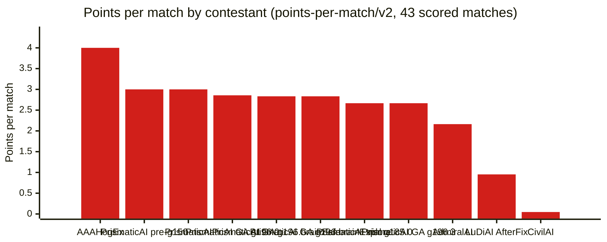
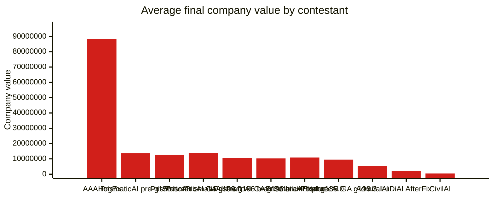
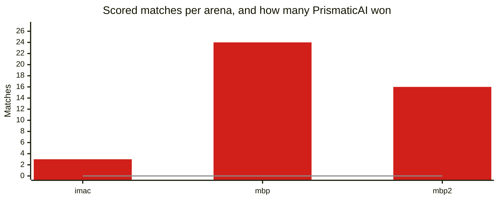

# battle-20261120T225615-bf3d1c36

Derived from `battle-20261120T225615-bf3d1c36.json` by `tools/research/ai-battle/battle.py report`; do not edit.

- Edition `bf3d1c3601f75bdc`: PrismaticAI and referee at `962699034c20d90baeb9f617789ea6558cc6ff52`, base set `opengfx-8.0.tar`
- 20-year free-for-all from 1960, map 256x256 temperate, breakdowns 1
- 43 scored match(es) on `imac` (20261119-master-gdf1e05e7d8), `mbp` (20261120-master-m17653b726e), `mbp2` (20261119-master-gdf1e05e7d8)
- Replays: 0 of 1 identical to their original on another arena

| # | Contestant | Played | Wins | Points | Points/match | Avg rank | Avg final value | Squirrel errors | Matches with anomalies |
|---|---|---|---|---|---|---|---|---|---|
| 1 | AAAHogEx | 43 | 43 | 172 | 4.0 | 1.0 | 88.4 M | 0 | 0 |
| 2 | PrismaticAI pre-g150 | 7 | 0 | 21 | 3.0 | 2.0 | 13.7 M | 0 | 1 |
| 3 | PrismaticAI | 5 | 0 | 15 | 3.0 | 2.0 | 12.7 M | 0 | 0 |
| 4 | PrismaticAI GA g196.0 | 7 | 0 | 20 | 2.857 | 2.14 | 14.0 M | 0 | 2 |
| 5 | PrismaticAI GA g196.brainSafe | 6 | 0 | 17 | 2.833 | 2.17 | 10.7 M | 0 | 0 |
| 6 | PrismaticAI GA g196.brainExplore | 6 | 0 | 17 | 2.833 | 2.17 | 10.3 M | 0 | 0 |
| 7 | PrismaticAI trial g185.0 | 6 | 0 | 16 | 2.667 | 2.33 | 10.9 M | 0 | 1 |
| 8 | PrismaticAI GA g196.3 | 6 | 0 | 16 | 2.667 | 2.33 | 9.5 M | 0 | 0 |
| 9 | AdmiralAI | 43 | 0 | 93 | 2.163 | 2.84 | 5.3 M | 0 | 5 |
| 10 | LuDiAI AfterFix | 43 | 0 | 41 | 0.953 | 4.05 | 1.9 M | 0 | 4 |
| 11 | CivilAI | 43 | 0 | 2 | 0.047 | 4.95 | 450.4 k | 0 | 6 |

```mermaid
---
config:
  xyChart:
    width: 900
    height: 360
  themeVariables:
    xyChart:
      plotColorPalette: "#d11f1a, #8a8a8a, #0b0b0b, #ece4d6"
---
xychart-beta
    title "Final company value per scored match: winner vs best PrismaticAI"
    x-axis ["m-0001", "m-0002", "m-0003", "m-0004", "m-0005", "m-0006", "m-0007", "m-0008", "m-0009", "m-0010", "m-0011", "m-0012", "m-0013", "m-0014", "m-0015", "m-0016", "m-0017", "m-0018", "m-0019", "m-0020", "m-0021", "m-0022", "m-0023", "m-0024", "m-0025", "m-0026", "m-0027", "m-0028", "m-0036", "m-0037", "m-0038", "m-0039", "m-0040", "m-0041", "m-0042", "m-0043", "m-0044", "m-0045", "m-0052", "m-0053", "m-0054", "m-0055", "m-0057"]
    %% series: Winner | Best PrismaticAI
    %% links: battle-20261120T225615-bf3d1c36.md?col=Match&filter=m-0001 | battle-20261120T225615-bf3d1c36.md?col=Match&filter=m-0002 | battle-20261120T225615-bf3d1c36.md?col=Match&filter=m-0003 | battle-20261120T225615-bf3d1c36.md?col=Match&filter=m-0004 | battle-20261120T225615-bf3d1c36.md?col=Match&filter=m-0005 | battle-20261120T225615-bf3d1c36.md?col=Match&filter=m-0006 | battle-20261120T225615-bf3d1c36.md?col=Match&filter=m-0007 | battle-20261120T225615-bf3d1c36.md?col=Match&filter=m-0008 | battle-20261120T225615-bf3d1c36.md?col=Match&filter=m-0009 | battle-20261120T225615-bf3d1c36.md?col=Match&filter=m-0010 | battle-20261120T225615-bf3d1c36.md?col=Match&filter=m-0011 | battle-20261120T225615-bf3d1c36.md?col=Match&filter=m-0012 | battle-20261120T225615-bf3d1c36.md?col=Match&filter=m-0013 | battle-20261120T225615-bf3d1c36.md?col=Match&filter=m-0014 | battle-20261120T225615-bf3d1c36.md?col=Match&filter=m-0015 | battle-20261120T225615-bf3d1c36.md?col=Match&filter=m-0016 | battle-20261120T225615-bf3d1c36.md?col=Match&filter=m-0017 | battle-20261120T225615-bf3d1c36.md?col=Match&filter=m-0018 | battle-20261120T225615-bf3d1c36.md?col=Match&filter=m-0019 | battle-20261120T225615-bf3d1c36.md?col=Match&filter=m-0020 | battle-20261120T225615-bf3d1c36.md?col=Match&filter=m-0021 | battle-20261120T225615-bf3d1c36.md?col=Match&filter=m-0022 | battle-20261120T225615-bf3d1c36.md?col=Match&filter=m-0023 | battle-20261120T225615-bf3d1c36.md?col=Match&filter=m-0024 | battle-20261120T225615-bf3d1c36.md?col=Match&filter=m-0025 | battle-20261120T225615-bf3d1c36.md?col=Match&filter=m-0026 | battle-20261120T225615-bf3d1c36.md?col=Match&filter=m-0027 | battle-20261120T225615-bf3d1c36.md?col=Match&filter=m-0028 | battle-20261120T225615-bf3d1c36.md?col=Match&filter=m-0036 | battle-20261120T225615-bf3d1c36.md?col=Match&filter=m-0037 | battle-20261120T225615-bf3d1c36.md?col=Match&filter=m-0038 | battle-20261120T225615-bf3d1c36.md?col=Match&filter=m-0039 | battle-20261120T225615-bf3d1c36.md?col=Match&filter=m-0040 | battle-20261120T225615-bf3d1c36.md?col=Match&filter=m-0041 | battle-20261120T225615-bf3d1c36.md?col=Match&filter=m-0042 | battle-20261120T225615-bf3d1c36.md?col=Match&filter=m-0043 | battle-20261120T225615-bf3d1c36.md?col=Match&filter=m-0044 | battle-20261120T225615-bf3d1c36.md?col=Match&filter=m-0045 | battle-20261120T225615-bf3d1c36.md?col=Match&filter=m-0052 | battle-20261120T225615-bf3d1c36.md?col=Match&filter=m-0053 | battle-20261120T225615-bf3d1c36.md?col=Match&filter=m-0054 | battle-20261120T225615-bf3d1c36.md?col=Match&filter=m-0055 | battle-20261120T225615-bf3d1c36.md?col=Match&filter=m-0057
    y-axis "Company value" 0 --> 143000000
    bar [60546170, 79891541, 51759815, 77585536, 67243696, 77973424, 94923950, 82005886, 81176012, 104379217, 60184042, 70210176, 129611377, 69459000, 76298069, 73279857, 80015052, 83023681, 95219000, 74633488, 109397556, 111294486, 93132763, 106292365, 118677790, 119859146, 85924009, 94118432, 114805225, 126078669, 111251397, 101335575, 99872156, 94157488, 94779330, 67587577, 70444357, 54681317, 94346329, 79904296, 113337120, 79202703, 69669379]
    line [8797745, 3933074, 7083308, 7762597, 6911178, 4868351, 12570657, 9427506, 7737831, 12676029, 11258198, 7653760, 5723445, 12580830, 15750037, 18387279, 20567759, 9449824, 12249753, 17322435, 10700883, 13007193, 6901718, 12257519, 9273926, 6392966, 4595891, 18902981, 23512651, 19990701, 23359122, 18382673, 19870515, 16037001, 8655903, 7395772, 8324227, 9938162, 11868440, 7793459, 8638850, 8649107, 18354485]
```

<!-- battle-charts:begin -->
<!-- derived from battle-20261120T225615-bf3d1c36.json by `battle.py render`; `battle.py check` fails when it is stale -->

<!-- battle-charts:end -->

| Seed | Original | Replay | Arenas | Identical |
|---|---|---|---|---|
| 1689619572 | m-0011 | m-0056 | imac / mbp | NO |

| Match | Arena | Seed | Winner | Value | Last | Anomalies |
|---|---|---|---|---|---|---|
| m-0001 | mbp | 988814206 | AAAHogEx | 60.5 M | CivilAI | - |
| m-0002 | mbp | 988814206 | AAAHogEx | 79.9 M | CivilAI | PrismaticAI trial g185.0: fleet_drop:79->44 |
| m-0003 | mbp | 988814206 | AAAHogEx | 51.8 M | CivilAI | - |
| m-0004 | mbp | 988814206 | AAAHogEx | 77.6 M | CivilAI | - |
| m-0005 | mbp | 988814206 | AAAHogEx | 67.2 M | CivilAI | - |
| m-0006 | mbp | 988814206 | AAAHogEx | 78.0 M | CivilAI | - |
| m-0007 | mbp | 1689619572 | AAAHogEx | 94.9 M | CivilAI | CivilAI: no_vehicles |
| m-0008 | mbp | 1689619572 | AAAHogEx | 82.0 M | CivilAI | LuDiAI AfterFix: fleet_drop:115->72 |
| m-0009 | mbp | 1689619572 | AAAHogEx | 81.2 M | CivilAI | - |
| m-0010 | imac | 1689619572 | AAAHogEx | 104.4 M | CivilAI | - |
| m-0011 | imac | 1689619572 | AAAHogEx | 60.2 M | CivilAI | - |
| m-0012 | imac | 1689619572 | AAAHogEx | 70.2 M | CivilAI | - |
| m-0013 | mbp2 | 1689619572 | AAAHogEx | 129.6 M | CivilAI | AdmiralAI: fleet_drop:164->90; LuDiAI AfterFix: fleet_drop:56->36 |
| m-0014 | mbp2 | 1042008759 | AAAHogEx | 69.5 M | CivilAI | CivilAI: fleet_drop:21->12 |
| m-0015 | mbp2 | 1042008759 | AAAHogEx | 76.3 M | CivilAI | CivilAI: fleet_drop:38->13 |
| m-0016 | mbp2 | 1042008759 | AAAHogEx | 73.3 M | CivilAI | CivilAI: fleet_drop:28->6 |
| m-0017 | mbp2 | 1042008759 | AAAHogEx | 80.0 M | CivilAI | - |
| m-0018 | mbp2 | 1042008759 | AAAHogEx | 83.0 M | CivilAI | - |
| m-0019 | mbp2 | 1042008759 | AAAHogEx | 95.2 M | CivilAI | - |
| m-0020 | mbp2 | 1042008759 | AAAHogEx | 74.6 M | CivilAI | - |
| m-0021 | mbp2 | 1016284461 | AAAHogEx | 109.4 M | CivilAI | - |
| m-0022 | mbp2 | 1016284461 | AAAHogEx | 111.3 M | CivilAI | - |
| m-0023 | mbp2 | 1016284461 | AAAHogEx | 93.1 M | CivilAI | - |
| m-0024 | mbp2 | 1016284461 | AAAHogEx | 106.3 M | CivilAI | AdmiralAI: fleet_drop:258->176 |
| m-0025 | mbp2 | 1016284461 | AAAHogEx | 118.7 M | CivilAI | - |
| m-0026 | mbp2 | 1016284461 | AAAHogEx | 119.9 M | CivilAI | LuDiAI AfterFix: fleet_drop:123->74 |
| m-0027 | mbp2 | 1016284461 | AAAHogEx | 85.9 M | CivilAI | - |
| m-0028 | mbp2 | 1132377291 | AAAHogEx | 94.1 M | CivilAI | - |
| m-0036 | mbp | 1802362207 | AAAHogEx | 114.8 M | CivilAI | PrismaticAI pre-g150: fleet_drop:94->46; AdmiralAI: fleet_drop:366->235 |
| m-0037 | mbp | 1802362207 | AAAHogEx | 126.1 M | CivilAI | - |
| m-0038 | mbp | 1802362207 | AAAHogEx | 111.3 M | CivilAI | - |
| m-0039 | mbp | 1802362207 | AAAHogEx | 101.3 M | CivilAI | - |
| m-0040 | mbp | 1802362207 | AAAHogEx | 99.9 M | CivilAI | AdmiralAI: fleet_drop:263->182 |
| m-0041 | mbp | 1802362207 | AAAHogEx | 94.2 M | LuDiAI AfterFix | - |
| m-0042 | mbp | 1386956288 | AAAHogEx | 94.8 M | CivilAI | - |
| m-0043 | mbp | 1386956288 | AAAHogEx | 67.6 M | CivilAI | - |
| m-0044 | mbp | 1386956288 | AAAHogEx | 70.4 M | CivilAI | AdmiralAI: fleet_drop:264->181; CivilAI: fleet_drop:58->22 |
| m-0045 | mbp | 1386956288 | AAAHogEx | 54.7 M | CivilAI | PrismaticAI GA g196.0: fleet_drop:135->54 |
| m-0052 | mbp | 695780083 | AAAHogEx | 94.3 M | CivilAI | PrismaticAI GA g196.0: fleet_drop:109->73 |
| m-0053 | mbp | 695780083 | AAAHogEx | 79.9 M | CivilAI | - |
| m-0054 | mbp | 695780083 | AAAHogEx | 113.3 M | CivilAI | CivilAI: fleet_drop:18->9 |
| m-0055 | mbp | 695780083 | AAAHogEx | 79.2 M | LuDiAI AfterFix | - |
| m-0056 (replay) | mbp | 1689619572 | AAAHogEx | 64.9 M | CivilAI | - |
| m-0057 | mbp | 1601070842 | AAAHogEx | 69.7 M | CivilAI | LuDiAI AfterFix: fleet_drop:28->15 |
