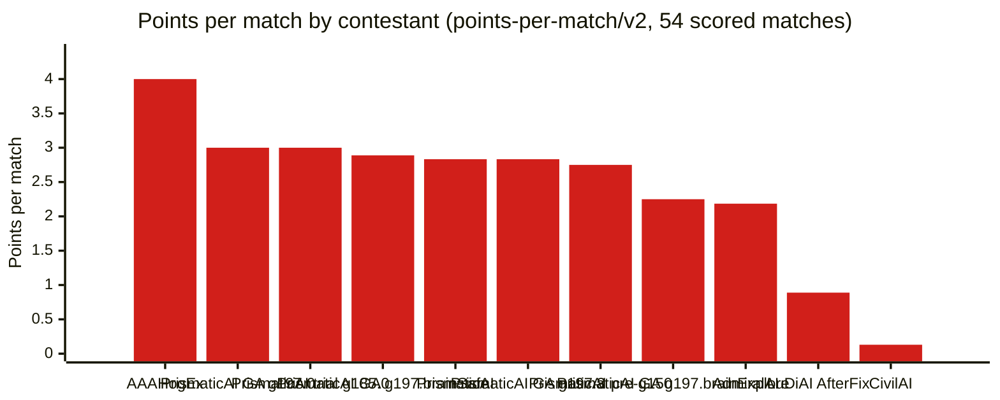
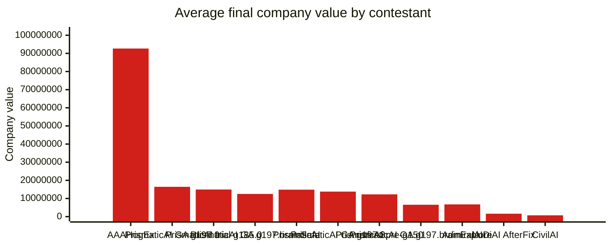
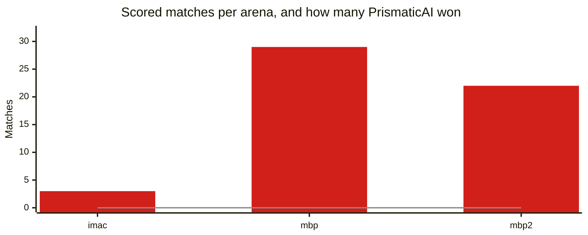

# battle-20261120T230920-9f0adfaf

Derived from `battle-20261120T230920-9f0adfaf.json` by `tools/research/ai-battle/battle.py report`; do not edit.

- Edition `9f0adfafd2b68e68`: PrismaticAI and referee at `962699034c20d90baeb9f617789ea6558cc6ff52`, base set `opengfx-8.0.tar`
- 20-year free-for-all from 1960, map 256x256 temperate, breakdowns 1
- 54 scored match(es) on `imac` (20261119-master-gdf1e05e7d8), `mbp` (20261120-master-m17653b726e), `mbp2` (20261119-master-gdf1e05e7d8)
- Replays: 2 of 3 identical to their original on another arena

| # | Contestant | Played | Wins | Points | Points/match | Avg rank | Avg final value | Squirrel errors | Matches with anomalies |
|---|---|---|---|---|---|---|---|---|---|
| 1 | AAAHogEx | 54 | 54 | 216 | 4.0 | 1.0 | 92.7 M | 0 | 0 |
| 2 | PrismaticAI GA g197.0 | 9 | 0 | 27 | 3.0 | 2.0 | 16.4 M | 0 | 3 |
| 3 | PrismaticAI trial g185.0 | 8 | 0 | 24 | 3.0 | 2.0 | 14.9 M | 0 | 3 |
| 4 | PrismaticAI GA g197.brainSafe | 9 | 0 | 26 | 2.889 | 2.11 | 12.5 M | 0 | 0 |
| 5 | PrismaticAI | 6 | 0 | 17 | 2.833 | 2.17 | 14.8 M | 0 | 0 |
| 6 | PrismaticAI GA g197.3 | 6 | 0 | 17 | 2.833 | 2.17 | 13.8 M | 0 | 0 |
| 7 | PrismaticAI pre-g150 | 8 | 0 | 22 | 2.75 | 2.25 | 12.3 M | 0 | 3 |
| 8 | PrismaticAI GA g197.brainExplore | 8 | 0 | 18 | 2.25 | 2.75 | 6.5 M | 0 | 2 |
| 9 | AdmiralAI | 54 | 0 | 118 | 2.185 | 2.81 | 6.7 M | 0 | 2 |
| 10 | LuDiAI AfterFix | 54 | 0 | 48 | 0.889 | 4.11 | 1.6 M | 0 | 1 |
| 11 | CivilAI | 54 | 0 | 7 | 0.13 | 4.87 | 712.4 k | 0 | 8 |

```mermaid
---
config:
  xyChart:
    width: 900
    height: 360
  themeVariables:
    xyChart:
      plotColorPalette: "#d11f1a, #8a8a8a, #0b0b0b, #ece4d6"
---
xychart-beta
    title "Final company value per scored match: winner vs best PrismaticAI"
    x-axis ["m-0001", "m-0002", "m-0003", "m-0004", "m-0005", "m-0006", "m-0007", "m-0008", "m-0009", "m-0010", "m-0011", "m-0012", "m-0013", "m-0014", "m-0015", "m-0016", "m-0017", "m-0018", "m-0019", "m-0020", "m-0021", "m-0022", "m-0023", "m-0024", "m-0025", "m-0026", "m-0027", "m-0028", "m-0036", "m-0037", "m-0038", "m-0039", "m-0040", "m-0041", "m-0042", "m-0043", "m-0044", "m-0045", "m-0046", "m-0047", "m-0049", "m-0050", "m-0051", "m-0052", "m-0053", "m-0055", "m-0057", "m-0058", "m-0059", "m-0060", "m-0061", "m-0073", "m-0074", "m-0075"]
    %% series: Winner | Best PrismaticAI
    %% links: battle-20261120T230920-9f0adfaf.md?col=Match&filter=m-0001 | battle-20261120T230920-9f0adfaf.md?col=Match&filter=m-0002 | battle-20261120T230920-9f0adfaf.md?col=Match&filter=m-0003 | battle-20261120T230920-9f0adfaf.md?col=Match&filter=m-0004 | battle-20261120T230920-9f0adfaf.md?col=Match&filter=m-0005 | battle-20261120T230920-9f0adfaf.md?col=Match&filter=m-0006 | battle-20261120T230920-9f0adfaf.md?col=Match&filter=m-0007 | battle-20261120T230920-9f0adfaf.md?col=Match&filter=m-0008 | battle-20261120T230920-9f0adfaf.md?col=Match&filter=m-0009 | battle-20261120T230920-9f0adfaf.md?col=Match&filter=m-0010 | battle-20261120T230920-9f0adfaf.md?col=Match&filter=m-0011 | battle-20261120T230920-9f0adfaf.md?col=Match&filter=m-0012 | battle-20261120T230920-9f0adfaf.md?col=Match&filter=m-0013 | battle-20261120T230920-9f0adfaf.md?col=Match&filter=m-0014 | battle-20261120T230920-9f0adfaf.md?col=Match&filter=m-0015 | battle-20261120T230920-9f0adfaf.md?col=Match&filter=m-0016 | battle-20261120T230920-9f0adfaf.md?col=Match&filter=m-0017 | battle-20261120T230920-9f0adfaf.md?col=Match&filter=m-0018 | battle-20261120T230920-9f0adfaf.md?col=Match&filter=m-0019 | battle-20261120T230920-9f0adfaf.md?col=Match&filter=m-0020 | battle-20261120T230920-9f0adfaf.md?col=Match&filter=m-0021 | battle-20261120T230920-9f0adfaf.md?col=Match&filter=m-0022 | battle-20261120T230920-9f0adfaf.md?col=Match&filter=m-0023 | battle-20261120T230920-9f0adfaf.md?col=Match&filter=m-0024 | battle-20261120T230920-9f0adfaf.md?col=Match&filter=m-0025 | battle-20261120T230920-9f0adfaf.md?col=Match&filter=m-0026 | battle-20261120T230920-9f0adfaf.md?col=Match&filter=m-0027 | battle-20261120T230920-9f0adfaf.md?col=Match&filter=m-0028 | battle-20261120T230920-9f0adfaf.md?col=Match&filter=m-0036 | battle-20261120T230920-9f0adfaf.md?col=Match&filter=m-0037 | battle-20261120T230920-9f0adfaf.md?col=Match&filter=m-0038 | battle-20261120T230920-9f0adfaf.md?col=Match&filter=m-0039 | battle-20261120T230920-9f0adfaf.md?col=Match&filter=m-0040 | battle-20261120T230920-9f0adfaf.md?col=Match&filter=m-0041 | battle-20261120T230920-9f0adfaf.md?col=Match&filter=m-0042 | battle-20261120T230920-9f0adfaf.md?col=Match&filter=m-0043 | battle-20261120T230920-9f0adfaf.md?col=Match&filter=m-0044 | battle-20261120T230920-9f0adfaf.md?col=Match&filter=m-0045 | battle-20261120T230920-9f0adfaf.md?col=Match&filter=m-0046 | battle-20261120T230920-9f0adfaf.md?col=Match&filter=m-0047 | battle-20261120T230920-9f0adfaf.md?col=Match&filter=m-0049 | battle-20261120T230920-9f0adfaf.md?col=Match&filter=m-0050 | battle-20261120T230920-9f0adfaf.md?col=Match&filter=m-0051 | battle-20261120T230920-9f0adfaf.md?col=Match&filter=m-0052 | battle-20261120T230920-9f0adfaf.md?col=Match&filter=m-0053 | battle-20261120T230920-9f0adfaf.md?col=Match&filter=m-0055 | battle-20261120T230920-9f0adfaf.md?col=Match&filter=m-0057 | battle-20261120T230920-9f0adfaf.md?col=Match&filter=m-0058 | battle-20261120T230920-9f0adfaf.md?col=Match&filter=m-0059 | battle-20261120T230920-9f0adfaf.md?col=Match&filter=m-0060 | battle-20261120T230920-9f0adfaf.md?col=Match&filter=m-0061 | battle-20261120T230920-9f0adfaf.md?col=Match&filter=m-0073 | battle-20261120T230920-9f0adfaf.md?col=Match&filter=m-0074 | battle-20261120T230920-9f0adfaf.md?col=Match&filter=m-0075
    y-axis "Company value" 0 --> 193000000
    bar [82072238, 81713240, 89609384, 95448649, 95021278, 92094472, 107734496, 92521631, 83753718, 92633145, 107832338, 93347151, 87656555, 61848808, 65381476, 64642479, 89699970, 62131891, 62203484, 81177844, 62249099, 61848492, 73151121, 66201422, 68457713, 73290753, 95029111, 86853880, 115570752, 102351269, 78008646, 73589307, 98827564, 88182438, 143755539, 142490480, 133280388, 175503058, 141452535, 150281784, 89909500, 90191943, 74592037, 92951232, 103479029, 84095474, 77193287, 71232824, 84446433, 101251826, 82579538, 113076156, 125453920, 94721716]
    line [14023955, 19589655, 20418960, 10063332, 4878111, 15578296, 10528456, 15798238, 15793104, 17961408, 11934145, 4631600, 12195126, 17971302, 21887557, 13722634, 14424074, 7636831, 12386287, 15731900, 10801316, 9232244, 12059561, 5413680, 5815389, 1469759, 12247322, 23272986, 8413417, 12936990, 15141699, 16796991, 3707269, 8271664, 12025095, 4081761, 14626966, 17160156, 20360859, 2553174, 14487434, 13626602, 17058178, 21083493, 12159151, 18688911, 11080684, 13775771, 14844141, 12846981, 4848705, 21451273, 14909517, 17862403]
```

<!-- battle-charts:begin -->
<!-- derived from battle-20261120T230920-9f0adfaf.json by `battle.py render`; `battle.py check` fails when it is stale -->

<!-- battle-charts:end -->

| Seed | Original | Replay | Arenas | Identical |
|---|---|---|---|---|
| 762288839 | m-0014 | m-0048 | mbp2 / mbp | yes |
| 39349870 | m-0001 | m-0056 | mbp / mbp2 | yes |
| 1200874732 | m-0011 | m-0072 | imac / mbp | NO |

| Match | Arena | Seed | Winner | Value | Last | Anomalies |
|---|---|---|---|---|---|---|
| m-0001 | mbp | 39349870 | AAAHogEx | 82.1 M | CivilAI | - |
| m-0002 | mbp | 39349870 | AAAHogEx | 81.7 M | CivilAI | PrismaticAI trial g185.0: fleet_drop:93->60; CivilAI: fleet_drop:50->25 |
| m-0003 | mbp | 39349870 | AAAHogEx | 89.6 M | CivilAI | - |
| m-0004 | mbp | 39349870 | AAAHogEx | 95.4 M | CivilAI | - |
| m-0005 | mbp | 39349870 | AAAHogEx | 95.0 M | LuDiAI AfterFix | - |
| m-0006 | mbp | 39349870 | AAAHogEx | 92.1 M | CivilAI | CivilAI: fleet_drop:59->28 |
| m-0007 | mbp | 1200874732 | AAAHogEx | 107.7 M | CivilAI | - |
| m-0008 | mbp | 1200874732 | AAAHogEx | 92.5 M | CivilAI | PrismaticAI pre-g150: fleet_drop:105->67 |
| m-0009 | mbp | 1200874732 | AAAHogEx | 83.8 M | CivilAI | - |
| m-0010 | imac | 1200874732 | AAAHogEx | 92.6 M | CivilAI | PrismaticAI GA g197.0: fleet_drop:100->62 |
| m-0011 | imac | 1200874732 | AAAHogEx | 107.8 M | CivilAI | - |
| m-0012 | imac | 1200874732 | AAAHogEx | 93.3 M | CivilAI | - |
| m-0013 | mbp2 | 1200874732 | AAAHogEx | 87.7 M | CivilAI | - |
| m-0014 | mbp2 | 762288839 | AAAHogEx | 61.8 M | CivilAI | CivilAI: fleet_drop:40->24 |
| m-0015 | mbp2 | 762288839 | AAAHogEx | 65.4 M | LuDiAI AfterFix | - |
| m-0016 | mbp2 | 762288839 | AAAHogEx | 64.6 M | CivilAI | - |
| m-0017 | mbp2 | 762288839 | AAAHogEx | 89.7 M | LuDiAI AfterFix | AdmiralAI: fleet_drop:231->156 |
| m-0018 | mbp2 | 762288839 | AAAHogEx | 62.1 M | CivilAI | CivilAI: fleet_drop:28->14 |
| m-0019 | mbp2 | 762288839 | AAAHogEx | 62.2 M | CivilAI | AdmiralAI: fleet_drop:305->188; CivilAI: fleet_drop:42->12 |
| m-0020 | mbp2 | 762288839 | AAAHogEx | 81.2 M | CivilAI | - |
| m-0021 | mbp2 | 609803706 | AAAHogEx | 62.2 M | CivilAI | - |
| m-0022 | mbp2 | 609803706 | AAAHogEx | 61.8 M | CivilAI | - |
| m-0023 | mbp2 | 609803706 | AAAHogEx | 73.2 M | CivilAI | - |
| m-0024 | mbp2 | 609803706 | AAAHogEx | 66.2 M | LuDiAI AfterFix | LuDiAI AfterFix: fleet_drop:31->16 |
| m-0025 | mbp2 | 609803706 | AAAHogEx | 68.5 M | CivilAI | - |
| m-0026 | mbp2 | 609803706 | AAAHogEx | 73.3 M | CivilAI | - |
| m-0027 | mbp2 | 609803706 | AAAHogEx | 95.0 M | CivilAI | - |
| m-0028 | mbp2 | 66421230 | AAAHogEx | 86.9 M | CivilAI | - |
| m-0036 | mbp | 262764521 | AAAHogEx | 115.6 M | CivilAI | - |
| m-0037 | mbp | 262764521 | AAAHogEx | 102.4 M | CivilAI | - |
| m-0038 | mbp | 262764521 | AAAHogEx | 78.0 M | CivilAI | - |
| m-0039 | mbp | 262764521 | AAAHogEx | 73.6 M | CivilAI | - |
| m-0040 | mbp | 262764521 | AAAHogEx | 98.8 M | CivilAI | PrismaticAI GA g197.brainExplore: fleet_drop:72->47 |
| m-0041 | mbp | 262764521 | AAAHogEx | 88.2 M | CivilAI | - |
| m-0042 | mbp | 1938461617 | AAAHogEx | 143.8 M | CivilAI | - |
| m-0043 | mbp | 1938461617 | AAAHogEx | 142.5 M | CivilAI | PrismaticAI pre-g150: fleet_drop:60->37 |
| m-0044 | mbp | 1938461617 | AAAHogEx | 133.3 M | CivilAI | PrismaticAI trial g185.0: fleet_drop:126->79 |
| m-0045 | mbp | 1938461617 | AAAHogEx | 175.5 M | CivilAI | PrismaticAI GA g197.0: fleet_drop:122->74 |
| m-0046 | mbp | 1938461617 | AAAHogEx | 141.5 M | CivilAI | - |
| m-0047 | mbp | 1938461617 | AAAHogEx | 150.3 M | CivilAI | - |
| m-0048 (replay) | mbp | 762288839 | AAAHogEx | 61.8 M | CivilAI | CivilAI: fleet_drop:40->24 |
| m-0049 | mbp2 | 1240403096 | AAAHogEx | 89.9 M | LuDiAI AfterFix | - |
| m-0050 | mbp2 | 1240403096 | AAAHogEx | 90.2 M | CivilAI | PrismaticAI pre-g150: fleet_drop:106->69 |
| m-0051 | mbp2 | 1240403096 | AAAHogEx | 74.6 M | CivilAI | PrismaticAI trial g185.0: fleet_drop:110->46 |
| m-0052 | mbp2 | 1240403096 | AAAHogEx | 93.0 M | CivilAI | - |
| m-0053 | mbp2 | 1240403096 | AAAHogEx | 103.5 M | CivilAI | - |
| m-0055 | mbp2 | 1240403096 | AAAHogEx | 84.1 M | CivilAI | - |
| m-0056 (replay) | mbp2 | 39349870 | AAAHogEx | 82.1 M | CivilAI | - |
| m-0057 | mbp | 842399474 | AAAHogEx | 77.2 M | CivilAI | CivilAI: fleet_drop:14->7 |
| m-0058 | mbp | 842399474 | AAAHogEx | 71.2 M | CivilAI | - |
| m-0059 | mbp | 842399474 | AAAHogEx | 84.4 M | CivilAI | PrismaticAI GA g197.0: fleet_drop:95->58; CivilAI: fleet_drop:15->9 |
| m-0060 | mbp | 842399474 | AAAHogEx | 101.3 M | LuDiAI AfterFix | CivilAI: no_vehicles |
| m-0061 | mbp | 842399474 | AAAHogEx | 82.6 M | CivilAI | - |
| m-0072 (replay) | mbp | 1200874732 | AAAHogEx | 94.6 M | CivilAI | - |
| m-0073 | mbp | 1202423851 | AAAHogEx | 113.1 M | CivilAI | - |
| m-0074 | mbp | 1202423851 | AAAHogEx | 125.5 M | CivilAI | - |
| m-0075 | mbp | 1202423851 | AAAHogEx | 94.7 M | LuDiAI AfterFix | PrismaticAI GA g197.brainExplore: fleet_drop:181->77 |
