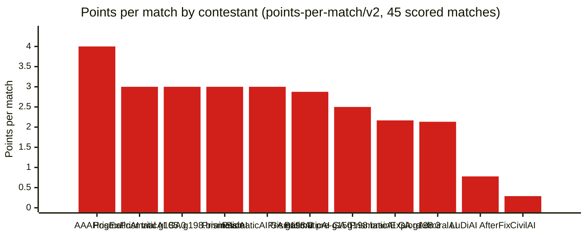
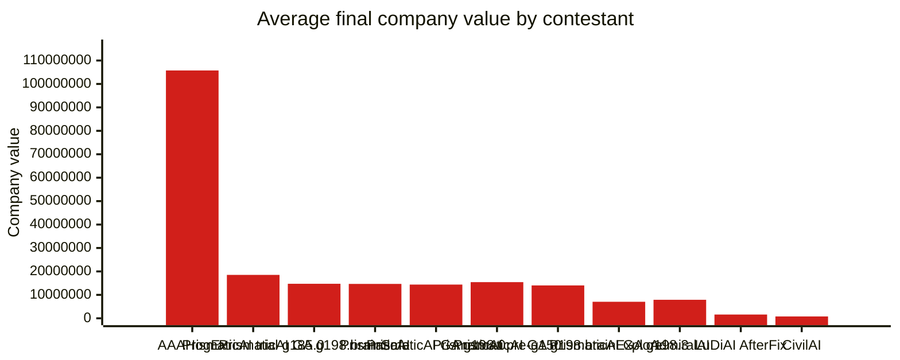
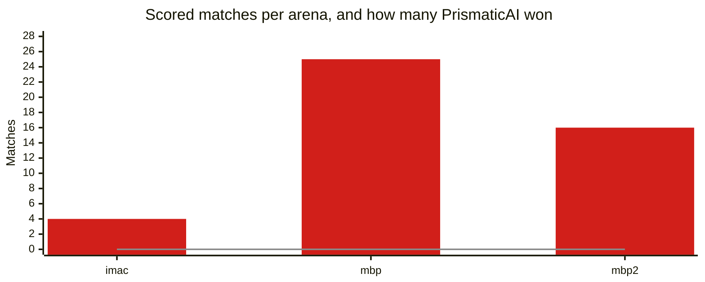

# battle-20261120T232041-46cc513f

Derived from `battle-20261120T232041-46cc513f.json` by `tools/research/ai-battle/battle.py report`; do not edit.

- Edition `46cc513f6004c857`: PrismaticAI and referee at `962699034c20d90baeb9f617789ea6558cc6ff52`, base set `opengfx-8.0.tar`
- 20-year free-for-all from 1960, map 256x256 temperate, breakdowns 1
- 45 scored match(es) on `imac` (20261119-master-gdf1e05e7d8), `mbp` (20261120-master-m17653b726e), `mbp2` (20261119-master-gdf1e05e7d8)
- Replays: 0 of 2 identical to their original on another arena

| # | Contestant | Played | Wins | Points | Points/match | Avg rank | Avg final value | Squirrel errors | Matches with anomalies |
|---|---|---|---|---|---|---|---|---|---|
| 1 | AAAHogEx | 45 | 45 | 180 | 4.0 | 1.0 | 105.8 M | 0 | 0 |
| 2 | PrismaticAI trial g185.0 | 7 | 0 | 21 | 3.0 | 2.0 | 18.5 M | 0 | 0 |
| 3 | PrismaticAI GA g198.brainSafe | 6 | 0 | 18 | 3.0 | 2.0 | 14.7 M | 0 | 0 |
| 4 | PrismaticAI | 6 | 0 | 18 | 3.0 | 2.0 | 14.7 M | 0 | 0 |
| 5 | PrismaticAI GA g198.0 | 6 | 0 | 18 | 3.0 | 2.0 | 14.4 M | 0 | 2 |
| 6 | PrismaticAI pre-g150 | 8 | 0 | 23 | 2.875 | 2.12 | 15.4 M | 0 | 1 |
| 7 | PrismaticAI GA g198.brainExplore | 6 | 0 | 15 | 2.5 | 2.5 | 14.0 M | 0 | 0 |
| 8 | PrismaticAI GA g198.3 | 6 | 0 | 13 | 2.167 | 2.83 | 7.0 M | 0 | 0 |
| 9 | AdmiralAI | 45 | 0 | 96 | 2.133 | 2.87 | 7.9 M | 116 | 4 |
| 10 | LuDiAI AfterFix | 45 | 0 | 35 | 0.778 | 4.22 | 1.6 M | 0 | 1 |
| 11 | CivilAI | 45 | 0 | 13 | 0.289 | 4.71 | 785.0 k | 3925 | 10 |

```mermaid
---
config:
  xyChart:
    width: 900
    height: 360
  themeVariables:
    xyChart:
      plotColorPalette: "#d11f1a, #8a8a8a, #0b0b0b, #ece4d6"
---
xychart-beta
    title "Final company value per scored match: winner vs best PrismaticAI"
    x-axis ["m-0001", "m-0002", "m-0003", "m-0004", "m-0005", "m-0006", "m-0007", "m-0008", "m-0009", "m-0010", "m-0011", "m-0012", "m-0013", "m-0014", "m-0015", "m-0016", "m-0017", "m-0018", "m-0019", "m-0020", "m-0021", "m-0022", "m-0023", "m-0024", "m-0025", "m-0026", "m-0027", "m-0028", "m-0036", "m-0037", "m-0038", "m-0039", "m-0040", "m-0041", "m-0042", "m-0043", "m-0044", "m-0045", "m-0046", "m-0047", "m-0049", "m-0050", "m-0051", "m-0055", "m-0057"]
    %% series: Winner | Best PrismaticAI
    %% links: battle-20261120T232041-46cc513f.md?col=Match&filter=m-0001 | battle-20261120T232041-46cc513f.md?col=Match&filter=m-0002 | battle-20261120T232041-46cc513f.md?col=Match&filter=m-0003 | battle-20261120T232041-46cc513f.md?col=Match&filter=m-0004 | battle-20261120T232041-46cc513f.md?col=Match&filter=m-0005 | battle-20261120T232041-46cc513f.md?col=Match&filter=m-0006 | battle-20261120T232041-46cc513f.md?col=Match&filter=m-0007 | battle-20261120T232041-46cc513f.md?col=Match&filter=m-0008 | battle-20261120T232041-46cc513f.md?col=Match&filter=m-0009 | battle-20261120T232041-46cc513f.md?col=Match&filter=m-0010 | battle-20261120T232041-46cc513f.md?col=Match&filter=m-0011 | battle-20261120T232041-46cc513f.md?col=Match&filter=m-0012 | battle-20261120T232041-46cc513f.md?col=Match&filter=m-0013 | battle-20261120T232041-46cc513f.md?col=Match&filter=m-0014 | battle-20261120T232041-46cc513f.md?col=Match&filter=m-0015 | battle-20261120T232041-46cc513f.md?col=Match&filter=m-0016 | battle-20261120T232041-46cc513f.md?col=Match&filter=m-0017 | battle-20261120T232041-46cc513f.md?col=Match&filter=m-0018 | battle-20261120T232041-46cc513f.md?col=Match&filter=m-0019 | battle-20261120T232041-46cc513f.md?col=Match&filter=m-0020 | battle-20261120T232041-46cc513f.md?col=Match&filter=m-0021 | battle-20261120T232041-46cc513f.md?col=Match&filter=m-0022 | battle-20261120T232041-46cc513f.md?col=Match&filter=m-0023 | battle-20261120T232041-46cc513f.md?col=Match&filter=m-0024 | battle-20261120T232041-46cc513f.md?col=Match&filter=m-0025 | battle-20261120T232041-46cc513f.md?col=Match&filter=m-0026 | battle-20261120T232041-46cc513f.md?col=Match&filter=m-0027 | battle-20261120T232041-46cc513f.md?col=Match&filter=m-0028 | battle-20261120T232041-46cc513f.md?col=Match&filter=m-0036 | battle-20261120T232041-46cc513f.md?col=Match&filter=m-0037 | battle-20261120T232041-46cc513f.md?col=Match&filter=m-0038 | battle-20261120T232041-46cc513f.md?col=Match&filter=m-0039 | battle-20261120T232041-46cc513f.md?col=Match&filter=m-0040 | battle-20261120T232041-46cc513f.md?col=Match&filter=m-0041 | battle-20261120T232041-46cc513f.md?col=Match&filter=m-0042 | battle-20261120T232041-46cc513f.md?col=Match&filter=m-0043 | battle-20261120T232041-46cc513f.md?col=Match&filter=m-0044 | battle-20261120T232041-46cc513f.md?col=Match&filter=m-0045 | battle-20261120T232041-46cc513f.md?col=Match&filter=m-0046 | battle-20261120T232041-46cc513f.md?col=Match&filter=m-0047 | battle-20261120T232041-46cc513f.md?col=Match&filter=m-0049 | battle-20261120T232041-46cc513f.md?col=Match&filter=m-0050 | battle-20261120T232041-46cc513f.md?col=Match&filter=m-0051 | battle-20261120T232041-46cc513f.md?col=Match&filter=m-0055 | battle-20261120T232041-46cc513f.md?col=Match&filter=m-0057
    y-axis "Company value" 0 --> 180000000
    bar [122051528, 111833361, 120873618, 142245079, 116561038, 132775088, 72862638, 54787678, 54828081, 70517643, 65829068, 52556636, 68849800, 106849399, 112709258, 102359444, 115510441, 97521890, 122602826, 97416331, 115910541, 121902577, 130518957, 104434078, 114331475, 119043258, 133173448, 68189964, 85331791, 76728508, 97756388, 97911376, 88504765, 113207379, 128016138, 124567012, 97083939, 105700601, 136097047, 123202677, 116628246, 104762429, 133311507, 117357684, 163899519]
    line [31102231, 37309843, 28543253, 33631619, 24907262, 11211106, 6774173, 7881845, 7298016, 4662592, 9555085, 10524049, 1718823, 17538882, 12422931, 16837530, 13031110, 12711831, 12591943, 10273601, 12107758, 14025166, 15005952, 14441566, 13169349, 11555154, 5193808, 19459968, 17566200, 17049194, 14641216, 11483963, 17490633, 4569242, 10055010, 7072994, 14674878, 11034955, 7826886, 7087812, 22117680, 17726324, 21466691, 9332337, 15655201]
```

<!-- battle-charts:begin -->
<!-- derived from battle-20261120T232041-46cc513f.json by `battle.py render`; `battle.py check` fails when it is stale -->

<!-- battle-charts:end -->

| Seed | Original | Replay | Arenas | Identical |
|---|---|---|---|---|
| 785608726 | m-0010 | m-0056 | imac / mbp | NO |
| 785608726 | m-0011 | m-0064 | imac / mbp | NO |

| Match | Arena | Seed | Winner | Value | Last | Anomalies |
|---|---|---|---|---|---|---|
| m-0001 | mbp | 601468775 | AAAHogEx | 122.1 M | CivilAI | CivilAI: fleet_drop:34->18 |
| m-0002 | mbp | 601468775 | AAAHogEx | 111.8 M | CivilAI | CivilAI: fleet_drop:31->18 |
| m-0003 | mbp | 601468775 | AAAHogEx | 120.9 M | CivilAI | - |
| m-0004 | mbp | 601468775 | AAAHogEx | 142.2 M | CivilAI | - |
| m-0005 | mbp | 601468775 | AAAHogEx | 116.6 M | LuDiAI AfterFix | - |
| m-0006 | mbp | 601468775 | AAAHogEx | 132.8 M | CivilAI | - |
| m-0007 | mbp | 785608726 | AAAHogEx | 72.9 M | CivilAI | - |
| m-0008 | mbp | 785608726 | AAAHogEx | 54.8 M | CivilAI | - |
| m-0009 | mbp | 785608726 | AAAHogEx | 54.8 M | CivilAI | - |
| m-0010 | imac | 785608726 | AAAHogEx | 70.5 M | LuDiAI AfterFix | PrismaticAI GA g198.0: fleet_drop:66->46 |
| m-0011 | imac | 785608726 | AAAHogEx | 65.8 M | AdmiralAI | CivilAI: fleet_drop:66->36 |
| m-0012 | imac | 785608726 | AAAHogEx | 52.6 M | CivilAI | - |
| m-0013 | mbp2 | 785608726 | AAAHogEx | 68.8 M | CivilAI | CivilAI: fleet_drop:46->31 |
| m-0014 | mbp2 | 79207669 | AAAHogEx | 106.8 M | LuDiAI AfterFix | - |
| m-0015 | mbp2 | 79207669 | AAAHogEx | 112.7 M | CivilAI | - |
| m-0016 | mbp2 | 79207669 | AAAHogEx | 102.4 M | CivilAI | - |
| m-0017 | mbp2 | 79207669 | AAAHogEx | 115.5 M | CivilAI | CivilAI: fleet_drop:59->30 |
| m-0018 | mbp2 | 79207669 | AAAHogEx | 97.5 M | LuDiAI AfterFix | CivilAI: fleet_drop:56->33 |
| m-0019 | mbp2 | 79207669 | AAAHogEx | 122.6 M | CivilAI | CivilAI: squirrel_errors:3925 |
| m-0020 | mbp2 | 79207669 | AAAHogEx | 97.4 M | CivilAI | AdmiralAI: fleet_drop:284->186 |
| m-0021 | mbp2 | 1920364770 | AAAHogEx | 115.9 M | CivilAI | - |
| m-0022 | mbp2 | 1920364770 | AAAHogEx | 121.9 M | LuDiAI AfterFix | - |
| m-0023 | mbp2 | 1920364770 | AAAHogEx | 130.5 M | CivilAI | - |
| m-0024 | mbp2 | 1920364770 | AAAHogEx | 104.4 M | CivilAI | - |
| m-0025 | mbp2 | 1920364770 | AAAHogEx | 114.3 M | CivilAI | - |
| m-0026 | mbp2 | 1920364770 | AAAHogEx | 119.0 M | CivilAI | - |
| m-0027 | mbp2 | 1920364770 | AAAHogEx | 133.2 M | CivilAI | CivilAI: fleet_drop:37->25 |
| m-0028 | mbp2 | 1930557074 | AAAHogEx | 68.2 M | CivilAI | AdmiralAI: squirrel_errors:44 |
| m-0036 | mbp | 699591322 | AAAHogEx | 85.3 M | LuDiAI AfterFix | - |
| m-0037 | mbp | 699591322 | AAAHogEx | 76.7 M | LuDiAI AfterFix | - |
| m-0038 | mbp | 699591322 | AAAHogEx | 97.8 M | LuDiAI AfterFix | CivilAI: fleet_drop:31->21 |
| m-0039 | mbp | 699591322 | AAAHogEx | 97.9 M | LuDiAI AfterFix | - |
| m-0040 | mbp | 699591322 | AAAHogEx | 88.5 M | LuDiAI AfterFix | - |
| m-0041 | mbp | 699591322 | AAAHogEx | 113.2 M | CivilAI | CivilAI: fleet_drop:40->26 |
| m-0042 | mbp | 1269463398 | AAAHogEx | 128.0 M | CivilAI | - |
| m-0043 | mbp | 1269463398 | AAAHogEx | 124.6 M | CivilAI | AdmiralAI: fleet_drop:416->271 |
| m-0044 | mbp | 1269463398 | AAAHogEx | 97.1 M | CivilAI | - |
| m-0045 | imac | 1269463398 | AAAHogEx | 105.7 M | CivilAI | PrismaticAI GA g198.0: fleet_drop:144->95; AdmiralAI: squirrel_errors:72 |
| m-0046 | mbp | 1269463398 | AAAHogEx | 136.1 M | CivilAI | - |
| m-0047 | mbp | 1269463398 | AAAHogEx | 123.2 M | CivilAI | - |
| m-0049 | mbp | 5666580 | AAAHogEx | 116.6 M | CivilAI | - |
| m-0050 | mbp | 5666580 | AAAHogEx | 104.8 M | CivilAI | PrismaticAI pre-g150: fleet_drop:96->57 |
| m-0051 | mbp | 5666580 | AAAHogEx | 133.3 M | LuDiAI AfterFix | - |
| m-0055 | mbp | 5666580 | AAAHogEx | 117.4 M | LuDiAI AfterFix | - |
| m-0056 (replay) | mbp | 785608726 | AAAHogEx | 69.3 M | LuDiAI AfterFix | - |
| m-0057 | mbp | 563747436 | AAAHogEx | 163.9 M | CivilAI | LuDiAI AfterFix: fleet_drop:157->104 |
| m-0064 (replay) | mbp | 785608726 | AAAHogEx | 55.0 M | AdmiralAI | - |
