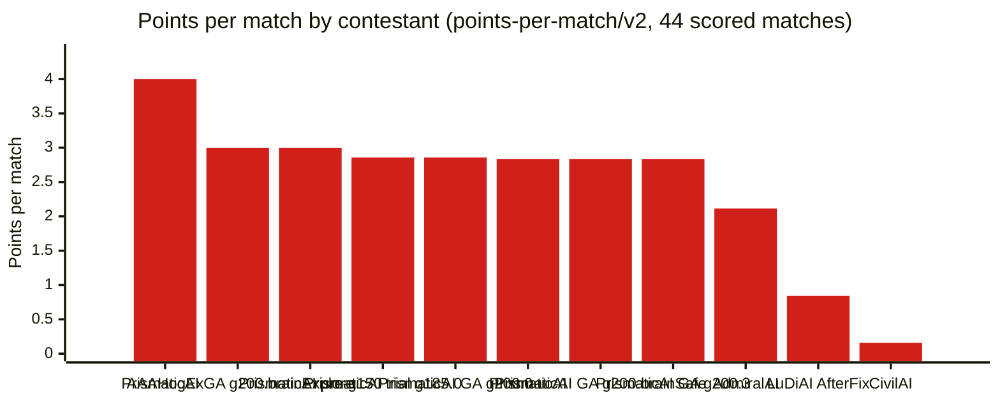
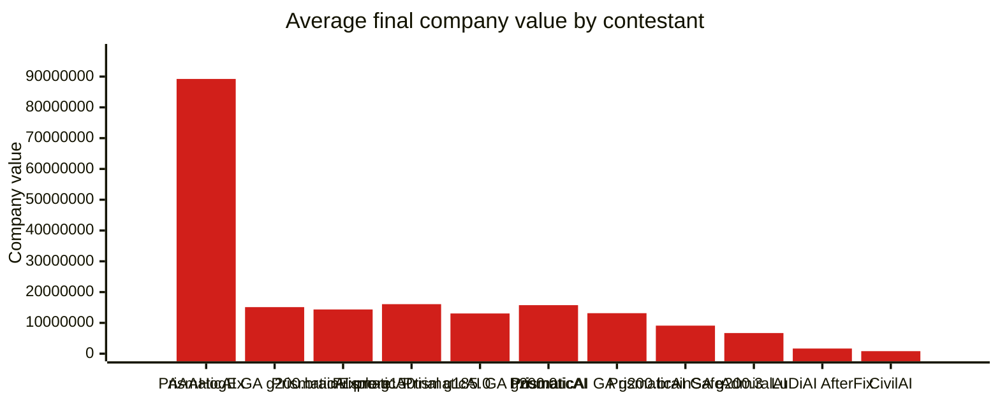
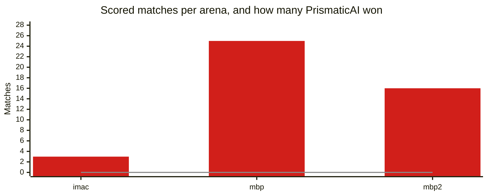

# battle-20261120T234306-7b2b868d

Derived from `battle-20261120T234306-7b2b868d.json` by `tools/research/ai-battle/battle.py report`; do not edit.

- Edition `7b2b868d85a92d4f`: PrismaticAI and referee at `962699034c20d90baeb9f617789ea6558cc6ff52`, base set `opengfx-8.0.tar`
- 20-year free-for-all from 1960, map 256x256 temperate, breakdowns 1
- 44 scored match(es) on `imac` (20261119-master-gdf1e05e7d8), `mbp` (20261120-master-m17653b726e), `mbp2` (20261119-master-gdf1e05e7d8)
- Replays: 0 of 1 identical to their original on another arena

| # | Contestant | Played | Wins | Points | Points/match | Avg rank | Avg final value | Squirrel errors | Matches with anomalies |
|---|---|---|---|---|---|---|---|---|---|
| 1 | AAAHogEx | 44 | 44 | 176 | 4.0 | 1.0 | 89.2 M | 0 | 0 |
| 2 | PrismaticAI GA g200.brainExplore | 6 | 0 | 18 | 3.0 | 2.0 | 15.1 M | 0 | 4 |
| 3 | PrismaticAI pre-g150 | 6 | 0 | 18 | 3.0 | 2.0 | 14.4 M | 0 | 4 |
| 4 | PrismaticAI trial g185.0 | 7 | 0 | 20 | 2.857 | 2.14 | 16.1 M | 0 | 2 |
| 5 | PrismaticAI GA g200.0 | 7 | 0 | 20 | 2.857 | 2.14 | 13.1 M | 0 | 1 |
| 6 | PrismaticAI | 6 | 0 | 17 | 2.833 | 2.17 | 15.8 M | 0 | 0 |
| 7 | PrismaticAI GA g200.brainSafe | 6 | 0 | 17 | 2.833 | 2.17 | 13.1 M | 0 | 1 |
| 8 | PrismaticAI GA g200.3 | 6 | 0 | 17 | 2.833 | 2.17 | 9.1 M | 0 | 0 |
| 9 | AdmiralAI | 44 | 0 | 93 | 2.114 | 2.89 | 6.7 M | 0 | 2 |
| 10 | LuDiAI AfterFix | 44 | 0 | 37 | 0.841 | 4.16 | 1.7 M | 0 | 1 |
| 11 | CivilAI | 44 | 0 | 7 | 0.159 | 4.84 | 815.6 k | 3785 | 11 |

```mermaid
---
config:
  xyChart:
    width: 900
    height: 360
  themeVariables:
    xyChart:
      plotColorPalette: "#d11f1a, #8a8a8a, #0b0b0b, #ece4d6"
---
xychart-beta
    title "Final company value per scored match: winner vs best PrismaticAI"
    x-axis ["m-0001", "m-0002", "m-0003", "m-0004", "m-0005", "m-0006", "m-0007", "m-0008", "m-0009", "m-0010", "m-0011", "m-0012", "m-0013", "m-0014", "m-0015", "m-0016", "m-0017", "m-0018", "m-0019", "m-0020", "m-0021", "m-0022", "m-0023", "m-0024", "m-0025", "m-0026", "m-0027", "m-0028", "m-0036", "m-0037", "m-0038", "m-0039", "m-0040", "m-0041", "m-0042", "m-0043", "m-0044", "m-0045", "m-0046", "m-0047", "m-0049", "m-0051", "m-0052", "m-0055"]
    %% series: Winner | Best PrismaticAI
    %% links: battle-20261120T234306-7b2b868d.md?col=Match&filter=m-0001 | battle-20261120T234306-7b2b868d.md?col=Match&filter=m-0002 | battle-20261120T234306-7b2b868d.md?col=Match&filter=m-0003 | battle-20261120T234306-7b2b868d.md?col=Match&filter=m-0004 | battle-20261120T234306-7b2b868d.md?col=Match&filter=m-0005 | battle-20261120T234306-7b2b868d.md?col=Match&filter=m-0006 | battle-20261120T234306-7b2b868d.md?col=Match&filter=m-0007 | battle-20261120T234306-7b2b868d.md?col=Match&filter=m-0008 | battle-20261120T234306-7b2b868d.md?col=Match&filter=m-0009 | battle-20261120T234306-7b2b868d.md?col=Match&filter=m-0010 | battle-20261120T234306-7b2b868d.md?col=Match&filter=m-0011 | battle-20261120T234306-7b2b868d.md?col=Match&filter=m-0012 | battle-20261120T234306-7b2b868d.md?col=Match&filter=m-0013 | battle-20261120T234306-7b2b868d.md?col=Match&filter=m-0014 | battle-20261120T234306-7b2b868d.md?col=Match&filter=m-0015 | battle-20261120T234306-7b2b868d.md?col=Match&filter=m-0016 | battle-20261120T234306-7b2b868d.md?col=Match&filter=m-0017 | battle-20261120T234306-7b2b868d.md?col=Match&filter=m-0018 | battle-20261120T234306-7b2b868d.md?col=Match&filter=m-0019 | battle-20261120T234306-7b2b868d.md?col=Match&filter=m-0020 | battle-20261120T234306-7b2b868d.md?col=Match&filter=m-0021 | battle-20261120T234306-7b2b868d.md?col=Match&filter=m-0022 | battle-20261120T234306-7b2b868d.md?col=Match&filter=m-0023 | battle-20261120T234306-7b2b868d.md?col=Match&filter=m-0024 | battle-20261120T234306-7b2b868d.md?col=Match&filter=m-0025 | battle-20261120T234306-7b2b868d.md?col=Match&filter=m-0026 | battle-20261120T234306-7b2b868d.md?col=Match&filter=m-0027 | battle-20261120T234306-7b2b868d.md?col=Match&filter=m-0028 | battle-20261120T234306-7b2b868d.md?col=Match&filter=m-0036 | battle-20261120T234306-7b2b868d.md?col=Match&filter=m-0037 | battle-20261120T234306-7b2b868d.md?col=Match&filter=m-0038 | battle-20261120T234306-7b2b868d.md?col=Match&filter=m-0039 | battle-20261120T234306-7b2b868d.md?col=Match&filter=m-0040 | battle-20261120T234306-7b2b868d.md?col=Match&filter=m-0041 | battle-20261120T234306-7b2b868d.md?col=Match&filter=m-0042 | battle-20261120T234306-7b2b868d.md?col=Match&filter=m-0043 | battle-20261120T234306-7b2b868d.md?col=Match&filter=m-0044 | battle-20261120T234306-7b2b868d.md?col=Match&filter=m-0045 | battle-20261120T234306-7b2b868d.md?col=Match&filter=m-0046 | battle-20261120T234306-7b2b868d.md?col=Match&filter=m-0047 | battle-20261120T234306-7b2b868d.md?col=Match&filter=m-0049 | battle-20261120T234306-7b2b868d.md?col=Match&filter=m-0051 | battle-20261120T234306-7b2b868d.md?col=Match&filter=m-0052 | battle-20261120T234306-7b2b868d.md?col=Match&filter=m-0055
    y-axis "Company value" 0 --> 161000000
    bar [59989686, 65978175, 56474256, 75918741, 49671446, 82783895, 70594437, 82424164, 96739951, 98288885, 72151260, 92634403, 104682538, 100976796, 94298546, 89504596, 72004718, 99513827, 99272010, 106901751, 81735301, 68321435, 58241156, 79049617, 70836418, 70769017, 75688110, 87424084, 54200204, 80319361, 70894126, 82801556, 84191773, 91445323, 102715259, 117766252, 136840771, 133018657, 138193259, 146668483, 107867739, 119633500, 88285938, 108260950]
    line [6660340, 10147687, 14313969, 10831801, 13489679, 6681220, 21908062, 16637172, 19260235, 12692585, 17030130, 16883804, 7637653, 13194956, 11556376, 16418885, 10363484, 16406436, 16644501, 5935648, 14864896, 12274399, 19355428, 13495393, 14250059, 17082425, 11301423, 15419282, 20239417, 15042518, 14388208, 16930702, 11202731, 8756820, 10381854, 18774517, 10178911, 8758330, 3441856, 15386428, 18767451, 22133352, 17375843, 14317189]
```

<!-- battle-charts:begin -->
<!-- derived from battle-20261120T234306-7b2b868d.json by `battle.py render`; `battle.py check` fails when it is stale -->

<!-- battle-charts:end -->

| Seed | Original | Replay | Arenas | Identical |
|---|---|---|---|---|
| 127546531 | m-0011 | m-0048 | imac / mbp | NO |

| Match | Arena | Seed | Winner | Value | Last | Anomalies |
|---|---|---|---|---|---|---|
| m-0001 | mbp | 164074846 | AAAHogEx | 60.0 M | LuDiAI AfterFix | - |
| m-0002 | mbp | 164074846 | AAAHogEx | 66.0 M | CivilAI | LuDiAI AfterFix: fleet_drop:67->44 |
| m-0003 | mbp | 164074846 | AAAHogEx | 56.5 M | CivilAI | - |
| m-0004 | mbp | 164074846 | AAAHogEx | 75.9 M | CivilAI | - |
| m-0005 | mbp | 164074846 | AAAHogEx | 49.7 M | LuDiAI AfterFix | - |
| m-0006 | mbp | 164074846 | AAAHogEx | 82.8 M | LuDiAI AfterFix | AdmiralAI: fleet_drop:190->119 |
| m-0007 | mbp | 127546531 | AAAHogEx | 70.6 M | CivilAI | CivilAI: fleet_drop:20->13 |
| m-0008 | mbp | 127546531 | AAAHogEx | 82.4 M | CivilAI | PrismaticAI pre-g150: fleet_drop:96->57 |
| m-0009 | mbp | 127546531 | AAAHogEx | 96.7 M | CivilAI | - |
| m-0010 | imac | 127546531 | AAAHogEx | 98.3 M | CivilAI | CivilAI: fleet_drop:49->25 |
| m-0011 | imac | 127546531 | AAAHogEx | 72.2 M | CivilAI | CivilAI: fleet_drop:16->10 |
| m-0012 | imac | 127546531 | AAAHogEx | 92.6 M | CivilAI | PrismaticAI GA g200.brainExplore: fleet_drop:75->50 |
| m-0013 | mbp2 | 127546531 | AAAHogEx | 104.7 M | CivilAI | CivilAI: squirrel_errors:3785 |
| m-0014 | mbp2 | 145244870 | AAAHogEx | 101.0 M | CivilAI | - |
| m-0015 | mbp2 | 145244870 | AAAHogEx | 94.3 M | CivilAI | PrismaticAI pre-g150: fleet_drop:82->45 |
| m-0016 | mbp2 | 145244870 | AAAHogEx | 89.5 M | CivilAI | - |
| m-0017 | mbp2 | 145244870 | AAAHogEx | 72.0 M | CivilAI | - |
| m-0018 | mbp2 | 145244870 | AAAHogEx | 99.5 M | LuDiAI AfterFix | - |
| m-0019 | mbp2 | 145244870 | AAAHogEx | 99.3 M | CivilAI | PrismaticAI GA g200.brainExplore: fleet_drop:97->57 |
| m-0020 | mbp2 | 145244870 | AAAHogEx | 106.9 M | CivilAI | - |
| m-0021 | mbp2 | 1039445375 | AAAHogEx | 81.7 M | CivilAI | AdmiralAI: fleet_drop:266->181; CivilAI: fleet_drop:64->36 |
| m-0022 | mbp2 | 1039445375 | AAAHogEx | 68.3 M | CivilAI | CivilAI: fleet_drop:59->27 |
| m-0023 | mbp2 | 1039445375 | AAAHogEx | 58.2 M | CivilAI | PrismaticAI trial g185.0: fleet_drop:94->54 |
| m-0024 | mbp2 | 1039445375 | AAAHogEx | 79.0 M | CivilAI | - |
| m-0025 | mbp2 | 1039445375 | AAAHogEx | 70.8 M | CivilAI | PrismaticAI GA g200.brainSafe: fleet_drop:85->56; CivilAI: fleet_drop:31->11 |
| m-0026 | mbp2 | 1039445375 | AAAHogEx | 70.8 M | LuDiAI AfterFix | - |
| m-0027 | mbp2 | 1039445375 | AAAHogEx | 75.7 M | CivilAI | CivilAI: fleet_drop:72->45 |
| m-0028 | mbp2 | 64380878 | AAAHogEx | 87.4 M | CivilAI | - |
| m-0036 | mbp | 208219291 | AAAHogEx | 54.2 M | LuDiAI AfterFix | PrismaticAI pre-g150: fleet_drop:96->57 |
| m-0037 | mbp | 208219291 | AAAHogEx | 80.3 M | CivilAI | - |
| m-0038 | mbp | 208219291 | AAAHogEx | 70.9 M | LuDiAI AfterFix | - |
| m-0039 | mbp | 208219291 | AAAHogEx | 82.8 M | CivilAI | - |
| m-0040 | mbp | 208219291 | AAAHogEx | 84.2 M | CivilAI | PrismaticAI GA g200.brainExplore: fleet_drop:79->40 |
| m-0041 | mbp | 208219291 | AAAHogEx | 91.4 M | CivilAI | - |
| m-0042 | mbp | 1926949485 | AAAHogEx | 102.7 M | CivilAI | CivilAI: fleet_drop:78->46 |
| m-0043 | mbp | 1926949485 | AAAHogEx | 117.8 M | CivilAI | PrismaticAI pre-g150: fleet_drop:105->64; CivilAI: fleet_drop:23->16 |
| m-0044 | mbp | 1926949485 | AAAHogEx | 136.8 M | CivilAI | PrismaticAI trial g185.0: fleet_drop:80->49 |
| m-0045 | mbp | 1926949485 | AAAHogEx | 133.0 M | CivilAI | PrismaticAI GA g200.0: fleet_drop:119->75 |
| m-0046 | mbp | 1926949485 | AAAHogEx | 138.2 M | CivilAI | - |
| m-0047 | mbp | 1926949485 | AAAHogEx | 146.7 M | CivilAI | PrismaticAI GA g200.brainExplore: fleet_drop:122->67 |
| m-0048 (replay) | mbp | 127546531 | AAAHogEx | 67.9 M | CivilAI | - |
| m-0049 | mbp | 264621951 | AAAHogEx | 107.9 M | CivilAI | - |
| m-0051 | mbp | 264621951 | AAAHogEx | 119.6 M | CivilAI | - |
| m-0052 | mbp | 264621951 | AAAHogEx | 88.3 M | CivilAI | - |
| m-0055 | mbp | 264621951 | AAAHogEx | 108.3 M | CivilAI | CivilAI: fleet_drop:50->22 |
