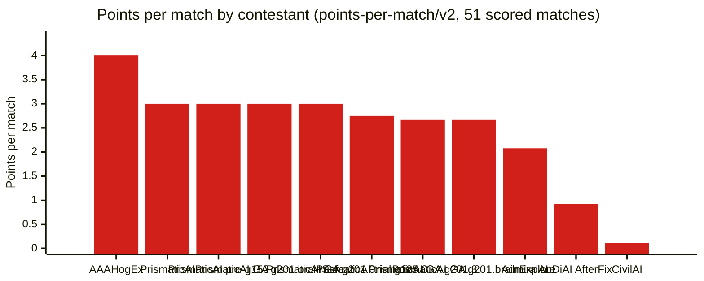
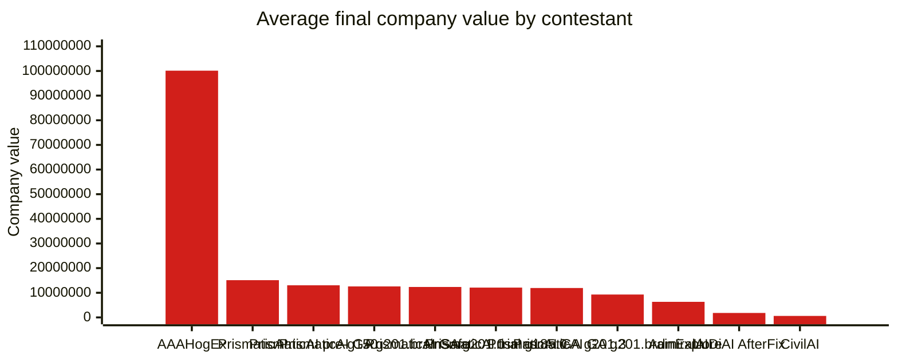
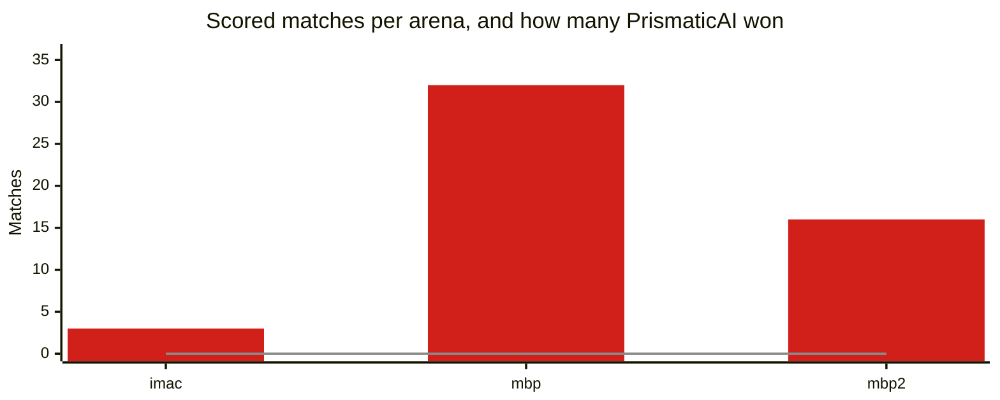

# battle-20261120T235635-42a33398

Derived from `battle-20261120T235635-42a33398.json` by `tools/research/ai-battle/battle.py report`; do not edit.

- Edition `42a33398518f0906`: PrismaticAI and referee at `962699034c20d90baeb9f617789ea6558cc6ff52`, base set `opengfx-8.0.tar`
- 20-year free-for-all from 1960, map 256x256 temperate, breakdowns 1
- 51 scored match(es) on `imac` (20261119-master-gdf1e05e7d8), `mbp` (20261120-master-m17653b726e), `mbp2` (20261119-master-gdf1e05e7d8)
- Replays: 1 of 2 identical to their original on another arena

| # | Contestant | Played | Wins | Points | Points/match | Avg rank | Avg final value | Squirrel errors | Matches with anomalies |
|---|---|---|---|---|---|---|---|---|---|
| 1 | AAAHogEx | 51 | 51 | 204 | 4.0 | 1.0 | 100.1 M | 0 | 0 |
| 2 | PrismaticAI | 7 | 0 | 21 | 3.0 | 2.0 | 15.1 M | 0 | 0 |
| 3 | PrismaticAI pre-g150 | 7 | 0 | 21 | 3.0 | 2.0 | 13.0 M | 0 | 3 |
| 4 | PrismaticAI GA g201.brainSafe | 8 | 0 | 24 | 3.0 | 2.0 | 12.6 M | 0 | 3 |
| 5 | PrismaticAI GA g201.0 | 9 | 0 | 27 | 3.0 | 2.0 | 12.4 M | 0 | 3 |
| 6 | PrismaticAI trial g185.0 | 8 | 0 | 22 | 2.75 | 2.25 | 12.1 M | 0 | 3 |
| 7 | PrismaticAI GA g201.3 | 6 | 0 | 16 | 2.667 | 2.33 | 11.9 M | 0 | 0 |
| 8 | PrismaticAI GA g201.brainExplore | 6 | 0 | 16 | 2.667 | 2.33 | 9.3 M | 0 | 0 |
| 9 | AdmiralAI | 51 | 0 | 106 | 2.078 | 2.92 | 6.3 M | 0 | 3 |
| 10 | LuDiAI AfterFix | 51 | 0 | 47 | 0.922 | 4.08 | 1.8 M | 0 | 2 |
| 11 | CivilAI | 51 | 0 | 6 | 0.118 | 4.88 | 603.5 k | 33 | 9 |

```mermaid
---
config:
  xyChart:
    width: 900
    height: 360
  themeVariables:
    xyChart:
      plotColorPalette: "#d11f1a, #8a8a8a, #0b0b0b, #ece4d6"
---
xychart-beta
    title "Final company value per scored match: winner vs best PrismaticAI"
    x-axis ["m-0001", "m-0002", "m-0003", "m-0004", "m-0005", "m-0006", "m-0007", "m-0008", "m-0009", "m-0010", "m-0011", "m-0012", "m-0013", "m-0014", "m-0015", "m-0016", "m-0017", "m-0018", "m-0019", "m-0020", "m-0021", "m-0022", "m-0023", "m-0024", "m-0025", "m-0026", "m-0027", "m-0028", "m-0036", "m-0037", "m-0038", "m-0039", "m-0040", "m-0041", "m-0042", "m-0043", "m-0044", "m-0045", "m-0046", "m-0047", "m-0049", "m-0051", "m-0052", "m-0053", "m-0059", "m-0071", "m-0073", "m-0074", "m-0076", "m-0077", "m-0079"]
    %% series: Winner | Best PrismaticAI
    %% links: battle-20261120T235635-42a33398.md?col=Match&filter=m-0001 | battle-20261120T235635-42a33398.md?col=Match&filter=m-0002 | battle-20261120T235635-42a33398.md?col=Match&filter=m-0003 | battle-20261120T235635-42a33398.md?col=Match&filter=m-0004 | battle-20261120T235635-42a33398.md?col=Match&filter=m-0005 | battle-20261120T235635-42a33398.md?col=Match&filter=m-0006 | battle-20261120T235635-42a33398.md?col=Match&filter=m-0007 | battle-20261120T235635-42a33398.md?col=Match&filter=m-0008 | battle-20261120T235635-42a33398.md?col=Match&filter=m-0009 | battle-20261120T235635-42a33398.md?col=Match&filter=m-0010 | battle-20261120T235635-42a33398.md?col=Match&filter=m-0011 | battle-20261120T235635-42a33398.md?col=Match&filter=m-0012 | battle-20261120T235635-42a33398.md?col=Match&filter=m-0013 | battle-20261120T235635-42a33398.md?col=Match&filter=m-0014 | battle-20261120T235635-42a33398.md?col=Match&filter=m-0015 | battle-20261120T235635-42a33398.md?col=Match&filter=m-0016 | battle-20261120T235635-42a33398.md?col=Match&filter=m-0017 | battle-20261120T235635-42a33398.md?col=Match&filter=m-0018 | battle-20261120T235635-42a33398.md?col=Match&filter=m-0019 | battle-20261120T235635-42a33398.md?col=Match&filter=m-0020 | battle-20261120T235635-42a33398.md?col=Match&filter=m-0021 | battle-20261120T235635-42a33398.md?col=Match&filter=m-0022 | battle-20261120T235635-42a33398.md?col=Match&filter=m-0023 | battle-20261120T235635-42a33398.md?col=Match&filter=m-0024 | battle-20261120T235635-42a33398.md?col=Match&filter=m-0025 | battle-20261120T235635-42a33398.md?col=Match&filter=m-0026 | battle-20261120T235635-42a33398.md?col=Match&filter=m-0027 | battle-20261120T235635-42a33398.md?col=Match&filter=m-0028 | battle-20261120T235635-42a33398.md?col=Match&filter=m-0036 | battle-20261120T235635-42a33398.md?col=Match&filter=m-0037 | battle-20261120T235635-42a33398.md?col=Match&filter=m-0038 | battle-20261120T235635-42a33398.md?col=Match&filter=m-0039 | battle-20261120T235635-42a33398.md?col=Match&filter=m-0040 | battle-20261120T235635-42a33398.md?col=Match&filter=m-0041 | battle-20261120T235635-42a33398.md?col=Match&filter=m-0042 | battle-20261120T235635-42a33398.md?col=Match&filter=m-0043 | battle-20261120T235635-42a33398.md?col=Match&filter=m-0044 | battle-20261120T235635-42a33398.md?col=Match&filter=m-0045 | battle-20261120T235635-42a33398.md?col=Match&filter=m-0046 | battle-20261120T235635-42a33398.md?col=Match&filter=m-0047 | battle-20261120T235635-42a33398.md?col=Match&filter=m-0049 | battle-20261120T235635-42a33398.md?col=Match&filter=m-0051 | battle-20261120T235635-42a33398.md?col=Match&filter=m-0052 | battle-20261120T235635-42a33398.md?col=Match&filter=m-0053 | battle-20261120T235635-42a33398.md?col=Match&filter=m-0059 | battle-20261120T235635-42a33398.md?col=Match&filter=m-0071 | battle-20261120T235635-42a33398.md?col=Match&filter=m-0073 | battle-20261120T235635-42a33398.md?col=Match&filter=m-0074 | battle-20261120T235635-42a33398.md?col=Match&filter=m-0076 | battle-20261120T235635-42a33398.md?col=Match&filter=m-0077 | battle-20261120T235635-42a33398.md?col=Match&filter=m-0079
    y-axis "Company value" 0 --> 153000000
    bar [80246076, 73289096, 96857440, 96104122, 97542151, 84289618, 124596326, 121667402, 138860628, 114571719, 138485934, 134969979, 122394020, 103477935, 110009927, 101965178, 113276181, 128840842, 124071615, 103151803, 98412839, 101684584, 111138311, 91068154, 110153785, 115372706, 94137619, 84628070, 137990189, 115207383, 106725117, 120693156, 109482652, 105379578, 94392529, 61911921, 86892798, 71359910, 106197560, 82386514, 104185972, 102965146, 74997586, 112920250, 82429318, 72089873, 60774310, 75649562, 85400760, 45137899, 75768527]
    line [9671431, 6892899, 5076104, 10969164, 7843504, 8694209, 13527776, 18683380, 18784844, 18062783, 9711559, 10412883, 10026862, 16871680, 14232887, 11927602, 14943683, 18355023, 11962350, 14054633, 18139311, 15571816, 17347085, 17045860, 17199788, 8615491, 18142091, 13245626, 7170243, 7042200, 13260835, 10849284, 9025680, 10798204, 15657930, 13641941, 6519696, 8158413, 10135749, 7862534, 9695003, 16448236, 17321256, 13716406, 9637676, 12250727, 7687864, 9629749, 9888297, 18652186, 11811146]
```

<!-- battle-charts:begin -->
<!-- derived from battle-20261120T235635-42a33398.json by `battle.py render`; `battle.py check` fails when it is stale -->

<!-- battle-charts:end -->

| Seed | Original | Replay | Arenas | Identical |
|---|---|---|---|---|
| 333316278 | m-0025 | m-0048 | mbp2 / mbp | yes |
| 170555963 | m-0010 | m-0072 | imac / mbp | NO |

| Match | Arena | Seed | Winner | Value | Last | Anomalies |
|---|---|---|---|---|---|---|
| m-0001 | mbp | 829591256 | AAAHogEx | 80.2 M | CivilAI | PrismaticAI pre-g150: fleet_drop:95->57 |
| m-0002 | mbp | 829591256 | AAAHogEx | 73.3 M | CivilAI | PrismaticAI trial g185.0: fleet_drop:86->55 |
| m-0003 | mbp | 829591256 | AAAHogEx | 96.9 M | CivilAI | PrismaticAI GA g201.0: fleet_drop:82->40 |
| m-0004 | mbp | 829591256 | AAAHogEx | 96.1 M | CivilAI | CivilAI: fleet_drop:55->37 |
| m-0005 | mbp | 829591256 | AAAHogEx | 97.5 M | CivilAI | - |
| m-0006 | mbp | 829591256 | AAAHogEx | 84.3 M | CivilAI | - |
| m-0007 | mbp | 170555963 | AAAHogEx | 124.6 M | LuDiAI AfterFix | CivilAI: squirrel_errors:33; LuDiAI AfterFix: no_vehicles |
| m-0008 | mbp | 170555963 | AAAHogEx | 121.7 M | CivilAI | PrismaticAI pre-g150: fleet_drop:101->57 |
| m-0009 | mbp | 170555963 | AAAHogEx | 138.9 M | CivilAI | AdmiralAI: fleet_drop:236->118 |
| m-0010 | imac | 170555963 | AAAHogEx | 114.6 M | CivilAI | - |
| m-0011 | imac | 170555963 | AAAHogEx | 138.5 M | CivilAI | PrismaticAI GA g201.brainSafe: fleet_drop:107->58; CivilAI: fleet_drop:55->38 |
| m-0012 | imac | 170555963 | AAAHogEx | 135.0 M | CivilAI | - |
| m-0013 | mbp2 | 170555963 | AAAHogEx | 122.4 M | CivilAI | - |
| m-0014 | mbp2 | 648843747 | AAAHogEx | 103.5 M | CivilAI | CivilAI: fleet_drop:29->18 |
| m-0015 | mbp2 | 648843747 | AAAHogEx | 110.0 M | CivilAI | CivilAI: fleet_drop:54->36 |
| m-0016 | mbp2 | 648843747 | AAAHogEx | 102.0 M | CivilAI | - |
| m-0017 | mbp2 | 648843747 | AAAHogEx | 113.3 M | CivilAI | - |
| m-0018 | mbp2 | 648843747 | AAAHogEx | 128.8 M | CivilAI | AdmiralAI: fleet_drop:203->103 |
| m-0019 | mbp2 | 648843747 | AAAHogEx | 124.1 M | CivilAI | - |
| m-0020 | mbp2 | 648843747 | AAAHogEx | 103.2 M | CivilAI | - |
| m-0021 | mbp2 | 333316278 | AAAHogEx | 98.4 M | CivilAI | - |
| m-0022 | mbp2 | 333316278 | AAAHogEx | 101.7 M | CivilAI | - |
| m-0023 | mbp2 | 333316278 | AAAHogEx | 111.1 M | CivilAI | - |
| m-0024 | mbp2 | 333316278 | AAAHogEx | 91.1 M | CivilAI | CivilAI: no_vehicles |
| m-0025 | mbp2 | 333316278 | AAAHogEx | 110.2 M | CivilAI | CivilAI: no_vehicles |
| m-0026 | mbp2 | 333316278 | AAAHogEx | 115.4 M | CivilAI | LuDiAI AfterFix: fleet_drop:19->12 |
| m-0027 | mbp2 | 333316278 | AAAHogEx | 94.1 M | CivilAI | - |
| m-0028 | mbp2 | 43919659 | AAAHogEx | 84.6 M | CivilAI | - |
| m-0036 | mbp | 1696471661 | AAAHogEx | 138.0 M | CivilAI | PrismaticAI pre-g150: fleet_drop:64->42; AdmiralAI: fleet_drop:243->168 |
| m-0037 | mbp | 1696471661 | AAAHogEx | 115.2 M | LuDiAI AfterFix | - |
| m-0038 | mbp | 1696471661 | AAAHogEx | 106.7 M | LuDiAI AfterFix | - |
| m-0039 | mbp | 1696471661 | AAAHogEx | 120.7 M | CivilAI | PrismaticAI GA g201.brainSafe: fleet_drop:140->89 |
| m-0040 | mbp | 1696471661 | AAAHogEx | 109.5 M | CivilAI | - |
| m-0041 | mbp | 1696471661 | AAAHogEx | 105.4 M | CivilAI | - |
| m-0042 | mbp | 345666556 | AAAHogEx | 94.4 M | CivilAI | - |
| m-0043 | mbp | 345666556 | AAAHogEx | 61.9 M | CivilAI | - |
| m-0044 | mbp | 345666556 | AAAHogEx | 86.9 M | CivilAI | PrismaticAI trial g185.0: fleet_drop:80->49 |
| m-0045 | mbp | 345666556 | AAAHogEx | 71.4 M | CivilAI | - |
| m-0046 | mbp | 345666556 | AAAHogEx | 106.2 M | CivilAI | PrismaticAI GA g201.brainSafe: fleet_drop:76->39; CivilAI: fleet_drop:12->7 |
| m-0047 | mbp | 345666556 | AAAHogEx | 82.4 M | CivilAI | - |
| m-0048 (replay) | mbp | 333316278 | AAAHogEx | 110.2 M | CivilAI | CivilAI: no_vehicles |
| m-0049 | mbp | 1879721483 | AAAHogEx | 104.2 M | CivilAI | - |
| m-0051 | mbp | 1879721483 | AAAHogEx | 103.0 M | CivilAI | PrismaticAI trial g185.0: fleet_drop:93->64 |
| m-0052 | mbp | 1879721483 | AAAHogEx | 75.0 M | CivilAI | PrismaticAI GA g201.0: fleet_drop:103->62 |
| m-0053 | mbp | 1879721483 | AAAHogEx | 112.9 M | CivilAI | - |
| m-0059 | mbp | 324915595 | AAAHogEx | 82.4 M | CivilAI | CivilAI: fleet_drop:31->8 |
| m-0071 | mbp | 946875968 | AAAHogEx | 72.1 M | LuDiAI AfterFix | - |
| m-0072 (replay) | mbp | 170555963 | AAAHogEx | 113.5 M | CivilAI | PrismaticAI GA g201.0: fleet_drop:120->71 |
| m-0073 | mbp | 946875968 | AAAHogEx | 60.8 M | CivilAI | PrismaticAI GA g201.0: fleet_drop:62->33 |
| m-0074 | mbp | 946875968 | AAAHogEx | 75.6 M | CivilAI | - |
| m-0076 | mbp | 946875968 | AAAHogEx | 85.4 M | CivilAI | - |
| m-0077 | mbp | 302854693 | AAAHogEx | 45.1 M | LuDiAI AfterFix | - |
| m-0079 | mbp | 302854693 | AAAHogEx | 75.8 M | LuDiAI AfterFix | - |
