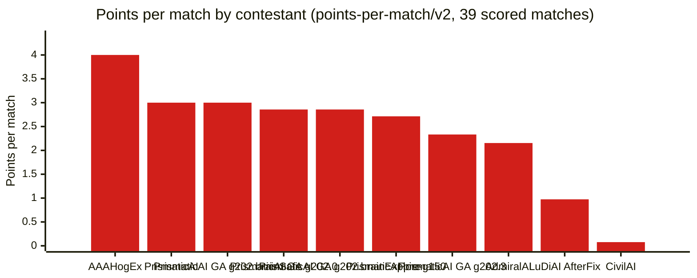
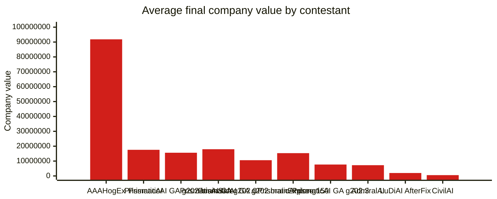
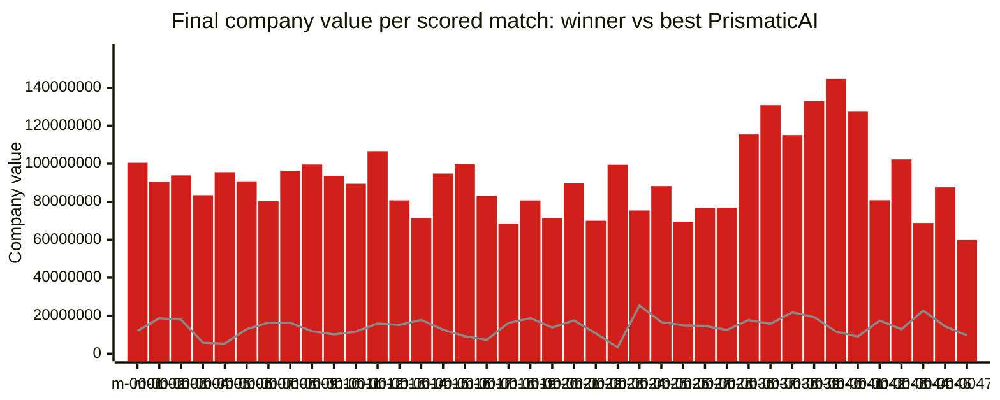
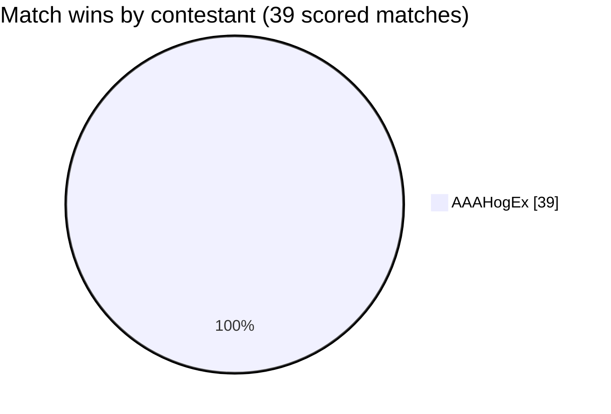
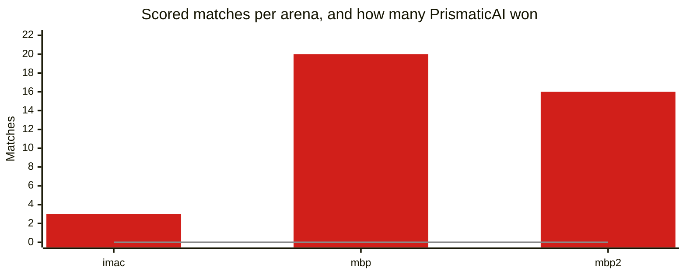

# battle-20261121T000512-ca532993

Derived from `battle-20261121T000512-ca532993.json` by `tools/research/ai-battle/battle.py report`; do not edit.

- Edition `ca53299333c27f5e`: PrismaticAI and referee at `962699034c20d90baeb9f617789ea6558cc6ff52`, base set `opengfx-8.0.tar`
- 20-year free-for-all from 1960, map 256x256 temperate, breakdowns 1
- 39 scored match(es) on `imac` (20261119-master-gdf1e05e7d8), `mbp` (20261120-master-m17653b726e), `mbp2` (20261119-master-gdf1e05e7d8)
- Replays: 0 of 0 identical to their original on another arena

| # | Contestant | Played | Wins | Points | Points/match | Avg rank | Avg final value | Squirrel errors | Matches with anomalies |
|---|---|---|---|---|---|---|---|---|---|
| 1 | AAAHogEx | 39 | 39 | 156 | 4.0 | 1.0 | 91.8 M | 0 | 0 |
| 2 | PrismaticAI | 6 | 0 | 18 | 3.0 | 2.0 | 17.6 M | 0 | 0 |
| 3 | PrismaticAI GA g202.brainSafe | 6 | 0 | 18 | 3.0 | 2.0 | 15.6 M | 0 | 2 |
| 4 | PrismaticAI GA g202.0 | 7 | 0 | 20 | 2.857 | 2.14 | 18.0 M | 0 | 3 |
| 5 | PrismaticAI GA g202.brainExplore | 7 | 0 | 20 | 2.857 | 2.14 | 10.6 M | 0 | 0 |
| 6 | PrismaticAI pre-g150 | 7 | 0 | 19 | 2.714 | 2.29 | 15.3 M | 0 | 3 |
| 7 | PrismaticAI GA g202.3 | 6 | 0 | 14 | 2.333 | 2.67 | 7.7 M | 0 | 2 |
| 8 | AdmiralAI | 39 | 0 | 84 | 2.154 | 2.85 | 7.2 M | 47 | 1 |
| 9 | LuDiAI AfterFix | 39 | 0 | 38 | 0.974 | 4.03 | 2.0 M | 0 | 1 |
| 10 | CivilAI | 39 | 0 | 3 | 0.077 | 4.92 | 549.6 k | 3620 | 8 |

<!-- battle-charts:begin -->
<!-- derived from battle-20261121T000512-ca532993.json by `battle.py render`; `battle.py check` fails when it is stale -->

<!-- battle-charts:end -->

| Match | Arena | Seed | Winner | Value | Last | Anomalies |
|---|---|---|---|---|---|---|
| m-0001 | mbp | 227132907 | AAAHogEx | 100.5 M | CivilAI | PrismaticAI pre-g150: fleet_drop:106->73; CivilAI: fleet_drop:44->23 |
| m-0002 | mbp | 227132907 | AAAHogEx | 90.5 M | CivilAI | PrismaticAI GA g202.0: fleet_drop:141->87 |
| m-0003 | mbp | 227132907 | AAAHogEx | 93.8 M | CivilAI | CivilAI: fleet_drop:53->24 |
| m-0004 | mbp | 227132907 | AAAHogEx | 83.4 M | CivilAI | CivilAI: fleet_drop:33->22 |
| m-0005 | mbp | 227132907 | AAAHogEx | 95.5 M | CivilAI | PrismaticAI GA g202.3: fleet_drop:80->50 |
| m-0006 | mbp | 1072553074 | AAAHogEx | 90.7 M | CivilAI | CivilAI: squirrel_errors:3620 |
| m-0007 | mbp | 1072553074 | AAAHogEx | 80.2 M | CivilAI | PrismaticAI pre-g150: fleet_drop:130->63 |
| m-0008 | mbp | 1072553074 | AAAHogEx | 96.3 M | CivilAI | - |
| m-0009 | mbp | 1072553074 | AAAHogEx | 99.6 M | CivilAI | PrismaticAI GA g202.brainSafe: fleet_drop:51->34 |
| m-0010 | imac | 1072553074 | AAAHogEx | 93.6 M | CivilAI | - |
| m-0011 | imac | 1072553074 | AAAHogEx | 89.4 M | CivilAI | - |
| m-0012 | imac | 1751467365 | AAAHogEx | 106.6 M | CivilAI | - |
| m-0013 | mbp2 | 1751467365 | AAAHogEx | 80.7 M | CivilAI | - |
| m-0014 | mbp2 | 1751467365 | AAAHogEx | 71.4 M | CivilAI | - |
| m-0015 | mbp2 | 1751467365 | AAAHogEx | 94.8 M | CivilAI | CivilAI: fleet_drop:51->27 |
| m-0016 | mbp2 | 1751467365 | AAAHogEx | 99.7 M | CivilAI | - |
| m-0017 | mbp2 | 1751467365 | AAAHogEx | 83.0 M | CivilAI | - |
| m-0018 | mbp2 | 642389306 | AAAHogEx | 68.5 M | CivilAI | - |
| m-0019 | mbp2 | 642389306 | AAAHogEx | 80.7 M | CivilAI | - |
| m-0020 | mbp2 | 642389306 | AAAHogEx | 71.3 M | CivilAI | PrismaticAI GA g202.0: fleet_drop:121->72 |
| m-0021 | mbp2 | 642389306 | AAAHogEx | 89.6 M | CivilAI | PrismaticAI GA g202.brainSafe: fleet_drop:83->56; LuDiAI AfterFix: fleet_drop:114->71 |
| m-0022 | mbp2 | 642389306 | AAAHogEx | 70.0 M | CivilAI | - |
| m-0023 | mbp2 | 642389306 | AAAHogEx | 99.4 M | CivilAI | PrismaticAI GA g202.3: fleet_drop:71->33 |
| m-0024 | mbp2 | 1178169844 | AAAHogEx | 75.4 M | CivilAI | - |
| m-0025 | mbp2 | 1178169844 | AAAHogEx | 88.2 M | CivilAI | CivilAI: fleet_drop:55->26 |
| m-0026 | mbp2 | 1178169844 | AAAHogEx | 69.5 M | CivilAI | - |
| m-0027 | mbp2 | 1178169844 | AAAHogEx | 76.7 M | LuDiAI AfterFix | - |
| m-0028 | mbp2 | 1178169844 | AAAHogEx | 76.8 M | CivilAI | - |
| m-0036 | mbp | 149334625 | AAAHogEx | 115.4 M | CivilAI | AdmiralAI: squirrel_errors:47 |
| m-0037 | mbp | 149334625 | AAAHogEx | 130.8 M | CivilAI | - |
| m-0038 | mbp | 149334625 | AAAHogEx | 115.0 M | CivilAI | - |
| m-0039 | mbp | 149334625 | AAAHogEx | 132.9 M | CivilAI | - |
| m-0040 | mbp | 149334625 | AAAHogEx | 144.6 M | CivilAI | - |
| m-0041 | mbp | 149334625 | AAAHogEx | 127.4 M | CivilAI | CivilAI: fleet_drop:21->10 |
| m-0042 | mbp | 1848098722 | AAAHogEx | 80.8 M | CivilAI | - |
| m-0043 | mbp | 1848098722 | AAAHogEx | 102.3 M | LuDiAI AfterFix | PrismaticAI pre-g150: fleet_drop:87->46; CivilAI: fleet_drop:81->52 |
| m-0044 | mbp | 1848098722 | AAAHogEx | 68.8 M | CivilAI | PrismaticAI GA g202.0: fleet_drop:130->87 |
| m-0046 | mbp | 1848098722 | AAAHogEx | 87.6 M | CivilAI | - |
| m-0047 | mbp | 1848098722 | AAAHogEx | 59.8 M | LuDiAI AfterFix | - |
