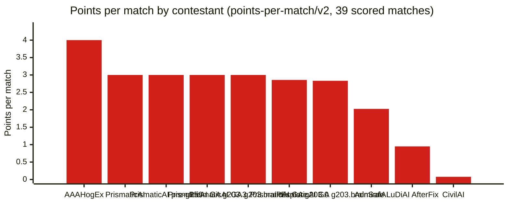
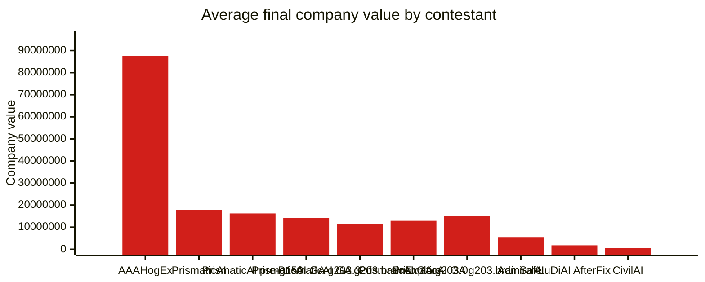
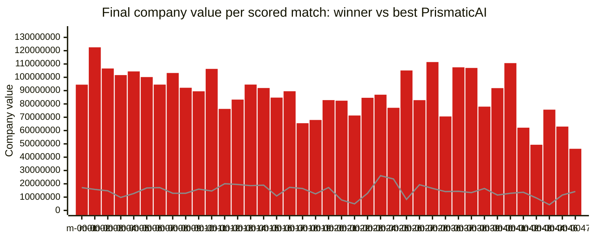
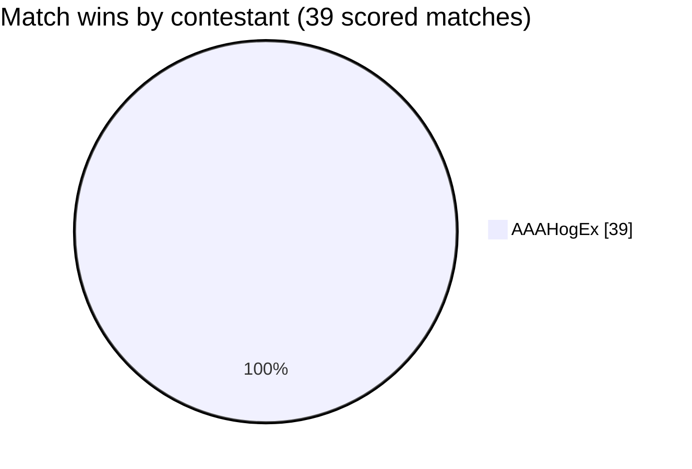
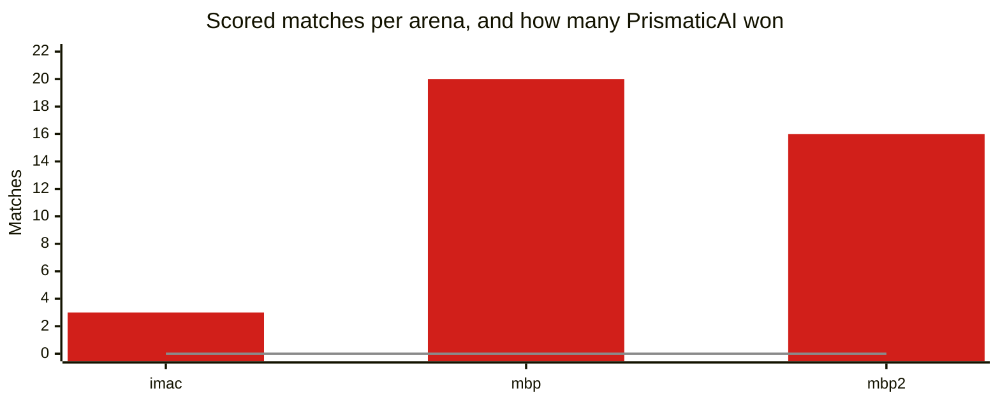

# battle-20261121T001408-1de042a7

Derived from `battle-20261121T001408-1de042a7.json` by `tools/research/ai-battle/battle.py report`; do not edit.

- Edition `1de042a76887fc08`: PrismaticAI and referee at `962699034c20d90baeb9f617789ea6558cc6ff52`, base set `opengfx-8.0.tar`
- 20-year free-for-all from 1960, map 256x256 temperate, breakdowns 1
- 39 scored match(es) on `imac` (20261119-master-gdf1e05e7d8), `mbp` (20261120-master-m17653b726e), `mbp2` (20261119-master-gdf1e05e7d8)
- Replays: 0 of 0 identical to their original on another arena

| # | Contestant | Played | Wins | Points | Points/match | Avg rank | Avg final value | Squirrel errors | Matches with anomalies |
|---|---|---|---|---|---|---|---|---|---|
| 1 | AAAHogEx | 39 | 39 | 156 | 4.0 | 1.0 | 87.6 M | 0 | 0 |
| 2 | PrismaticAI | 6 | 0 | 18 | 3.0 | 2.0 | 17.9 M | 0 | 0 |
| 3 | PrismaticAI pre-g150 | 7 | 0 | 21 | 3.0 | 2.0 | 16.2 M | 0 | 3 |
| 4 | PrismaticAI GA g203.3 | 6 | 0 | 18 | 3.0 | 2.0 | 14.1 M | 0 | 0 |
| 5 | PrismaticAI GA g203.brainExplore | 7 | 0 | 21 | 3.0 | 2.0 | 11.6 M | 0 | 0 |
| 6 | PrismaticAI GA g203.0 | 7 | 0 | 20 | 2.857 | 2.14 | 12.9 M | 0 | 3 |
| 7 | PrismaticAI GA g203.brainSafe | 6 | 0 | 17 | 2.833 | 2.17 | 15.0 M | 0 | 0 |
| 8 | AdmiralAI | 39 | 0 | 79 | 2.026 | 2.97 | 5.5 M | 0 | 2 |
| 9 | LuDiAI AfterFix | 39 | 0 | 37 | 0.949 | 4.05 | 1.8 M | 0 | 4 |
| 10 | CivilAI | 39 | 0 | 3 | 0.077 | 4.92 | 650.0 k | 0 | 9 |

<!-- battle-charts:begin -->
<!-- derived from battle-20261121T001408-1de042a7.json by `battle.py render`; `battle.py check` fails when it is stale -->

<!-- battle-charts:end -->

| Match | Arena | Seed | Winner | Value | Last | Anomalies |
|---|---|---|---|---|---|---|
| m-0001 | mbp | 1116879798 | AAAHogEx | 94.5 M | CivilAI | PrismaticAI pre-g150: fleet_drop:168->104; AdmiralAI: fleet_drop:169->111 |
| m-0002 | mbp | 1116879798 | AAAHogEx | 122.5 M | CivilAI | - |
| m-0003 | mbp | 1116879798 | AAAHogEx | 106.6 M | CivilAI | - |
| m-0004 | mbp | 1116879798 | AAAHogEx | 101.7 M | CivilAI | - |
| m-0005 | mbp | 1116879798 | AAAHogEx | 104.4 M | CivilAI | - |
| m-0006 | mbp | 170730970 | AAAHogEx | 100.2 M | CivilAI | - |
| m-0007 | mbp | 170730970 | AAAHogEx | 94.5 M | CivilAI | PrismaticAI pre-g150: fleet_drop:107->51 |
| m-0008 | mbp | 170730970 | AAAHogEx | 103.2 M | CivilAI | PrismaticAI GA g203.0: fleet_drop:63->39 |
| m-0009 | mbp | 170730970 | AAAHogEx | 92.2 M | CivilAI | - |
| m-0010 | imac | 170730970 | AAAHogEx | 89.5 M | CivilAI | - |
| m-0011 | imac | 170730970 | AAAHogEx | 106.3 M | CivilAI | - |
| m-0012 | imac | 1486107671 | AAAHogEx | 76.3 M | CivilAI | - |
| m-0013 | mbp2 | 1486107671 | AAAHogEx | 83.3 M | CivilAI | - |
| m-0014 | mbp2 | 1486107671 | AAAHogEx | 94.5 M | CivilAI | - |
| m-0015 | mbp2 | 1486107671 | AAAHogEx | 92.0 M | CivilAI | - |
| m-0016 | mbp2 | 1486107671 | AAAHogEx | 84.8 M | CivilAI | - |
| m-0017 | mbp2 | 1486107671 | AAAHogEx | 89.5 M | LuDiAI AfterFix | CivilAI: fleet_drop:74->44 |
| m-0018 | mbp2 | 19082935 | AAAHogEx | 65.5 M | LuDiAI AfterFix | CivilAI: fleet_drop:78->51 |
| m-0019 | mbp2 | 19082935 | AAAHogEx | 68.0 M | CivilAI | LuDiAI AfterFix: fleet_drop:82->55 |
| m-0020 | mbp2 | 19082935 | AAAHogEx | 82.9 M | CivilAI | AdmiralAI: fleet_drop:229->154; CivilAI: fleet_drop:49->10 |
| m-0021 | mbp2 | 19082935 | AAAHogEx | 82.4 M | CivilAI | LuDiAI AfterFix: fleet_drop:62->28 |
| m-0022 | mbp2 | 19082935 | AAAHogEx | 71.3 M | CivilAI | CivilAI: fleet_drop:84->41 |
| m-0023 | mbp2 | 19082935 | AAAHogEx | 84.6 M | CivilAI | - |
| m-0024 | mbp2 | 1705950040 | AAAHogEx | 86.9 M | CivilAI | - |
| m-0025 | mbp2 | 1705950040 | AAAHogEx | 77.1 M | CivilAI | - |
| m-0026 | mbp2 | 1705950040 | AAAHogEx | 105.1 M | CivilAI | - |
| m-0027 | mbp2 | 1705950040 | AAAHogEx | 82.8 M | CivilAI | - |
| m-0028 | mbp2 | 1705950040 | AAAHogEx | 111.5 M | CivilAI | - |
| m-0036 | mbp | 325462052 | AAAHogEx | 70.6 M | CivilAI | CivilAI: fleet_drop:62->43 |
| m-0037 | mbp | 325462052 | AAAHogEx | 107.5 M | LuDiAI AfterFix | - |
| m-0038 | mbp | 325462052 | AAAHogEx | 107.0 M | CivilAI | PrismaticAI GA g203.0: fleet_drop:54->35 |
| m-0039 | mbp | 325462052 | AAAHogEx | 78.0 M | CivilAI | CivilAI: fleet_drop:55->21 |
| m-0040 | mbp | 325462052 | AAAHogEx | 91.9 M | CivilAI | - |
| m-0041 | mbp | 325462052 | AAAHogEx | 110.7 M | CivilAI | CivilAI: fleet_drop:28->16 |
| m-0042 | mbp | 1672362984 | AAAHogEx | 62.2 M | CivilAI | - |
| m-0043 | mbp | 1672362984 | AAAHogEx | 49.3 M | CivilAI | PrismaticAI pre-g150: fleet_drop:67->42; LuDiAI AfterFix: fleet_drop:97->54; CivilAI: fleet_drop:21->12 |
| m-0044 | mbp | 1672362984 | AAAHogEx | 75.7 M | CivilAI | PrismaticAI GA g203.0: fleet_drop:48->22; CivilAI: fleet_drop:53->22 |
| m-0046 | mbp | 1672362984 | AAAHogEx | 63.0 M | CivilAI | LuDiAI AfterFix: fleet_drop:65->43 |
| m-0047 | mbp | 1672362984 | AAAHogEx | 46.3 M | CivilAI | - |
