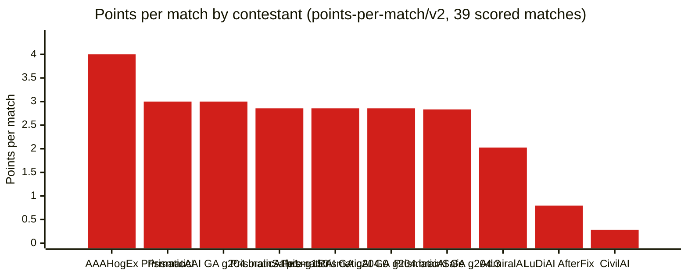
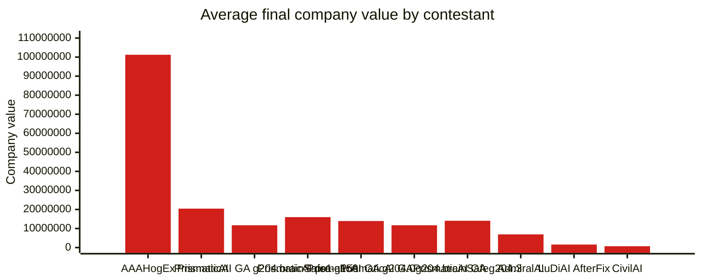
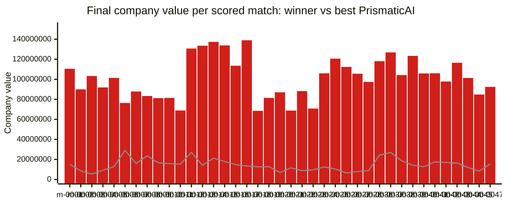
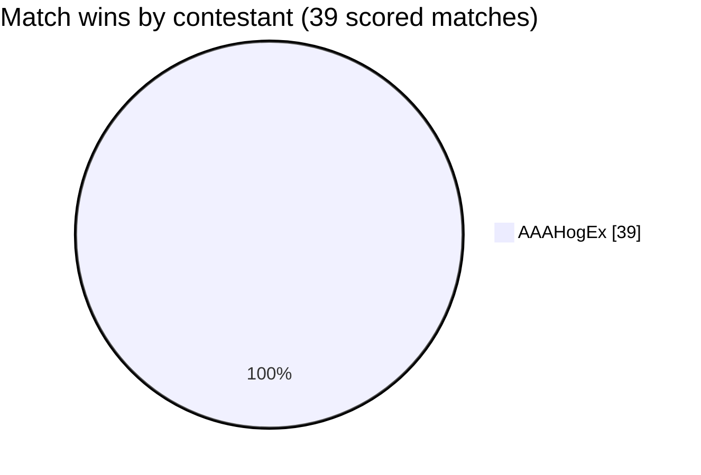
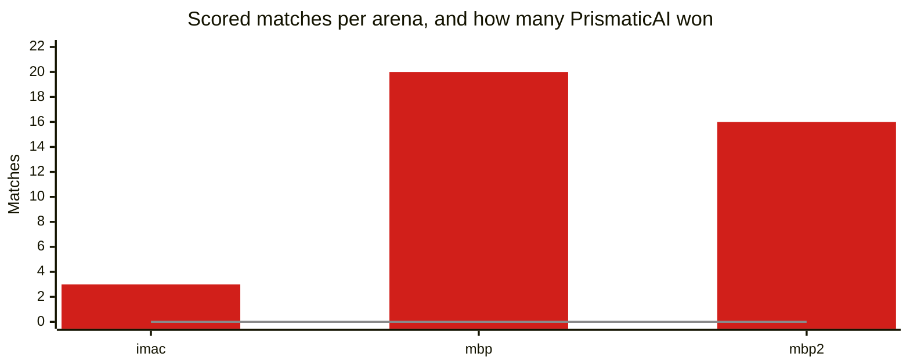

# battle-20261121T002345-92588e81

Derived from `battle-20261121T002345-92588e81.json` by `tools/research/ai-battle/battle.py report`; do not edit.

- Edition `92588e81971e47fb`: PrismaticAI and referee at `962699034c20d90baeb9f617789ea6558cc6ff52`, base set `opengfx-8.0.tar`
- 20-year free-for-all from 1960, map 256x256 temperate, breakdowns 1
- 39 scored match(es) on `imac` (20261119-master-gdf1e05e7d8), `mbp` (20261120-master-m17653b726e), `mbp2` (20261119-master-gdf1e05e7d8)
- Replays: 0 of 1 identical to their original on another arena

| # | Contestant | Played | Wins | Points | Points/match | Avg rank | Avg final value | Squirrel errors | Matches with anomalies |
|---|---|---|---|---|---|---|---|---|---|
| 1 | AAAHogEx | 39 | 39 | 156 | 4.0 | 1.0 | 101.2 M | 0 | 0 |
| 2 | PrismaticAI | 6 | 0 | 18 | 3.0 | 2.0 | 20.4 M | 0 | 0 |
| 3 | PrismaticAI GA g204.brainSafe1 | 6 | 0 | 18 | 3.0 | 2.0 | 11.7 M | 0 | 1 |
| 4 | PrismaticAI pre-g150 | 7 | 0 | 20 | 2.857 | 2.14 | 16.0 M | 0 | 3 |
| 5 | PrismaticAI GA g204.0 | 7 | 0 | 20 | 2.857 | 2.14 | 13.9 M | 0 | 0 |
| 6 | PrismaticAI GA g204.brainSafe | 7 | 0 | 20 | 2.857 | 2.14 | 11.7 M | 0 | 1 |
| 7 | PrismaticAI GA g204.3 | 6 | 0 | 17 | 2.833 | 2.17 | 14.1 M | 0 | 0 |
| 8 | AdmiralAI | 39 | 0 | 79 | 2.026 | 2.97 | 6.9 M | 0 | 2 |
| 9 | LuDiAI AfterFix | 39 | 0 | 31 | 0.795 | 4.21 | 1.6 M | 0 | 0 |
| 10 | CivilAI | 39 | 0 | 11 | 0.282 | 4.72 | 713.2 k | 3700 | 9 |

<!-- battle-charts:begin -->
<!-- derived from battle-20261121T002345-92588e81.json by `battle.py render`; `battle.py check` fails when it is stale -->

<!-- battle-charts:end -->

| Seed | Original | Replay | Arenas | Identical |
|---|---|---|---|---|
| 1444383283 | m-0011 | m-0048 | imac / mbp | NO |

| Match | Arena | Seed | Winner | Value | Last | Anomalies |
|---|---|---|---|---|---|---|
| m-0001 | mbp | 1697539188 | AAAHogEx | 110.5 M | CivilAI | - |
| m-0002 | mbp | 1697539188 | AAAHogEx | 90.0 M | CivilAI | - |
| m-0003 | mbp | 1697539188 | AAAHogEx | 103.3 M | CivilAI | - |
| m-0004 | mbp | 1697539188 | AAAHogEx | 91.9 M | CivilAI | PrismaticAI GA g204.brainSafe1: fleet_drop:159->108 |
| m-0005 | mbp | 1697539188 | AAAHogEx | 101.4 M | CivilAI | CivilAI: no_vehicles |
| m-0006 | mbp | 1444383283 | AAAHogEx | 76.3 M | LuDiAI AfterFix | - |
| m-0007 | mbp | 1444383283 | AAAHogEx | 87.8 M | CivilAI | PrismaticAI pre-g150: fleet_drop:103->41 |
| m-0008 | mbp | 1444383283 | AAAHogEx | 83.3 M | LuDiAI AfterFix | - |
| m-0009 | mbp | 1444383283 | AAAHogEx | 81.2 M | CivilAI | - |
| m-0010 | imac | 1444383283 | AAAHogEx | 81.4 M | CivilAI | - |
| m-0011 | imac | 1444383283 | AAAHogEx | 68.9 M | LuDiAI AfterFix | - |
| m-0012 | imac | 1853478485 | AAAHogEx | 130.7 M | CivilAI | AdmiralAI: fleet_drop:212->121 |
| m-0013 | mbp2 | 1853478485 | AAAHogEx | 133.5 M | CivilAI | CivilAI: fleet_drop:38->21 |
| m-0014 | mbp2 | 1853478485 | AAAHogEx | 137.3 M | CivilAI | - |
| m-0015 | mbp2 | 1853478485 | AAAHogEx | 133.8 M | CivilAI | - |
| m-0016 | mbp2 | 1853478485 | AAAHogEx | 113.5 M | CivilAI | - |
| m-0017 | mbp2 | 1853478485 | AAAHogEx | 139.0 M | CivilAI | CivilAI: fleet_drop:53->13 |
| m-0018 | mbp2 | 1990015760 | AAAHogEx | 68.5 M | CivilAI | - |
| m-0019 | mbp2 | 1990015760 | AAAHogEx | 81.4 M | CivilAI | PrismaticAI pre-g150: fleet_drop:99->61; CivilAI: no_vehicles |
| m-0020 | mbp2 | 1990015760 | AAAHogEx | 87.0 M | CivilAI | CivilAI: fleet_drop:30->19 |
| m-0021 | mbp2 | 1990015760 | AAAHogEx | 68.8 M | CivilAI | PrismaticAI GA g204.brainSafe: fleet_drop:149->94 |
| m-0022 | mbp2 | 1990015760 | AAAHogEx | 88.2 M | CivilAI | CivilAI: no_vehicles |
| m-0023 | mbp2 | 1990015760 | AAAHogEx | 70.8 M | CivilAI | CivilAI: no_vehicles |
| m-0024 | mbp2 | 810401602 | AAAHogEx | 105.9 M | CivilAI | - |
| m-0025 | mbp2 | 810401602 | AAAHogEx | 120.6 M | CivilAI | PrismaticAI pre-g150: fleet_drop:115->70 |
| m-0026 | mbp2 | 810401602 | AAAHogEx | 112.3 M | CivilAI | - |
| m-0027 | mbp2 | 810401602 | AAAHogEx | 105.6 M | CivilAI | - |
| m-0028 | mbp2 | 810401602 | AAAHogEx | 97.4 M | CivilAI | - |
| m-0036 | mbp | 478508487 | AAAHogEx | 118.1 M | LuDiAI AfterFix | CivilAI: squirrel_errors:3700 |
| m-0037 | mbp | 478508487 | AAAHogEx | 126.8 M | LuDiAI AfterFix | - |
| m-0038 | mbp | 478508487 | AAAHogEx | 104.2 M | LuDiAI AfterFix | - |
| m-0039 | mbp | 478508487 | AAAHogEx | 123.4 M | CivilAI | - |
| m-0040 | mbp | 478508487 | AAAHogEx | 105.8 M | LuDiAI AfterFix | CivilAI: fleet_drop:65->45 |
| m-0041 | mbp | 478508487 | AAAHogEx | 106.0 M | LuDiAI AfterFix | - |
| m-0042 | mbp | 1740707382 | AAAHogEx | 97.8 M | LuDiAI AfterFix | - |
| m-0043 | mbp | 1740707382 | AAAHogEx | 116.5 M | CivilAI | - |
| m-0044 | mbp | 1740707382 | AAAHogEx | 101.3 M | CivilAI | - |
| m-0045 | mbp | 1740707382 | AAAHogEx | 84.8 M | LuDiAI AfterFix | AdmiralAI: fleet_drop:368->226 |
| m-0047 | mbp | 1740707382 | AAAHogEx | 92.4 M | CivilAI | - |
| m-0048 (replay) | mbp | 1444383283 | AAAHogEx | 68.9 M | CivilAI | - |
