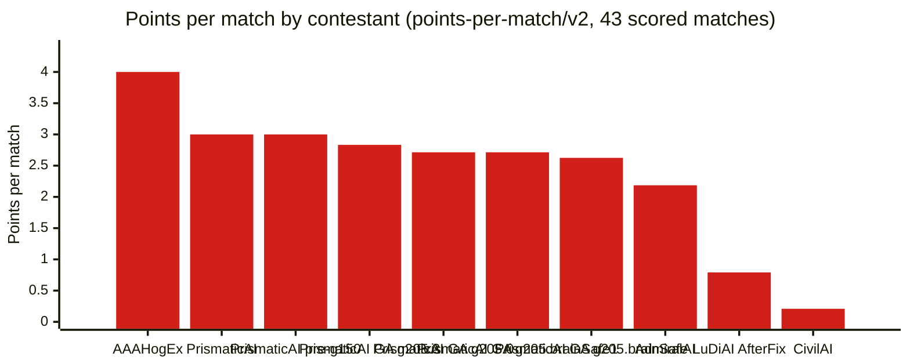
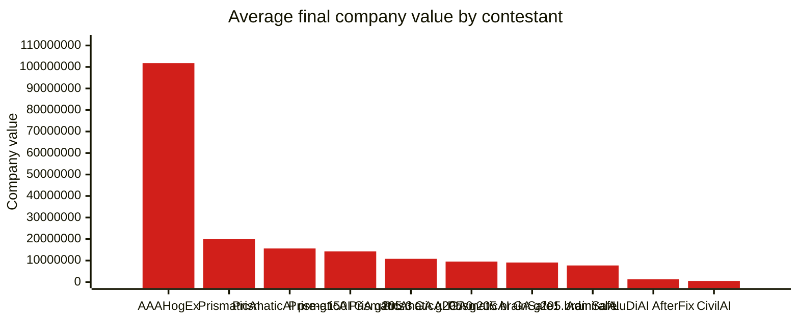
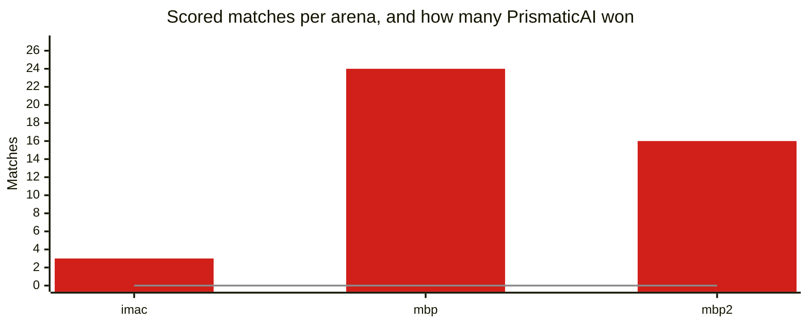

# battle-20261121T003334-980ea5da

Derived from `battle-20261121T003334-980ea5da.json` by `tools/research/ai-battle/battle.py report`; do not edit.

- Edition `980ea5da8ca22366`: PrismaticAI and referee at `962699034c20d90baeb9f617789ea6558cc6ff52`, base set `opengfx-8.0.tar`
- 20-year free-for-all from 1960, map 256x256 temperate, breakdowns 1
- 43 scored match(es) on `imac` (20261119-master-gdf1e05e7d8), `mbp` (20261120-master-m17653b726e), `mbp2` (20261119-master-gdf1e05e7d8)
- Replays: 0 of 0 identical to their original on another arena

| # | Contestant | Played | Wins | Points | Points/match | Avg rank | Avg final value | Squirrel errors | Matches with anomalies |
|---|---|---|---|---|---|---|---|---|---|
| 1 | AAAHogEx | 43 | 43 | 172 | 4.0 | 1.0 | 101.8 M | 0 | 0 |
| 2 | PrismaticAI | 7 | 0 | 21 | 3.0 | 2.0 | 19.9 M | 0 | 0 |
| 3 | PrismaticAI pre-g150 | 8 | 0 | 24 | 3.0 | 2.0 | 15.6 M | 0 | 2 |
| 4 | PrismaticAI GA g205.3 | 6 | 0 | 17 | 2.833 | 2.17 | 14.3 M | 0 | 1 |
| 5 | PrismaticAI GA g205.0 | 7 | 0 | 19 | 2.714 | 2.29 | 10.8 M | 0 | 0 |
| 6 | PrismaticAI GA g205.brainSafe1 | 7 | 0 | 19 | 2.714 | 2.29 | 9.5 M | 0 | 2 |
| 7 | PrismaticAI GA g205.brainSafe | 8 | 0 | 21 | 2.625 | 2.38 | 9.1 M | 0 | 0 |
| 8 | AdmiralAI | 43 | 0 | 94 | 2.186 | 2.81 | 7.7 M | 0 | 1 |
| 9 | LuDiAI AfterFix | 43 | 0 | 34 | 0.791 | 4.21 | 1.3 M | 0 | 1 |
| 10 | CivilAI | 43 | 0 | 9 | 0.209 | 4.79 | 505.3 k | 0 | 9 |

```mermaid
---
config:
  xyChart:
    width: 900
    height: 360
  themeVariables:
    xyChart:
      plotColorPalette: "#d11f1a, #8a8a8a, #0b0b0b, #ece4d6"
---
xychart-beta
    title "Final company value per scored match: winner vs best PrismaticAI"
    x-axis ["m-0001", "m-0002", "m-0003", "m-0004", "m-0005", "m-0006", "m-0007", "m-0008", "m-0009", "m-0010", "m-0011", "m-0012", "m-0013", "m-0014", "m-0015", "m-0016", "m-0017", "m-0018", "m-0019", "m-0020", "m-0021", "m-0022", "m-0023", "m-0024", "m-0025", "m-0026", "m-0027", "m-0028", "m-0036", "m-0037", "m-0038", "m-0039", "m-0040", "m-0041", "m-0042", "m-0043", "m-0044", "m-0045", "m-0046", "m-0047", "m-0048", "m-0049", "m-0051"]
    %% series: Winner | Best PrismaticAI
    %% links: battle-20261121T003334-980ea5da.md?col=Match&filter=m-0001 | battle-20261121T003334-980ea5da.md?col=Match&filter=m-0002 | battle-20261121T003334-980ea5da.md?col=Match&filter=m-0003 | battle-20261121T003334-980ea5da.md?col=Match&filter=m-0004 | battle-20261121T003334-980ea5da.md?col=Match&filter=m-0005 | battle-20261121T003334-980ea5da.md?col=Match&filter=m-0006 | battle-20261121T003334-980ea5da.md?col=Match&filter=m-0007 | battle-20261121T003334-980ea5da.md?col=Match&filter=m-0008 | battle-20261121T003334-980ea5da.md?col=Match&filter=m-0009 | battle-20261121T003334-980ea5da.md?col=Match&filter=m-0010 | battle-20261121T003334-980ea5da.md?col=Match&filter=m-0011 | battle-20261121T003334-980ea5da.md?col=Match&filter=m-0012 | battle-20261121T003334-980ea5da.md?col=Match&filter=m-0013 | battle-20261121T003334-980ea5da.md?col=Match&filter=m-0014 | battle-20261121T003334-980ea5da.md?col=Match&filter=m-0015 | battle-20261121T003334-980ea5da.md?col=Match&filter=m-0016 | battle-20261121T003334-980ea5da.md?col=Match&filter=m-0017 | battle-20261121T003334-980ea5da.md?col=Match&filter=m-0018 | battle-20261121T003334-980ea5da.md?col=Match&filter=m-0019 | battle-20261121T003334-980ea5da.md?col=Match&filter=m-0020 | battle-20261121T003334-980ea5da.md?col=Match&filter=m-0021 | battle-20261121T003334-980ea5da.md?col=Match&filter=m-0022 | battle-20261121T003334-980ea5da.md?col=Match&filter=m-0023 | battle-20261121T003334-980ea5da.md?col=Match&filter=m-0024 | battle-20261121T003334-980ea5da.md?col=Match&filter=m-0025 | battle-20261121T003334-980ea5da.md?col=Match&filter=m-0026 | battle-20261121T003334-980ea5da.md?col=Match&filter=m-0027 | battle-20261121T003334-980ea5da.md?col=Match&filter=m-0028 | battle-20261121T003334-980ea5da.md?col=Match&filter=m-0036 | battle-20261121T003334-980ea5da.md?col=Match&filter=m-0037 | battle-20261121T003334-980ea5da.md?col=Match&filter=m-0038 | battle-20261121T003334-980ea5da.md?col=Match&filter=m-0039 | battle-20261121T003334-980ea5da.md?col=Match&filter=m-0040 | battle-20261121T003334-980ea5da.md?col=Match&filter=m-0041 | battle-20261121T003334-980ea5da.md?col=Match&filter=m-0042 | battle-20261121T003334-980ea5da.md?col=Match&filter=m-0043 | battle-20261121T003334-980ea5da.md?col=Match&filter=m-0044 | battle-20261121T003334-980ea5da.md?col=Match&filter=m-0045 | battle-20261121T003334-980ea5da.md?col=Match&filter=m-0046 | battle-20261121T003334-980ea5da.md?col=Match&filter=m-0047 | battle-20261121T003334-980ea5da.md?col=Match&filter=m-0048 | battle-20261121T003334-980ea5da.md?col=Match&filter=m-0049 | battle-20261121T003334-980ea5da.md?col=Match&filter=m-0051
    y-axis "Company value" 0 --> 157000000
    bar [105083573, 101281914, 94312783, 91005793, 83246591, 87136500, 113555213, 116163877, 86813314, 113548249, 76925424, 104556154, 105481090, 95513147, 100887455, 103652966, 110554854, 110164026, 142792963, 97835851, 125154013, 112830009, 108996281, 127563205, 97158244, 132375889, 123030296, 124389528, 93137353, 72976682, 104267344, 92356563, 84586664, 87190489, 101137922, 93660989, 99062829, 115517776, 106454381, 120152696, 58274640, 76827177, 80117456]
    line [13384862, 7163099, 6757112, 7129221, 10636597, 11006114, 13493246, 4914013, 7581912, 7656377, 14541562, 26342533, 16975598, 15067112, 11826351, 10231922, 12390967, 21467362, 15416183, 13235777, 6721097, 10889329, 15789117, 19821545, 21271283, 7801458, 10625151, 10593952, 26094456, 16437697, 14486267, 13009955, 12482090, 17669316, 20184651, 9192627, 12888796, 4178691, 7749526, 14478811, 14655465, 18684614, 12027272]
```

<!-- battle-charts:begin -->
<!-- derived from battle-20261121T003334-980ea5da.json by `battle.py render`; `battle.py check` fails when it is stale -->

<!-- battle-charts:end -->

| Match | Arena | Seed | Winner | Value | Last | Anomalies |
|---|---|---|---|---|---|---|
| m-0001 | mbp | 914034004 | AAAHogEx | 105.1 M | CivilAI | - |
| m-0002 | mbp | 914034004 | AAAHogEx | 101.3 M | LuDiAI AfterFix | - |
| m-0003 | mbp | 914034004 | AAAHogEx | 94.3 M | CivilAI | - |
| m-0004 | mbp | 914034004 | AAAHogEx | 91.0 M | CivilAI | PrismaticAI GA g205.brainSafe1: fleet_drop:149->104 |
| m-0005 | mbp | 914034004 | AAAHogEx | 83.2 M | CivilAI | PrismaticAI GA g205.3: fleet_drop:118->79 |
| m-0006 | mbp | 1513374586 | AAAHogEx | 87.1 M | CivilAI | - |
| m-0007 | mbp | 1513374586 | AAAHogEx | 113.6 M | CivilAI | CivilAI: fleet_drop:32->15 |
| m-0008 | mbp | 1513374586 | AAAHogEx | 116.2 M | CivilAI | - |
| m-0009 | mbp | 1513374586 | AAAHogEx | 86.8 M | LuDiAI AfterFix | - |
| m-0010 | imac | 1513374586 | AAAHogEx | 113.5 M | CivilAI | PrismaticAI GA g205.brainSafe1: fleet_drop:142->89 |
| m-0011 | imac | 1513374586 | AAAHogEx | 76.9 M | LuDiAI AfterFix | CivilAI: fleet_drop:61->40 |
| m-0012 | imac | 1409763649 | AAAHogEx | 104.6 M | CivilAI | - |
| m-0013 | mbp2 | 1409763649 | AAAHogEx | 105.5 M | CivilAI | - |
| m-0014 | mbp2 | 1409763649 | AAAHogEx | 95.5 M | CivilAI | - |
| m-0015 | mbp2 | 1409763649 | AAAHogEx | 100.9 M | LuDiAI AfterFix | - |
| m-0016 | mbp2 | 1409763649 | AAAHogEx | 103.7 M | CivilAI | - |
| m-0017 | mbp2 | 1409763649 | AAAHogEx | 110.6 M | CivilAI | - |
| m-0018 | mbp2 | 1072242 | AAAHogEx | 110.2 M | LuDiAI AfterFix | - |
| m-0019 | mbp2 | 1072242 | AAAHogEx | 142.8 M | LuDiAI AfterFix | PrismaticAI pre-g150: fleet_drop:145->99; LuDiAI AfterFix: fleet_drop:90->56 |
| m-0020 | mbp2 | 1072242 | AAAHogEx | 97.8 M | CivilAI | CivilAI: fleet_drop:19->12 |
| m-0021 | mbp2 | 1072242 | AAAHogEx | 125.2 M | LuDiAI AfterFix | - |
| m-0022 | mbp2 | 1072242 | AAAHogEx | 112.8 M | LuDiAI AfterFix | CivilAI: fleet_drop:34->23 |
| m-0023 | mbp2 | 1072242 | AAAHogEx | 109.0 M | LuDiAI AfterFix | - |
| m-0024 | mbp2 | 433254029 | AAAHogEx | 127.6 M | CivilAI | - |
| m-0025 | mbp2 | 433254029 | AAAHogEx | 97.2 M | CivilAI | - |
| m-0026 | mbp2 | 433254029 | AAAHogEx | 132.4 M | CivilAI | CivilAI: no_vehicles |
| m-0027 | mbp2 | 433254029 | AAAHogEx | 123.0 M | CivilAI | - |
| m-0028 | mbp2 | 433254029 | AAAHogEx | 124.4 M | CivilAI | - |
| m-0036 | mbp | 504234761 | AAAHogEx | 93.1 M | CivilAI | - |
| m-0037 | mbp | 504234761 | AAAHogEx | 73.0 M | CivilAI | - |
| m-0038 | mbp | 504234761 | AAAHogEx | 104.3 M | CivilAI | CivilAI: fleet_drop:22->14 |
| m-0039 | mbp | 504234761 | AAAHogEx | 92.4 M | CivilAI | - |
| m-0040 | mbp | 504234761 | AAAHogEx | 84.6 M | CivilAI | - |
| m-0041 | mbp | 504234761 | AAAHogEx | 87.2 M | CivilAI | - |
| m-0042 | mbp | 1248605680 | AAAHogEx | 101.1 M | CivilAI | - |
| m-0043 | mbp | 1248605680 | AAAHogEx | 93.7 M | CivilAI | PrismaticAI pre-g150: fleet_drop:80->49; CivilAI: fleet_drop:62->20 |
| m-0044 | mbp | 1248605680 | AAAHogEx | 99.1 M | CivilAI | - |
| m-0045 | mbp | 1248605680 | AAAHogEx | 115.5 M | CivilAI | AdmiralAI: fleet_drop:208->131 |
| m-0046 | mbp | 1248605680 | AAAHogEx | 106.5 M | CivilAI | - |
| m-0047 | mbp | 1248605680 | AAAHogEx | 120.2 M | CivilAI | - |
| m-0048 | mbp | 1744442378 | AAAHogEx | 58.3 M | CivilAI | CivilAI: fleet_drop:25->8 |
| m-0049 | mbp | 1744442378 | AAAHogEx | 76.8 M | CivilAI | - |
| m-0051 | mbp | 1744442378 | AAAHogEx | 80.1 M | CivilAI | CivilAI: fleet_drop:21->4 |
