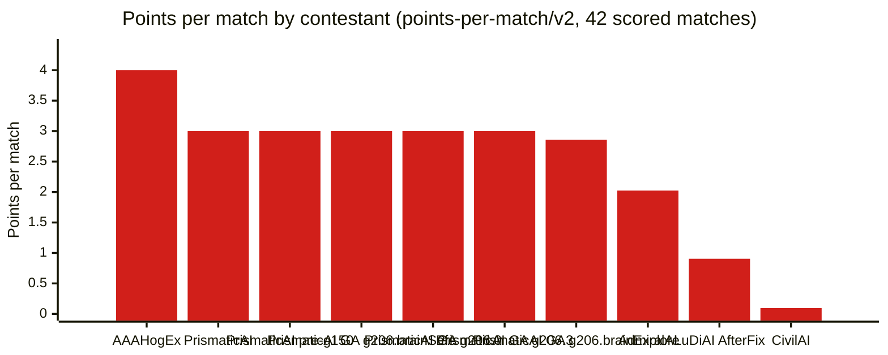
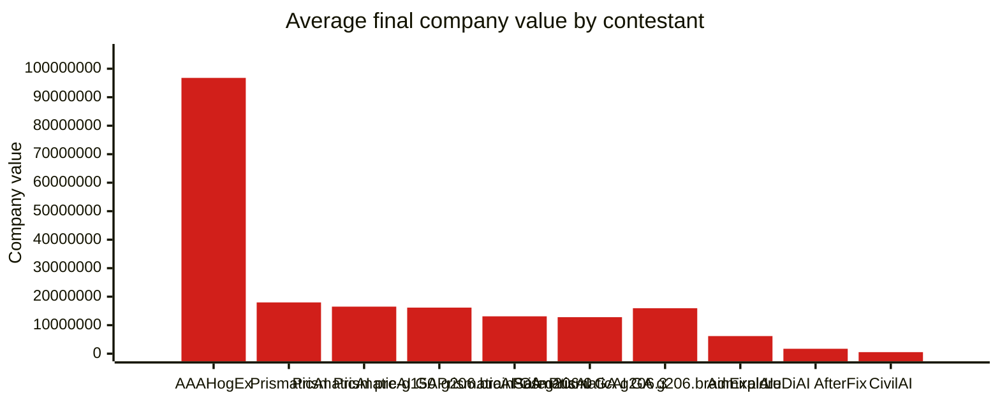
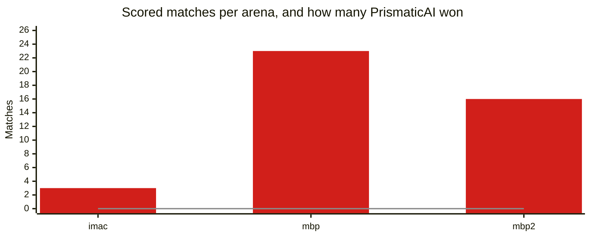

# battle-20261121T004433-7eeca7e8

Derived from `battle-20261121T004433-7eeca7e8.json` by `tools/research/ai-battle/battle.py report`; do not edit.

- Edition `7eeca7e804a81a2d`: PrismaticAI and referee at `962699034c20d90baeb9f617789ea6558cc6ff52`, base set `opengfx-8.0.tar`
- 20-year free-for-all from 1960, map 256x256 temperate, breakdowns 1
- 42 scored match(es) on `imac` (20261119-master-gdf1e05e7d8), `mbp` (20261120-master-m17653b726e), `mbp2` (20261119-master-gdf1e05e7d8)
- Replays: 1 of 1 identical to their original on another arena

| # | Contestant | Played | Wins | Points | Points/match | Avg rank | Avg final value | Squirrel errors | Matches with anomalies |
|---|---|---|---|---|---|---|---|---|---|
| 1 | AAAHogEx | 42 | 42 | 168 | 4.0 | 1.0 | 96.8 M | 68 | 1 |
| 2 | PrismaticAI | 6 | 0 | 18 | 3.0 | 2.0 | 18.0 M | 0 | 0 |
| 3 | PrismaticAI pre-g150 | 8 | 0 | 24 | 3.0 | 2.0 | 16.5 M | 0 | 3 |
| 4 | PrismaticAI GA g206.brainSafe | 7 | 0 | 21 | 3.0 | 2.0 | 16.2 M | 0 | 4 |
| 5 | PrismaticAI GA g206.0 | 8 | 0 | 24 | 3.0 | 2.0 | 13.1 M | 0 | 0 |
| 6 | PrismaticAI GA g206.3 | 6 | 0 | 18 | 3.0 | 2.0 | 12.8 M | 0 | 4 |
| 7 | PrismaticAI GA g206.brainExplore | 7 | 0 | 20 | 2.857 | 2.14 | 16.0 M | 0 | 2 |
| 8 | AdmiralAI | 42 | 0 | 85 | 2.024 | 2.98 | 6.2 M | 0 | 4 |
| 9 | LuDiAI AfterFix | 42 | 0 | 38 | 0.905 | 4.1 | 1.7 M | 0 | 2 |
| 10 | CivilAI | 42 | 0 | 4 | 0.095 | 4.9 | 536.3 k | 0 | 10 |

```mermaid
---
config:
  xyChart:
    width: 900
    height: 360
  themeVariables:
    xyChart:
      plotColorPalette: "#d11f1a, #8a8a8a, #0b0b0b, #ece4d6"
---
xychart-beta
    title "Final company value per scored match: winner vs best PrismaticAI"
    x-axis ["m-0001", "m-0002", "m-0003", "m-0004", "m-0005", "m-0006", "m-0007", "m-0008", "m-0009", "m-0010", "m-0011", "m-0012", "m-0013", "m-0014", "m-0015", "m-0016", "m-0017", "m-0018", "m-0019", "m-0020", "m-0021", "m-0022", "m-0023", "m-0024", "m-0025", "m-0026", "m-0027", "m-0028", "m-0036", "m-0037", "m-0038", "m-0039", "m-0040", "m-0041", "m-0042", "m-0043", "m-0044", "m-0045", "m-0046", "m-0047", "m-0049", "m-0050"]
    %% series: Winner | Best PrismaticAI
    %% links: battle-20261121T004433-7eeca7e8.md?col=Match&filter=m-0001 | battle-20261121T004433-7eeca7e8.md?col=Match&filter=m-0002 | battle-20261121T004433-7eeca7e8.md?col=Match&filter=m-0003 | battle-20261121T004433-7eeca7e8.md?col=Match&filter=m-0004 | battle-20261121T004433-7eeca7e8.md?col=Match&filter=m-0005 | battle-20261121T004433-7eeca7e8.md?col=Match&filter=m-0006 | battle-20261121T004433-7eeca7e8.md?col=Match&filter=m-0007 | battle-20261121T004433-7eeca7e8.md?col=Match&filter=m-0008 | battle-20261121T004433-7eeca7e8.md?col=Match&filter=m-0009 | battle-20261121T004433-7eeca7e8.md?col=Match&filter=m-0010 | battle-20261121T004433-7eeca7e8.md?col=Match&filter=m-0011 | battle-20261121T004433-7eeca7e8.md?col=Match&filter=m-0012 | battle-20261121T004433-7eeca7e8.md?col=Match&filter=m-0013 | battle-20261121T004433-7eeca7e8.md?col=Match&filter=m-0014 | battle-20261121T004433-7eeca7e8.md?col=Match&filter=m-0015 | battle-20261121T004433-7eeca7e8.md?col=Match&filter=m-0016 | battle-20261121T004433-7eeca7e8.md?col=Match&filter=m-0017 | battle-20261121T004433-7eeca7e8.md?col=Match&filter=m-0018 | battle-20261121T004433-7eeca7e8.md?col=Match&filter=m-0019 | battle-20261121T004433-7eeca7e8.md?col=Match&filter=m-0020 | battle-20261121T004433-7eeca7e8.md?col=Match&filter=m-0021 | battle-20261121T004433-7eeca7e8.md?col=Match&filter=m-0022 | battle-20261121T004433-7eeca7e8.md?col=Match&filter=m-0023 | battle-20261121T004433-7eeca7e8.md?col=Match&filter=m-0024 | battle-20261121T004433-7eeca7e8.md?col=Match&filter=m-0025 | battle-20261121T004433-7eeca7e8.md?col=Match&filter=m-0026 | battle-20261121T004433-7eeca7e8.md?col=Match&filter=m-0027 | battle-20261121T004433-7eeca7e8.md?col=Match&filter=m-0028 | battle-20261121T004433-7eeca7e8.md?col=Match&filter=m-0036 | battle-20261121T004433-7eeca7e8.md?col=Match&filter=m-0037 | battle-20261121T004433-7eeca7e8.md?col=Match&filter=m-0038 | battle-20261121T004433-7eeca7e8.md?col=Match&filter=m-0039 | battle-20261121T004433-7eeca7e8.md?col=Match&filter=m-0040 | battle-20261121T004433-7eeca7e8.md?col=Match&filter=m-0041 | battle-20261121T004433-7eeca7e8.md?col=Match&filter=m-0042 | battle-20261121T004433-7eeca7e8.md?col=Match&filter=m-0043 | battle-20261121T004433-7eeca7e8.md?col=Match&filter=m-0044 | battle-20261121T004433-7eeca7e8.md?col=Match&filter=m-0045 | battle-20261121T004433-7eeca7e8.md?col=Match&filter=m-0046 | battle-20261121T004433-7eeca7e8.md?col=Match&filter=m-0047 | battle-20261121T004433-7eeca7e8.md?col=Match&filter=m-0049 | battle-20261121T004433-7eeca7e8.md?col=Match&filter=m-0050
    y-axis "Company value" 0 --> 156000000
    bar [107020981, 109028397, 84299978, 101712300, 116664071, 107407436, 114300194, 125220791, 131177122, 141992939, 136878104, 104660830, 93022727, 87621489, 90669472, 100699093, 101800794, 63736111, 68353579, 65994212, 78600502, 47875960, 67825013, 89820485, 75880460, 107871148, 109193812, 92946039, 84433327, 110436980, 90725915, 78476834, 96600352, 85657968, 93546090, 88627250, 88948806, 107996609, 90209348, 124520408, 88131091, 114069488]
    line [14909562, 16084582, 15925692, 14728006, 16403862, 14336334, 12214820, 4531057, 8075805, 13379517, 11456704, 17935019, 13001247, 13978182, 14814781, 18759399, 11422717, 18127303, 17708456, 8818895, 16438129, 9238403, 10867768, 14358418, 11050277, 11332987, 11495110, 13160832, 22847236, 19216092, 17996602, 21899559, 21552235, 13746475, 20319351, 23767904, 17084523, 24504208, 20853963, 12977201, 20175174, 15006307]
```

<!-- battle-charts:begin -->
<!-- derived from battle-20261121T004433-7eeca7e8.json by `battle.py render`; `battle.py check` fails when it is stale -->

<!-- battle-charts:end -->

| Seed | Original | Replay | Arenas | Identical |
|---|---|---|---|---|
| 627344027 | m-0014 | m-0048 | mbp2 / mbp | yes |

| Match | Arena | Seed | Winner | Value | Last | Anomalies |
|---|---|---|---|---|---|---|
| m-0001 | mbp | 197829924 | AAAHogEx | 107.0 M | CivilAI | - |
| m-0002 | mbp | 197829924 | AAAHogEx | 109.0 M | CivilAI | LuDiAI AfterFix: fleet_drop:143->98 |
| m-0003 | mbp | 197829924 | AAAHogEx | 84.3 M | CivilAI | CivilAI: fleet_drop:68->29 |
| m-0004 | mbp | 197829924 | AAAHogEx | 101.7 M | CivilAI | - |
| m-0005 | mbp | 197829924 | AAAHogEx | 116.7 M | CivilAI | - |
| m-0006 | mbp | 1427945914 | AAAHogEx | 107.4 M | CivilAI | - |
| m-0007 | mbp | 1427945914 | AAAHogEx | 114.3 M | CivilAI | - |
| m-0008 | mbp | 1427945914 | AAAHogEx | 125.2 M | CivilAI | CivilAI: fleet_drop:39->19 |
| m-0009 | mbp | 1427945914 | AAAHogEx | 131.2 M | CivilAI | - |
| m-0010 | imac | 1427945914 | AAAHogEx | 142.0 M | CivilAI | - |
| m-0011 | imac | 1427945914 | AAAHogEx | 136.9 M | CivilAI | PrismaticAI GA g206.3: fleet_drop:144->99 |
| m-0012 | imac | 627344027 | AAAHogEx | 104.7 M | CivilAI | - |
| m-0013 | mbp2 | 627344027 | AAAHogEx | 93.0 M | CivilAI | PrismaticAI pre-g150: fleet_drop:140->82 |
| m-0014 | mbp2 | 627344027 | AAAHogEx | 87.6 M | CivilAI | CivilAI: fleet_drop:35->23 |
| m-0015 | mbp2 | 627344027 | AAAHogEx | 90.7 M | CivilAI | PrismaticAI GA g206.brainSafe: fleet_drop:92->63; CivilAI: fleet_drop:21->13 |
| m-0016 | mbp2 | 627344027 | AAAHogEx | 100.7 M | CivilAI | - |
| m-0017 | mbp2 | 627344027 | AAAHogEx | 101.8 M | CivilAI | PrismaticAI GA g206.3: fleet_drop:93->45 |
| m-0018 | mbp2 | 392826822 | AAAHogEx | 63.7 M | LuDiAI AfterFix | - |
| m-0019 | mbp2 | 392826822 | AAAHogEx | 68.4 M | CivilAI | - |
| m-0020 | mbp2 | 392826822 | AAAHogEx | 66.0 M | CivilAI | - |
| m-0021 | mbp2 | 392826822 | AAAHogEx | 78.6 M | CivilAI | PrismaticAI GA g206.brainSafe: fleet_drop:113->74; AdmiralAI: fleet_drop:147->94 |
| m-0022 | mbp2 | 392826822 | AAAHogEx | 47.9 M | CivilAI | PrismaticAI GA g206.brainExplore: fleet_drop:71->47 |
| m-0023 | mbp2 | 392826822 | AAAHogEx | 67.8 M | CivilAI | CivilAI: fleet_drop:54->25 |
| m-0024 | mbp2 | 866268010 | AAAHogEx | 89.8 M | LuDiAI AfterFix | - |
| m-0025 | mbp2 | 866268010 | AAAHogEx | 75.9 M | LuDiAI AfterFix | - |
| m-0026 | mbp2 | 866268010 | AAAHogEx | 107.9 M | CivilAI | LuDiAI AfterFix: fleet_drop:42->29; CivilAI: fleet_drop:13->3 |
| m-0027 | mbp2 | 866268010 | AAAHogEx | 109.2 M | CivilAI | - |
| m-0028 | mbp2 | 866268010 | AAAHogEx | 92.9 M | CivilAI | PrismaticAI GA g206.brainExplore: fleet_drop:77->49 |
| m-0036 | mbp | 748653930 | AAAHogEx | 84.4 M | CivilAI | - |
| m-0037 | mbp | 748653930 | AAAHogEx | 110.4 M | CivilAI | PrismaticAI pre-g150: fleet_drop:133->59 |
| m-0038 | mbp | 748653930 | AAAHogEx | 90.7 M | CivilAI | - |
| m-0039 | mbp | 748653930 | AAAHogEx | 78.5 M | CivilAI | PrismaticAI GA g206.brainSafe: fleet_drop:105->72 |
| m-0040 | mbp | 748653930 | AAAHogEx | 96.6 M | CivilAI | - |
| m-0041 | mbp | 748653930 | AAAHogEx | 85.7 M | CivilAI | PrismaticAI GA g206.3: fleet_drop:132->65 |
| m-0042 | mbp | 1964038830 | AAAHogEx | 93.5 M | CivilAI | AdmiralAI: fleet_drop:373->231 |
| m-0043 | mbp | 1964038830 | AAAHogEx | 88.6 M | CivilAI | AdmiralAI: fleet_drop:423->284 |
| m-0044 | mbp | 1964038830 | AAAHogEx | 88.9 M | LuDiAI AfterFix | AAAHogEx: squirrel_errors:68 |
| m-0045 | mbp | 1964038830 | AAAHogEx | 108.0 M | CivilAI | PrismaticAI GA g206.brainSafe: fleet_drop:134->90; CivilAI: fleet_drop:44->28 |
| m-0046 | mbp | 1964038830 | AAAHogEx | 90.2 M | CivilAI | AdmiralAI: fleet_drop:498->339 |
| m-0047 | mbp | 1964038830 | AAAHogEx | 124.5 M | CivilAI | PrismaticAI GA g206.3: fleet_drop:137->92; CivilAI: fleet_drop:51->15 |
| m-0048 (replay) | mbp | 627344027 | AAAHogEx | 87.6 M | CivilAI | CivilAI: fleet_drop:35->23 |
| m-0049 | mbp | 1664805660 | AAAHogEx | 88.1 M | CivilAI | PrismaticAI pre-g150: fleet_drop:91->55; CivilAI: fleet_drop:55->25 |
| m-0050 | mbp | 1664805660 | AAAHogEx | 114.1 M | CivilAI | CivilAI: fleet_drop:33->20 |
