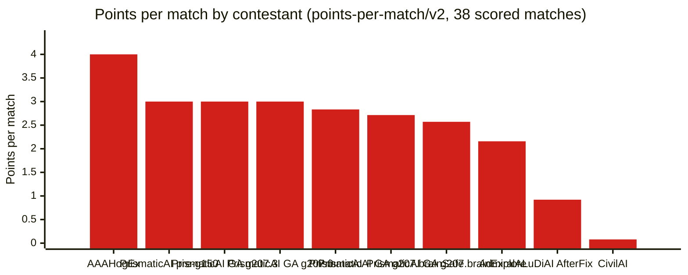
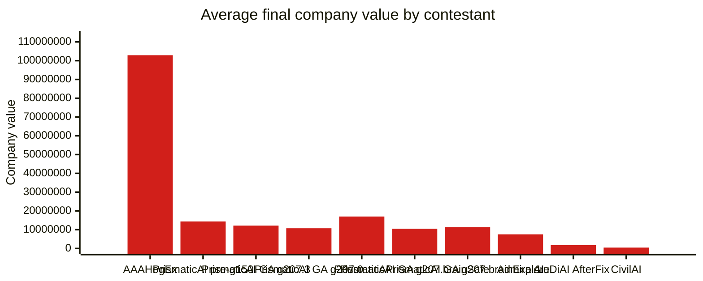
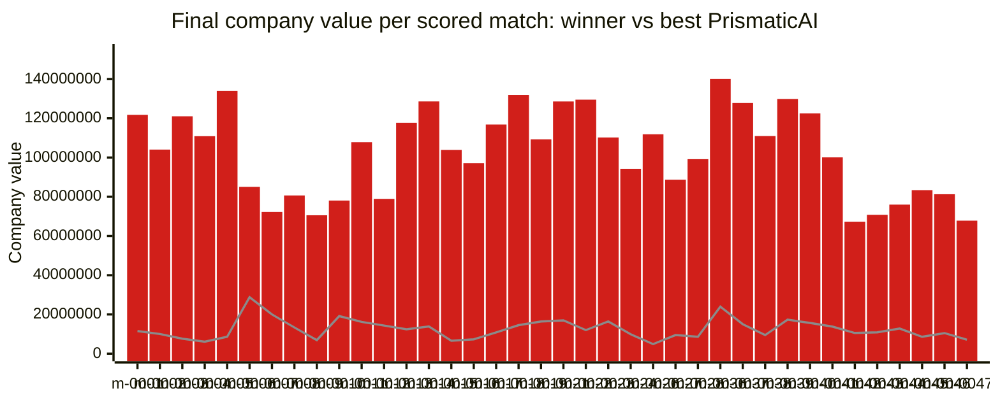
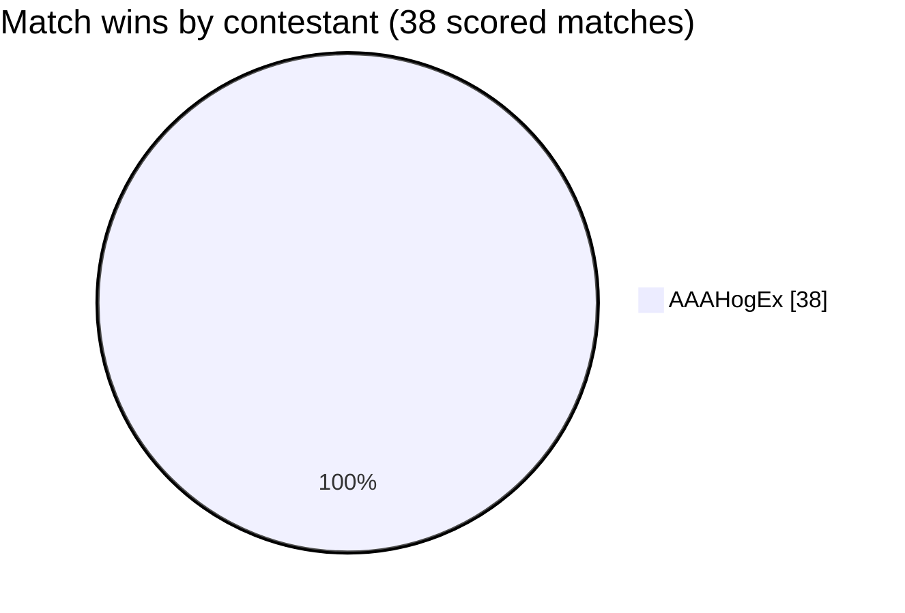
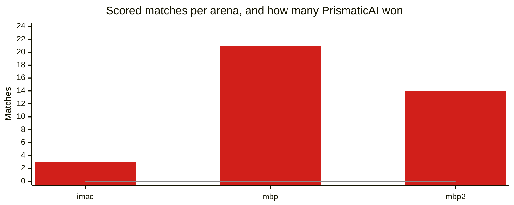

# battle-20261121T005410-428f521c

Derived from `battle-20261121T005410-428f521c.json` by `tools/research/ai-battle/battle.py report`; do not edit.

- Edition `428f521cfc84789d`: PrismaticAI and referee at `962699034c20d90baeb9f617789ea6558cc6ff52`, base set `opengfx-8.0.tar`
- 20-year free-for-all from 1960, map 256x256 temperate, breakdowns 1
- 38 scored match(es) on `imac` (20261119-master-gdf1e05e7d8), `mbp` (20261120-master-m17653b726e), `mbp2` (20261119-master-gdf1e05e7d8)
- Replays: 0 of 0 identical to their original on another arena

| # | Contestant | Played | Wins | Points | Points/match | Avg rank | Avg final value | Squirrel errors | Matches with anomalies |
|---|---|---|---|---|---|---|---|---|---|
| 1 | AAAHogEx | 38 | 38 | 152 | 4.0 | 1.0 | 102.9 M | 0 | 0 |
| 2 | PrismaticAI pre-g150 | 6 | 0 | 18 | 3.0 | 2.0 | 14.4 M | 0 | 3 |
| 3 | PrismaticAI GA g207.3 | 6 | 0 | 18 | 3.0 | 2.0 | 12.2 M | 0 | 1 |
| 4 | PrismaticAI GA g207.0 | 6 | 0 | 18 | 3.0 | 2.0 | 10.7 M | 0 | 0 |
| 5 | PrismaticAI | 6 | 0 | 17 | 2.833 | 2.17 | 17.0 M | 0 | 0 |
| 6 | PrismaticAI GA g207.brainSafe | 7 | 0 | 19 | 2.714 | 2.29 | 10.5 M | 0 | 0 |
| 7 | PrismaticAI GA g207.brainExplore | 7 | 0 | 18 | 2.571 | 2.43 | 11.3 M | 0 | 1 |
| 8 | AdmiralAI | 38 | 0 | 82 | 2.158 | 2.84 | 7.5 M | 0 | 0 |
| 9 | LuDiAI AfterFix | 38 | 0 | 35 | 0.921 | 4.08 | 1.7 M | 0 | 1 |
| 10 | CivilAI | 38 | 0 | 3 | 0.079 | 4.92 | 455.5 k | 0 | 7 |

<!-- battle-charts:begin -->
<!-- derived from battle-20261121T005410-428f521c.json by `battle.py render`; `battle.py check` fails when it is stale -->

<!-- battle-charts:end -->

| Match | Arena | Seed | Winner | Value | Last | Anomalies |
|---|---|---|---|---|---|---|
| m-0001 | mbp | 1714657969 | AAAHogEx | 121.8 M | CivilAI | PrismaticAI pre-g150: fleet_drop:55->37 |
| m-0002 | mbp | 1714657969 | AAAHogEx | 104.1 M | CivilAI | - |
| m-0003 | mbp | 1714657969 | AAAHogEx | 121.0 M | CivilAI | - |
| m-0004 | mbp | 1714657969 | AAAHogEx | 110.9 M | CivilAI | - |
| m-0005 | mbp | 1714657969 | AAAHogEx | 133.9 M | CivilAI | - |
| m-0006 | mbp | 383608553 | AAAHogEx | 85.0 M | CivilAI | CivilAI: fleet_drop:44->24 |
| m-0007 | mbp | 383608553 | AAAHogEx | 72.2 M | CivilAI | - |
| m-0008 | mbp | 383608553 | AAAHogEx | 80.7 M | CivilAI | - |
| m-0009 | mbp | 383608553 | AAAHogEx | 70.6 M | CivilAI | LuDiAI AfterFix: fleet_drop:76->52 |
| m-0010 | imac | 383608553 | AAAHogEx | 78.1 M | CivilAI | CivilAI: fleet_drop:66->26 |
| m-0011 | imac | 383608553 | AAAHogEx | 107.8 M | CivilAI | - |
| m-0012 | imac | 1382186102 | AAAHogEx | 78.9 M | LuDiAI AfterFix | - |
| m-0013 | mbp2 | 1382186102 | AAAHogEx | 117.7 M | CivilAI | PrismaticAI pre-g150: fleet_drop:49->34 |
| m-0014 | mbp2 | 1382186102 | AAAHogEx | 128.6 M | CivilAI | - |
| m-0015 | mbp2 | 1382186102 | AAAHogEx | 103.9 M | CivilAI | - |
| m-0016 | mbp2 | 1382186102 | AAAHogEx | 97.1 M | CivilAI | CivilAI: fleet_drop:44->28 |
| m-0017 | mbp2 | 1382186102 | AAAHogEx | 116.8 M | CivilAI | PrismaticAI GA g207.3: fleet_drop:98->67 |
| m-0018 | mbp2 | 1564522130 | AAAHogEx | 131.9 M | CivilAI | - |
| m-0019 | mbp2 | 1564522130 | AAAHogEx | 109.3 M | CivilAI | PrismaticAI pre-g150: fleet_drop:85->49; CivilAI: no_vehicles |
| m-0021 | mbp2 | 1564522130 | AAAHogEx | 128.6 M | CivilAI | - |
| m-0022 | mbp2 | 1564522130 | AAAHogEx | 129.5 M | CivilAI | PrismaticAI GA g207.brainExplore: fleet_drop:108->70 |
| m-0023 | mbp2 | 1564522130 | AAAHogEx | 110.2 M | CivilAI | - |
| m-0024 | mbp2 | 34307411 | AAAHogEx | 94.3 M | LuDiAI AfterFix | - |
| m-0026 | mbp2 | 34307411 | AAAHogEx | 111.9 M | CivilAI | CivilAI: fleet_drop:46->21 |
| m-0027 | mbp2 | 34307411 | AAAHogEx | 88.7 M | CivilAI | CivilAI: fleet_drop:65->44 |
| m-0028 | mbp2 | 34307411 | AAAHogEx | 99.2 M | CivilAI | - |
| m-0036 | mbp | 1031681075 | AAAHogEx | 140.1 M | CivilAI | - |
| m-0037 | mbp | 1031681075 | AAAHogEx | 127.8 M | CivilAI | - |
| m-0038 | mbp | 1031681075 | AAAHogEx | 111.0 M | CivilAI | - |
| m-0039 | mbp | 1031681075 | AAAHogEx | 129.9 M | LuDiAI AfterFix | - |
| m-0040 | mbp | 1031681075 | AAAHogEx | 122.5 M | CivilAI | - |
| m-0041 | mbp | 1031681075 | AAAHogEx | 100.1 M | CivilAI | - |
| m-0042 | mbp | 1600175019 | AAAHogEx | 67.3 M | CivilAI | - |
| m-0043 | mbp | 1600175019 | AAAHogEx | 70.8 M | CivilAI | - |
| m-0044 | mbp | 1600175019 | AAAHogEx | 76.0 M | CivilAI | CivilAI: fleet_drop:19->8 |
| m-0045 | mbp | 1600175019 | AAAHogEx | 83.4 M | CivilAI | - |
| m-0046 | mbp | 1600175019 | AAAHogEx | 81.3 M | CivilAI | - |
| m-0047 | mbp | 1600175019 | AAAHogEx | 67.8 M | CivilAI | - |
