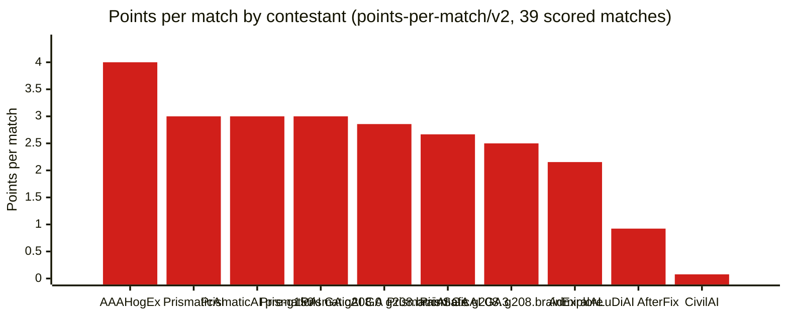
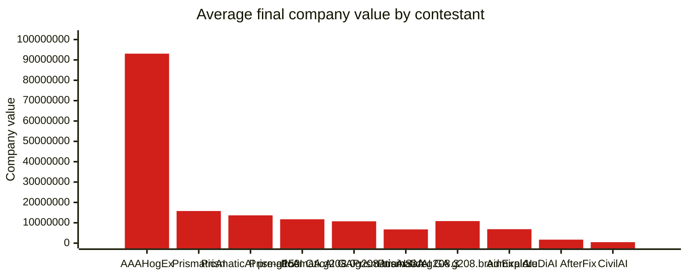
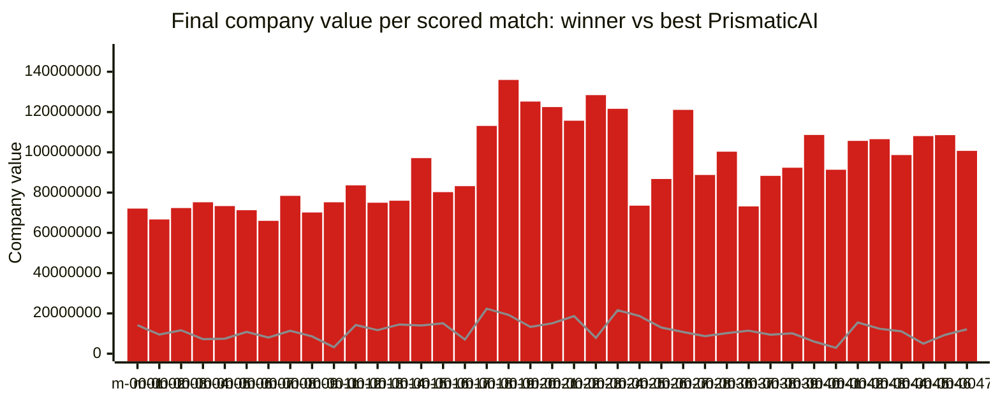
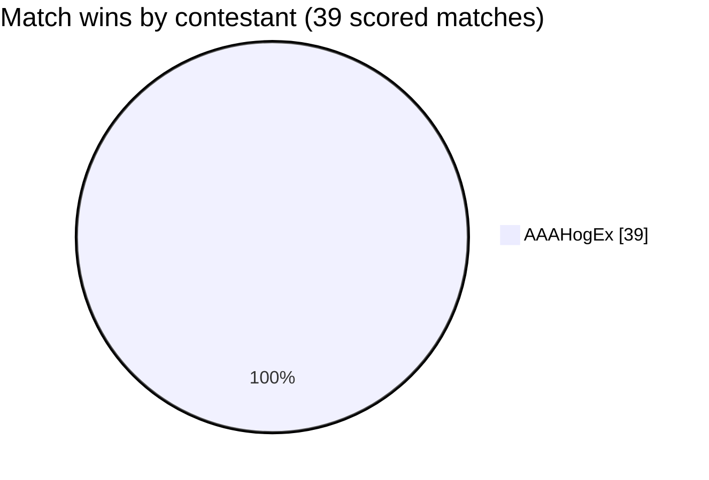
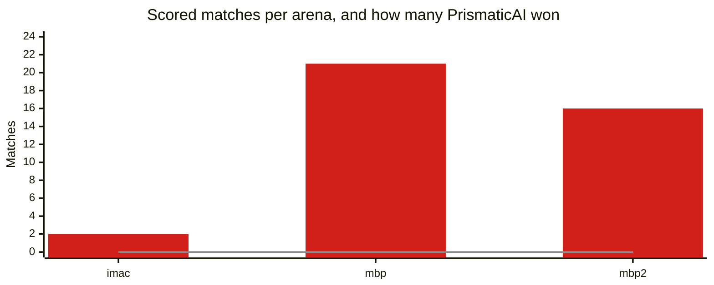

# battle-20261121T010353-cc18ed98

Derived from `battle-20261121T010353-cc18ed98.json` by `tools/research/ai-battle/battle.py report`; do not edit.

- Edition `cc18ed9812bb9e26`: PrismaticAI and referee at `962699034c20d90baeb9f617789ea6558cc6ff52`, base set `opengfx-8.0.tar`
- 20-year free-for-all from 1960, map 256x256 temperate, breakdowns 1
- 39 scored match(es) on `imac` (20261119-master-gdf1e05e7d8), `mbp` (20261120-master-m17653b726e), `mbp2` (20261119-master-gdf1e05e7d8)
- Replays: 0 of 0 identical to their original on another arena

| # | Contestant | Played | Wins | Points | Points/match | Avg rank | Avg final value | Squirrel errors | Matches with anomalies |
|---|---|---|---|---|---|---|---|---|---|
| 1 | AAAHogEx | 39 | 39 | 156 | 4.0 | 1.0 | 93.1 M | 35 | 1 |
| 2 | PrismaticAI | 6 | 0 | 18 | 3.0 | 2.0 | 15.8 M | 0 | 0 |
| 3 | PrismaticAI pre-g150 | 7 | 0 | 21 | 3.0 | 2.0 | 13.7 M | 0 | 3 |
| 4 | PrismaticAI GA g208.0 | 7 | 0 | 21 | 3.0 | 2.0 | 11.7 M | 0 | 0 |
| 5 | PrismaticAI GA g208.brainSafe | 7 | 0 | 20 | 2.857 | 2.14 | 10.7 M | 0 | 0 |
| 6 | PrismaticAI GA g208.3 | 6 | 0 | 16 | 2.667 | 2.33 | 6.7 M | 0 | 1 |
| 7 | PrismaticAI GA g208.brainExplore | 6 | 0 | 15 | 2.5 | 2.5 | 10.8 M | 0 | 2 |
| 8 | AdmiralAI | 39 | 0 | 84 | 2.154 | 2.85 | 6.9 M | 153 | 3 |
| 9 | LuDiAI AfterFix | 39 | 0 | 36 | 0.923 | 4.08 | 1.7 M | 0 | 0 |
| 10 | CivilAI | 39 | 0 | 3 | 0.077 | 4.92 | 476.4 k | 3685 | 11 |

<!-- battle-charts:begin -->
<!-- derived from battle-20261121T010353-cc18ed98.json by `battle.py render`; `battle.py check` fails when it is stale -->

<!-- battle-charts:end -->

| Match | Arena | Seed | Winner | Value | Last | Anomalies |
|---|---|---|---|---|---|---|
| m-0001 | mbp | 126475049 | AAAHogEx | 72.0 M | CivilAI | CivilAI: squirrel_errors:3685 |
| m-0002 | mbp | 126475049 | AAAHogEx | 66.7 M | CivilAI | - |
| m-0003 | mbp | 126475049 | AAAHogEx | 72.3 M | CivilAI | CivilAI: fleet_drop:13->8 |
| m-0004 | mbp | 126475049 | AAAHogEx | 75.2 M | CivilAI | - |
| m-0005 | mbp | 126475049 | AAAHogEx | 73.3 M | CivilAI | PrismaticAI GA g208.3: fleet_drop:113->78 |
| m-0006 | mbp | 156371557 | AAAHogEx | 71.2 M | CivilAI | - |
| m-0007 | mbp | 156371557 | AAAHogEx | 66.0 M | CivilAI | - |
| m-0008 | mbp | 156371557 | AAAHogEx | 78.4 M | CivilAI | - |
| m-0009 | mbp | 156371557 | AAAHogEx | 70.1 M | CivilAI | CivilAI: fleet_drop:49->23 |
| m-0011 | imac | 156371557 | AAAHogEx | 75.2 M | CivilAI | CivilAI: fleet_drop:27->13 |
| m-0012 | imac | 1981284013 | AAAHogEx | 83.6 M | LuDiAI AfterFix | - |
| m-0013 | mbp2 | 1981284013 | AAAHogEx | 75.0 M | CivilAI | PrismaticAI pre-g150: fleet_drop:77->49 |
| m-0014 | mbp2 | 1981284013 | AAAHogEx | 76.0 M | LuDiAI AfterFix | - |
| m-0015 | mbp2 | 1981284013 | AAAHogEx | 97.1 M | CivilAI | - |
| m-0016 | mbp2 | 1981284013 | AAAHogEx | 80.2 M | LuDiAI AfterFix | - |
| m-0017 | mbp2 | 1981284013 | AAAHogEx | 83.2 M | CivilAI | AAAHogEx: squirrel_errors:35 |
| m-0018 | mbp2 | 98015036 | AAAHogEx | 113.1 M | CivilAI | - |
| m-0019 | mbp2 | 98015036 | AAAHogEx | 135.9 M | CivilAI | - |
| m-0020 | mbp2 | 98015036 | AAAHogEx | 125.2 M | CivilAI | CivilAI: fleet_drop:53->37 |
| m-0021 | mbp2 | 98015036 | AAAHogEx | 122.5 M | CivilAI | CivilAI: fleet_drop:17->6 |
| m-0022 | mbp2 | 98015036 | AAAHogEx | 115.7 M | CivilAI | - |
| m-0023 | mbp2 | 98015036 | AAAHogEx | 128.4 M | CivilAI | - |
| m-0024 | mbp2 | 16179225 | AAAHogEx | 121.6 M | CivilAI | - |
| m-0025 | mbp2 | 16179225 | AAAHogEx | 73.5 M | CivilAI | - |
| m-0026 | mbp2 | 16179225 | AAAHogEx | 86.7 M | CivilAI | - |
| m-0027 | mbp2 | 16179225 | AAAHogEx | 121.1 M | CivilAI | - |
| m-0028 | mbp2 | 16179225 | AAAHogEx | 88.7 M | CivilAI | PrismaticAI GA g208.brainExplore: fleet_drop:106->64; CivilAI: fleet_drop:26->13 |
| m-0036 | mbp | 1179702810 | AAAHogEx | 100.3 M | CivilAI | CivilAI: fleet_drop:42->16 |
| m-0037 | mbp | 1179702810 | AAAHogEx | 73.1 M | CivilAI | PrismaticAI pre-g150: fleet_drop:88->48; CivilAI: fleet_drop:15->9 |
| m-0038 | mbp | 1179702810 | AAAHogEx | 88.3 M | CivilAI | - |
| m-0039 | mbp | 1179702810 | AAAHogEx | 92.3 M | CivilAI | AdmiralAI: squirrel_errors:44; CivilAI: fleet_drop:28->16 |
| m-0040 | mbp | 1179702810 | AAAHogEx | 108.6 M | CivilAI | AdmiralAI: squirrel_errors:47 |
| m-0041 | mbp | 1179702810 | AAAHogEx | 91.3 M | CivilAI | - |
| m-0042 | mbp | 155340657 | AAAHogEx | 105.7 M | CivilAI | - |
| m-0043 | mbp | 155340657 | AAAHogEx | 106.5 M | CivilAI | PrismaticAI pre-g150: fleet_drop:105->68; AdmiralAI: squirrel_errors:62 |
| m-0044 | mbp | 155340657 | AAAHogEx | 98.6 M | CivilAI | - |
| m-0045 | mbp | 155340657 | AAAHogEx | 108.1 M | CivilAI | - |
| m-0046 | mbp | 155340657 | AAAHogEx | 108.5 M | CivilAI | PrismaticAI GA g208.brainExplore: fleet_drop:166->93 |
| m-0047 | mbp | 155340657 | AAAHogEx | 100.7 M | CivilAI | CivilAI: fleet_drop:15->9 |
