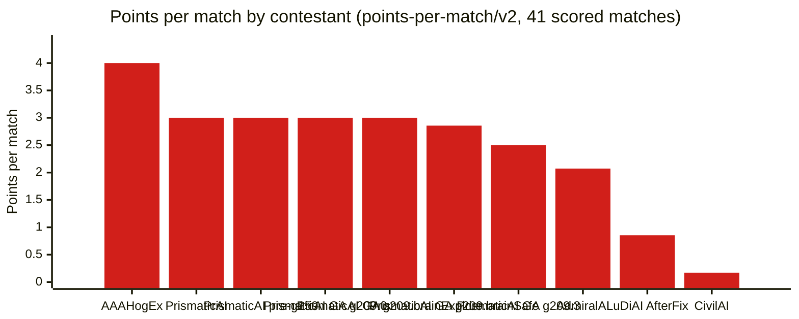
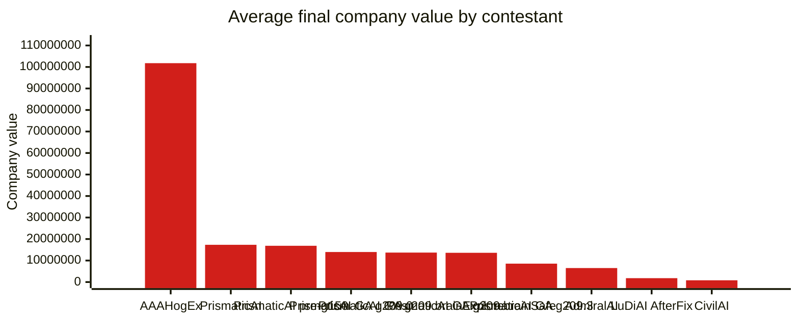
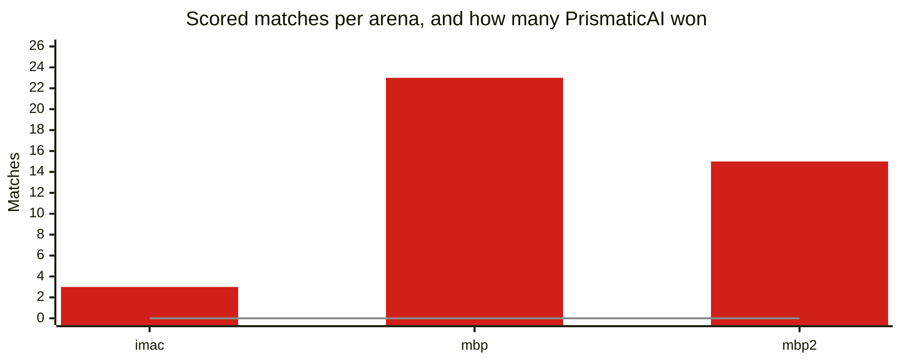

# battle-20261121T011326-37270c2c

Derived from `battle-20261121T011326-37270c2c.json` by `tools/research/ai-battle/battle.py report`; do not edit.

- Edition `37270c2c045521c9`: PrismaticAI and referee at `962699034c20d90baeb9f617789ea6558cc6ff52`, base set `opengfx-8.0.tar`
- 20-year free-for-all from 1960, map 256x256 temperate, breakdowns 1
- 41 scored match(es) on `imac` (20261119-master-gdf1e05e7d8), `mbp` (20261120-master-m17653b726e), `mbp2` (20261119-master-gdf1e05e7d8)
- Replays: 0 of 1 identical to their original on another arena

| # | Contestant | Played | Wins | Points | Points/match | Avg rank | Avg final value | Squirrel errors | Matches with anomalies |
|---|---|---|---|---|---|---|---|---|---|
| 1 | AAAHogEx | 41 | 41 | 164 | 4.0 | 1.0 | 101.8 M | 0 | 0 |
| 2 | PrismaticAI | 6 | 0 | 18 | 3.0 | 2.0 | 17.3 M | 0 | 0 |
| 3 | PrismaticAI pre-g150 | 8 | 0 | 24 | 3.0 | 2.0 | 16.9 M | 0 | 1 |
| 4 | PrismaticAI GA g209.0 | 8 | 0 | 24 | 3.0 | 2.0 | 14.0 M | 0 | 0 |
| 5 | PrismaticAI GA g209.brainExplore | 6 | 0 | 18 | 3.0 | 2.0 | 13.7 M | 0 | 2 |
| 6 | PrismaticAI GA g209.brainSafe | 7 | 0 | 20 | 2.857 | 2.14 | 13.6 M | 0 | 1 |
| 7 | PrismaticAI GA g209.3 | 6 | 0 | 15 | 2.5 | 2.5 | 8.6 M | 0 | 2 |
| 8 | AdmiralAI | 41 | 0 | 85 | 2.073 | 2.93 | 6.5 M | 44 | 4 |
| 9 | LuDiAI AfterFix | 41 | 0 | 35 | 0.854 | 4.15 | 1.8 M | 0 | 0 |
| 10 | CivilAI | 41 | 0 | 7 | 0.171 | 4.83 | 817.2 k | 0 | 10 |

```mermaid
---
config:
  xyChart:
    width: 900
    height: 360
  themeVariables:
    xyChart:
      plotColorPalette: "#d11f1a, #8a8a8a, #0b0b0b, #ece4d6"
---
xychart-beta
    title "Final company value per scored match: winner vs best PrismaticAI"
    x-axis ["m-0001", "m-0002", "m-0003", "m-0004", "m-0005", "m-0006", "m-0007", "m-0008", "m-0009", "m-0010", "m-0011", "m-0012", "m-0013", "m-0014", "m-0015", "m-0016", "m-0017", "m-0018", "m-0019", "m-0020", "m-0021", "m-0023", "m-0024", "m-0025", "m-0026", "m-0027", "m-0028", "m-0036", "m-0037", "m-0038", "m-0039", "m-0040", "m-0041", "m-0042", "m-0043", "m-0044", "m-0045", "m-0046", "m-0047", "m-0049", "m-0050"]
    %% series: Winner | Best PrismaticAI
    %% links: battle-20261121T011326-37270c2c.md?col=Match&filter=m-0001 | battle-20261121T011326-37270c2c.md?col=Match&filter=m-0002 | battle-20261121T011326-37270c2c.md?col=Match&filter=m-0003 | battle-20261121T011326-37270c2c.md?col=Match&filter=m-0004 | battle-20261121T011326-37270c2c.md?col=Match&filter=m-0005 | battle-20261121T011326-37270c2c.md?col=Match&filter=m-0006 | battle-20261121T011326-37270c2c.md?col=Match&filter=m-0007 | battle-20261121T011326-37270c2c.md?col=Match&filter=m-0008 | battle-20261121T011326-37270c2c.md?col=Match&filter=m-0009 | battle-20261121T011326-37270c2c.md?col=Match&filter=m-0010 | battle-20261121T011326-37270c2c.md?col=Match&filter=m-0011 | battle-20261121T011326-37270c2c.md?col=Match&filter=m-0012 | battle-20261121T011326-37270c2c.md?col=Match&filter=m-0013 | battle-20261121T011326-37270c2c.md?col=Match&filter=m-0014 | battle-20261121T011326-37270c2c.md?col=Match&filter=m-0015 | battle-20261121T011326-37270c2c.md?col=Match&filter=m-0016 | battle-20261121T011326-37270c2c.md?col=Match&filter=m-0017 | battle-20261121T011326-37270c2c.md?col=Match&filter=m-0018 | battle-20261121T011326-37270c2c.md?col=Match&filter=m-0019 | battle-20261121T011326-37270c2c.md?col=Match&filter=m-0020 | battle-20261121T011326-37270c2c.md?col=Match&filter=m-0021 | battle-20261121T011326-37270c2c.md?col=Match&filter=m-0023 | battle-20261121T011326-37270c2c.md?col=Match&filter=m-0024 | battle-20261121T011326-37270c2c.md?col=Match&filter=m-0025 | battle-20261121T011326-37270c2c.md?col=Match&filter=m-0026 | battle-20261121T011326-37270c2c.md?col=Match&filter=m-0027 | battle-20261121T011326-37270c2c.md?col=Match&filter=m-0028 | battle-20261121T011326-37270c2c.md?col=Match&filter=m-0036 | battle-20261121T011326-37270c2c.md?col=Match&filter=m-0037 | battle-20261121T011326-37270c2c.md?col=Match&filter=m-0038 | battle-20261121T011326-37270c2c.md?col=Match&filter=m-0039 | battle-20261121T011326-37270c2c.md?col=Match&filter=m-0040 | battle-20261121T011326-37270c2c.md?col=Match&filter=m-0041 | battle-20261121T011326-37270c2c.md?col=Match&filter=m-0042 | battle-20261121T011326-37270c2c.md?col=Match&filter=m-0043 | battle-20261121T011326-37270c2c.md?col=Match&filter=m-0044 | battle-20261121T011326-37270c2c.md?col=Match&filter=m-0045 | battle-20261121T011326-37270c2c.md?col=Match&filter=m-0046 | battle-20261121T011326-37270c2c.md?col=Match&filter=m-0047 | battle-20261121T011326-37270c2c.md?col=Match&filter=m-0049 | battle-20261121T011326-37270c2c.md?col=Match&filter=m-0050
    y-axis "Company value" 0 --> 160000000
    bar [137549457, 95202825, 121772027, 145136123, 109292892, 121313866, 131892330, 80251042, 113354662, 100207027, 136956184, 79322676, 81914615, 86628776, 90972725, 102872235, 86803469, 145837407, 102089567, 120682945, 118687339, 132080791, 106792016, 105274826, 109321381, 108475347, 102046325, 113274173, 105575125, 120735659, 122910920, 103807597, 90501726, 53492155, 64007568, 53973801, 49537866, 67584756, 68406113, 90490743, 95462020]
    line [22116322, 14924445, 13059890, 11213700, 10018443, 16815817, 18102123, 13061411, 10156340, 11796081, 13736140, 16074580, 14277213, 14148387, 9173014, 9729046, 4128833, 20642498, 19195269, 17869803, 19629615, 10864210, 18904744, 16147048, 13722115, 18433231, 18563463, 16051853, 16445116, 14879056, 16022973, 20130272, 6660736, 15424814, 9815013, 10207528, 8726758, 10755802, 5917958, 18783124, 12899853]
```

<!-- battle-charts:begin -->
<!-- derived from battle-20261121T011326-37270c2c.json by `battle.py render`; `battle.py check` fails when it is stale -->

<!-- battle-charts:end -->

| Seed | Original | Replay | Arenas | Identical |
|---|---|---|---|---|
| 1563141078 | m-0012 | m-0048 | imac / mbp | NO |

| Match | Arena | Seed | Winner | Value | Last | Anomalies |
|---|---|---|---|---|---|---|
| m-0001 | mbp | 1214744859 | AAAHogEx | 137.5 M | CivilAI | - |
| m-0002 | mbp | 1214744859 | AAAHogEx | 95.2 M | CivilAI | CivilAI: fleet_drop:49->34 |
| m-0003 | mbp | 1214744859 | AAAHogEx | 121.8 M | CivilAI | - |
| m-0004 | mbp | 1214744859 | AAAHogEx | 145.1 M | LuDiAI AfterFix | PrismaticAI GA g209.brainExplore: fleet_drop:54->37 |
| m-0005 | mbp | 1214744859 | AAAHogEx | 109.3 M | CivilAI | PrismaticAI GA g209.3: fleet_drop:103->69 |
| m-0006 | mbp | 788800849 | AAAHogEx | 121.3 M | CivilAI | - |
| m-0007 | mbp | 788800849 | AAAHogEx | 131.9 M | CivilAI | - |
| m-0008 | mbp | 788800849 | AAAHogEx | 80.3 M | LuDiAI AfterFix | CivilAI: fleet_drop:105->58 |
| m-0009 | mbp | 788800849 | AAAHogEx | 113.4 M | CivilAI | - |
| m-0010 | imac | 788800849 | AAAHogEx | 100.2 M | CivilAI | CivilAI: fleet_drop:32->21 |
| m-0011 | imac | 788800849 | AAAHogEx | 137.0 M | CivilAI | CivilAI: fleet_drop:28->9 |
| m-0012 | imac | 1563141078 | AAAHogEx | 79.3 M | CivilAI | AdmiralAI: squirrel_errors:44 |
| m-0013 | mbp2 | 1563141078 | AAAHogEx | 81.9 M | LuDiAI AfterFix | - |
| m-0014 | mbp2 | 1563141078 | AAAHogEx | 86.6 M | LuDiAI AfterFix | CivilAI: fleet_drop:32->21 |
| m-0015 | mbp2 | 1563141078 | AAAHogEx | 91.0 M | CivilAI | - |
| m-0016 | mbp2 | 1563141078 | AAAHogEx | 102.9 M | CivilAI | CivilAI: fleet_drop:22->11 |
| m-0017 | mbp2 | 1563141078 | AAAHogEx | 86.8 M | LuDiAI AfterFix | - |
| m-0018 | mbp2 | 759140875 | AAAHogEx | 145.8 M | LuDiAI AfterFix | - |
| m-0019 | mbp2 | 759140875 | AAAHogEx | 102.1 M | CivilAI | PrismaticAI pre-g150: fleet_drop:95->58 |
| m-0020 | mbp2 | 759140875 | AAAHogEx | 120.7 M | CivilAI | CivilAI: fleet_drop:78->37 |
| m-0021 | mbp2 | 759140875 | AAAHogEx | 118.7 M | CivilAI | - |
| m-0023 | mbp2 | 759140875 | AAAHogEx | 132.1 M | CivilAI | PrismaticAI GA g209.3: fleet_drop:131->71 |
| m-0024 | mbp2 | 1553801773 | AAAHogEx | 106.8 M | CivilAI | - |
| m-0025 | mbp2 | 1553801773 | AAAHogEx | 105.3 M | CivilAI | - |
| m-0026 | mbp2 | 1553801773 | AAAHogEx | 109.3 M | CivilAI | - |
| m-0027 | mbp2 | 1553801773 | AAAHogEx | 108.5 M | CivilAI | AdmiralAI: fleet_drop:158->101 |
| m-0028 | mbp2 | 1553801773 | AAAHogEx | 102.0 M | CivilAI | PrismaticAI GA g209.brainExplore: fleet_drop:73->48 |
| m-0036 | mbp | 11260077 | AAAHogEx | 113.3 M | CivilAI | CivilAI: fleet_drop:34->19 |
| m-0037 | mbp | 11260077 | AAAHogEx | 105.6 M | CivilAI | - |
| m-0038 | mbp | 11260077 | AAAHogEx | 120.7 M | CivilAI | - |
| m-0039 | mbp | 11260077 | AAAHogEx | 122.9 M | CivilAI | - |
| m-0040 | mbp | 11260077 | AAAHogEx | 103.8 M | CivilAI | AdmiralAI: fleet_drop:104->66 |
| m-0041 | mbp | 11260077 | AAAHogEx | 90.5 M | CivilAI | - |
| m-0042 | mbp | 1946326349 | AAAHogEx | 53.5 M | CivilAI | - |
| m-0043 | mbp | 1946326349 | AAAHogEx | 64.0 M | LuDiAI AfterFix | - |
| m-0044 | mbp | 1946326349 | AAAHogEx | 54.0 M | CivilAI | CivilAI: fleet_drop:52->35 |
| m-0045 | mbp | 1946326349 | AAAHogEx | 49.5 M | CivilAI | PrismaticAI GA g209.brainSafe: fleet_drop:58->36 |
| m-0046 | mbp | 1946326349 | AAAHogEx | 67.6 M | CivilAI | - |
| m-0047 | mbp | 1946326349 | AAAHogEx | 68.4 M | CivilAI | - |
| m-0048 (replay) | mbp | 1563141078 | AAAHogEx | 69.5 M | CivilAI | CivilAI: fleet_drop:24->7 |
| m-0049 | mbp | 1798463383 | AAAHogEx | 90.5 M | CivilAI | AdmiralAI: fleet_drop:169->118; CivilAI: fleet_drop:66->38 |
| m-0050 | mbp | 1798463383 | AAAHogEx | 95.5 M | CivilAI | - |
