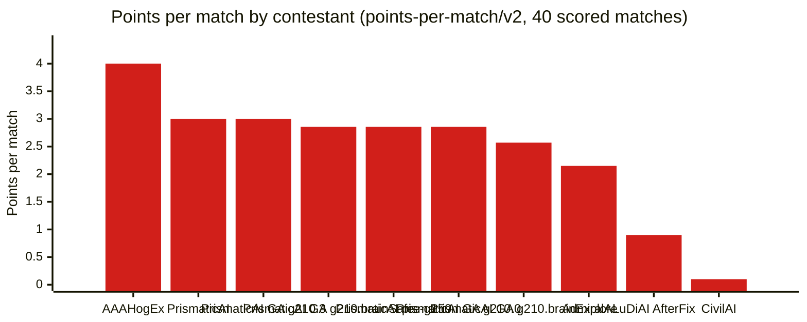
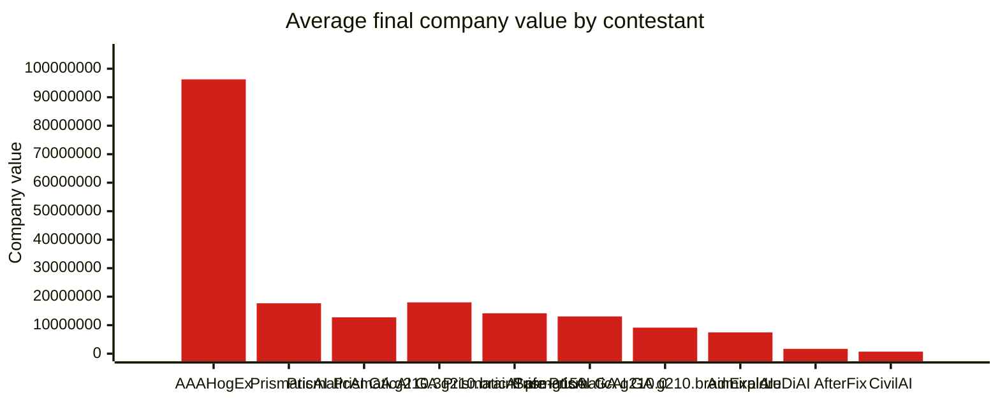
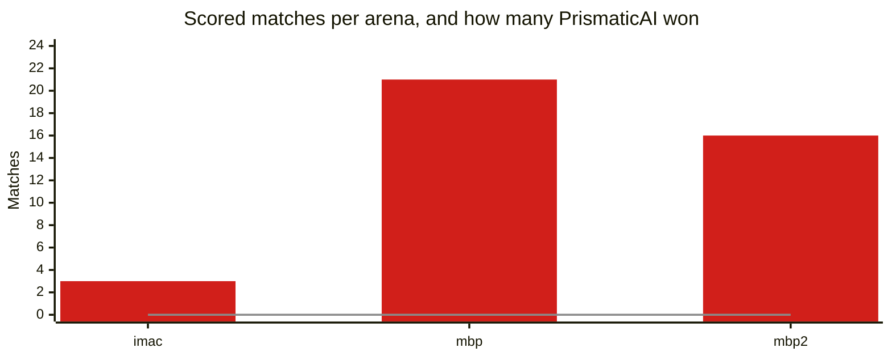

# battle-20261121T012249-7532d9c2

Derived from `battle-20261121T012249-7532d9c2.json` by `tools/research/ai-battle/battle.py report`; do not edit.

- Edition `7532d9c2bf594684`: PrismaticAI and referee at `962699034c20d90baeb9f617789ea6558cc6ff52`, base set `opengfx-8.0.tar`
- 20-year free-for-all from 1960, map 256x256 temperate, breakdowns 1
- 40 scored match(es) on `imac` (20261119-master-gdf1e05e7d8), `mbp` (20261120-master-m17653b726e), `mbp2` (20261119-master-gdf1e05e7d8)
- Replays: 0 of 0 identical to their original on another arena

| # | Contestant | Played | Wins | Points | Points/match | Avg rank | Avg final value | Squirrel errors | Matches with anomalies |
|---|---|---|---|---|---|---|---|---|---|
| 1 | AAAHogEx | 40 | 40 | 160 | 4.0 | 1.0 | 96.3 M | 0 | 0 |
| 2 | PrismaticAI | 6 | 0 | 18 | 3.0 | 2.0 | 17.7 M | 0 | 0 |
| 3 | PrismaticAI GA g210.3 | 6 | 0 | 18 | 3.0 | 2.0 | 12.8 M | 0 | 2 |
| 4 | PrismaticAI GA g210.brainSafe | 7 | 0 | 20 | 2.857 | 2.14 | 18.0 M | 0 | 3 |
| 5 | PrismaticAI pre-g150 | 7 | 0 | 20 | 2.857 | 2.14 | 14.2 M | 0 | 5 |
| 6 | PrismaticAI GA g210.0 | 7 | 0 | 20 | 2.857 | 2.14 | 13.1 M | 0 | 0 |
| 7 | PrismaticAI GA g210.brainExplore | 7 | 0 | 18 | 2.571 | 2.43 | 9.1 M | 0 | 3 |
| 8 | AdmiralAI | 40 | 0 | 86 | 2.15 | 2.85 | 7.5 M | 0 | 2 |
| 9 | LuDiAI AfterFix | 40 | 0 | 36 | 0.9 | 4.1 | 1.7 M | 0 | 1 |
| 10 | CivilAI | 40 | 0 | 4 | 0.1 | 4.9 | 704.7 k | 0 | 10 |

```mermaid
---
config:
  xyChart:
    width: 900
    height: 360
  themeVariables:
    xyChart:
      plotColorPalette: "#d11f1a, #8a8a8a, #0b0b0b, #ece4d6"
---
xychart-beta
    title "Final company value per scored match: winner vs best PrismaticAI"
    x-axis ["m-0001", "m-0002", "m-0003", "m-0004", "m-0005", "m-0006", "m-0007", "m-0008", "m-0009", "m-0010", "m-0011", "m-0012", "m-0013", "m-0014", "m-0015", "m-0016", "m-0017", "m-0018", "m-0019", "m-0020", "m-0021", "m-0022", "m-0023", "m-0024", "m-0025", "m-0026", "m-0027", "m-0028", "m-0036", "m-0037", "m-0038", "m-0039", "m-0040", "m-0041", "m-0042", "m-0043", "m-0044", "m-0045", "m-0046", "m-0047"]
    %% series: Winner | Best PrismaticAI
    %% links: battle-20261121T012249-7532d9c2.md?col=Match&filter=m-0001 | battle-20261121T012249-7532d9c2.md?col=Match&filter=m-0002 | battle-20261121T012249-7532d9c2.md?col=Match&filter=m-0003 | battle-20261121T012249-7532d9c2.md?col=Match&filter=m-0004 | battle-20261121T012249-7532d9c2.md?col=Match&filter=m-0005 | battle-20261121T012249-7532d9c2.md?col=Match&filter=m-0006 | battle-20261121T012249-7532d9c2.md?col=Match&filter=m-0007 | battle-20261121T012249-7532d9c2.md?col=Match&filter=m-0008 | battle-20261121T012249-7532d9c2.md?col=Match&filter=m-0009 | battle-20261121T012249-7532d9c2.md?col=Match&filter=m-0010 | battle-20261121T012249-7532d9c2.md?col=Match&filter=m-0011 | battle-20261121T012249-7532d9c2.md?col=Match&filter=m-0012 | battle-20261121T012249-7532d9c2.md?col=Match&filter=m-0013 | battle-20261121T012249-7532d9c2.md?col=Match&filter=m-0014 | battle-20261121T012249-7532d9c2.md?col=Match&filter=m-0015 | battle-20261121T012249-7532d9c2.md?col=Match&filter=m-0016 | battle-20261121T012249-7532d9c2.md?col=Match&filter=m-0017 | battle-20261121T012249-7532d9c2.md?col=Match&filter=m-0018 | battle-20261121T012249-7532d9c2.md?col=Match&filter=m-0019 | battle-20261121T012249-7532d9c2.md?col=Match&filter=m-0020 | battle-20261121T012249-7532d9c2.md?col=Match&filter=m-0021 | battle-20261121T012249-7532d9c2.md?col=Match&filter=m-0022 | battle-20261121T012249-7532d9c2.md?col=Match&filter=m-0023 | battle-20261121T012249-7532d9c2.md?col=Match&filter=m-0024 | battle-20261121T012249-7532d9c2.md?col=Match&filter=m-0025 | battle-20261121T012249-7532d9c2.md?col=Match&filter=m-0026 | battle-20261121T012249-7532d9c2.md?col=Match&filter=m-0027 | battle-20261121T012249-7532d9c2.md?col=Match&filter=m-0028 | battle-20261121T012249-7532d9c2.md?col=Match&filter=m-0036 | battle-20261121T012249-7532d9c2.md?col=Match&filter=m-0037 | battle-20261121T012249-7532d9c2.md?col=Match&filter=m-0038 | battle-20261121T012249-7532d9c2.md?col=Match&filter=m-0039 | battle-20261121T012249-7532d9c2.md?col=Match&filter=m-0040 | battle-20261121T012249-7532d9c2.md?col=Match&filter=m-0041 | battle-20261121T012249-7532d9c2.md?col=Match&filter=m-0042 | battle-20261121T012249-7532d9c2.md?col=Match&filter=m-0043 | battle-20261121T012249-7532d9c2.md?col=Match&filter=m-0044 | battle-20261121T012249-7532d9c2.md?col=Match&filter=m-0045 | battle-20261121T012249-7532d9c2.md?col=Match&filter=m-0046 | battle-20261121T012249-7532d9c2.md?col=Match&filter=m-0047
    y-axis "Company value" 0 --> 155000000
    bar [73875827, 57311447, 87209216, 78772481, 93331497, 140458762, 137715053, 122750318, 140325675, 120847604, 130024848, 96908653, 104420505, 119047459, 110174739, 117901681, 116665880, 109626525, 106124681, 102506641, 100628028, 97851063, 131748590, 48039896, 65962494, 45222057, 51050488, 46581051, 109899765, 121759152, 100232821, 105569057, 100633977, 121744010, 68651867, 52925201, 79190336, 83843426, 91286616, 61832797]
    line [14309709, 13189464, 18909995, 10182024, 12133723, 13666566, 6784914, 6262015, 12527042, 4778480, 14007965, 24929077, 16515058, 16926101, 23069554, 12288984, 12009478, 18506410, 17726585, 16230017, 18348059, 9024959, 9617705, 15979986, 12351917, 11424012, 21420138, 9644716, 17295083, 13474126, 16294118, 19690642, 13693512, 10436188, 15736636, 18028726, 11138913, 12064561, 4321045, 18296993]
```

<!-- battle-charts:begin -->
<!-- derived from battle-20261121T012249-7532d9c2.json by `battle.py render`; `battle.py check` fails when it is stale -->

<!-- battle-charts:end -->

| Match | Arena | Seed | Winner | Value | Last | Anomalies |
|---|---|---|---|---|---|---|
| m-0001 | mbp | 592091062 | AAAHogEx | 73.9 M | CivilAI | PrismaticAI pre-g150: fleet_drop:76->51 |
| m-0002 | mbp | 592091062 | AAAHogEx | 57.3 M | CivilAI | CivilAI: fleet_drop:37->20 |
| m-0003 | mbp | 592091062 | AAAHogEx | 87.2 M | CivilAI | - |
| m-0004 | mbp | 592091062 | AAAHogEx | 78.8 M | LuDiAI AfterFix | - |
| m-0005 | mbp | 592091062 | AAAHogEx | 93.3 M | CivilAI | LuDiAI AfterFix: fleet_drop:32->22 |
| m-0006 | mbp | 1771331596 | AAAHogEx | 140.5 M | CivilAI | - |
| m-0007 | mbp | 1771331596 | AAAHogEx | 137.7 M | CivilAI | CivilAI: fleet_drop:45->22 |
| m-0008 | mbp | 1771331596 | AAAHogEx | 122.8 M | CivilAI | CivilAI: fleet_drop:20->12 |
| m-0009 | mbp | 1771331596 | AAAHogEx | 140.3 M | CivilAI | PrismaticAI GA g210.brainSafe: fleet_drop:126->62; CivilAI: fleet_drop:16->11 |
| m-0010 | imac | 1771331596 | AAAHogEx | 120.8 M | CivilAI | PrismaticAI GA g210.brainExplore: fleet_drop:176->44 |
| m-0011 | imac | 1771331596 | AAAHogEx | 130.0 M | CivilAI | - |
| m-0012 | imac | 1332996234 | AAAHogEx | 96.9 M | LuDiAI AfterFix | - |
| m-0013 | mbp2 | 1332996234 | AAAHogEx | 104.4 M | CivilAI | PrismaticAI pre-g150: fleet_drop:82->53 |
| m-0014 | mbp2 | 1332996234 | AAAHogEx | 119.0 M | LuDiAI AfterFix | - |
| m-0015 | mbp2 | 1332996234 | AAAHogEx | 110.2 M | CivilAI | CivilAI: fleet_drop:39->24 |
| m-0016 | mbp2 | 1332996234 | AAAHogEx | 117.9 M | CivilAI | - |
| m-0017 | mbp2 | 1332996234 | AAAHogEx | 116.7 M | CivilAI | - |
| m-0018 | mbp2 | 34233355 | AAAHogEx | 109.6 M | CivilAI | - |
| m-0019 | mbp2 | 34233355 | AAAHogEx | 106.1 M | CivilAI | - |
| m-0020 | mbp2 | 34233355 | AAAHogEx | 102.5 M | CivilAI | - |
| m-0021 | mbp2 | 34233355 | AAAHogEx | 100.6 M | CivilAI | - |
| m-0022 | mbp2 | 34233355 | AAAHogEx | 97.9 M | LuDiAI AfterFix | PrismaticAI GA g210.brainExplore: fleet_drop:158->45 |
| m-0023 | mbp2 | 34233355 | AAAHogEx | 131.7 M | CivilAI | PrismaticAI GA g210.3: fleet_drop:79->50; CivilAI: fleet_drop:33->17 |
| m-0024 | mbp2 | 1567868117 | AAAHogEx | 48.0 M | CivilAI | CivilAI: fleet_drop:35->11 |
| m-0025 | mbp2 | 1567868117 | AAAHogEx | 66.0 M | CivilAI | PrismaticAI pre-g150: fleet_drop:58->31 |
| m-0026 | mbp2 | 1567868117 | AAAHogEx | 45.2 M | CivilAI | - |
| m-0027 | mbp2 | 1567868117 | AAAHogEx | 51.1 M | CivilAI | CivilAI: fleet_drop:58->32 |
| m-0028 | mbp2 | 1567868117 | AAAHogEx | 46.6 M | CivilAI | PrismaticAI GA g210.brainExplore: fleet_drop:117->54; AdmiralAI: fleet_drop:224->153 |
| m-0036 | mbp | 1483468211 | AAAHogEx | 109.9 M | CivilAI | AdmiralAI: fleet_drop:289->117 |
| m-0037 | mbp | 1483468211 | AAAHogEx | 121.8 M | CivilAI | PrismaticAI pre-g150: fleet_drop:92->61 |
| m-0038 | mbp | 1483468211 | AAAHogEx | 100.2 M | CivilAI | - |
| m-0039 | mbp | 1483468211 | AAAHogEx | 105.6 M | CivilAI | PrismaticAI GA g210.brainSafe: fleet_drop:165->98; CivilAI: fleet_drop:75->50 |
| m-0040 | mbp | 1483468211 | AAAHogEx | 100.6 M | CivilAI | - |
| m-0041 | mbp | 1483468211 | AAAHogEx | 121.7 M | CivilAI | PrismaticAI GA g210.3: fleet_drop:124->79; CivilAI: fleet_drop:31->7 |
| m-0042 | mbp | 1133313272 | AAAHogEx | 68.7 M | CivilAI | - |
| m-0043 | mbp | 1133313272 | AAAHogEx | 52.9 M | CivilAI | PrismaticAI pre-g150: fleet_drop:68->43 |
| m-0044 | mbp | 1133313272 | AAAHogEx | 79.2 M | CivilAI | - |
| m-0045 | mbp | 1133313272 | AAAHogEx | 83.8 M | CivilAI | PrismaticAI GA g210.brainSafe: fleet_drop:54->29 |
| m-0046 | mbp | 1133313272 | AAAHogEx | 91.3 M | CivilAI | - |
| m-0047 | mbp | 1133313272 | AAAHogEx | 61.8 M | CivilAI | - |
